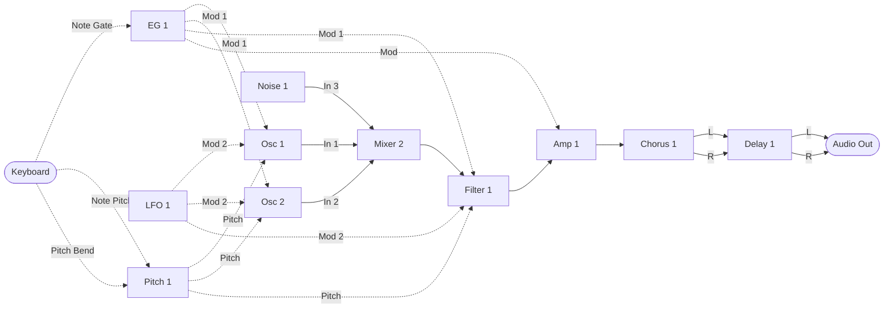
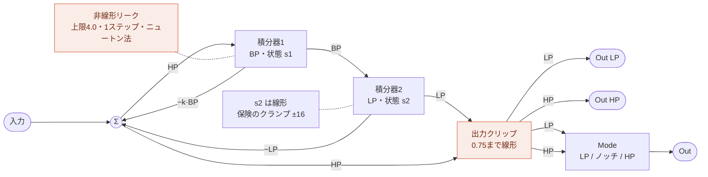
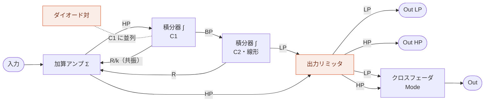
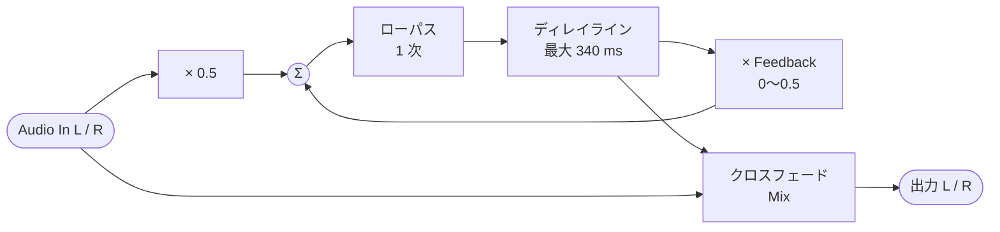

MIDI Synthesizer SPMS-1 (type-2) v0.0.3
=======================================

- Spinel (Ruby AOT コンパイラ) で作った、Raspberry Pi Pico 2 用のモノフォニック・セミモジュラー MIDI シンセサイザー
- 音源モジュールとして MIDI で制御します
- 後着優先で 1 ノート分を記憶: 前のノートを押さえたまま新しいノートを離すと、前のノートにレガートで戻ります (トリルなどに)
- 48 kHz オーディオ出力: I2S DAC による 24 bit、または PWM Audio (DAC 不要)
- オシレータ: ノコギリ波から矩形波へのモーフ、パルス幅付き (CC 114)。パルス幅のモジュレーション付き (PWM。ピッチと同じ 2 つのモジュレーション、デフォルトではエンベロープと LFO で、CC 8 と 103)。ノコギリ波とパルス波の個別出力付き
- LFO: 三角波 (PolyBLAMP) と矩形波 (PolyBLEP) の個別出力と、その間をクロスフェードするメイン出力 (Wave、CC 33)
- フィルタ: ZDF/TPT ステート・バリアブル・フィルタ (BP 積分器の非線形リーク付き、1 ステップ・ニュートン法で解く)。LP、HP の 2 出力と、その間をノッチを経てクロスフェードするメイン出力 (Mode、CC 39)
- コーラス: モノラル入力・ステレオ出力、実行順に入るモジュール
- ディレイ: ステレオ、フィードバック付き、実行順に入るモジュール (最大 340 ms)
- ピッチ: ノートのピッチを扱う、実行順に入るモジュール。指数カーブのラグによるポルタメント (CC 5)、その後に足すピッチベンド (レンジは CC 57)、鍵盤のストレッチ (CC 22)
- ステレオ出力: コーラスがモノラルの音を左右に広げ、ディレイが左右を分けたまま運びます
- 開発: ISGK Instruments (Ryo Ishigaki)
- <https://github.com/risgk/midi_synthesizer_spms1>
- [English README](./README.md) (英語版が正です)


必要なハードウェア
------------------

- Raspberry Pi Pico 2 (RP2350)
    - [Raspberry Pi Pico 2](https://www.raspberrypi.com/products/raspberry-pi-pico-2/)
    - I2S DAC ハードウェア (48 kHz/24 bit): `SPMS1_USE_I2S_INSTEAD_OF_PWM_AUDIO` のコメントを外してください
        - Pimoroni [Pico Audio Pack](https://shop.pimoroni.com/products/pico-audio-pack) (PIM544)
        - [Adafruit PCM5102 I2S DAC](https://www.adafruit.com/product/6250) (Product ID: 6250)
        - GY-PCM5102 (PCM5102A I2S DAC モジュール)
    - または PWM Audio 出力 (DAC 不要、スケッチのデフォルト)
        - L は GP28、R は GP27 で、Pimoroni [Pico VGA Demo Base](https://shop.pimoroni.com/products/pimoroni-pico-vga-demo-base) (PIM553) と同じです
        - PWM のリップルを取り除くため、各出力に RC ローパスフィルタを付けることをお勧めします
            - 矩形波が流れるケーブルからの輻射ノイズ (EMI) も減らせます。ケーブルの先ではなく、ピンの近くに付けてください
        - RC フィルタを付けない場合は、抵抗か接続先の機器の入力ゲイン (ボリューム) でレベルを下げてください:
          PWM のリップル (3.3 V の矩形波) で入力 (オーディオインターフェースなど) が飽和し、「ピー」という音やノイズが出ることがあります。
          レベルメーターが適正に見えていても起こります
        - PWM のレベル (3200 段階) は、1 次のノイズシェーピングと TPDF ディザ付きで量子化されます
        - 1 サンプルを 4 つの PWM 周期に分けて出力します (PWM キャリア: 48 kHz ではなく 192 kHz)。キャリアをフィルタで取り除きやすく、
          アクティブスピーカーで「ピー」という音が出にくくなります (`SPMS1_PWM_AUDIO_SUBPERIODS`: 1、2、4、8)
    - 注意: RP2350 のシステムクロック (sysclk) は 153.6 MHz にオーバークロックされます。設定するのはスケッチ自身の I2S または
      PWM Audio 出力 ("spms1_pico2_i2s.h" または "spms1_pico2_pwm_audio.h"、PRA32-U2 と同じもの) で、Arduino-Pico の I2S ライブラリではありません


改造に必要なソフトウェア
------------------------

- [Arduino IDE](https://www.arduino.cc/en/software)
    - スケッチは "spms1" フォルダです。"spms1/spms1.ino" を開いてください。エディタ、README、ツール類は
      その外側のこのフォルダにあります
- Arduino-Pico = Raspberry Pi Pico/RP2040/RP2350 (by Earle F. Philhower, III) コア
    - 追加のボードマネージャ URL: <https://github.com/earlephilhower/arduino-pico/releases/download/global/package_rp2040_index.json>
    - このスケッチはバージョン 6.2.0 で動作確認しています: <https://github.com/earlephilhower/arduino-pico/releases/tag/6.2.0>
    - 情報: <https://github.com/earlephilhower/arduino-pico>
    - ボード: "Raspberry Pi Pico 2"、"ツール" メニューの USB Stack: "Adafruit TinyUSB"
- Arduino MIDI Library (by Francois Best, lathoub)
    - このスケッチはバージョン 5.0.2 で動作確認しています: <https://github.com/FortySevenEffects/arduino_midi_library/releases/tag/5.0.2>
    - 情報: <https://github.com/FortySevenEffects/arduino_midi_library>
- Spinel
    - リリース: 2026.09.12 <https://github.com/matz/spinel/tree/2026.09.12>
    - Spinel の出力ファイル "spms1_main.c" に手を入れる必要はありません。本スケッチの
      "spinel_rt_mcu_head.h" ("spinel_rt.h" の先頭で読み込み) が
      `#define main __attribute__((section(".time_critical"), flatten)) Spms1_main` を持っており、改名と
      シンセ本体の RAM 配置を同時に行います。手で改名すると、このマクロが一致しなく
      なって属性が付かず、本体が flash から実行されます
    - 本体が演奏中に呼ぶ関数 ("spms1_midi_state.h" の MIDI 読み出しと "spms1.ino" の音声出力) も
      `SPMS1_RAM_FUNC` で RAM に置きます。flash にあると、core 0 の MIDI と USB のコードと共有の
      XIP キャッシュ経由で読まれ、MIDI が続くとキャッシュが追い出されてシンセのバッファ処理が遅れます
    - "spms1_main.c" は "spms1" で `spinel spms1_main.rb -c --rbs sig` を実行して生成します。"spms1/sig" の
      型シードがフィルタの状態とパラメータのスムージングをボックス化させずに保ちます。必要な理由は
      "spms1/sig/spms1_filter.rbs" と "spms1/sig/spms1_dsp.rbs" にあります
- Ruby (CRuby): パッチの番号や初期パッチを変えるとき、モジュールを追加するとき。これらは
  "spms1_patch.yaml" にまとめてあり、`ruby patch_gen/spms1_patch_gen.rb` が "spms1/spms1_patch.rb"
  ("spms1/spms1_main.rb" が読み込みます)、"spms1_editor.html" のテーブル、この README と "README.md" の
  NRPN の表、"spms1/spms1_main.rb" のループの配線 ([モジュールの追加](#モジュールの追加) を参照) に
  書き出します。実行したあと、"spms1/spms1_main.c" を生成し直してください。`--check` は、ファイルが
  最新かどうかを調べるだけです


使い方
------

### ビルド済みバイナリ

- "bin" フォルダの "spms1_i2s.ino.uf2" は Raspberry Pi Pico 2 と、Pimoroni Pico Audio Pack、
  Adafruit PCM5102 I2S DAC、または GY-PCM5102 用です
- "bin" フォルダの "spms1_pwm_audio.ino.uf2" は Raspberry Pi Pico 2 と PWM Audio 出力用で、L は GP28、R は GP27 でビルドされています


### Web エディタ

- Web MIDI API を使う、プラットフォームを問わないパラメータ・コントローラ: "spms1_editor.html"
    - Controls タブには CC のあるパラメータのスライダーが並びます。CC のないものは、"Show parameters with
      no CC" にチェックを入れるか CC を割り当てるまで隠れます。チェックの状態は覚えておきます。
      表示した CC のないパラメータのスライダーは、スロットが保持する値を NRPN で送って設定します
    - Patch タブでは、値をつまみのように上下にドラッグして変えられます。Shift を押すと細かく動き、
      編集中の値はホイールでも 1 ずつ動かせます
    - 設定・表示する値はどれも、シンセが使う範囲の 4〜124 です。MIDI In やパッチファイルから範囲外の値が届いたら、
      近い方の端に寄せます。シンセにとっては同じ値です
    - Initialize & Send All は、各 CC の値と、CC のないパラメータの値を起動時の値に戻して送ります
- 音を出して試すためのソフトウェア鍵盤を内蔵しています
    - 見出しをクリックすると隠れ、パッチエディタやコントロールがその高さまで広がります。どちらの状態かは
      覚えておき、隠れている間は PC キーボードのキーでは弾けません
- グラフィカルなパッチエディタを Patch タブに内蔵しています
    - モジュールの出力を入力やパラメータへ配線し、実行順と CC の割り当てを設定します
    - 各モジュールのパラメータをすべて表示し、CC のないものは青で示します。配線はいつも行き先のパラメータに
      つながります
    - パッチを JSON で保存・読み込みします
    - パッチを MIDI バイト列または NRPN リストとしてコピーするか、Web MIDI で送信します
    - サイドパネル (Patch、Run Order、Export) は見出しのクリックで畳め、それぞれの状態を覚えておきます。
      3 つとも畳むと、空いた幅まで配線図が広がります
- SPMS-1 Web: エディタに組み込まれたシンセサイザー本体 ("spms1_web_synth.js")
    - "MIDI Out" で "SPMS-1 Web (Built-in)" を選び、ソフトウェア鍵盤 (または "MIDI In" の MIDI キーボード) で演奏します
    - "spms1_main.c" を WebAssembly として Web ブラウザで動かすので、実機と同じ音がします
    - [web/README.md](./web/README.md) を参照してください


### MIDI の設定

- MIDI チャンネル: チャンネル 1
- USB MIDI 入力
    - 製造者ディスクリプタ: "ISGK Instruments"
    - デバイス名: "SPMS-1 (type-2)"
- UART MIDI 入力
    - 速度: 31250 bps
    - GP4 ピンと GP5 ピンを TX と RX に、`SerialPIO` で使います
    - `SPMS1_UART_MIDI_TX_PIN` と `SPMS1_UART_MIDI_RX_PIN` を書き換えれば、TX と RX の入れ替えを含め、
      どのピンでも使えます
    - DIN/TRS MIDI は、たとえば Adafruit MIDI FeatherWing Kit などを使う (そして手を入れる) ことで利用できます
        - Adafruit [MIDI FeatherWing Kit](https://www.adafruit.com/product/4740) (Product ID: 4740)
        - M5Stack [Midi Unit with DIN Connector (SAM2695)](https://shop.m5stack.com/products/midi-unit-with-din-connector-sam2695) (SKU: U187) のセパレートモード
        - Kinoshita Laboratory [MIDI-UART interface-san Kit](https://www.tindie.com/products/kinoshitalab/midi-uart-interface-san-kit/)
        - 木下研究所 [MIDI-UARTインターフェースさん キット](https://www.switch-science.com/products/8117) (日本国内発送のみ)
        - necobit電子 [MIDI Unit for GROVE](https://necobit.com/denshi/grove-midi-unit/) (日本国内発送のみ)
        - necobit電子 [MIDI Unit Mini for GROVE](https://necobit.com/denshi/midi-unit-mini-for-grove/) (日本国内発送のみ)


### レイテンシ

MIDI メッセージを受けてから音が出るまで、およそ 4 ms です。

- 64 サンプルの出力バッファが 2 つ: 2.7 ms
- MIDI はバッファごとに 1 回読むので、最大でもう 1 つ分待ちます: 1.3 ms

これはシンセ自身の分で、MIDI の伝送と DAC の分はこの上に乗ります。


### [MIDI インプリメンテーション・チャート](./spms1_midi_chart.md)


### ブロック図

デフォルトのパッチです。実線の矢印がオーディオ信号を、破線の矢印がコントロール信号を運びます。



モジュールは下の実行順で、1 サンプルずつ処理されます。波形やカットオフ、ゲインといったパラメータは CC
から届くもので、この図では省いています。パラメータ名では Amount を Amt、Polarity (極性) を Pol と略しています。

ノートのピッチは Pitch 1 を通ってオシレータに届き、ノートからノートへ滑らかに移ります。ポルタメントです。
Pitch 1 Glide は CC 5 (MIDI 規格の Portamento Time) にあり、起動時は 0.0 です。そこではポルタメントはオフで、
ピッチを届いたとおりそのまま通します。Pitch 1 Glide Switch は Glide を動かさずにポルタメントを
オン・オフします。MIDI のスイッチと同じく値 64 以上でオンです。CC はなく、オン（値 124）を保持します。Pitch Bend は Pitch 1 Bend In に入ります。Bend In はグライドの後で出力に
足されるので、ベンドはすぐに効き、オシレータにもフィルタのキーボードトラッキングにも同じように届きます。
Pitch 1 Bend Amt（CC 57）がベンドレンジで、1 目盛り半音ずつです。起動時の CC 8 で上下 2 半音、CC 28 で
1 オクターブ、最大で 5 オクターブです。

LFO はオシレータの Mod 2 In に直接、フルレベルで入ります。フィルタにも入りますが、Filter 1 Mod 2 Amt
（CC 25）が起動時 0.0 なので、上げるまではカットオフはエンベロープだけで動きます。
LFO は Osc 1 Pitch Mod 2 Amt（CC 13）でピッチへ入り、Osc 1 Pitch Mod Range が保持する 0.2 で
ビブラートの深さまで絞ります。パルス幅へは Osc 1 PW Mod 2 Amt（CC 103）で入ります。どちらも起動時は
0.0 です。Pitch 1 からのピッチはフィルタの Filter 1 Pitch In にも入ります。キーボードトラッキング用です。
CC 9（Filter 1 Pitch Amt）を最大にするとカットオフがノートに半音ずつ追従し、ノート 60 では動きません。
Filter 1 Pitch Amt は起動時 0.0 で、トラッキングはオフです。
エンベロープはオシレータの Osc 1 Mod 1 In にも入ります。ピッチエンベロープ用です。Pitch Mod 1 Amt
（CC 89）と PW Mod 1 Amt（CC 8）は起動時 0.0 で、オフです。モジュレーションの深さはどれも動かす先のレンジ全体に届くので、
ソースを音楽的な深さまで絞る仕事はモジュールに作り込まず、パッチの側に任せています。

Mixer 2 がフィルタの前でオーディオを足し合わせます。Osc 1 が In 1、Osc 2 が In 2、Noise 1 の Out が In 3 です。
それぞれ自分のレベルで足されます。Level 1（CC 116）は起動時 1.0、Level 2（CC 21）と Level 3（CC 23）は起動時 0.0 なので、上げるまでデフォルトのパッチは Osc 1 だけで鳴ります。Osc 2 は Osc 1 と同じく Pitch 1 からノートを受け取り、自分の Pitch Coarse（CC 85）と
Pitch Fine（CC 76）で Osc 1 に対する音程を決めます。起動時は 12 セント高く、ゆっくりうなります。Wave も自分のもので、CC 104 です（Osc 1 は CC 102）。それ以外は
Osc 1 に従います。Mod Amt と PW には Osc 1 と同じ CC が割り当ててあるので、1 つの CC で両方が動きます。

アンプまではモノラルです。コーラスがそれを受け取って左右 2 つを出し、ディレイが左右を受け取って分けた
まま運び、その 2 つの出力が最終出力の左右になります。

以上はどれも固定ではありません。実行順も、上の図のすべての矢印も、どの CC がどのパラメータに入るかも、
NRPN が書き換えます。

#### 実行順

すべてのモジュールが入っています。音を作る型が 1 つずつで、先頭にモジュレーションのソース（エンベロープ、その後に LFO を置くのは、
エンベロープでビブラートを掛けていくときのように、LFO の Mod In がエンベロープを同じサンプルで読めるようにするためです）、それと Pitch 1 の間に Mixer 1、オシレータの直前に Pitch 1、オシレータの後に
Noise 1（主に音として使うためで、モジュレーションに使うと 1 サンプル遅れますが、聞き分けられる差ではありません）、
それとフィルタの間に Mixer 2、最後にコーラスとディレイです。


ミキサーには何も結線されていないので、毎サンプル自分のスロットぶんのコストを払うだけで、パッチが
何かを与えるまでは何も変えません。意味があるのは置かれている位置です。あるモジュールが今サンプルの
値を見られるのは、この列で自分より前にあるものからだけで、後ろにあるものからは前サンプルの値を受け取ります。
Mixer 1 は LFO とエンベロープに手が届き、オシレータ、フィルタ、アンプは Mixer 1 に手が届きます。
Mixer 2 はオシレータとフィルタの間で、オーディオをまとめます。
Pitch 1 がその 3 つの後にあるのは、自分への変調（LFO を Bend In に入れたベンドなど）を今サンプルの値で
受け取るためで、オシレータとフィルタの前にあるのは、それらが同じサンプルの値を読めるようにするためです。

ミキサーは 2 つの信号を合流させるための道具であり、エンベロープのように片側にしか振れない信号を正負
どちらにも振れるようにする手段でもあります。下の例を参照してください。

#### Filter 1

ゼロディレイ・フィードバックの状態変数フィルタです。BP の積分器は、BP がソフトクリップの曲線に
入るほど強く漏れ (リーク)、これがレゾナンスを抑えます。小さな信号ではリークはほぼゼロなので、
通過帯域はほぼクリーンです。リークを含むループの式はサンプルごとに 1 ステップ・ニュートン法で解きます。
初期値はリークを除いた線形の解で、そこから 1 ステップでほぼ収束します。リークの速さは時間で
決まっているので、サンプルレートを変えても音は変わりません。
LP の状態は線形のままで、通常の使い方では届かない保険として ±16 のクランプだけがあります。出力
クリップはフィルタの最後にあります。レゾナンスのつまみの上端では k が負になり、ループが発振します。

フィルタはローパスとハイパスを Out LP、Out HP として同時に出力し、それぞれに専用の
DC ブロッカーと出力クリップがあります。さらに、この 2 つを Filter 1 Mode (CC 39、PRA32-U2 の Filter Mode と同じ)
でクロスフェードしたものを Out として出力します。それぞれ自分の側の半分ではフルのまま、
反対側の半分でゼロまで下がります。起動時の 0.0 (CC 4) ではローパスだけ、
1.0 (CC 124) ではハイパスだけ、0.5 (CC 64) では両方フルで、その和 (入力 − k·BP) がカットオフにノッチを持ち、
その両側はそのまま通ります。その間ではノッチがカットオフからずれ (ローパス寄りでは上、ハイパス寄りでは下)、
反対側は最大 6 dB 下がって残ります。デフォルトのパッチが使うのは Out で、Amp 1 に入ります。そのため、Mode を上げるまでは
ローパスが鳴ります。
Out はもう一度クリップしません。通過帯域ではどちらか一方しかなく、両方があるカットオフ付近ではノッチが
それを下げるからです。2 つの係数はほかのレベルと同じくスムージングします。



同じ構造を、オペアンプ積分器によるフィルタに置き換えて描いたものです。ダイオード対は非線形リーク、
出力リミッタは出力クリップに対応します。解釈として描いたもので、実在の回路を再現したものでは
ありません。



#### Chorus 1

PRA32-U2 の Chorus FX にならった、モノラル入力・ステレオ出力のコーラスです。ディレイと同じくインサート
式で経路に入り、センドレベルではなく Mix でドライとコーラスのバランスを決めます。入力は穏やかなローパス
フィルタを通って 1 本の短いディレイラインに入り、そこを 2 つのタップで読み出します。三角波の LFO が
2 つのタップを 5.33 ms を挟んで逆向きに揺らすので、左右の遅延信号のピッチは互いに逆方向に
揺れます。それぞれの出力は入力と自分のタップのクロスフェードなので、モノラルの音源がステレオに広がって
出てきます。


後ろにリミッタもクリップも要りません。入力は入口で 1.0 に収め、フィルタも 2 サンプル間の読み出しも
クロスフェードも重み付き平均で、平均するもの以上にはなりません。タップが揺れる中心の遅延は
固定です。

サブ出力の Out Mono は Out L と Out R の平均で、ミキサーの入力やフィルタなどモノラルの行き先に
使います。2 つのタップを足すので、ステレオに広げたときよりおとなしいコーラスになり、タップが重なる
ところで多少コムフィルタがかかります。

#### Delay 1

PRA32-U2 の Delay FX の Stereo Delay モードにならった、フィードバック付きのステレオディレイです。左右
それぞれが自分のディレイラインとループを持ちます。入力の半分と、Feedback を掛けた遅延信号が、穏やかな
ローパスフィルタを通ってディレイラインに入り、出力は入力と遅延信号のクロスフェードです。Time、Feedback、
Mix は左右で共通なので、左右は一緒に繰り返し、入ってきたときのステレオ像を保ちます。



図は片側で、もう片側も同じです。後ろにリミッタもクリップも要りません。入ってくるのが入力の半分、戻るのが
遅延信号の高々半分なので、遅延信号が 1.0 以内なら書き戻すものも 1.0 以内で、始まりは無音です。フィルタも
2 サンプル間の読み出しもクロスフェードも重み付き平均で、平均するもの以上にはなりません。代わりに、最初の
繰り返しはドライ信号より 6 dB 小さくなります。入力は、アンプが Mod In にするのと同じく入口で 1.0 に収める
ので、何を結線してもこの上限は保たれます。

サブ出力の Out Mono は Out L と Out R の平均で、モノラルの行き先に使います。

### パッチの編集 (NRPN)

パッチはデータであり、NRPN は動いているシンセのそれを書き換えます。どのモジュールがどの順で走るか、各
モジュール入力に何が入るか、各パラメータがどこから値を取るか、どの CC がどのコントロールスロットを埋める
か、CC のない各パラメータの値。すべてのモジュールは番号の付いたシグナルスロットから読み、番号の付いたスロットへ書くので、配線し直すことは
スロット番号を変えることです。各パラメータには、それとは別に自分専用のコントロールスロットがあり、その CC の
値が、CC がなければカテゴリ 4 の値が入ります。読めるのはそのパラメータだけで、ソースに 127 を指定するとそこを指します。ほかからスロット番号で
指す方法はありません。

#### 送り方

- CC 99 でカテゴリを、CC 98 でその中のエントリを選びます。順序はどちらが先でも構いません
- CC 6 (Data Entry MSB) で値が確定し、次のオーディオバッファから効きます
- CC 38 (Data Entry LSB) は無視されます。ここで扱う値はすべて 7 ビットです
- CC 101 と CC 100 (RPN セレクト) はデータ入力を中断させるので、RPN がパッチ編集と取り違えられることは
  ありません。再開するには CC 99 か CC 98 をもう一度送ります
- 編集内容は保存されません。電源投入時にデフォルトのパッチへ戻ります

#### カテゴリ (CC 99)

| CC 99 | CC 98 | 設定する対象 | CC 6 の値 |
| ----- | ----- | ---- | ---------- |
| 0 | 0-31 | 実行順、スロットごとに | モジュール ID |
| 1 | 0-29 | モジュール入力に何を入れるか | シグナル ID |
| 2 | 0-57 | パラメータがどこから値を取るか | シグナル ID、127 なら自分のコントロールスロット |
| 3 | 0-62 | どの CC がコントロールスロットを埋めるか | CC 番号、0 なら割り当てなし |
| 4 | 0-57 | CC がないときにパラメータのコントロールスロットが保持する値 | CC の値 |

実行順はスロット 0 から上へ読まれ、最初に現れたモジュール ID 0 で止まります。32 個に満たないパッチは
そこで自ら終わるわけです。実行順はモジュールの番号付けとは別物です。あるモジュールが今サンプルの値を
見られるのは自分より前に並んでいるものからだけで、後ろにあるものからは前サンプルの値を受け取ります。
同じモジュールを複数のスロットに並べると、最後に書き込んだスロットで 1 回だけ処理され、ほかのスロットは
無いものとして扱われます (後勝ち)。前のスロットでも後ろのスロットでも、書き込んだ方に移ります。そのスロットに
あったモジュールは実行順から外れます。

カテゴリ 3 で CC 番号 0 を指定すると、そのコントロールには CC がない状態になります。パラメータのコントロール
スロットはそれまでの CC にかかわらずカテゴリ 4 の値を保持するので、パラメータが読む値はパッチだけで決まります。
General スロットは 0.0 になります。カテゴリ 4 の値は CC の値と同じように受け取って同じように読むので、
バイポーラのパラメータでは CC 64 が 0.0 です。CC があるあいだ、カテゴリ 4 の値は保たれますが読まれません。
起動時はどれもパラメータの起動時の値です。

オシレータが 2 つ、ほかの音を作るモジュールが 1 つずつ、ミキサーが 2 つ、コーラスとディレイとピッチのモジュールとノイズ源が 1 つずつあり、**この 12 個すべてがデフォルトの
実行順に入っています**。パッチは結線するだけでよく、何かを先に有効化する必要はありません。シンセは
すべてのモジュールが走った状態で処理時間に収まるよう作ってあるので、パッチを収めるためにモジュールを
実行順から外す必要はありません。音から外したいモジュールは、結線で迂回して、誰も読まないまま走らせておきます。
下の例を参照してください。Mixer 1 には CC がありません。レベルは 0.0 を保持するので、パッチがカテゴリ 4 の値か CC の割り当てで
上げるまで無音です。Mixer 2 は最初の 3 つのレベルに CC（CC 116、21、23）があり、起動時 1.0 なのは Level 1 だけです。
Level 4 は CC がなく 0.0 を保持するので、この入力は閉じた状態で始まります。Out Level は CC がなく 1.0 を保持するので、レベルを上げた入力はそのまま通ります。

#### エントリ (CC 98)、カテゴリ 1

<!-- patch_gen inputs -->

| CC 98 | モジュール入力 | | CC 98 | モジュール入力 |
| ----- | ------ | - | ----- | ------ |
| 0 | EG 1 Gate In | | 15 | Mixer 2 In 1 |
| 1 | LFO 1 Rate Mod In | | 16 | Mixer 2 In 2 |
| 2 | LFO 1 Level Mod In | | 17 | Mixer 2 In 3 |
| 3 | Mixer 1 In 1 | | 18 | Mixer 2 In 4 |
| 4 | Mixer 1 In 2 | | 19 | Filter 1 Audio In |
| 5 | Mixer 1 In 3 | | 20 | Filter 1 Pitch In |
| 6 | Mixer 1 In 4 | | 21 | Filter 1 Mod 1 In |
| 7 | Pitch 1 Pitch In | | 22 | Filter 1 Mod 2 In |
| 8 | Pitch 1 Bend In | | 23 | Amp 1 Audio In |
| 9 | Osc 1 Pitch In | | 24 | Amp 1 Mod In |
| 10 | Osc 1 Mod 1 In | | 25 | Chorus 1 Audio In |
| 11 | Osc 1 Mod 2 In | | 26 | Delay 1 Audio In L |
| 12 | Osc 2 Pitch In | | 27 | Delay 1 Audio In R |
| 13 | Osc 2 Mod 1 In | | 28 | 最終出力 L |
| 14 | Osc 2 Mod 2 In | | 29 | 最終出力 R |

<!-- patch_gen end -->

ほとんどは名前のとおりのものを受け取りますが、3 つだけ名前からは分からない決まりがあります。Gate はレベル
ではなく閾値で、信号が 0.25 以上になるとエンベロープがトリガし、下回るとリリースします。ピッチ（Note Pitch が Pitch In に運ぶもの）は MIDI ノート
0〜120 を -0.5〜+0.5 で表すので、0.0 がノート 60、0.1 が 1 オクターブです。そして Mod In は届いたままの値を
受け取ります。入口では何も制限せず、クランプされるのはモジュールが最終的に得た値のほうです。カットオフは
つまみの両端、ピッチは -0.5〜+0.5、パルス幅は -0.5〜+0.5 に収まります。オシレータの Pitch In、Mod 1 In、Mod 2 In も Mod In の一種です。ミキサーは上限なしで足し算をするので、大きすぎる変調は入口で
削られるのではなく、行き先を端に貼り付かせます。アンプだけは例外で、Mod In を -1.0〜+1.0 でクランプします。
アンプはアッテネーターなので、変調でゲインを下げることはできても、上げることはできません。負の変調は反転させます。コーラスとディレイ
もオーディオ入力を同じく 1.0 に収めます。Pitch 1 の Pitch In は Mod In と同じく何でも受け取り、受け取ったものを
グライド、ベンドして出します。出力はミキサーと同じく -1.0〜+1.0 に収めます。

最終出力の左右は別々に読まれるので、どちらもどこへでも向けられます。両方を同じシグナルに向ければモノラル
出力になります。

#### エントリ (CC 98)、カテゴリ 2、3、4

<!-- patch_gen params -->

| CC 98 | パラメータ | | CC 98 | パラメータ | | CC 98 | パラメータ |
| ----- | ------ | - | ----- | ------ | - | ----- | ------ |
| 0 | EG 1 Attack | | 20 | Osc 1 Pitch Fine | | 40 | Mixer 2 Level 2 |
| 1 | EG 1 Decay | | 21 | Osc 1 Pitch Mod 1 Amt | | 41 | Mixer 2 Level 3 |
| 2 | EG 1 Sustain | | 22 | Osc 1 Pitch Mod 2 Amt | | 42 | Mixer 2 Level 4 |
| 3 | EG 1 Release Switch | | 23 | Osc 1 Pitch Mod Range | | 43 | Mixer 2 Out Level |
| 4 | EG 1 Level | | 24 | Osc 1 Wave | | 44 | Filter 1 Gain |
| 5 | LFO 1 Rate | | 25 | Osc 1 PW | | 45 | Filter 1 Cutoff |
| 6 | LFO 1 Rate Mod Amt | | 26 | Osc 1 PW Mod 1 Amt | | 46 | Filter 1 Pitch Amt |
| 7 | LFO 1 Wave | | 27 | Osc 1 PW Mod 2 Amt | | 47 | Filter 1 Mod 1 Amt |
| 8 | LFO 1 Level | | 28 | Osc 2 Pitch Coarse | | 48 | Filter 1 Mod 2 Amt |
| 9 | LFO 1 Level Mod Amt | | 29 | Osc 2 Pitch Fine | | 49 | Filter 1 Resonance |
| 10 | Mixer 1 Level 1 | | 30 | Osc 2 Pitch Mod 1 Amt | | 50 | Filter 1 Mode |
| 11 | Mixer 1 Level 2 | | 31 | Osc 2 Pitch Mod 2 Amt | | 51 | Amp 1 Gain |
| 12 | Mixer 1 Level 3 | | 32 | Osc 2 Pitch Mod Range | | 52 | Chorus 1 Mix |
| 13 | Mixer 1 Level 4 | | 33 | Osc 2 Wave | | 53 | Chorus 1 Rate |
| 14 | Mixer 1 Out Level | | 34 | Osc 2 PW | | 54 | Chorus 1 Depth |
| 15 | Pitch 1 Glide | | 35 | Osc 2 PW Mod 1 Amt | | 55 | Delay 1 Mix |
| 16 | Pitch 1 Glide Switch | | 36 | Osc 2 PW Mod 2 Amt | | 56 | Delay 1 Time |
| 17 | Pitch 1 Stretch | | 37 | Noise 1 Level | | 57 | Delay 1 Feedback |
| 18 | Pitch 1 Bend Amt | | 38 | Noise 1 Color | |  |  |
| 19 | Osc 1 Pitch Coarse | | 39 | Mixer 2 Level 1 | |  |  |

<!-- patch_gen end -->

#### エントリ (CC 98)、カテゴリ 3 のみ

これらの CC はどのパラメータにも属さないので、カテゴリ 2 には対応するエントリがありません。General 1〜4 は
それぞれユニポーラとバイポーラの 2 つのスロットを埋めます。後述の General スロットを参照してください。

<!-- patch_gen generals -->

| CC 98 | CC の割り当て先 | 埋めるスロット |
| ----- | ------ | ----- |
| 58 | General Mod Wheel | General Mod Wheel |
| 59 | General 1 | General Unipolar 1、General Bipolar 1 |
| 60 | General 2 | General Unipolar 2、General Bipolar 2 |
| 61 | General 3 | General Unipolar 3、General Bipolar 3 |
| 62 | General 4 | General Unipolar 4、General Bipolar 4 |

<!-- patch_gen end -->

#### モジュール ID

<!-- patch_gen modules -->

| ID | モジュール |
| ----- | ------ |
| 0 | なし（実行順の終端） |
| 1 | EG 1 |
| 2 | LFO 1 |
| 3 | Mixer 1 |
| 4 | Pitch 1 |
| 5 | Osc 1 |
| 6 | Osc 2 |
| 7 | Noise 1 |
| 8 | Mixer 2 |
| 9 | Filter 1 |
| 10 | Amp 1 |
| 11 | Chorus 1 |
| 12 | Delay 1 |

<!-- patch_gen end -->

#### シグナル ID

<!-- patch_gen signals -->

| ID | シグナル | | ID | シグナル | | ID | シグナル |
| ----- | ------ | - | ----- | ------ | - | ----- | ------ |
| 0 | なし（定数 0.0） | | 17 | EG 1 Output | | 34 | Noise 1 Output ± |
| 1 | 定数 1.0 | | 18 | EG 1 Output Inv | | 35 | Noise 1 Output White ± |
| 2 | 定数 0.5 | | 19 | LFO 1 Output ± | | 36 | Noise 1 Output Red ± |
| 3 | 定数 -0.5 | | 20 | LFO 1 Output Inv ± | | 37 | Mixer 2 Output ± |
| 4 | 定数 -1.0 | | 21 | LFO 1 Output Triangle ± | | 38 | Mixer 2 Output Inv ± |
| 5 | Note Pitch ± | | 22 | LFO 1 Output Triangle Inv ± | | 39 | Filter 1 Output ± |
| 6 | Note Gate | | 23 | LFO 1 Output Square ± | | 40 | Filter 1 Output LP ± |
| 7 | Pitch Bend ± | | 24 | LFO 1 Output Square Inv ± | | 41 | Filter 1 Output HP ± |
| 8 | General Mod Wheel | | 25 | Mixer 1 Output ± | | 42 | Amp 1 Output ± |
| 9 | General Unipolar 1 | | 26 | Mixer 1 Output Inv ± | | 43 | Chorus 1 Output L ± |
| 10 | General Unipolar 2 | | 27 | Pitch 1 Output ± | | 44 | Chorus 1 Output R ± |
| 11 | General Unipolar 3 | | 28 | Osc 1 Output ± | | 45 | Chorus 1 Output Mono ± |
| 12 | General Unipolar 4 | | 29 | Osc 1 Output Saw ± | | 46 | Delay 1 Output L ± |
| 13 | General Bipolar 1 ± | | 30 | Osc 1 Output Pulse ± | | 47 | Delay 1 Output R ± |
| 14 | General Bipolar 2 ± | | 31 | Osc 2 Output ± | | 48 | Delay 1 Output Mono ± |
| 15 | General Bipolar 3 ± | | 32 | Osc 2 Output Saw ± | |  |  |
| 16 | General Bipolar 4 ± | | 33 | Osc 2 Output Pulse ± | |  |  |

<!-- patch_gen end -->

**±** は、正負どちらにも振れるシグナルを表します。モジュール出力はフルスケールで -0.5 と +0.5 に届き、
バイポーラの General スロットは -0.5〜+0.5 で、ミキサーはそれを 2 つ足して 1.0 で止まります。
印のないものは 0.0〜1.0 で、エンベロープ、Note Gate、ユニポーラの General スロットがこれにあたります。
バスは両方を 1 つの番号空間で運ぶので、レンジは「何が書いたか」ではなくスロットごとの性質です。表にない番号は
空きです。127 はスロットではなく、パラメータ自身のコントロールスロットを指します。

パラメータ自身のコントロールスロットには、バスの外で、その CC から届いた値が、CC がなければカテゴリ 4 の値が入ります。パラメータはデフォルトで
それを読みます（カテゴリ 2 でシグナル ID 127）。パラメータはそれぞれユニポーラかバイポーラで、スロットも同じ
レンジを取ります。ユニポーラは CC 4〜124 で
0.0〜1.0 と、エンベロープと同じ幅なので、エンベロープを向ければつまみの全域を動かせます。バイポーラは
CC 64 を 0.0 とする -0.5〜+0.5 と、LFO と同じ幅なので、バイポーラのソースを向ければ中央を挟んで上下に
振れます。Osc 1 Pitch Coarse と Pitch Fine は中央が「変化なし」を意味するのでバイポーラです。パラメータにバス上の
スロットを指させることがモジュレーションになります。パラメータの
コントロールスロットは、モジュール入力からもほかのパラメータからも読めません。1 つの CC を複数のパラメータや
モジュール入力に届けたいときは General スロットに載せるか、Osc 1 と Osc 2 のように、カテゴリ 3 でそれぞれの
パラメータに同じ CC を割り当てます。

スロット 12〜20 の General スロットは、どのパラメータにも属さないコントロールスロットです。CC をバスに
載せるだけで、どのモジュール入力やパラメータからも読めます。General Mod Wheel は CC 1 を読む 0.0〜1.0
のスロットで、起動時は CC 4 なので、ホイールを動かすまで 0.0 です。デフォルトではどこにも結線されて
いません。General 1〜4 はデフォルトで
CC 16、17、18、19 を読み、それぞれの CC を両方の形で同時にバスに載せます。General Unipolar 1〜4 は 0.0〜1.0、
General Bipolar 1〜4 は -0.5〜+0.5 です。起動時は 4 つとも CC 64 なので、ユニポーラは 0.5、バイポーラは
0.0 から始まります。

Note Pitch、Note Gate、Pitch Bend の 3 つは鍵盤がバスに載せるものです。Note Pitch は MIDI ノート 0〜120 を
-0.5〜+0.5 で運びます。オシレータがピッチの全域として読むのと同じ幅です。Pitch Bend も同じくバイポーラで、
ホイールの端から端までがちょうど 1 単位で、両端がちょうど -0.5 と +0.5、中央のディテントがちょうど 0 に
なるので、ミキサーで下駄を履かせなくてもモジュール入力へ入れられます。Note Gate は 0.0 か 1.0 で、
エンベロープは 0.25 以上でトリガします。Pitch Bend はデフォルトでは Pitch 1 Bend In に結線されています。

鳴るのは最後に押したノートで、それに置き換わったノートは、まだ押さえられている間は記憶されます (1 ノート
分だけです)。最後のノートを離すと記憶していたノートが Note Gate を 1.0 のまま戻ってくるので、エンベロープは
アタックをやり直さずに続き、1 つのキーを押さえたまま別のキーを叩くとトリルになります。記憶しているノートを
離したときは記憶から消すだけです。3 つのキーを押さえたときは、最後のキーを離すと 2 番目に戻り、それを離すと
1 番目がまだ押さえられていても Gate が閉じます。

スロット 0〜4 は何も書き込まない定数で、ソースではなく固定値を入れたい入力のためにあり、大きい値から
並んでいます。シグナル 0 は誰も設定していないエントリが読む値でもあるので、未結線の入力は最初のスロットに
入っているものに繋がるのではなく、無音になります。シグナル 1 はモジュレーションのかかっていない入力が
欲しがる値で、アンプのモジュレーション入力をここへ向ければアンプはフルレベルのままです。シグナル 0 と 1 は
ユニポーラの、シグナル 3 と 2 はバイポーラのパラメータのレンジの両端なので、パラメータをそこに固定するのに
使えます。シグナル 2 はユニポーラのつまみの中央でもあり、シグナル 4 はシグナル 1 の負の値です。ミキサーの 2 番目の入力に定数を置けば、信号を 2 種類の間で
ずらせます。-0.5 なら片側にしか振れない信号を正負どちらにも振れるものへ、+0.5 ならその逆です。

ID 番号はファームウェアのバージョンをまたいで安定ではありません。どの一覧も欠番なしに順に番号が振られて
います（モジュールはデフォルトの実行順、バスは定数、MIDI、モジュール出力の順、入力とパラメータは
モジュールごと）。そのため、モジュールの種類が増えたり、あるモジュールのインスタンスが増えたり、シグナルが
増えたりすると、それ以降がすべて振り直されます。NRPN のバイト列として送るパッチは、作ったときの
バージョン用です。エディタはパッチを名前で保持し、自分が対応するバージョンの番号にして送ります。
アップデート後はこれらの表を読み直してください。

#### 知っておきたいレンジ

Osc 1 Pitch Coarse と Pitch Fine はオシレータを移調します。どちらも CC 64 を中心とし、CC 1 ステップで
ちょうど 1 単位動きます。Coarse は半音で上下 5 オクターブまで、Fine は 1 セントで上下 60 セントまでです。
両者は加算されるので、どのピッチにも届きます。CC はなく、デフォルトでは 0.0 を保持します。Osc 2 のもの
（CC 85 と 76）で、オシレータ間の音程差やデチューンを決めます。

Pitch 1 Stretch（CC 22）は、グライドの前で Pitch In に係数を掛け、ノート 60 を中心に鍵盤を引き伸ばします。
ノート 60 からの音程がすべて同じ割合で広がるので、量は 1 オクターブがどれだけ広がるかで表します。
起動時の 0.0 (CC 4) では鍵盤はそのままです。CC 5 からは、エンベロープのタイムと同じく 1 ステップごとに
半音の比率で広がり方が増えます。CC 5 で 1 オクターブあたり 1.2 セント、CC 64 で 38 セント、CC 124 で
ちょうど 1 オクターブで、そこではすべての音程が 2 倍になり、鍵盤が全音音階になります。下の方は、
1 オクターブあたり数セントのピアノのストレッチチューニングにあたります。ベンドはその後なので
引き伸ばされません。回したときはピッチが段差なく滑らかに動きます。最大では、ノート 60 から 30 半音より
離れた音がオシレータのレンジを超えます。

LFO 1 は三角波と矩形波を同時に、それぞれ Out Triangle、Out Square として出力し、2 つをクロスフェードしたものを
Out として出力します。三角波は角を PolyBLAMP で、矩形波は段差を PolyBLEP で丸めているので、LFO が可聴音になる
レートの上端 220 Hz でも、矩形波の折り返しは信号に対して -41 dB です（丸めなしでは -24 dB）。矩形波は三角波の符号で、
三角波が 0 より上のあいだ +0.5、0 を横切るところで切り替わります。LFO 1 Wave（CC 33、PRA32-U2 の LFO Wave と同じ）は
Out を直線でクロスフェードし、起動時の 0.0（CC 4）では三角波、1.0（CC 124）では矩形波です。Level と同じく
スムージングします。デフォルトのパッチがつないでいるのは Out なので、Wave を
上げるまでは三角波です。

LFO 1 Level は、ミキサーの Level が入力に掛かるのと同じく、LFO の出力に掛かります。0.0 (CC 4) で無音、
1.0 (CC 124) で最大です。CC 113 にあり、起動時は 1.0 なので、LFO はそのまま出ます。LFO 1 Level Mod In は
Level Mod Amt だけ Level に足され、同じレンジに収められます。デフォルトでは General
Mod Wheel が深さ 1.0 で入ります（Level Mod Amt は CC がなく、1.0 を保持します）。Level を下げておけば、
ホイールで LFO を掛けられ、ホイールの上端で最大レベルになります。
LFO を反転させたいときは、Out を反転した Out Inv か、ミキサーの Out Inv を使います。三角波と矩形波にも
Out Triangle Inv と Out Square Inv があります。デフォルトのパッチではどれも何にもつながっていません。

LFO 1 Rate Mod In は、Mod 2 In がオシレータのピッチを動かすのと同じく、Rate Mod Amt だけ
周波数を動かします。入力と深さの積の 1 単位が周波数の全域 (10 オクターブ) なので、0.1 で 1 オクターブ
です。Rate Mod Amt は CC がなく 1.0 を保持し、デフォルトのパッチは Rate Mod In に
何もつないでいないので、ソースをつなぐだけで効きます。LFO の 2 つの Mod In は、多くのモジュール入力が
毎サンプル読まれるのに対し、LFO が周波数を計算する 4 サンプルごとに読まれます。

EG 1 Level も、同じレンジで同じようにエンベロープの出力に掛かります。CC がなく、
1.0 を保持するので、エンベロープはそのまま出ます。エンベロープは 0.0〜1.0 の片側にだけ振れます。
反転させたいときは、エンベロープを反転した Out Inv（0.0 から -1.0 まで）か、ミキサーの Out Inv を
使います。デフォルトのパッチでは Out Inv は何にもつながっていません。

EG 1 Release Switch はノートのゲートが落ちた後のリリースを選びます。MIDI のスイッチと同じく
値 64 以上でオンになり、EG 1 Decay で決まるディケイの速さでリリースします。64 未満でオフになり、
ディケイの値にかかわらず最短のディケイ、10 ms でリリースするので、ディケイが長くてもノートは短く切れます。
CC はなく、オン（値 124）を保持します。スイッチなのでスムージングしません。

Osc 1 は 2 つのモジュレーション、Mod 1 In と Mod 2 In を、それぞれ自分の深さでピッチとパルス幅に掛けます。
Pitch Mod 1 Amt と Pitch Mod 2 Amt、PW Mod 1 Amt と PW Mod 2 Amt で、どれもユニポーラです。Pitch Mod 1 Amt と
Pitch Mod 2 Amt は PRA32-U2 の EG Mod Amt と LFO Mod Amt と同じ CC 89 と 13、PW Mod 1 Amt と PW Mod 2 Amt は
EG Mod Dst と LFO Mod Dst と同じ CC 8 と 103 で、4 つとも起動時は 0.0 です。Pol はなく、モジュレーションは
ソースと同じ向きに掛かります。逆向きにしたいときは、EG 1 Out Inv や LFO 1 Out Inv のように、反転したソースを
つなぎます。ソースをピッチとパルス幅の両方に、あるいは片方だけに掛けるのに、結線の変更は要りません。

ピッチへの深さは、それぞれの Pitch Mod Amt と Pitch Mod Range の積です。どちらもユニポーラでそのまま掛かり、
Pitch Mod Range は Pitch Mod Amt を最大にしたときの深さです。深さ 1.0 ではモジュレーションがピッチの全域に届き、
深さいっぱいのバイポーラのソースがピッチを 5 オクターブ上下に振ります。ビブラートには粗すぎるので、
Pitch Mod Range には CC がなく、0.2（CC の値で 28）を保持します。そのため Pitch Mod 2 Amt で半音のビブラートが
CC 14、つまみの上端で 1 オクターブ、Pitch Mod 1 Amt ではエンベロープがピッチを CC 9 で半音、CC 64 で
1 オクターブ、上端で 2 オクターブ動かします。

Osc 1 Pitch In はノートが入ってくる入力で、デフォルトのパッチでは Pitch 1 からつながっています。
深さはなく、受け取ったピッチをそのまま足すので、ノートは鍵盤どおりの音程 (1 鍵で半音) で鳴ります。

デフォルトのパッチでは、Osc 1 Mod 1 In にエンベロープがつながっていてピッチエンベロープに、Mod 2 In に LFO が
つながっていてビブラートになります。Mod Amt はどれも起動時 0.0 なので、上げるまでオシレータは動きません。

Osc 1 PW（パルス幅）は、モーフを作る 2 つのノコギリ波のうち 2 つ目を半周期からずらす量です。バイポーラで、
-0.5 (CC 4) から +0.5 (CC 124) まで両方向にずれ、起動時は 0.0 (CC 64) です。Osc 1 Wave の矩形波側の端では、
CC 64 でパルス幅 50%、CC 94 で 25%、CC 34 で 75%、両端はパルス幅 0% または 100% で無音です。CC は 114 です。パルス幅は、
モジュレーションが PW Mod 1 Amt（CC 8）と PW Mod 2 Amt（CC 103）だけ動かします。どちらも起動時は 0.0 です。
入力の 1 単位がパルス幅のレンジ全体なので、PW Mod 2 Amt を最大にすると、LFO がパルス幅をレンジの半分ずつ
上下に振ります。PW が CC 64 なら、ほぼ 100% からほぼ 0% までです。PW Mod 1 Amt を最大にすると、
エンベロープがパルス幅を PW からレンジ全体にわたって動かします（反転したエンベロープなら逆向き）。モジュレーションを足したパルス幅は -0.5〜+0.5 に収められます。

各オシレータは、Wave の値にかかわらず、モーフの両端を個別にも出力します。Out Saw はノコギリ波、
Out Pulse はパルス幅に応じたパルス波で、Wave を矩形波側の端にしたときの Out と同じです。どちらも Out と同じく
-0.5〜+0.5 で、デフォルトのパッチでは使っていません。1 つのオシレータの 2 つをミキサーで別々のレベルで混ぜたり、
ノコギリ波とパルス波を別々の行き先に送ったりできます。

Noise 1 は 1 つの発生器から 2 種類のノイズを Noise 1 Level の大きさで出します。それぞれの出力と、
2 つをクロスフェードした Out があります。Out White はスペクトルの平坦な
ホワイトノイズで、0.0 では無音、1.0 ではオシレータと同じ -0.5〜+0.5 いっぱいのノイズです。Out Red は
同じノイズを 1 次ローパスに通したもので、MIDI ノート番号の A に合わせた固定のカットオフ、ノート 21（A0、27.5 Hz）から上は
1 オクターブにつき 6 dB 下がるので、可聴帯域全体で下がっていきます。
ゲインで RMS をホワイトの 1/√2 にそろえ、-0.5〜+0.5 に収めます。まれなピークが切られ、サンプルの 1.5% にあたります。
Noise 1 Color（CC 115）は Out を直線でクロスフェードし、起動時の 0.0（CC 4）ではホワイト、1.0（CC 124）ではレッドです。
両端はそれぞれの出力と同じなので、レッド側は 3 dB 小さくなります。Out はホワイトがいたスロットを引き継ぎ、デフォルトの
パッチで Mixer 2 に入っているのも Out なので、そこのノイズは Color を上げるまではホワイトで、上げるほど暗くなります。
Color も Level と同じくスムージングします。Level には CC がなく 1.0 を読むので、
ノイズは常にフルレベルで出ていて、どれだけ聞こえるかは Mixer 2 Level 3（CC 23）か、変調先の深さで決めます。レベルはほかのレベルと同じく
スムージングします。ノイズが繰り返すのは 2^32 サンプル後（48 kHz で 1 日以上）で、毎回同じところから始まるので、
レンダリング結果は毎回同じです。

Filter 1 Gain はオーディオ入力がフィルタをどれだけ強く駆動するかを決め、それがそのままフィルタ自身の
サチュレーションの深さにもなります。Mixer 2 で 2 つのオシレータを最大にすると、フィルタを 1 つのときの 2 倍
強く駆動します。レベルを保つなら Gain を下げ、サチュレーションを深くするなら上げたままにします。サチュレーションが掛かるのは通過帯域ではなくレゾナンスです。カットオフが低くても大きな音はほぼ
そのまま通り、ゲインを上げるとレゾナンスのピークが丸くなります。

Filter 1 は 2 つのモジュレーションを、それぞれ自分の深さ Mod 1 Amt と Mod 2 Amt でカットオフに掛けます。
Osc 1 の PW Mod Amt がパルス幅を動かすのと同じです。どちらもユニポーラで、PRA32-U2 の Filter EG Amt と
LFO Filter Amt と同じ CC 24 と 25 です。起動時は Mod 1 Amt が 0.2（CC 28）、Mod 2 Amt が 0.0（CC 4）です。
入力の 1 単位がカットオフのレンジ全体なので、Mod 2 Amt を最大にすると LFO がカットオフを上下に 5 オクターブ
振ります。エンベロープが上がるほどフィルタを閉じたいときは、Mod 1 In に EG 1 Out Inv をつなぎます。
キーボードトラッキングの Pitch In は、Pitch Amt（CC 9）だけ別に足されます。オシレータの Pitch In が Pitch Mod Amt の外にあるのと
同じです。ユニポーラで、最大でノートに半音ずつ追従し、ノート 60 では動きません。

Filter 1 Resonance は CC 94 の Q 5.66 までは CC 30 段ごとにピークが 6 dB（Q が 2 倍）上がり、そこから
Q は段差なしに次第に速く上がって、CC 109 で Q 29、CC 118 で Q 256 になります。それより上ではフィルタが
自己発振し、カットオフ周波数のサイン波を出します。発振は CC 123 までに約 0.5 の最大レベルに達し、
つまみの上端までそのままです。この区間の下の方では発振がゆっくり立ち上がって入力と共存し、上端では
入力を押しのけます。レベルはカットオフが約 150 Hz まではほぼ一定で、それより下では小さくなります。
カットオフの上の方では、3 倍音が折り返して非整数次の音になる前に発振がフェードアウトします。48 kHz では
変調込みで 8 kHz（CC 108）から 10 kHz（CC 112）までで、それより上では Q 256 のレゾナンスとして働きます。
下の例のようにカットオフを鍵盤に追従させると、サイン波の音源として弾けます。

ミキサーは 4 つの入力をそれぞれのレベルで受け取り、足し合わせます。Level は 0.0 (CC 4) で
無音、1.0 (CC 124) で最大です。そのうえで Out Level が和に掛かります。レンジは Level と同じで、
初期値は 1.0 です。2 つのソースを混ぜたものを 1 つのつまみでまとめて増減でき、和を -1.0〜+1.0 に収める前に
掛かるので、絞れば切られるはずだった和も範囲内に戻せます。ミキサーは和を Out に、反転した和を Out Inv に
出すので、入力を 1 つだけ結線したミキサーはバッファ、アッテネータ、インバータになります。別の入力に負の定数を
置けば、ユニポーラの信号を下にずらせます。

和は -1.0〜+1.0 に収められます。フルスケールの信号 2 本がちょうどそこに届き、オシレータやノイズは最大でも
その半分なので、普通の使い方では何も切られません。Mixer 2 で 2 つのオシレータとノイズをすべて最大にすると
切られるので、そのときは Out Level を下げます。例外は幅の狭いパルス波です。ピーク間は 1.0 のままですが、
0 を中心に保つため、ほとんどの時間は 0 のすぐ下にいて、パルスの瞬間だけ 0.95 まで跳ね上がります。
ほかの音源と重ねたり、2 つ重ねたりすると先端が切られるので、そのときはレベルを下げます。上限が止めているのは、ミキサーを自分の入力に戻した場合です。放っておけば毎サンプル 2 倍になり、
やがて数値でなくなって、オシレータやフィルタを道連れにします。フィルタも同じ 1.0 に収まりますが、
こちらは角ではなく曲線です。出力は 0.75 まではまったく手を加えずに通し（デフォルトのパッチはそこまで
届きません）、その先で滑らかに上限へ寄せます。共振のピークはスイープ中に 1.0 を超えることがあり、そこを
丸めても、角で切った場合に音の中へ折り返してくる高次の倍音よりずっと弱いもので済みます。

Chorus 1 の 3 つのパラメータはユニポーラで、1/120 刻みで動きます。Rate は LFO 1 Rate と同じくノート番号
として読まれ、1 ステップが半音です。CC 4 で 0.015 Hz、CC 64 で 0.48 Hz、CC 124 で 15.4 Hz、つまり初期値の 1/32 倍から 32 倍までです。Depth は
それぞれのタップが 5.33 ms を挟んで揺れる幅で、CC 4 の 0 から、CC 64 の 2.63 ms を通って、CC 124 の 5.25 ms
までの直線です。Mix は左右それぞれのクロスフェードのタップの割合で、CC 4 でドライ入力だけ、CC 64 で半々、
CC 124 でタップだけになり、左右で逆向きに揺れる
ビブラートになります。起動時は 3 つとも CC 64 です。コーラスを 1.0 に収めているのはクロスフェードの半分ずつ
なので、デフォルトではドライ信号が 6 dB 下がり、タップとの和がその一部を補います。

Delay 1 の 3 つのパラメータはユニポーラで、ほかのユニポーラのつまみと同じく 1/120 刻みで動きます。Time は
1 ステップ 2.83 ms の直線で CC 4 の 0 から CC 124 の 340 ms までを取り、下は 2.83 ms でクリップします。
CC 5 までは 2.83 ms のままで、CC 64 で 170 ms です。回すと、テープディレイのように繰り返しのピッチが
最大 25% 曲がり、少し遅れて新しい時間に着きます。
Feedback は繰り返しをラインに戻すゲインで、CC 4 の 0（繰り返しは 1 回）から CC 124 の 0.5（繰り返す
たびに 6 dB 下がり、少しずつ暗くなる）までです。CC 64 で 0.25 です。Mix はクロスフェードの繰り返しの
割合で、CC 4 でドライ入力だけ、CC 64 で半々、CC 124 で繰り返しだけです。起動時は Time と Feedback が
CC 64、Mix が CC 34（0.25）で、ドライ信号は 2.5 dB 下がり、最初の繰り返しはその約 16 dB 下に来ます。

Pitch 1 Glide はユニポーラで、1/120 刻み、1 ステップで時間が半音ぶん動きます。EG 1 Decay と同じで、レンジも
同じです。CC 5 で約 10 ms、CC 64 で 320 ms、CC 124 で 10.24 s で、どれも残りの 1/1024 まで近づく時間です。
1 オクターブのグライドなら半音の 1/100 手前にあたります。9 割まではその 3 分の 1 で進みます。CC 4 以下の
0.0 ではポルタメントはオフで、出力は入力そのままです。グライドは指数カーブで、アナログシンセのポルタメントと同じく
最初は速く、着地に向かって遅くなります。出力がその時いる所から動き出すので、グライド中に弾いたノートは
そこから引き継ぎます。時間はスムージングしません。時間を変えても出力の動く速さが変わるだけなので、出力に
段差は生じません。Glide Switch を 64 未満にしてオフにすると、Glide が 0.0 のときと同じく、グライドの途中でも
出力はすぐに入力に移ります。

#### 例

- ビブラートはデフォルトで結線済みです。LFO がオシレータの Mod 2 入力に直接届くので、
  CC 13（Osc 1 Pitch Mod 2 Amt）で深さ（CC 14 で半音、上端で 1 オクターブ）、CC 3 でレートを決められます。モジュレーションホイールは LFO 1 Level（CC 113）
  に足されるので、CC 113 を CC 4 まで下げておけば、CC 13 で決めた深さまでホイールでビブラートを掛けられます
- LFO はデフォルトでフィルタの Mod 2 入力にも届いているので、CC 25 で、Mod 1 のエンベロープに重ねて
  カットオフを LFO で揺らせます
- 2 つ目のオシレータもデフォルトで結線済みです。Mixer 2 の 2 番目の入力に届いているので、CC 21 で加えられ、
  CC 76 の起動時の値で 12 セント高いので、Osc 1 とゆっくりうなります。音程は CC 85 と 76 で決めます。
  CC 85 = 76 で 1 オクターブ上、CC 85 = 71 で 5 度上、CC 76 = 64 でユニゾンです
- ノイズもデフォルトで結線済みです。Out がオシレータと並んで Mixer 2 の 3 番目の入力に届いているので、CC 23 で
  ノートの下に混ぜられます。CC 16 でオシレータの 10 分の 1 のレベルです。CC 99 = 2, CC 98 = 39, CC 6 = 0 で
  Mixer 2 Level 1 を 0.0 に向けて Osc 1 を外せば、フィルタを通ったノイズだけになります。CC 115（Color）でホワイトからレッドに変わります
- キーボードトラッキングもデフォルトで結線済みです。Pitch 1 からのピッチがフィルタの Pitch 入力に届くので、
  CC 9 でカットオフが鍵盤にどれだけ追従するかを決められます。CC 124 で完全に追従し、起動時の CC 4 では追従しません
- フィルタの自己発振を、音程の合ったサイン波の音源として弾く: CC 71 = 124 で発振させ、CC 9 = 124 でカットオフを
  鍵盤に追従させ、CC 74 = 49 でノート 60 のときカットオフをノート 60 に置けば、どのノートでも弾いた音程になります。
  CC 24 = 4 でエンベロープをカットオフから外し（そのままでは最大 2 オクターブ高くなります）、CC 116 = 4 で Osc 1 を
  外せば、サイン波だけが残ります。中央の C から上ではノートとのずれは 5 セント以内、その 1 オクターブ下では 17 セント低めです
- ピッチエンベロープもデフォルトで結線済みです（エンベロープがオシレータの Mod 1 入力に届いています）。
  CC 89（Osc 1 Pitch Mod 1 Amt）で深さを決められます。CC 9 で半音、CC 64 で 1 オクターブ、上端で 2 オクターブ高く始まり、CC 30（Sustain）を下げておけばディケイとともに元の音程に戻ります
- ノイズをモジュレーションソースにして、カットオフをランダムに震わせる: CC 99 = 1, CC 98 = 22, CC 6 = 36 で
  LFO の代わりに Noise 1 のレッド出力をフィルタの Mod 2 入力に置きます。あとは CC 25 で量を決めます。CC 6 を 35 に
  すればホワイトになり、さらに細かく震えます。レッドはどのミキサーにも入っておらず、ホワイトも CC 23 を上げるまでは鳴らないので、
  どちらも音としては聞こえません
- フィルタのカットオフを、自分の CC ではなくエンベロープで動かす: CC 99 = 2, CC 98 = 45, CC 6 = 17。
  エンベロープもカットオフもユニポーラなので、カットオフはつまみの下端から上端まで開きます
- アンプのゲインとフィルタのカットオフで 1 つの CC を共有する: CC 99 = 3, CC 98 = 51, CC 6 = 74
- エンベロープなしでアンプをフルレベルにする: CC 99 = 1, CC 98 = 24, CC 6 = 1
- フィルタの Mod 1 入力を切り離し、エンベロープを外す: CC 99 = 1, CC 98 = 21, CC 6 = 0
- より細かい、深さ 60 セントのピッチエンベロープ: CC 99 = 2, CC 98 = 20, CC 6 = 17 で Osc 1 Pitch Fine をエンベロープに
  向けると、チューニングが元の音程から 60 セント高いところまで動き、エンベロープのピークの半分でそこに
  届きます
- ノートの出だしでエンベロープがフィルタをより強く駆動する: CC 99 = 2, CC 98 = 44, CC 6 = 17 で、フィルタの
  入力レベルが無音からつまみの上端まで上がって戻ります
- ポルタメントはデフォルトで結線済みです。Note Pitch が Pitch 1 を通ってオシレータに届くので、CC 5 で時間を
  決められます。CC 64 では 0.1 秒ほどで 9 割まで進みます。レガートで弾いてもそうでなくても、どのノートも
  グライドします。CC 99 = 2, CC 98 = 15, CC 6 = 8 で時間を General Mod Wheel から取るようにすれば、
  ホイールでポルタメントを掛けられます
- モジュレーション入力を通して、ピッチを両方向に曲げる CC: CC 99 = 1, CC 98 = 11, CC 6 = 13 で LFO の代わりに
  General Bipolar 1 をオシレータの Mod 2 入力に向けます。スロットはバイポーラで、LFO が 0 を中心とするのと
  同じく CC 64 が中心なので、CC 16 は CC 13 の許す範囲でノートの上下にピッチを曲げるようになります。
  CC 13 が CC 14 で上下に半音、上端で 1 オクターブです
- 下から上がってくるピッチエンベロープ: CC 99 = 1, CC 98 = 10, CC 6 = 18 で、エンベロープを反転した EG 1 Out Inv を
  オシレータの Mod 1 入力に置きます。CC 89 を最大にすると、ノートは 2 オクターブ低く
  始まり、CC 30（Sustain）を下げておけばディケイとともに元の音程に戻ります
- 上げるほどフィルタを閉じる CC（Mixer 1 で反転）: CC 99 = 1, CC 98 = 3, CC 6 = 9 で General Unipolar 1（CC 16）を
  ミキサーの 1 番目の入力に置き、CC 99 = 4, CC 98 = 10, CC 6 = 124 でその Level 1 を 1.0 にして通します。
  CC 99 = 1, CC 98 = 22, CC 6 = 26 で LFO の代わりにミキサーの Out Inv をフィルタの Mod 2 入力に置きます。CC 25 を CC 124 にすると、CC 16 は上げるほど Filter 1 Cutoff から
  下へフィルタを閉じます
- フィルタを経路から外す: CC 99 = 1, CC 98 = 23, CC 6 = 37 でアンプのオーディオ入力を Mixer 2 に向けます。
  フィルタは走り続けスロットも占めたままですが、誰も読みません
- モジュレーションホイールで掛かるエコー: CC 99 = 2, CC 98 = 55, CC 6 = 8 で Delay 1 Mix を General Mod
  Wheel から取ります。起動時は 0.0 なので、ホイールを動かすまで出力はドライです
- モジュレーションホイールで掛かるコーラス: CC 99 = 2, CC 98 = 52, CC 6 = 8 で Chorus 1 Mix を General
  Mod Wheel から取ります。ホイールを動かすまで出力はモノラルのままです
- ディレイを残してコーラスを音から外す: CC 99 = 1, CC 98 = 26 と 27 に CC 6 = 42 を送って Delay 1 の左右に
  アンプを入れます。コーラスは走り続けますが誰も読まず、出力はモノラルになります
- フィルタの前に置くエコー: CC 99 = 1, CC 98 = 26, CC 6 = 28 で Delay 1 の左にオシレータを入れ、CC 98 = 19,
  CC 6 = 46 でフィルタにその出力を入れ、CC 98 = 28 と 29 に CC 6 = 43 と 44 を送って最終出力を、アンプを
  受け取ったままのコーラスに向けます。繰り返しもノートと同じくフィルタとアンプのエンベロープを通るので、
  音と一緒に消えていきます。Delay 1 はフィルタの後ろで走ったままなので、フィルタは 1 サンプル遅れて読み
  ますが、エコーには関係ありません

#### 注意点

- モジュール入力（カテゴリ 1）は毎サンプル（EG 1 Gate In、LFO 1 の 2 つの Mod In、Filter 1 の 3 つの Mod In は 4 サンプルごと）読まれ、スムージングされません。パラメータ（カテゴリ 2）は
  1 バッファに 1 回読まれ、受け取る側でスムージングされます。速いソースはモジュール入力へ、段階的なものは
  パラメータへ通してください
- スムージングは 2 段（48 kHz で平均遅れ 10.7 ms、35 ms で 99%）で、CC をまばらに（例えば 20 ms ごとに）
  送るコントローラーの段差を丸めます。Osc 1 Pitch Coarse と Pitch Fine は、音程がすぐ追従するように
  スムージングしません。Pitch 1 Glide も、設定する対象に段差を生じさせないのでスムージングしません。EG 1 の Attack、
  Decay、Sustain も、エンベロープ自身のカーブがその間をつなぐのでスムージングしません
- ソースはどのスロット番号でも指せます。空き番号は何かが書き込むまで 0 を返すので、そこを指したパラメータは
  ユニポーラならつまみの下端、バイポーラなら中央に留まります。127（パラメータ自身のコントロールスロット）を
  モジュール入力のソースにすると 0 を読みます
- パラメータは自分の値を自分のレンジ、0.0〜1.0 か -0.5〜+0.5 にクランプし、コントロールスロットも同じレンジを
  取ります。ユニポーラの General スロットをモジュール入力に結線するとエンベロープと同じく片側にしか振れず、
  CC 64 を挟んで正負どちらにも振るにはバイポーラの方を使います
- NRPN 用の CC も通常のコントロールとして保存されるので、パラメータを CC 6 に割り当てることもできます。
  その場合、パッチ編集を送るたびにそのパラメータが動きます
- バスを通したフィードバック（ミキサーの出力を、直接か他のモジュールを経由して、最大未満のレベルで自分の
  入力に戻すもの）は 0 に向かって減衰し、0 に着地します。実機でも C のシミュレーターでも flush-to-zero で
  動かしているので、デノーマルは 0.0 になります。CRuby のシミュレーターにはこのモードがないので、そこでは
  デノーマルに張り付くことがあり、x86 はその計算が遅くなります

### デバッグプリント

- USB CDC (同じケーブルで USB MIDI と並ぶシリアルポート)
- 代わりに UART も使えます: `SPMS1_DEBUG_PRINT_USE_USB_SERIAL` をコメントアウトしてください
    - 速度: 115200 bps
    - GP0 ピンと GP1 ピンを UART0 TX と UART0 RX に使います


### PC シミュレーター

C のホスト ("sim_spinel"、"sim_render"、"web" の SPMS-1 Web) は、スケッチ自身の "spms1_midi_state.h"
("spms1_main.rb" が読むテーブルと、それを埋めるハンドラ) で MIDI を扱うので、そこを変えれば実機とすべての
ホストに一度に反映されます。"sim_cruby" は Ruby で書いた写しを "sim_cruby/spms1_c_midi.rb" に持っています。

シミュレーターは Windows で開発・テストしています。macOS と Linux は、各 API に沿って書いてはいますが、
試せる環境が手元にないため、ベストエフォートでの対応です。GitHub Actions のワークフロー
("SPMS-1 (type-2) Build (UF2 and Web)") で、Windows、macOS、Linux での sim_spinel と sim_render のビルドとオフライン・
レンダリング、Linux での CRuby との比較を確認しています。どちらもオーディオや MIDI のハードウェアでは
試していません (Linux では、sim_spinel を MIDI デバイスの代わりの FIFO と、音声用の ALSA の file
プラグインで一度動かしました)。

- Spinel 出力 (実験的): "sim_spinel" -- "spms1" の "spms1_main.c" とランタイムを、変更せずに Windows、macOS、
  Linux 向けにビルドし、リアルタイムで動かします。音声は PortAudio で出力し、MIDI は WinMM、CoreMIDI、
  または ALSA の raw MIDI デバイス ("/dev/snd/midiC*D*") で受けます。`sh sim_spinel/build.sh` でビルドし
  (Windows は Git Bash 上の MinGW gcc、macOS は clang、Linux は cc)、
  `build/sim_spinel/spms1_sim --midi-in NAME` で起動します。`--list` で MIDI 入力の一覧を表示します
    - ビルドの最初に、PATH 上、Windows では WSL の中にある Spinel で "spms1_main.c" を生成し直します。
      その際 "spms1/sig" の型シードを渡します。`--no-spinel` を付けるか、Spinel が見つからなければ、
      今ある "spms1_main.c" をビルドします
    - PortAudio は実行時に読み込みます。PortAudio プロジェクトの配布はソースのみなので、Windows では
      RubyInstaller の MSYS2 に `ridk exec pacman -S mingw-w64-ucrt-x86_64-portaudio` で入れ
      (シミュレーターはそこを探します)、macOS では `brew install portaudio`、Linux ではディストリビューションの
      パッケージ (Debian と Ubuntu では `sudo apt install libportaudio2`) で入れます。
      `SPMS1_PORTAUDIO_DLL` で任意のパスを指定することもできます
    - Linux: `--host alsa` か `--host jack` で PortAudio のホスト API を選びます (省略時は PortAudio の既定)。
      USB の MIDI キーボードやインターフェースは raw MIDI デバイスとして見えます。ALSA シーケンサーの
      ソフトウェアのポート (仮想キーボードなど) には raw MIDI デバイスがないので、使えません
- CRuby (実験的): "sim_cruby" -- "spms1_main.rb" そのものを CRuby で動かします。PortAudio は上と同じく
  入れたものを ffi gem 経由で使い、MIDI 入力は Windows では WinMM、macOS では unimidi gem で受けます:
  `ruby sim_cruby/spms1_sim.rb --midi-in NAME`。デフォルトのパッチはインタプリタではリアルタイムに
  間に合いません
    - オフライン (gem 不要): `ruby sim_cruby/spms1_render.rb` は下の "sim_render" と同じオプションを取り、
      "spms1_render_cruby.wav" に書き出します。`ruby sim_cruby/spms1_compare.rb A.wav B.wav` で 2 つの
      レンダリングを比べます
- Spinel 出力のオフライン・レンダリング: "sim_render" -- "sim_spinel" と同じく "spms1_main.c" と
  ランタイムを改変せずにビルドし、シンセ全体を実時間より速く動かして WAV ファイル (48 kHz、24 bit、
  ステレオ) に書き出します。シグナルバス、実行順、NRPN テーブルがすべて動くので、結線も実機と同じに
  鳴ります。必要なのは C コンパイラだけで、Linux、macOS、Windows (Git Bash 上の MinGW gcc) で動きます:
  `sh sim_render/build.sh` の後に `build/sim_render/spms1_render`
    - `--patch FILE`: エディタから Format "MIDI bytes (hex)" でコピーしたパッチ (';' 以降はコメント)。
      シンセがデフォルトのパッチを書いた後に、電源投入後に送ったパッチと同じく取り込まれます
    - `--score FILE`: 演奏する MIDI。1 行に 1 つずつ、秒単位の時刻と 16 進のバイト列を書きます
      (例: `1.5 80 3C 40`)。省略すると、ノート 60 を 0 秒から 1 秒まで鳴らします
    - `--seconds N` (デフォルト 4) と `--out FILE` (デフォルト "spms1_render.wav")
    - ピークとサンプルのハッシュを表示するので、2 つのレンダリングの違いがすぐ分かります。
      エディタの "Init" パッチは、パッチなしと同じハッシュになります。ハッシュは同じコンパイラ同士で
      比べてください: "spinel_rt_mcu_head.h" の `single-precision-constant` を GCC は (実機と同じく) 守り、
      clang は無視するので、両者では下位のビットが変わります
    - GC も確認し、次のどちらかに反すると終了コード 1 で終わります ("compare_with_cruby.sh" と
      GitHub Actions のワークフローも失敗します): シンセが鳴っている間に何も確保しないこと
      (実機では GC が音を途切れさせます)、"sp_gc.h" が MCU 向けに決めた `sp_gc_roots` の大きさ
      (`SP_GC_STACK_MAX`) が足りずに GC ルートが落とされないこと。前のリリースがボックス化しなかった値を
      ボックス化するリリースは前者で分かります。後者は実機に負担をかけないよう、ここでだけ
      `SP_GC_ROOT_OVERFLOW_CHECK` 付きで確認します
    - ビルドは "sim_spinel" と同じく、先に Spinel で "spms1_main.c" を再生成します (`--no-spinel` で省略)
    - `sh sim_render/compare_with_cruby.sh [--patch FILE] [--score FILE] [--seconds N]` は、同じパッチと
      スコアをこれと、"spms1_main.rb" そのものを動かす CRuby とでレンダリングして比べるので、Spinel が
      作った C が Ruby の書いたとおりに動くかが分かります。比較は短時間スペクトルで、信号に対する相対値です:
      float (Spinel の出力) と double (CRuby) ではオシレーターの位相が少しずつずれ、サンプル単位では
      差が出ますが、スペクトルには出ません。精度による差は約 -35 dB 以下、結線の違いや CC 値の 4 段階の
      違いは -10 dB 以上になります。判定の上限は -25 dB です (`ruby sim_cruby/spms1_compare.rb --limit DB` で変更)


### モジュールの追加

このシンセはフレームワークとして作られていて、音はその上に載るモジュールが作ります。

- "spms1/spms1_framework.rb": どのシンセでも共通の部分。ホストが提供する関数 (`Spms1::C`。
  "spms1.ino" と各シミュレーターが実装します)、MIDI からモジュールが受け取る値への変換、下の決まり事
- "spms1/spms1_main.rb": パッチを動かすループ。実行順、ルーティング、CC、ディスパッチ。
  大部分は patch_gen が書きます
- "spms1_patch.yaml" と "patch_gen": パッチのすべての番号と、各モジュールの配線
- モジュール ("spms1_osc.rb" など): それぞれ 1 つのクラス。MIDI のこともパッチのことも知りません

モジュールは、ループに何も手で書かずに追加できます。

1. クラスを "spms1" の中に、クラス名にちなんだファイル名で書きます。"spms1_" にクラス名を
   スネークケースにしたものを続けた名前で、`EnvGen` なら "spms1_env_gen.rb" です。いちばん小さい
   "spms1_amp.rb" から始めるとよいでしょう。クラスに必要なもの:
    - `initialize(sample_rate)`
    - パラメータごとの setter。バッファごとに 1 回、ソースの値で呼ばれます。値は YAML での指定に
      従ってユニポーラ 0.0..1.0 かバイポーラ -0.5..0.5 です。クランプして目標値として持ちます
    - `process(control_tick, input, ...)`。サンプルごとに 1 回、YAML に並べた順の入力で呼ばれ、
      メインの出力を返します。`control_tick` は 4 サンプルに 1 回 true で、全モジュールで同じ
      サンプルです。パラメータはここで `Dsp.smooth` により目標値へ平滑化します
    - それ以外の出力ごとのメソッド。`process` の直後に読まれます
2. "spms1_patch.yaml" の各一覧の、それぞれふさわしい位置に追加します。どの一覧も 0 から (モジュールは
   1 から) 欠番なしに順に番号を振り、patch_gen がこれを確認します。追加したあとは
   `ruby patch_gen/spms1_patch_gen.rb --renumber` で振り直せます:
    - `modules`: ID、`class`、`process` (`process` が受け取る順の入力のキー)
    - `signals`: 出力ごとのスロット。`module` と `output`、さらに `process` が返すもの以外の
      出力には、それを読むメソッドの `get`
    - `inputs`: 入力ごとのエントリ
    - `controls`: パラメータごとのエントリと、その setter の `set`
    - 初期パッチで動かすなら `default_order` の動かしたい位置。モジュールはこの順に番号が振られます
3. `ruby patch_gen/spms1_patch_gen.rb` を (`--renumber` を付けて) 実行し、"spms1/spms1_main.c" を生成し直します
   (`sh sim_render/build.sh`)。そのあと音を確かめ (ルーティングするパッチファイルでレンダリング)、
   負荷を測ります (`sh sim_load/estimate.sh`)

patch_gen は、モジュールのファイルの `require_relative`、インスタンス、ルーティングと CC の読み出し、setter の呼び出し、
ディスパッチの `when` を "spms1/spms1_main.rb" に書きます。手で書いた場合と同じ
素直な直線的な Ruby なので、Spinel も同じものにコンパイルします。モジュールにかかるのは、
そのモジュール自身のコードの分だけです。エディタと README の NRPN の表にも反映されます。

#### モジュールの書き方

バッファの最悪実行時間は、期待するものではなく保証するものです。"sim_load" が全モジュールを
動かして測る時間が、どんなパッチ、CC、ノートが来てもバッファにかかる最長の時間になるように、
モジュールは次を守ります。

- 値によらず、毎サンプル、毎バッファ同じ処理をする。各パラメータの係数は毎バッファか毎コントロール
  ティック計算し、変わったときだけ計算することはしない
- 値で分岐しない。クランプは三項演算子の入れ子 `(x < 0.0) ? 0.0 : ((x > 1.0) ? 1.0 : x)` で書く
  (select にコンパイルされます)。`control_tick` での分岐はかまいません。全モジュールが同じ
  サンプルで通り、測定にはそのすべてが含まれます
- カーブはクラスで一度作るルックアップテーブルと線形補間で求め、入力によって時間が変わる
  ライブラリ関数 (`Math.sqrt`、`Math.exp` など) は使わない
- 演奏中に何も確保しない。配列はすべて `initialize` で作る
- サンプルごとのコードでは名前付き定数よりリテラルを使う。Spinel は名前付きの Integer や Float の
  定数を実行時のグローバル変数として出力し、読むたびにロードします
- ゼロへ減衰する状態は `Dsp.flush_tiny` を通し、デノーマルに沈まずゼロに落ちるようにする
- Spinel が型を決めきれず演算をボックス化する場合は、"spms1/sig" の型シードで直す
  (やり方は "spms1/sig/spms1_dsp.rbs" にあります)


### 処理負荷の見積もり

"sim_load" は、Raspberry Pi Pico 2 の実機なしで、シンセが各オーディオバッファの時間をどれだけ使うかを見積もります。
`sh sim_load/estimate.sh [--profile]` で、GitHub Actions のワークフローと同じく arduino-cli でスケッチをビルドし、
その `Spms1_main` を Cortex-M33 のエミュレータ (Unicorn) で動かして、`start_debug_measure` から
`stop_debug_measure` まで (実機の Debug Print が測る区間) の命令数を数えます。デフォルトのパッチで、ノートを
押したままの状態です。

- バッファあたりの命令数 (ビルドしたコードについて正確な値) と、153.6 MHz でのサイクル数と時間を表示し、
  48 kHz で 64 サンプルのバッファ 1 つぶんの 1333 us と比べます。サイクル数と時間は 1 次の近似モデルによる
  見積もりです ("sim_load/spms1_load_estimate.py" の `cost` を参照)
- `--profile` でサイクルの行き先の関数を表示し、`--elf FILE` で別にビルドした ELF (別のコミットのものなど) を
  見積もれるので、2 つの版を比べられます。そのほかは `--help` を参照してください
- Python 3 と `pip install unicorn capstone pyelftools numpy` が必要です。各自でインストールするもので、ここには
  含めていません。Unicorn は Python バインディングが BSD ライセンス、エミュレータ本体が GPLv2、Capstone と
  NumPy は BSD ライセンス、pyelftools はパブリックドメインです


### GitHub Actions

"../.github/workflows/spms1-type2.yml" の "SPMS-1 (type-2) Build (UF2 and Web)" を手動で実行します
(リリース時など、Actions タブの "Run workflow" で)。毎回、以下をすべて行います:

- UF2: "spms1/spms1.ino" を Arduino-Pico 6.2.0 で PWM Audio 版と I2S 版にコンパイルし、UF2 ファイルを
  成果物 (artifact) として残します
- SPMS-1 Web: "spms1_web_synth.js" をビルド・テストし、成果物として残します
- シミュレーター: "sim_spinel" と "sim_render" を Linux、macOS、Windows でビルドしてレンダリングし、
  Linux では CRuby とのレンダリングの比較もします。Linux では最初に、"spms1_patch.yaml" から生成される
  ファイルが最新かを確認します ("patch_gen/spms1_patch_gen.rb --check")。また、ランタイムの関数と変数がどこで宣言されても
  同じ型かも確認します ("spinel_mcu/lto_type_check.sh")。片側で float、もう片側で double と宣言された関数は、
  ほかでは気づけません (MCU 向けに `#define double float` でランタイムを float にしているため、起こりやすい誤りです)
- Spinel: 上で指定したリリースをビルドし、"spms1_main.c" が .rb ファイルから作られるものと一致するかを確認します。
  また、ランタイムのファイルがそのリリースに "spinel_mcu/spinel_mcu.patch" を当てたものかを確認します (下記参照)
- "commit_package" を選び、上記がすべて通ると、UF2 ファイル ("bin") と "spms1_web_synth.js" を選んだブランチに
  コミットします (ビルドの後でソースが変わっていた場合と、何も変わっていない場合はコミットしません)


### Spinel の更新

"spms1" のランタイムのファイルは、上で指定したリリースの Spinel の `lib` (と `lib/regexp`) のすべてです。
MCU 向けの変更は 2 か所にまとめてあります:

- "spinel_rt_mcu_head.h"、"spinel_rt_mcu_libm.h"、"spinel_rt_mcu_cold.h": MCU 向けに足すもの --
  シンセ本体のセクションと pragma、オーバーフロー検査なしの Integer 演算 (`SP_INT_OVERFLOW_MODE_WRAP`。
  `spinel --int-overflow=wrap` と同じ)、数学関数の float 版、そして "spinel_rt.h" の最後で生成コードを
  float のランタイムにつなぐもの (下記)。"spinel_rt.h" にはそれぞれの `#include` 行だけがあります
- "spinel_mcu/spinel_mcu.patch": Spinel 自身のファイルへの変更 -- Float を表す `double` を `sp_float`
  で書いたランタイム、POSIX 部分の `#if 0` による除外 (中身がリリースで変わってもパッチが
  当たりやすいように)、全体が POSIX 前提のファイルの `SPINEL_BARE_METAL` による除外 (下記)、
  SRAM に収まる GC のバッファ、配列の読み書き (`sp_FloatArray_get`/`set`、`sp_IntArray_get`) で範囲内の
  場合を他の検査より先に置くこと (残りの検査はそのまま関数の外へ)。変更するファイルの隣には、
  リリースのままのコピー "NAME.orig" があります
- "sp_cold_bare_metal.c" と "spinel_mcu/sp_cold_bare_metal.patch": ベアメタル向けの "sp_cold.c" (下記)。
  リリースの "sp_cold.c" とは分けてあり、そちらは丸ごと外すこと以外は元のままです

RP2350 の FPU は単精度だけなので、Float は float です。ランタイム全体を "sp_types.h" の
`SPINEL_FLOAT32` が決めます: ここでは 1 で、0 にすると Spinel のとおり double になり、結果は CRuby と
同じです。生成コードはキャストや一時変数でまだ `double` と書き、Float の定数に `DBL_EPSILON` などを
使うので、"spinel_rt_mcu_cold.h" の最後に `#define double float` と `DBL_*` の代わりの `FLT_*` があり、
これは生成コードにだけ効きます。`Float#to_s` は、同じ float に読み戻せる最短の桁を出します
(`0.1`、`0.33333334`)。

シンセの下に OS はありません。"sp_types.h" の `SPINEL_BARE_METAL` (ここでは 1) が、ランタイムのうち
C ライブラリより多くを必要とするものを外します: POSIX が全体の前提のファイル ("sp_cold.c"、"sp_fiber.c"、
"sp_io.c"、"sp_net.c"、"sp_process.c"、"sp_process_status.c"、"sp_sched.c"、"sp_system.c") を丸ごと。
"sp_cold.c" の代わりには "sp_cold_bare_metal.c" をビルドします。これは "sp_cold.c" から、C ライブラリより
多くを必要とする関数 (ファイル、ディレクトリ、プロセス、ソケット、外したファイルを使うもの) を外したもので、
リリースを取り込むときに "spinel_mcu/sp_cold_bare_metal.patch" で作られます。シンセが毎サンプル呼ぶ
`Float#to_i` は、そこで "sp_alloc.h" のインライン関数にしてあり、flash から呼ばれずにシンセ本体へ
展開されます。残りはそのままビルドし、シンセが使わないものはリンカが捨てます。シミュレーターと
SPMS-1 Web も同じようにランタイムをビルドします。

新しいリリースは GitHub Actions で取り込むので、特定の OS は要りません:

1. "SPMS-1 (type-2) Try a Spinel Release" ("../.github/workflows/spms1-type2-spinel-try.yml") を、
   ブランチを選び、リリースのタグを指定して手動で実行します。`sh spinel_mcu/update.sh update TAG` で
   リリースを取り込み (ファイルをコピーし、パッチを当て、この README と README.md のリリース名を
   書き換えます)、"spms1_main.c" を再生成し、ランタイムの型が食い違っていないかを確かめ
   ("spinel_mcu/lto_type_check.sh"、"GitHub Actions" 参照)、CRuby とレンダリングを比べ (リリースのせいでシンセが
   鳴っている間に確保したり、GC ルートが収まらなくなったりすると失敗します)、取り込む前と後の
   UF2 をビルドします (`sp_float` が `float` でなくなるとビルドが止まります)。何もコミットせず、
   変わったものを成果物 (artifact) として残します
2. 実行結果のまとめを見ます。"spinel_mcu/size_report.sh" が 2 つのビルドを比べ、RAM 上のシンセ本体
   (`Spms1_main`)、RAM、flash がどれだけ増えたかを表示し、2% を超えると警告します。本体が大きく
   なると 1 サンプルあたりの命令が増えますが、音にもシミュレーターにも表れません。リリースが
   `lib` に足したファイルもここに出ます (ほかと同じくコピーされます): POSIX を必要とするものは
   ビルドできないので、ほかと同じく `SPINEL_BARE_METAL` で外します ("NAME.orig" にコピーし、中身を
   `#include "sp_types.h"` `#if !SPINEL_BARE_METAL` と `#endif` で囲み、`sh spinel_mcu/update.sh save`)
3. 成果物の "spinel-TAG.diff" をリポジトリの最上位で当て (`git apply spinel-TAG.diff`)、
   コミットして、ビルド用のワークフローを実行します。その Spinel ジョブが結果を確認します
   (`sh spinel_mcu/update.sh check`)
4. 当たらなかった hunk は成果物の "NAME.rej" に入り、実行は失敗します。それ以外はすべて diff に
   入っています。diff を当てた後で手で変更し、`sh spinel_mcu/update.sh save` でパッチを書き直します
   (diff だけで動きます。Windows では Git Bash にあります)。そのうえで、ブランチで手順 1 を
   もう一度実行します

手動実行のワークフローは GitHub がデフォルトブランチのものを使うので、デフォルトブランチに
入ってから実行できます。実行するブランチはそのとき選べます。

ランタイムのファイルをさらに変更するときは、"NAME.orig" がなければ先にコピーしてから編集し、
`sh spinel_mcu/update.sh save` を実行します。

スクリプトはこのフォルダからローカルでも実行できます: `sh spinel_mcu/update.sh update TAG`、
`sh spinel_mcu/update.sh check` (どちらも `--spinel DIR` で、clone せずにチェックアウト済みの
Spinel を使います)、`sh spinel_mcu/size_report.sh BEFORE.elf AFTER.elf` (`arduino-cli compile
--output-dir DIR` が DIR に残す .elf)。git、diff、GNU patch が必要で、size_report.sh には
Arduino-Pico コアのツールが必要です。動作を確認しているのは Linux だけです。Windows では Git Bash に
すべてあり、macOS では `brew install gpatch` で GNU patch が入ります。

パッチの大半は、Spinel 自体にいくつかのビルドオプションがあれば不要になります。それを提案する Issue の
**下書き** が "spinel_mcu/UPSTREAM_PROPOSAL_DRAFT.md" にあります (**未投稿**)。


### 生成コードの確認

サンプル単位の処理に手を入れたら、書き込む前にコンパイラが何を吐いたか見る価値があります。
Ruby でブランチレスに書いても、バイナリがブランチレスになるとは限りません。決めるのは GCC で、
その判断は関数全体に依存します。スケッチのフォルダ "spms1" で、
Spinel の出力を単体でコンパイルします。

```
arm-none-eabi-gcc -c -g -mcpu=cortex-m33 -mthumb -march=armv8-m.main+fp+dsp -mfloat-abi=softfp -mcmse -std=gnu23 -Os -I. -o out.o spms1_main.c
```

コンパイラは Arduino-Pico コアに同梱されており、`packages/rp2040/tools/pqt-gcc` の下にあります。
1 分ほどかかります。あとは `arm-none-eabi-objdump -d out.o` で `Spms1_main` の中の条件分岐を数え、
`arm-none-eabi-objdump --dwarf=decodedline out.o` でアドレスを元の Ruby の行に戻せます。生成された
C が `.rb` を指す `#line` を持っているので、対応は最後まで残ります。

読む前に知っておくべきことが 4 つあります。

- 上の `-Os` は実際の設定ではありません。"spinel_rt_mcu_head.h" が `#pragma GCC optimize ("O3")` を
  持っており、この翻訳単位ではコマンドラインの指定を上書きします。`-O3` を渡しても `-Os` を
  渡しても結果は変わりません
- シンセ本体は `.text` にありません。"spinel_rt_mcu_head.h" の `#define main` が `.time_critical` に
  置きます。2 つのビルドが同じコードだと示すには、それぞれに
  `arm-none-eabi-objcopy -O binary --only-section=.time_critical` をかけてバイト比較します。
  コメントだけの変更は "spms1_main.c" の `#line` を全部動かして他は何も変えませんが、その確認も
  この方法です
- 単体コンパイルは実際の firmware より 2000 命令ほど軽く出ます。本番のビルドでは `flatten` が
  スケッチ側の関数まで `Spms1_main` に取り込むからです。単体ビルド同士の差分は信用できますが、
  絶対値は信用できません。絶対値は Arduino のビルドキャッシュに残る `.elf` から取ります
- テスト用の小さな関数でうまくコンパイルされる書き方が、1 万 2000 命令の `Spms1_main` に
  インライン展開されたあとも同じとは限りません。小さなファイルではなく、実物で測ります


SPMS-1 (type-2) のライセンス
----------------------------

```
MIDI Synthesizer SPMS-1 (type-2) by ISGK Instruments (Ryo Ishigaki) is marked with CC0 1.0.
To view a copy of this license, visit https://creativecommons.org/publicdomain/zero/1.0/
```

- 対象ファイル: `spms1_*.*`, `spms1/spms1.ino`, `spms1/spms1_*.*`


Spinel のライセンス
-------------------

```
Copyright (c) 2024- Yukihiro Matsumoto (matz@ruby.or.jp)

Permission is hereby granted, free of charge, to any person obtaining a
copy of this software and associated documentation files (the "Software"),
to deal in the Software without restriction, including without limitation
the rights to use, copy, modify, merge, publish, distribute, sublicense,
and/or sell copies of the Software, and to permit persons to whom the
Software is furnished to do so, subject to the following conditions:

The above copyright notice and this permission notice shall be included in
all copies or substantial portions of the Software.

THE SOFTWARE IS PROVIDED "AS IS", WITHOUT WARRANTY OF ANY KIND, EXPRESS OR
IMPLIED, INCLUDING BUT NOT LIMITED TO THE WARRANTIES OF MERCHANTABILITY,
FITNESS FOR A PARTICULAR PURPOSE AND NONINFRINGEMENT. IN NO EVENT SHALL THE
AUTHORS OR COPYRIGHT HOLDERS BE LIABLE FOR ANY CLAIM, DAMAGES OR OTHER
LIABILITY, WHETHER IN AN ACTION OF CONTRACT, TORT OR OTHERWISE, ARISING
FROM, OUT OF OR IN CONNECTION WITH THE SOFTWARE OR THE USE OR OTHER
DEALINGS IN THE SOFTWARE.
```

- ベースリリース: 2026.09.12 <https://github.com/matz/spinel/tree/2026.09.12>
- 対象ファイル: `spms1/spinel_rt*.h*`, `spms1/mruby_shim.h*`, `spms1/sp_*.*`, `spms1/re_*.*`, `spinel_mcu/*`
    - 注: ランタイムの一部のファイルは、MCU 向けに ISGK Instruments (Ryo Ishigaki) が変更しています
