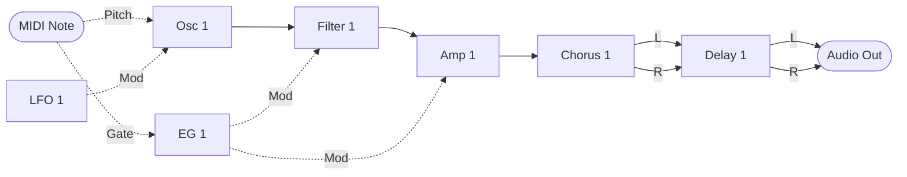
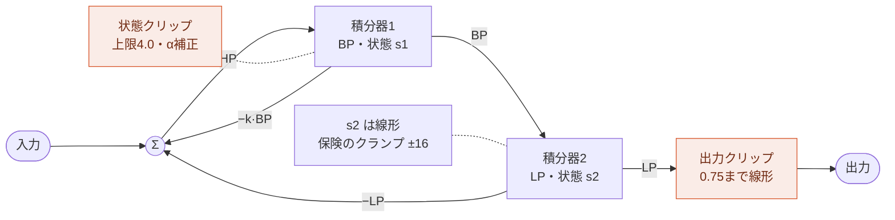
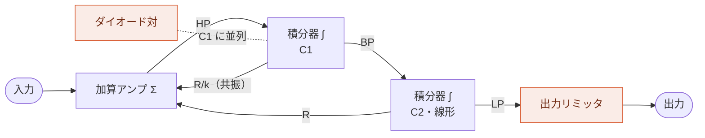
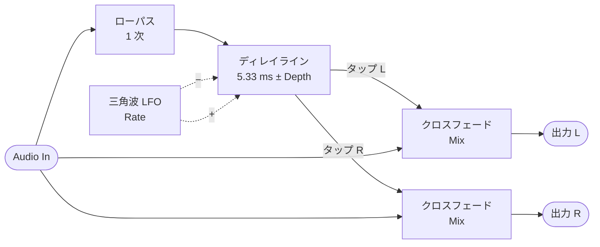

MIDI Synthesizer SPMS-1 (type-2) v0.0.2
=======================================

- Spinel (Ruby AOT コンパイラ) で作った、Raspberry Pi Pico 2 用のモノフォニック・セミモジュラー MIDI シンセサイザー
- 音源モジュールとして MIDI で制御します
- 48 kHz オーディオ出力: I2S DAC による 24 bit、または PWM Audio (DAC 不要)
- フィルタ: ZDF/TPT ステート・バリアブル・フィルタ (遅延ソフトクリッピング付き)
- コーラス: モノラル入力・ステレオ出力、実行順に入るモジュール
- ディレイ: ステレオ、フィードバック付き、実行順に入るモジュール (最大 340 ms)
- ステレオ出力: コーラスがモノラルの音を左右に広げ、ディレイが左右を分けたまま運びます
- 開発: ISGK Instruments (Ryo Ishigaki)
- <https://github.com/risgk/midi_synthesizer_spms1>
- [English README](./README.md) (英語版が正です)


必要なハードウェア
------------------

- Raspberry Pi Pico 2 (RP2350)
    - [Raspberry Pi Pico 2](https://www.raspberrypi.com/products/raspberry-pi-pico-2/)
    - I2S DAC ハードウェア (48 kHz/24 bit): `SPMS1_USE_I2S_INSTEAD_OF_PWM_AUDIO` のコメントを外してください
        - Pimoroni [Pico Audio Pack](https://shop.pimoroni.com/products/pico-audio-pack) (PIM544)
        - [Adafruit PCM5102 I2S DAC](https://www.adafruit.com/product/6250) (Product ID: 6250)
        - GY-PCM5102 (PCM5102A I2S DAC モジュール)
    - または PWM Audio 出力 (DAC 不要、スケッチのデフォルト)
        - L は GP28、R は GP27 で、Pimoroni [Pico VGA Demo Base](https://shop.pimoroni.com/products/pimoroni-pico-vga-demo-base) (PIM553) と同じです
        - PWM のリップルを取り除くため、各出力に RC ローパスフィルターを付けることをお勧めします
            - 矩形波が流れるケーブルからの輻射ノイズ (EMI) も減らせます。ケーブルの先ではなく、ピンの近くに付けてください
        - RC フィルタを付けない場合は、抵抗か接続先の機器の入力ゲイン (ボリューム) でレベルを下げてください:
          PWM のリップル (3.3 V の矩形波) で入力 (オーディオインターフェースなど) が飽和し、「ピー」という音やノイズが出ることがあります。
          レベルメーターが適正に見えていても起こります
        - PWM のレベル (3200 段階) は、1 次のノイズシェーピングと TPDF ディザ付きで量子化されます
        - 1 サンプルを 4 つの PWM 周期に分けて出力します (PWM キャリア: 48 kHz ではなく 192 kHz)。キャリアをフィルタで取り除きやすく、
          アクティブスピーカーで「ピー」という音が出にくくなります (`SPMS1_PWM_AUDIO_SUBPERIODS`: 1、2、4、8)
    - 注意: RP2350 のシステムクロック (sysclk) は 153.6 MHz にオーバークロックされます。設定するのはスケッチ自身の I2S または
      PWM Audio 出力 ("spms1_pico2_i2s.h" または "spms1_pico2_pwm_audio.h"、PRA32-U2 と同じもの) で、Arduino-Pico の I2S ライブラリではありません


改造に必要なソフトウェア
------------------------

- [Arduino IDE](https://www.arduino.cc/en/software)
- Arduino-Pico = Raspberry Pi Pico/RP2040/RP2350 (by Earle F. Philhower, III) コア
    - 追加のボードマネージャ URL: <https://github.com/earlephilhower/arduino-pico/releases/download/global/package_rp2040_index.json>
    - このスケッチはバージョン 6.2.0 で動作確認しています: <https://github.com/earlephilhower/arduino-pico/releases/tag/6.2.0>
    - 情報: <https://github.com/earlephilhower/arduino-pico>
    - ボード: "Raspberry Pi Pico 2"、"ツール" メニューの USB Stack: "Adafruit TinyUSB"
- Arduino MIDI Library (by Francois Best, lathoub)
    - このスケッチはバージョン 5.0.2 で動作確認しています: <https://github.com/FortySevenEffects/arduino_midi_library/releases/tag/5.0.2>
    - 情報: <https://github.com/FortySevenEffects/arduino_midi_library>
- Spinel
    - リリース: 2026.09.12 <https://github.com/matz/spinel/tree/2026.09.12>
    - Spinel の出力ファイル "spms1_main.c" に手を入れる必要はありません。本スケッチの
      "spinel_rt_mcu_head.h" ("spinel_rt.h" の先頭で読み込み) が
      `#define main __attribute__((section(".time_critical"), flatten)) Spms1_main` を持っており、改名と
      シンセ本体の RAM 配置を同時に行います。手で改名すると、このマクロが一致しなく
      なって属性が付かず、本体が flash から実行されます
    - "spms1_main.c" は `spinel spms1_main.rb -c --rbs sig` で生成します。"sig" の型シードが
      フィルタの状態をボックス化させずに保ちます。必要な理由は "sig/spms1_filter.rbs" にあります


使い方
------

### ビルド済みバイナリ

- "bin" フォルダの "spms1_type2_i2s.ino.uf2" は Raspberry Pi Pico 2 と、Pimoroni Pico Audio Pack、
  Adafruit PCM5102 I2S DAC、または GY-PCM5102 用です
- "bin" フォルダの "spms1_type2_pwm_audio.ino.uf2" は Raspberry Pi Pico 2 と PWM Audio 出力用で、L は GP28、R は GP27 でビルドされています


### Web エディタ

- Web MIDI API を使う、プラットフォームを問わないパラメータ・コントローラ: "spms1_editor.html"
- 音を出して試すためのソフトウェア鍵盤を内蔵しています
- グラフィカルなパッチエディタを Patch タブに内蔵しています
    - モジュールの出力を入力やパラメータへ配線し、実行順と CC の割り当てを設定します
    - パッチを JSON で保存・読み込みします
    - パッチを MIDI バイト列または NRPN リストとしてコピーするか、Web MIDI で送信します
- SPMS-1 Web: エディタに組み込まれたシンセサイザー本体 ("spms1_web_synth.js")
    - "MIDI Out" で "SPMS-1 Web (Built-in)" を選び、ソフトウェア鍵盤 (または "MIDI In" の MIDI キーボード) で演奏します
    - "spms1_main.c" を WebAssembly として Web ブラウザで動かすので、実機と同じ音がします
    - [web/README.md](./web/README.md) を参照してください


### MIDI の設定

- MIDI チャンネル: チャンネル 1
- USB MIDI 入力
    - 製造者ディスクリプタ: "ISGK Instruments"
    - デバイス名: "SPMS-1 (type-2)"
- UART MIDI 入力
    - 速度: 31250 bps
    - GP4 ピンと GP5 ピンを TX と RX に、`SoftwareSerial` で使います
    - `SPMS1_UART_MIDI_TX_PIN` と `SPMS1_UART_MIDI_RX_PIN` を書き換えれば、TX と RX の入れ替えを含め、
      どのピンでも使えます
    - DIN/TRS MIDI は、たとえば Adafruit MIDI FeatherWing Kit などを使う (そして手を入れる) ことで利用できます
        - Adafruit [MIDI FeatherWing Kit](https://www.adafruit.com/product/4740) (Product ID: 4740)
        - M5Stack [Midi Unit with DIN Connector (SAM2695)](https://shop.m5stack.com/products/midi-unit-with-din-connector-sam2695) (SKU: U187) のセパレートモード
        - Kinoshita Laboratory [MIDI-UART interface-san Kit](https://www.tindie.com/products/kinoshitalab/midi-uart-interface-san-kit/)
        - 木下研究所 [MIDI-UARTインターフェースさん キット](https://www.switch-science.com/products/8117) (日本国内発送のみ)
        - necobit電子 [MIDI Unit for GROVE](https://necobit.com/denshi/grove-midi-unit/) (日本国内発送のみ)
        - necobit電子 [MIDI Unit Mini for GROVE](https://necobit.com/denshi/midi-unit-mini-for-grove/) (日本国内発送のみ)


### レイテンシ

MIDI メッセージを受けてから音が出るまで、およそ 4 ms です。

- 64 サンプルの出力バッファが 2 つ: 2.7 ms
- MIDI はバッファごとに 1 回読むので、最大でもう 1 つ分待ちます: 1.3 ms

これはシンセ自身の分で、MIDI の伝送と DAC の分はこの上に乗ります。


### [MIDI インプリメンテーション・チャート](./spms1_midi_chart.md)


### ブロック図

デフォルトのパッチです。実線の矢印がオーディオ信号を、破線の矢印がコントロール信号を運びます。



モジュールは下の実行順で、1 サンプルずつ処理されます。波形やカットオフ、ゲインといったパラメータは CC
から届くもので、この図では省いています。

LFO はオシレータに直接入り、LFO 1 Polarity が定数 0.1 を読んでビブラートの深さまで絞ります。Osc 1 Mod
Amt Uni はここにあるどのモジュレーション深度とも同じくピッチの全域に届くので、ソースを音楽的な深さまで
絞る仕事はオシレータに作り込まず、ソースの側に任せています。

アンプまではモノラルです。コーラスがそれを受け取って左右 2 つを出し、ディレイが左右を受け取って分けた
まま運び、その 2 つの出力が最終出力の左右になります。

以上はどれも固定ではありません。実行順も、上の図のすべての矢印も、どの CC がどのパラメータに入るかも、
NRPN が書き換えます。

#### 実行順

すべてのモジュールが入っています。音を作る型が 1 つずつと、モジュレーションのソースとオシレータの間に
ミキサーが 1 つ、最後にコーラスとディレイです。


ミキサーには何も結線されていないので、毎サンプル自分のスロットぶんのコストを払うだけで、パッチが
何かを与えるまでは何も変えません。どこに座っているかがそのまま価値になります。あるモジュールが今サンプル
の値を見られるのは、この列で自分より前にあるものからだけで、後ろにあるものからは前サンプルの値を受け取り
ます。Mixer 1 は LFO とエンベロープに手が届き、オシレータ、フィルタ、アンプは Mixer 1 に手が届きます。

ミキサーは 2 つの信号を合流させるための道具であり、エンベロープのように片側にしか振れない信号を正負
どちらにも振れるようにする手段でもあります。下の例を参照してください。

#### Filter 1

ゼロディレイ・フィードバックの状態変数フィルタです。Σ ではループの式を閉形式で解き、HP を一度に
求めます。ソフトクリップが掛かるのは BP の状態を読み出すところだけで、これがレゾナンスを抑えます。
LP の状態は線形のままで、通常の使い方では届かない保険として ±16 のクランプだけがあります。出力
クリップはフィルタの最後にあります。レゾナンスのつまみの上端では k が負になり、ループが発振します。



同じ構造を、オペアンプ積分器によるフィルタに置き換えて描いたものです。ダイオード対は状態クリップ、
出力リミッタは出力クリップに対応します。解釈として描いたもので、実在の回路を再現したものではあり
ません。



#### Chorus 1

PRA32-U2 の Chorus FX にならった、モノラル入力・ステレオ出力のコーラスです。ディレイと同じくインサート
式で経路に入り、センドレベルではなく Mix でドライとコーラスのバランスを決めます。入力は穏やかなローパス
フィルタを通って 1 本の短いディレイラインに入り、そこを 2 つのタップで読み出します。三角波の LFO が
2 つのタップを 5.33 ms を挟んで互いに逆向きに揺らすので、左右の遅延信号は互いに逆向きにピッチが
揺れます。それぞれの出力は入力と自分のタップのクロスフェードなので、モノラルの音源がステレオに広がって
出てきます。



後ろにリミッターもクリップも要りません。入力は入口で 1.0 に収め、フィルタも 2 サンプル間の読み出しも
クロスフェードも重み付き平均で、平均するもの以上にはなりません。タップが揺れる中心の遅延は、PRA32-U2 が
内部に持つのと同じく固定です。

#### Delay 1

PRA32-U2 の Delay FX の Stereo Delay モードにならった、フィードバック付きのステレオディレイです。左右
それぞれが自分のディレイラインとループを持ちます。入力の半分と、Feedback を掛けた遅延信号が、穏やかな
ローパスフィルタを通ってディレイラインに入り、出力は入力と遅延信号のクロスフェードです。Time、Feedback、
Mix は左右で共通なので、左右は一緒に繰り返し、入ってきたときのステレオ像を保ちます。


図は片側で、もう片側も同じです。後ろにリミッターもクリップも要りません。入ってくるのが入力の半分、戻るのが
遅延信号の高々半分なので、遅延信号が 1.0 以内なら書き戻すものも 1.0 以内で、始まりは無音です。フィルタも
2 サンプル間の読み出しもクロスフェードも重み付き平均で、平均するもの以上にはなりません。代わりに、最初の
繰り返しはドライ信号より 6 dB 小さくなります。入力は、アンプが Mod In にするのと同じく入口で 1.0 に収める
ので、何を結線してもこの上限は保たれます。

### パッチの編集 (NRPN)

パッチはデータであり、NRPN は動いているシンセのそれを書き換えます。どのモジュールがどの順で走るか、各
モジュール入力に何が入るか、各パラメータがどこから値を取るか、どの CC がどのコントロールスロットを埋める
か。すべてのモジュールは番号の付いたシグナルスロットから読み、番号の付いたスロットへ書くので、配線し直す
こととはスロット番号を変えることです。

#### 送り方

- CC 99 でカテゴリを、CC 98 でその中のエントリを選びます。順序はどちらが先でも構いません
- CC 6 (Data Entry MSB) で値が確定し、次のオーディオバッファから効きます
- CC 38 (Data Entry LSB) は無視されます。ここで扱う値はすべて 7 ビットです
- CC 101 と CC 100 (RPN セレクト) はデータ入力を中断させるので、RPN がパッチ編集と取り違えられることは
  ありません。再開するには CC 99 か CC 98 をもう一度送ります
- 編集内容は保存されません。電源投入時にデフォルトのパッチへ戻ります

#### カテゴリ (CC 99)

| CC 99 | CC 98 | 設定する対象 | CC 6 の値 |
| ----- | ----- | ---- | ---------- |
| 0 | 0-31 | 実行順、スロットごとに | モジュール ID |
| 1 | 0-13 | モジュール入力に何を入れるか | シグナル ID |
| 2 | 0-28 | パラメータがどこから値を取るか | シグナル ID |
| 3 | 0-33 | どの CC がコントロールスロットを埋めるか | CC 番号、0 なら割り当てなし |

実行順はスロット 0 から上へ読まれ、最初に現れたモジュール ID 0 で止まります。32 個に満たないパッチは
そこで自ら終わるわけです。実行順はモジュールの番号付けとは別物です。あるモジュールが今サンプルの値を
見られるのは自分より前に並んでいるものからだけで、後ろにあるものからは前サンプルの値を受け取ります。

カテゴリ 3 で CC 番号 0 を指定すると、そのパラメータには CC がない状態になります。コントロールスロットは
それまでの CC にかかわらず 0.0 になるので、パラメータが読む値はパッチだけで決まります。

音を作るモジュールは 1 つずつ、ミキサーとコーラスとディレイが 1 つずつあり、**この 8 個すべてがデフォルトの
実行順に入っています**。パッチは結線するだけでよく、何かを先に有効化する必要はありません。コーラスや
ディレイを実行順から外せばそのぶんの時間が浮きます。そのときはそれを読んでいたものを別の所へ向け直します。
下の例を参照してください。どのパラメータにも CC が付いていないのは
ミキサーだけで、そのぶんデフォルトのパッチでは定数を指させてあります。レベルは 1.0、極性は +0.5 なので、
入力を 1 つ結線したミキサーはそれをそのまま通します。

#### エントリ (CC 98)、カテゴリ 1

| CC 98 | モジュール入力 | | CC 98 | モジュール入力 |
| ----- | ------ | - | ----- | ------ |
| 0 | EG 1 Gate | | 7 | Mixer 1 In 1 |
| 1 | Osc 1 Pitch | | 8 | Mixer 1 In 2 |
| 2 | Osc 1 Mod In | | 9 | Chorus 1 Audio In |
| 3 | Filter 1 Audio In | | 10 | Delay 1 Audio In L |
| 4 | Filter 1 Mod In | | 11 | Delay 1 Audio In R |
| 5 | Amp 1 Audio In | | 12 | 最終出力 L |
| 6 | Amp 1 Mod In | | 13 | 最終出力 R |

ほとんどは名前のとおりのものを受け取りますが、3 つだけ名前からは分からない決まりがあります。Gate はレベル
ではなく閾値で、信号が 0.25 以上になるとエンベロープがトリガし、下回るとリリースします。Pitch は MIDI ノート
0〜120 を -0.5〜+0.5 で表すので、0.0 がノート 60、0.1 が 1 オクターブです。そして Mod In は届いたままの値を
受け取ります。入口では何も制限せず、クランプされるのはモジュールが最終的に得た値のほうです。カットオフは
つまみの両端、ピッチは -0.5〜+0.5 に収まります。ミキサーは上限なしで足し算をするので、大きすぎる変調は入口で
削られるのではなく、行き先を端に貼り付かせます。アンプだけは例外で、Mod In を -1.0〜+1.0 でクランプします。
アンプはアッテネーターなので、変調はゲインを下げられても上げられてはならないからです。コーラスとディレイ
もオーディオ入力を同じく 1.0 に収めます。

最終出力の左右は別々に読まれるので、どちらもどこへでも向けられます。両方を同じシグナルに向ければモノラル
出力になります。

#### エントリ (CC 98)、カテゴリ 2 と 3

| CC 98 | パラメータ | | CC 98 | パラメータ | | CC 98 | パラメータ |
| ----- | ------ | - | ----- | ------ | - | ----- | ------ |
| 0 | LFO 1 Rate | | 10 | Osc 1 Fine Tune | | 20 | Mixer 1 Polarity 1 |
| 1 | LFO 1 Level | | 11 | Osc 1 Mod Amt | | 21 | Mixer 1 Level 2 |
| 2 | LFO 1 Polarity | | 12 | Osc 1 Mod Polarity | | 22 | Mixer 1 Polarity 2 |
| 3 | EG 1 Attack | | 13 | Filter 1 Cutoff | | 23 | Chorus 1 Rate |
| 4 | EG 1 Decay | | 14 | Filter 1 Resonance | | 24 | Chorus 1 Depth |
| 5 | EG 1 Sustain | | 15 | Filter 1 Gain | | 25 | Chorus 1 Mix |
| 6 | EG 1 Level | | 16 | Filter 1 Mod Amt | | 26 | Delay 1 Time |
| 7 | EG 1 Polarity | | 17 | Filter 1 Mod Polarity | | 27 | Delay 1 Feedback |
| 8 | Osc 1 Wave | | 18 | Amp 1 Gain | | 28 | Delay 1 Mix |
| 9 | Osc 1 Coarse Tune | | 19 | Mixer 1 Level 1 | |  |  |

#### エントリ (CC 98)、カテゴリ 3 のみ

これらの CC はどのパラメータにも属さないので、カテゴリ 2 には対応するエントリがありません。General 1〜4 は
それぞれユニポーラとバイポーラの 2 つのスロットを埋めます。後述の General スロットを参照してください。

| CC 98 | CC の割り当て先 | 埋めるスロット |
| ----- | ------ | ----- |
| 29 | General Mod Wheel | General Mod Wheel |
| 30 | General 1 | General Unipolar 1、General Bipolar 1 |
| 31 | General 2 | General Unipolar 2、General Bipolar 2 |
| 32 | General 3 | General Unipolar 3、General Bipolar 3 |
| 33 | General 4 | General Unipolar 4、General Bipolar 4 |

#### モジュール ID

| ID | モジュール |
| ----- | ------ |
| 0 | なし（実行順の終端） |
| 1 | LFO 1 |
| 2 | EG 1 |
| 3 | Osc 1 |
| 4 | Filter 1 |
| 5 | Amp 1 |
| 6 | Mixer 1 |
| 7 | Chorus 1 |
| 8 | Delay 1 |

#### シグナル ID

| ID | シグナル | | ID | シグナル | | ID | シグナル |
| ----- | ------ | - | ----- | ------ | - | ----- | ------ |
| 0 | なし（定数 0.0） | | 20 | LFO 1 Level | | 40 | Mixer 1 Level 2 |
| 1 | 定数 1.0 | | 21 | LFO 1 Polarity ± | | 41 | Mixer 1 Polarity 2 ± |
| 2 | 定数 0.5 | | 22 | EG 1 Attack | | 42 | Chorus 1 Rate |
| 3 | 定数 0.2 | | 23 | EG 1 Decay | | 43 | Chorus 1 Depth |
| 4 | 定数 0.1 | | 24 | EG 1 Sustain | | 44 | Chorus 1 Mix |
| 5 | 定数 -0.1 | | 25 | EG 1 Level | | 45 | Delay 1 Time |
| 6 | 定数 -0.2 | | 26 | EG 1 Polarity ± | | 46 | Delay 1 Feedback |
| 7 | 定数 -0.5 | | 27 | Osc 1 Wave | | 47 | Delay 1 Mix |
| 8 | 定数 -1.0 | | 28 | Osc 1 Coarse Tune ± | | 48 | Note Pitch ± |
| 9 | LFO 1 Output ± | | 29 | Osc 1 Fine Tune ± | | 49 | Note Gate |
| 10 | EG 1 Output ± | | 30 | Osc 1 Mod Amt | | 50 | Pitch Bend ± |
| 11 | Osc 1 Output ± | | 31 | Osc 1 Mod Polarity ± | | 51 | General Mod Wheel |
| 12 | Filter 1 Output ± | | 32 | Filter 1 Cutoff | | 52 | General Unipolar 1 |
| 13 | Amp 1 Output ± | | 33 | Filter 1 Resonance | | 53 | General Unipolar 2 |
| 14 | Mixer 1 Output ± | | 34 | Filter 1 Gain | | 54 | General Unipolar 3 |
| 15 | Chorus 1 Output L ± | | 35 | Filter 1 Mod Amt | | 55 | General Unipolar 4 |
| 16 | Chorus 1 Output R ± | | 36 | Filter 1 Mod Polarity ± | | 56 | General Bipolar 1 ± |
| 17 | Delay 1 Output L ± | | 37 | Amp 1 Gain | | 57 | General Bipolar 2 ± |
| 18 | Delay 1 Output R ± | | 38 | Mixer 1 Level 1 | | 58 | General Bipolar 3 ± |
| 19 | LFO 1 Rate | | 39 | Mixer 1 Polarity 1 ± | | 59 | General Bipolar 4 ± |

**±** は、正負どちらにも振れるシグナルを表します。モジュール出力はフルスケールで -0.5 と +0.5 に届き、
バイポーラのコントロールスロットは -0.5〜+0.5 で、ミキサーはそれを 2 つ足して 1.0 で止まります。
エンベロープだけは例外で、デフォルトの Polarity +0.5 では 0.0〜1.0、Polarity を負にすると -1.0 まで
振れます。印のないものは 0.0〜1.0 で、Note Gate とユニポーラのコントロールスロットがこれにあたります。
バスは両方を 1 つの番号空間で運ぶので、レンジは「何が書いたか」ではなくスロットごとの性質です。

スロット 19〜47 には CC から届いた値が入るので、パラメータはデフォルトでは自分の CC を読んでいるわけです。
パラメータはそれぞれユニポーラかバイポーラで、スロットも同じレンジを取ります。ユニポーラは CC 4〜124 で
0.0〜1.0 と、エンベロープと同じ幅なので、エンベロープを向ければつまみの全域を動かせます。バイポーラは
CC 64 を 0.0 とする -0.5〜+0.5 と、LFO と同じ幅なので、バイポーラのソースを向ければ中央を挟んで上下に
振れます。2 つのチューンは中央が「変化なし」を意味するのでバイポーラです。Polarity も、LFO、EG、ミキサー、
2 つの Mod Polarity のいずれも、符号そのものが設定する値なのでバイポーラです。パラメータに別のスロットを指させることがモジュレー
ションになります。CC のないスロットは 0.0 です。

スロット 51〜59 の General スロットは、どのパラメータにも属さないコントロールスロットです。CC をバスに
載せるだけで、どのモジュール入力やパラメータからも読めます。General Mod Wheel は CC 1 を読む 0.0〜1.0
のスロットで、起動時は CC 4 なので、ホイールを動かすまで 0.0 です。デフォルトではどこにも結線されて
いません。General 1〜4 はデフォルトで
CC 16〜19 を読み、それぞれの CC を両方の形で同時にバスに載せます。General Unipolar 1〜4 は 0.0〜1.0、
General Bipolar 1〜4 は -0.5〜+0.5 です。起動時は 4 つとも CC 64 なので、ユニポーラは 0.5、バイポーラは
0.0 から始まります。

Note Pitch、Note Gate、Pitch Bend の 3 つは鍵盤がバスに載せるものです。Note Pitch は MIDI ノート 0〜120 を
-0.5〜+0.5 で運びます。オシレータがピッチの全域として読むのと同じ幅です。Pitch Bend も同じくバイポーラで、
ホイールの端から端までがちょうど 1 単位で、両端がちょうど -0.5 と +0.5、中央のディテントがちょうど 0 に
なるので、ミキサーで下駄を履かせなくてもモジュール入力へ入れられます。Note Gate は 0.0 か 1.0 で、
エンベロープは 0.25 以上でトリガします。Pitch Bend はデフォルトではどこにも結線されていません。

スロット 0〜8 は何も書き込まない定数で、ソースではなく固定値を入れたい入力のためにあります。シグナル 0 は
誰も設定していないエントリが読む値でもあるので、未結線の入力は最初のスロットに入っているものに繋がるので
はなく、無音になります。シグナル 1 はモジュレーションのかかっていない入力が欲しがる値で、アンプの
モジュレーション入力をここへ向ければアンプはフルレベルのままです。シグナル 0 と 1 はユニポーラの、
シグナル 7 と 2 はバイポーラのパラメータのレンジの両端なので、パラメータをそこに固定するのに使えます。
シグナル 2 はユニポーラのつまみの中央でもあります。シグナル 3 はフルスケールの 5 分の 1 で、シグナル 6 は
その負の値です。シグナル 4 はデフォルトのパッチが LFO 1 Polarity に与える値で、LFO をビブラートの深さ
まで絞ります。シグナル 5 はその負の値です。ミキサーの 2 番目の入力に定数を置けば、信号を 2 種類の間で
ずらせます。-0.5 なら片側にしか振れない信号を正負どちらにも振れるものへ、+0.5 ならその逆です。

ID 番号はファームウェアのバージョンをまたいで安定ではありません。パッチは保存されないので、モジュールの
種類が増えたり、あるモジュールのインスタンスが増えたり、シグナルが増えたりすると、それ以降がすべて振り
直されることがあります。アップデート後はこれらの表を読み直してください。

#### 知っておきたいレンジ

2 つのチューンはどちらも CC 64 を中心とし、CC 1 ステップでちょうど 1 単位動きます。Coarse Tune は半音で
上下 5 オクターブまで、Fine Tune は 1 セントで上下 60 セントまでです。両者は加算されるので、どのピッチにも
届きます。

LFO 1 Level と LFO 1 Polarity は、ミキサーの Level と Polarity が入力に掛かるのと同じく、LFO の出力に
一緒に掛かります。Level は 0.0 (CC 4) で無音、1.0 (CC 124) で最大、Polarity は -0.5 (CC 4) で反転、
0.0 (CC 64) で無音、+0.5 (CC 124) でそのままです。どちらも CC
がなく、デフォルトのパッチは Level に定数 1.0、Polarity に上端の 5 分の 1 の定数 0.1 を指させています。

EG 1 Level と EG 1 Polarity も、同じレンジで同じようにエンベロープの出力に掛かります。どちらも CC がなく、
デフォルトのパッチは定数 1.0 と +0.5 を指させているので、エンベロープはそのまま出ます。

モジュレーションの深さは Mod Amt と、2 倍にした Mod Polarity の積です。Mod Polarity は +0.5 (CC 124) で
Mod Amt をそのまま通し、0.0 (CC 64) で無効にし、-0.5 (CC 4) で反転させます。その間では Mod Amt を
スケールするので、向きだけでなく深さも決めます。Mod Polarity には CC がなく、デフォルトのパッチは定数
0.5 を指させているので、どちらを回してもかまいません。一方向の深さなら Mod Amt、0 をまたぐ深さなら
Mod Polarity です。

Osc 1 Mod Amt はオフセットではなく深さで、ピッチの全域に届きます。最大にすると、バイポーラのソースがピッチ
を 5 オクターブ上下に振ります。ビブラートのつまみとしては CC 1 ステップが 50 セントと粗いので、デフォルト
のパッチでは LFO 1 Polarity で LFO を 5 分の 1 に絞っています。そこでは半音のビブラートが CC 14、つまみの
上端で 1 オクターブです。

Filter 1 Gain はオーディオ入力がフィルタをどれだけ強く駆動するかを決め、それがそのままフィルタ自身の
サチュレーションの深さにもなります。デフォルトの CC 64 は、かつてオシレータ側で掛けていたレベルにあたり
ます。サチュレーションが掛かるのは通過帯域ではなくレゾナンスです。カットオフが低くても大きな音はほぼ
そのまま通り、ゲインを上げるとレゾナンスのピークが丸くなります。

Filter 1 Resonance は CC 94 の Q 5.66 までは CC 30 段ごとにピークが 6 dB（Q が2倍）上がり、そこから
Q は段差なしに次第に速く上がって、CC 109 で Q 29、CC 118 で Q 256 になります。それより上ではフィルタが
自己発振し、カットオフ周波数のサイン波を出します。発振は CC 123 までに約 0.5 の最大レベルに達し、
つまみの上端までそのままです。この区間の下の方では発振がゆっくり立ち上がって入力と共存し、上端では
入力を押しのけます。レベルはカットオフが約 150 Hz まではほぼ一定で、それより下では小さくなります。
カットオフの上の方では、3倍音が折り返して非整数次の音になる前に発振がフェードアウトします。48 kHz では
変調込みで 8 kHz（CC 108）から 10 kHz（CC 112）までで、それより上では Q 256 のレゾナンスとして働きます。
下の例のようにカットオフを鍵盤に追従させると、サイン波の音源として弾けます。

ミキサーは各入力をそれぞれのレベルとそれぞれの極性で受け取り、足し合わせます。Level は 0.0 (CC 4) で
無音、1.0 (CC 124) で最大、Polarity は -0.5 (CC 4) で反転、0.0 (CC 64) で無音、+0.5 (CC 124) で
そのままです。レベルの初期値は最大、Polarity はそのままなので、入力を 1 つだけ結線したミキサーは
バッファになります。その入力を反転させればインバータに、2 番目だけを反転させれば減算器になります。

和は -1.0〜+1.0 に収められます。フルスケールの信号 2 本がちょうどそこに届くので、普通の使い方では何も
切られません。止めているのは、ミキサーを自分の入力に戻した場合です。放っておけば毎サンプル 2 倍になり、
やがて数値でなくなって、オシレータやフィルタを道連れにします。フィルタも同じ 1.0 に収まりますが、
こちらは角ではなく曲線です。出力は 0.75 まではまったく手を加えずに通し（デフォルトのパッチはそこまで
届きません）、その先で滑らかに上限へ寄せます。共振のピークはスイープ中に 1.0 を超えることがあり、そこを
丸めても、角で切った場合に音の中へ折り返してくる高次の倍音よりずっと弱いもので済みます。

Chorus 1 の 3 つのパラメータはユニポーラで、1/120 刻みで動きます。Rate は LFO 1 Rate と同じくノート番号
として読まれ、1 ステップが半音です。CC 4 で 0.015 Hz、CC 64 で 0.48 Hz、CC 124 で 15.4 Hz、つまり初期値の 1/32 倍から 32 倍までです。Depth は
それぞれのタップが 5.33 ms を挟んで揺れる幅で、CC 4 の 0 から、CC 64 の 2.63 ms を通って、CC 124 の 5.25 ms
までの直線です。Mix は左右それぞれのクロスフェードのタップの割合で、CC 4 でドライ入力だけ、CC 64 で半々
（PRA32-U2 が Chorus Level 最大で作るコーラスです）、CC 124 でタップだけになり、左右で逆向きに揺れる
ビブラートになります。起動時は 3 つとも CC 64 です。コーラスを 1.0 に収めているのはクロスフェードの半分ずつ
なので、デフォルトではドライ信号が 6 dB 下がり、タップとの和がその一部を補います。

Delay 1 の 3 つのパラメータはユニポーラで、ほかのユニポーラのつまみと同じく 1/120 刻みで動きます。Time は
1 ステップ 2.83 ms の直線で CC 4 の 0 から CC 124 の 340 ms までを取り、下は 2.83 ms でクリップします。
CC 5 までは 2.83 ms のままで、CC 64 で 170 ms です。回すと、テープディレイのように繰り返しのピッチが
最大 25% 曲がり、少し遅れて新しい時間に着きます。
Feedback は繰り返しをラインに戻すゲインで、CC 4 の 0（繰り返しは 1 回）から CC 124 の 0.5（繰り返す
たびに 6 dB 下がり、少しずつ暗くなる）までです。CC 64 で 0.25 です。Mix はクロスフェードの繰り返しの
割合で、CC 4 でドライ入力だけ、CC 64 で半々、CC 124 で繰り返しだけです。起動時は Time と Feedback が
CC 64、Mix が CC 34（0.25）で、ドライ信号は 2.5 dB 下がり、最初の繰り返しはその約 16 dB 下に来ます。

#### 例

- ビブラートはデフォルトで結線済みです。LFO がオシレータのモジュレーション入力に直接届くので、CC 13 で
  深さ、CC 3 でレートを決められます。CC 99 = 2, CC 98 = 1, CC 6 = 51 で LFO 1 Level を General Mod Wheel
  から取るようにすれば、CC 13 で決めた深さまでホイールでビブラートを掛けられます
- フィルタのカットオフをノートのピッチに追従させる（キーボードトラッキング）: CC 99 = 1, CC 98 = 4,
  CC 6 = 48 で、エンベロープの代わりに Note Pitch をフィルタのモジュレーション入力に置きます。カットオフが
  CC 64、Mod Amt が CC 124 なら、ノート 60 でカットオフはつまみの中央のままで、1 ノートごとに半音動きます
- フィルタのカットオフを LFO でつまみの中央を挟んで揺らす: CC 99 = 1, CC 98 = 4, CC 6 = 9。
  モジュール入力は毎サンプル読まれるので、LFO のレートはいくつでも構いません
- フィルタのカットオフを、自分の CC ではなくエンベロープで動かす: CC 99 = 2, CC 98 = 13, CC 6 = 10。
  エンベロープもカットオフもユニポーラなので、カットオフはつまみの下端から上端まで開きます
- アンプのゲインとフィルタのカットオフで 1 つの CC を共有する: CC 99 = 3, CC 98 = 18, CC 6 = 74
- エンベロープなしでアンプをフルレベルにする: CC 99 = 1, CC 98 = 6, CC 6 = 1
- フィルタのモジュレーション入力を切り離す: CC 99 = 1, CC 98 = 4, CC 6 = 0
- 深さ 60 セントのピッチエンベロープ: CC 99 = 2, CC 98 = 10, CC 6 = 10 で Osc 1 Fine Tune をエンベロープに
  向けると、チューニングが元の音程から 60 セント高いところまで動き、エンベロープのピークの半分でそこに
  届きます
- ノートの出だしでエンベロープがフィルタをより強く駆動する: CC 99 = 2, CC 98 = 15, CC 6 = 10 で、フィルタの
  入力レベルが無音からつまみの上端まで上がって戻ります
- ピッチを LFO ではなくエンベロープで動かす: CC 99 = 1, CC 98 = 2, CC 6 = 10 で LFO の代わりにエンベロープ
  をオシレータのモジュレーション入力に置き、あとは CC 13 で深さを決めます。この経路ではエンベロープを
  絞るものがないので、CC 5 で半音、CC 16 で 1 オクターブです
- ピッチベンド。デフォルトではどこにも結線されていません。CC 99 = 1 で CC 98 = 7 と 8 に CC 6 = 48 と 50
  を送ると Note Pitch と Pitch Bend が Mixer 1 の 2 つの入力に入り、CC 99 = 1, CC 98 = 1, CC 6 = 14 で
  その和がオシレータのピッチになります。Mixer 1 はオシレータより前を走るので、ホイールは同じサンプルで
  音程を動かします。レベルはどちらも最大なので、そのままではホイールが上下 5 オクターブ振ります。
  CC 99 = 2, CC 98 = 21, CC 6 = 52 で Mixer 1 の 2 番目のレベルを General Unipolar 1 から取るように
  すれば、CC 16 で演奏できるベンドレンジまで絞れます
- モジュレーション入力を通して、ピッチを両方向に曲げる CC。Mixer 1 はオシレータより前を走り、空いて
  います: CC 99 = 1, CC 98 = 7, CC 6 = 32 でフィルタのカットオフのコントロールスロットを 1 番目の入力に、
  CC 98 = 8, CC 6 = 7 で定数 -0.5 を 2 番目の入力に置き、CC 98 = 2, CC 6 = 14 で LFO の代わりに Mixer 1 を
  オシレータのモジュレーション入力に向けます。スロットはユニポーラなので、この定数が LFO が 0 を中心と
  するのと同じく CC 64 を中心にします。CC 74 は CC 13 の許す範囲でノートの上下にピッチを曲げるように
  なります。CC 6 で上下に半音、CC 28 で 1 オクターブです
- 逆向きに効く CC。ミキサーに反転させます。Mixer 1 はすでに走っているので、結線するだけです。
  CC 99 = 1, CC 98 = 7, CC 6 = 32 でカットオフのコントロールスロットを 1 番目の入力に、CC 98 = 8,
  CC 6 = 1 で定数 1.0 を 2 番目の入力に置き、CC 99 = 2, CC 98 = 20, CC 6 = 7 で 1 番目の入力の Polarity を
  -0.5、つまり反転側の端に固定すると、ミキサーは 1.0 から CC を引いた値、つまり CC を CC 64 で折り返した
  ものを出力します。CC 99 = 2, CC 98 = 13, CC 6 = 14 でカットオフ自身のソースをその
  ミキサーに向ければ、CC 74 は上げるほどフィルタを閉じるようになります
- フィルタを経路から外す: CC 99 = 1, CC 98 = 5, CC 6 = 11 でアンプのオーディオ入力をオシレータに向けます。
  フィルタは走り続けスロットも占めたままですが、誰も読みません
- モジュレーションホイールで掛かるエコー: CC 99 = 2, CC 98 = 28, CC 6 = 51 で Delay 1 Mix を General Mod
  Wheel から取ります。起動時は 0.0 なので、ホイールを動かすまで出力はドライです
- モジュレーションホイールで掛かるコーラス: CC 99 = 2, CC 98 = 25, CC 6 = 51 で Chorus 1 Mix を General
  Mod Wheel から取ります。ホイールを動かすまで出力はモノラルのままです
- ディレイを残してコーラスを外す: CC 99 = 0, CC 98 = 6, CC 6 = 8 で実行順のコーラスの位置に Delay 1 を
  置き、CC 98 = 7, CC 6 = 0 で実行順をそこで終わらせ、CC 99 = 1, CC 98 = 10 と 11 に CC 6 = 13 を送って
  Delay 1 の左右にアンプを入れます。出力はモノラルになります
- コーラスとディレイを外して時間を浮かせる: CC 99 = 0, CC 98 = 6, CC 6 = 0 で実行順をアンプの後ろで
  終わらせ、CC 99 = 1, CC 98 = 12 と 13 に CC 6 = 13 を送って最終出力の左右をアンプに戻します
- フィルタの前に置くエコー: CC 99 = 1, CC 98 = 10, CC 6 = 11 で Delay 1 の左にオシレータを入れ、CC 98 = 3,
  CC 6 = 17 でフィルタにその出力を入れ、CC 98 = 12 と 13 に CC 6 = 15 と 16 を送って最終出力を、アンプを
  受け取ったままのコーラスに向けます。繰り返しもノートと同じくフィルタとアンプのエンベロープを通るので、
  音と一緒に消えていきます。Delay 1 はフィルタの後ろで走ったままなので、フィルタは 1 サンプル遅れて読み
  ますが、エコーには関係ありません

#### 注意点

- モジュール入力（カテゴリ 1）は毎サンプル読まれ、スムージングされません。パラメータ（カテゴリ 2）は
  1 バッファに 1 回読まれ、受け取る側でスムージングされます。速いソースはモジュール入力へ、段階的なものは
  パラメータへ通してください
- スムージングは 2 段（48 kHz で平均遅れ 10.7 ms、35 ms で 99%）で、CC をまばらに（例えば 20 ms ごとに）
  送るコントローラーの段差を丸めます。Osc 1 Coarse Tune と Fine Tune は、音程がすぐ追従するように
  スムージングしません
- パラメータのソースは 128 のスロットのどれでも指せます。59 より上のスロットは、何かが書き込むまで 0 を
  返すので、そこを指したパラメータはユニポーラならつまみの下端、バイポーラなら中央に留まります
- パラメータは自分の値を自分のレンジ、0.0〜1.0 か -0.5〜+0.5 に丸め、コントロールスロットも同じレンジを
  バスに載せます。ユニポーラのスロットをモジュール入力に結線するとエンベロープと同じく片側にしか振れず、
  CC 64 を挟んで正負どちらにも振るにはミキサーと定数 -0.5 が要ります
- NRPN 用の CC も通常のコントロールとして保存されるので、パラメータを CC 6 に割り当てることもできます。
  その場合、パッチ編集を送るたびにそのパラメータが動きます
- バスを通したフィードバック（ミキサーの出力を、直接か他のモジュールを経由して、最大未満のレベルで自分の
  入力に戻すもの）は 0 に向かって減衰し、デノーマルに張り付くことがあります。x86 はデノーマルの計算が
  遅いので、そこで動かす PC シミュレーターが重くなることがあります。ループの中にこれを 0 に落とすものは
  ありません

### デバッグプリント

- USB CDC (同じケーブルで USB MIDI と並ぶシリアルポート)
- 代わりに UART も使えます: `SPMS1_DEBUG_PRINT_USE_USB_SERIAL` をコメントアウトしてください
    - 速度: 115200 bps
    - GP0 ピンと GP1 ピンを UART0 TX と UART0 RX に使います


### PC シミュレーター

C のホスト ("sim_spinel"、"sim_render"、"web" の SPMS-1 Web) は、スケッチ自身の "spms1_midi_state.h"
("spms1_main.rb" が読むテーブルと、それを埋めるハンドラ) で MIDI を扱うので、そこを変えれば実機とすべての
ホストに一度に反映されます。"sim_cruby" は Ruby で書いた写しを "sim_cruby/spms1_c_midi.rb" に持っています。

シミュレーターは Windows で開発・テストしています。macOS と Linux は、各 API に沿って書いてはいますが、
試せる環境が手元にないため、ベストエフォートでの対応です。GitHub Actions のワークフロー
("SPMS-1 (type-2) Build (UF2 and Web)") で、macOS と Linux での sim_spinel と sim_render のビルドとオフライン・
レンダリング、Linux での CRuby との比較を確認しています。どちらもオーディオや MIDI のハードウェアでは
試していません (Linux では、sim_spinel を MIDI デバイスの代わりの FIFO と、音声用の ALSA の file
プラグインで一度動かしました)。

- Spinel 出力 (実験的): "sim_spinel" -- このフォルダの "spms1_main.c" とランタイムを、変更せずに Windows、macOS、
  Linux 向けにビルドし、リアルタイムで動かします。音声は PortAudio で出力し、MIDI は WinMM、CoreMIDI、
  または ALSA の raw MIDI デバイス ("/dev/snd/midiC*D*") で受けます。`sh sim_spinel/build.sh` でビルドし
  (Windows は Git Bash 上の MinGW gcc、macOS は clang、Linux は cc)、
  `build/sim_spinel/spms1_sim --midi-in NAME` で起動します。`--list` で MIDI 入力の一覧を表示します
    - ビルドの最初に、PATH 上、Windows では WSL の中にある Spinel で "spms1_main.c" を生成し直します。
      その際 "sig" の型シードを渡します。`--no-spinel` を付けるか、Spinel が見つからなければ、
      今ある "spms1_main.c" をビルドします
    - PortAudio は実行時に読み込みます。PortAudio プロジェクトの配布はソースのみなので、Windows では
      RubyInstaller の MSYS2 に `ridk exec pacman -S mingw-w64-ucrt-x86_64-portaudio` で入れ
      (シミュレーターはそこを探します)、macOS では `brew install portaudio`、Linux ではディストリビューションの
      パッケージ (Debian と Ubuntu では `sudo apt install libportaudio2`) で入れます。
      `SPMS1_PORTAUDIO_DLL` で任意のパスを指定することもできます
    - Linux: `--host alsa` か `--host jack` で PortAudio のホスト API を選びます (省略時は PortAudio の既定)。
      USB の MIDI キーボードやインターフェースは raw MIDI デバイスとして見えます。ALSA シーケンサーの
      ソフトウェアのポート (仮想キーボードなど) には raw MIDI デバイスがないので、使えません
- CRuby (実験的): "sim_cruby" -- "spms1_main.rb" そのものを CRuby で動かします。PortAudio は上と同じく
  入れたものを ffi gem 経由で使い、MIDI 入力は Windows では WinMM、macOS では unimidi gem で受けます:
  `ruby sim_cruby/spms1_sim.rb --midi-in NAME`。デフォルトのパッチはインタプリタではリアルタイムに
  間に合いません
    - オフライン (gem 不要): `ruby sim_cruby/spms1_render.rb` は下の "sim_render" と同じオプションを取り、
      "spms1_render_cruby.wav" に書き出します。`ruby sim_cruby/spms1_compare.rb A.wav B.wav` で 2 つの
      レンダリングを比べます
- Spinel 出力のオフライン・レンダリング: "sim_render" -- "sim_spinel" と同じく "spms1_main.c" と
  ランタイムを改変せずにビルドし、シンセ全体を実時間より速く動かして WAV ファイル (48 kHz、24 bit、
  ステレオ) に書き出します。シグナルバス、実行順、NRPN テーブルがすべて動くので、結線も実機と同じに
  鳴ります。必要なのは C コンパイラだけで、Linux、macOS、Windows (Git Bash 上の MinGW gcc) で動きます:
  `sh sim_render/build.sh` の後に `build/sim_render/spms1_render`
    - `--patch FILE`: エディタから Format "MIDI bytes (hex)" でコピーしたパッチ (';' 以降はコメント)。
      シンセがデフォルトのパッチを書いた後に、電源投入後に送ったパッチと同じく取り込まれます
    - `--score FILE`: 演奏する MIDI。1 行に 1 つずつ、秒単位の時刻と 16 進のバイト列を書きます
      (例: `1.5 80 3C 40`)。省略すると、ノート 60 を 0 秒から 1 秒まで鳴らします
    - `--seconds N` (デフォルト 4) と `--out FILE` (デフォルト "spms1_render.wav")
    - ピークとサンプルのハッシュを表示するので、2 つのレンダリングの違いがすぐ分かります。
      エディタの "Init" パッチは、パッチなしと同じハッシュになります。ハッシュは同じコンパイラ同士で
      比べてください: "spinel_rt_mcu_head.h" の `single-precision-constant` を GCC は (実機と同じく) 守り、
      clang は無視するので、両者では下位のビットが変わります
    - GC も確認し、次のどちらかに反すると終了コード 1 で終わります ("compare_with_cruby.sh" と
      GitHub Actions のワークフローも失敗します): シンセが鳴っている間に何も確保しないこと
      (実機では GC が音を途切れさせます)、"sp_gc.h" が MCU 向けに決めた `sp_gc_roots` の大きさ
      (`SP_GC_STACK_MAX`) が足りずに GC ルートが落とされないこと。前のリリースがボックス化しなかった値を
      ボックス化するリリースは前者で分かります。後者は実機に負担をかけないよう、ここでだけ
      `SP_GC_ROOT_OVERFLOW_CHECK` 付きで確認します
    - ビルドは "sim_spinel" と同じく、先に Spinel で "spms1_main.c" を再生成します (`--no-spinel` で省略)
    - `sh sim_render/compare_with_cruby.sh [--patch FILE] [--score FILE] [--seconds N]` は、同じパッチと
      スコアをこれと、"spms1_main.rb" そのものを動かす CRuby とでレンダリングして比べるので、Spinel が
      作った C が Ruby の書いたとおりに動くかが分かります。比較は短時間スペクトルで、信号に対する相対値です:
      float (Spinel の出力) と double (CRuby) ではオシレーターの位相が少しずつずれ、サンプル単位では
      差が出ますが、スペクトルには出ません。精度による差は約 -35 dB 以下、結線の違いや CC 値の 4 段階の
      違いは -10 dB 以上になります。判定の上限は -25 dB です (`ruby sim_cruby/spms1_compare.rb --limit DB` で変更)


### GitHub Actions

"../.github/workflows/spms1-type2.yml" の "SPMS-1 (type-2) Build (UF2 and Web)" を手動で実行します
(リリース時など、Actions タブの "Run workflow" で)。毎回、以下をすべて行います:

- UF2: "spms1_type2.ino" を Arduino-Pico 6.2.0 で PWM Audio 版と I2S 版にコンパイルし、UF2 ファイルを
  成果物 (artifact) として残します
- SPMS-1 Web: "spms1_web_synth.js" をビルド・テストし、成果物として残します
- シミュレーター: "sim_spinel" と "sim_render" を Linux、macOS、Windows でビルドしてレンダリングし、
  Linux では CRuby とのレンダリングの比較もします
- Spinel: 上で指定したリリースをビルドし、"spms1_main.c" が .rb ファイルから作られるものと一致するかを確認します。
  また、ランタイムのファイルがそのリリースに "spinel_mcu/spinel_mcu.patch" を当てたものかを確認します (下記参照)
- "commit_package" を選び、上記がすべて通ると、UF2 ファイル ("bin") と "spms1_web_synth.js" を選んだブランチに
  コミットします (ビルドの後でソースが変わっていた場合と、何も変わっていない場合はコミットしません)


### Spinel の更新

このフォルダのランタイムのファイルは、上で指定したリリースの Spinel の `lib` (と `lib/regexp`) です。
MCU 向けの変更は 2 か所にまとめてあります:

- "spinel_rt_mcu_head.h"、"spinel_rt_mcu_libm.h"、"spinel_rt_mcu_cold.h": MCU 向けに足すもの --
  シンセ本体のセクションと pragma、`double` の代わりの `float`、ビルドしない `lib/sp_cold.c` から
  生成コードが必要とするもの。"spinel_rt.h" にはそれぞれの `#include` 行だけがあります
- "spinel_mcu/spinel_mcu.patch": Spinel 自身のファイルへの変更 -- Spinel のヘッダや C ファイルが
  自分で宣言している `double` を `float` に、POSIX 部分の `#if 0` による除外 (中身が
  リリースで変わってもパッチが当たりやすいように)、SRAM に収まる GC のバッファ。
  変更するファイルの隣には、リリースのままのコピー "NAME.orig" があります

新しいリリースは、ブランチに手を付けずに先に試せます: "../.github/workflows/spms1-type2-spinel-try.yml" の
"SPMS-1 (type-2) Try a Spinel Release" を、タグを指定して手動で実行します。下の手順 1 と同じように
リリースを取り込み、"spms1_main.c" を再生成し、CRuby とレンダリングを比べ、取り込む前と後の UF2 を
ビルドしてサイズを比べ (下の手順 3)、変わったものを成果物 (artifact) として残します ("spinel-TAG.diff"
は `git apply` で当てられます。"NAME.rej" があればそれも、サイズの比較結果も)。

新しいリリースは "spinel_mcu/update.sh" で取り込みます:

1. `sh spinel_mcu/update.sh update TAG` がリリースのファイルをコピーし、パッチを当て、この README と
   README.md のリリース名を書き換えます。`--spinel DIR` で、clone せずにチェックアウト済みのものを使います
2. 当たらなかった hunk は "NAME.rej" に残ります: 手で変更し、.rej ファイルを消して、
   `sh spinel_mcu/update.sh save` でパッチを書き直します。リリースが `lib` に足したファイルは一覧に
   出ます: 生成コードが必要とするものはコピーして (`update` をもう一度実行)、それ以外は
   "spinel_mcu/not_vendored.txt" に加えます
3. "spms1_main.c" を再生成し (`sh sim_render/build.sh`)、CRuby と比べ
   (`sh sim_render/compare_with_cruby.sh`)、実機向けにビルドします。`sp_float` が `float` でなくなると
   ビルドが止まり、リリースのせいでシンセが鳴っている間に確保したり、GC ルートが収まらなく
   なったりすると、レンダリングが失敗します。そのうえで、前のビルドと比べます:
   `sh spinel_mcu/size_report.sh BEFORE.elf AFTER.elf` (`arduino-cli compile --output-dir DIR` が
   DIR に残す .elf) が、RAM 上のシンセ本体 (`Spms1_main`)、RAM、flash がどれだけ増えたかを表示し、
   2% を超えると警告します。本体が大きくなると 1 サンプルあたりの命令が増えますが、音にも
   シミュレーターにも表れません
4. `sh spinel_mcu/update.sh check` で、GitHub Actions のワークフローと同じ確認をします

ランタイムのファイルをさらに変更するときは、"NAME.orig" がなければ先にコピーしてから編集し、
`sh spinel_mcu/update.sh save` を実行します。スクリプトには diff と GNU patch が必要です
(Windows では Git Bash にあります。macOS では `brew install gpatch`)。

パッチの大半は、Spinel 自体にいくつかのビルドオプションがあれば不要になります。それを提案する Issue の
**下書き** が "spinel_mcu/UPSTREAM_PROPOSAL_DRAFT.md" にあります (**未投稿**)。


### 生成コードの確認

サンプル単位の処理に手を入れたら、書き込む前にコンパイラが何を吐いたか見る価値があります。
Ruby でブランチレスに書いても、バイナリがブランチレスになるとは限りません。決めるのは GCC で、
その判断は関数全体に依存します。スケッチのフォルダで、
Spinel の出力を単体でコンパイルします。

```
arm-none-eabi-gcc -c -g -mcpu=cortex-m33 -mthumb -march=armv8-m.main+fp+dsp -mfloat-abi=softfp -mcmse -std=gnu23 -Os -I. -o out.o spms1_main.c
```

コンパイラは Arduino-Pico コアに同梱されており、`packages/rp2040/tools/pqt-gcc` の下にあります。
1 分ほどかかります。あとは `arm-none-eabi-objdump -d out.o` で `Spms1_main` の中の条件分岐を数え、
`arm-none-eabi-objdump --dwarf=decodedline out.o` でアドレスを元の Ruby の行に戻せます。生成された
C が `.rb` を指す `#line` を持っているので、対応は最後まで残ります。

読む前に知っておくべきことが 4 つあります。

- 上の `-Os` は実際の設定ではありません。"spinel_rt_mcu_head.h" が `#pragma GCC optimize ("O3")` を
  持っており、この翻訳単位ではコマンドラインの指定を上書きします。`-O3` を渡しても `-Os` を
  渡しても結果は変わりません
- シンセ本体は `.text` にありません。"spinel_rt_mcu_head.h" の `#define main` が `.time_critical` に
  置きます。2 つのビルドが同じコードだと示すには、それぞれに
  `arm-none-eabi-objcopy -O binary --only-section=.time_critical` をかけてバイト比較します。
  コメントだけの変更は "spms1_main.c" の `#line` を全部動かして他は何も変えませんが、その確認も
  この方法です
- 単体コンパイルは実際の firmware より 2000 命令ほど軽く出ます。本番のビルドでは `flatten` が
  スケッチ側の関数まで `Spms1_main` に取り込むからです。単体ビルド同士の差分は信用できますが、
  絶対値は信用できません。絶対値は Arduino のビルドキャッシュに残る `.elf` から取ります
- テスト用の小さな関数でうまくコンパイルされる書き方が、1 万 2000 命令の `Spms1_main` に
  インライン展開されたあとも同じとは限りません。小さなファイルではなく、実物で測ります


SPMS-1 (type-2) のライセンス
----------------------------

```
MIDI Synthesizer SPMS-1 (type-2) by ISGK Instruments (Ryo Ishigaki) is marked with CC0 1.0.
To view a copy of this license, visit https://creativecommons.org/publicdomain/zero/1.0/
```

- 対象ファイル: `spms1_*.*`


Spinel のライセンス
-------------------

```
Copyright (c) 2024- Yukihiro Matsumoto (matz@ruby.or.jp)

Permission is hereby granted, free of charge, to any person obtaining a
copy of this software and associated documentation files (the "Software"),
to deal in the Software without restriction, including without limitation
the rights to use, copy, modify, merge, publish, distribute, sublicense,
and/or sell copies of the Software, and to permit persons to whom the
Software is furnished to do so, subject to the following conditions:

The above copyright notice and this permission notice shall be included in
all copies or substantial portions of the Software.

THE SOFTWARE IS PROVIDED "AS IS", WITHOUT WARRANTY OF ANY KIND, EXPRESS OR
IMPLIED, INCLUDING BUT NOT LIMITED TO THE WARRANTIES OF MERCHANTABILITY,
FITNESS FOR A PARTICULAR PURPOSE AND NONINFRINGEMENT. IN NO EVENT SHALL THE
AUTHORS OR COPYRIGHT HOLDERS BE LIABLE FOR ANY CLAIM, DAMAGES OR OTHER
LIABILITY, WHETHER IN AN ACTION OF CONTRACT, TORT OR OTHERWISE, ARISING
FROM, OUT OF OR IN CONNECTION WITH THE SOFTWARE OR THE USE OR OTHER
DEALINGS IN THE SOFTWARE.
```

- ベースリリース: 2026.09.12 <https://github.com/matz/spinel/tree/2026.09.12>
- 対象ファイル: `spinel_rt*.h*`, `mruby_shim.h*`, `sp_*.*`, `re_*.*`, `spinel_mcu/*`
    - 注: ランタイムの一部のファイルは、MCU 向けに ISGK Instruments (Ryo Ishigaki) が変更しています
