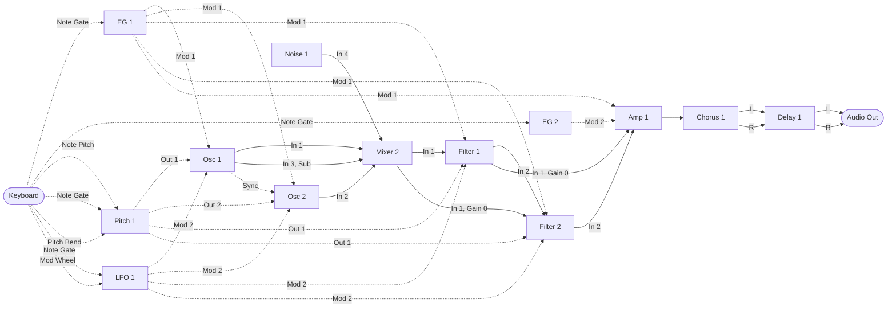

MIDI Synthesizer SPMS-1 (type-2) v0.3.4
=======================================

- Spinel (Ruby AOT コンパイラ) で作った、Raspberry Pi Pico 2 用のモノフォニック・セミモジュラー MIDI シンセサイザー
- 音源モジュールとして MIDI で制御します
- 後着優先で 1 ノート分を記憶: 前のノートを押さえたまま新しいノートを離すと、前のノートにレガートで戻ります (トリルなどに)
- 48 kHz オーディオ出力: I2S DAC による 24 bit、または PWM Audio (DAC 不要)
- オシレータ: ノコギリ波から矩形波へのモーフ、パルス幅付き (CC#114)。パルス幅のモジュレーション付き (PWM。ピッチと同じ 2 つのモジュレーション、デフォルトではエンベロープと LFO で、CC#8 と 103)。ノコギリ波、パルス波の個別出力付き。Osc 1 は 1 オクターブ下のサイン波のサブ出力も
- ハードシンク: Sync In (デフォルトで Osc 1 のノコギリ波) が 0 を上へ横切ったところで、Osc 2 がサンプルの間のその位置からやり直します。やり直しの段差も、周期の始まりと同じく PolyBLEP で丸めます (Sync Sw、CC#112)
- エンベロープ: ADS エンベロープ 2 つ。EG 2 はアンプの Mod 2 In 用で、起動時はオルガン型。CC#52、53、54。リリースのスイッチは 2 つとも CC#105
- LFO: 三角波 (PolyBLAMP) とユニポーラの矩形波 (PolyBLEP) の個別出力と、その間をクロスフェードするメイン出力 (Wave、CC#33)。リセット入力付き (デフォルトで Note Gate。Reset Sw、CC#113 をオンにするとノートごとにやり直す)
- フィルタ: 2 つの ZDF/TPT ステート・バリアブル・フィルタ (BP 積分器の非線形リーク付き、1 ステップ・ニュートン法で解く)。それぞれ LP、HP、BP の 3 出力と、LP と HP の間をノッチを経てクロスフェードするメイン出力 (Mode、CC#39)、ゲイン付きの 2 つのオーディオ入力を持つ。デフォルトでは同じ CC で直列につながり、4 次 (24 dB/oct) のローパスになる。1 つ目のレゾナンスは別 (CC#119)
- アンプ: 2 つのオーディオ入力と、それぞれ最大 +12 dB のゲイン (CC#15)。先読み型のリミッターで、ピークを 1.0 のクランプの手前に、切らずに丸めて収める (Limiter Sw、CC なし、起動時オン)
- コーラス: モノラル入力・ステレオ出力、実行順に入るモジュール
- ディレイ: ステレオ、フィードバック付き、実行順に入るモジュール (最大 340 ms)
- ピッチ: ノートのピッチを扱う、実行順に入るモジュール。指数カーブのラグによるポルタメント (CC#5)、その後に足すピッチベンド、鍵盤のストレッチ (ベンドレンジは CC#57、ストレッチは CC#22)
- ステレオ出力: コーラスがモノラルの音を左右に広げ、ディレイが左右を分けたまま運びます
- 開発: ISGK Instruments (Ryo Ishigaki)
- <https://github.com/risgk/midi_synthesizer_spms1>
- [English README](./README.md) (英語版が正です)
- [変更履歴 (Change History)](./spms1_change_history.md) (英語)


必要なハードウェア
------------------

- Raspberry Pi Pico 2 (RP2350)
    - [Raspberry Pi Pico 2](https://www.raspberrypi.com/products/raspberry-pi-pico-2/)
    - I2S DAC ハードウェア (48 kHz/24 bit): `SPMS1_USE_I2S_INSTEAD_OF_PWM_AUDIO` のコメントを外してください
        - Pimoroni [Pico Audio Pack](https://shop.pimoroni.com/products/pico-audio-pack) (PIM544)
        - [Adafruit PCM5102 I2S DAC](https://www.adafruit.com/product/6250) (Product ID: 6250)
        - GY-PCM5102 (PCM5102A I2S DAC モジュール)
    - または PWM Audio 出力 (DAC 不要、スケッチのデフォルト)
        - L は GP28、R は GP27 で、Pimoroni [Pico VGA Demo Base](https://shop.pimoroni.com/products/pimoroni-pico-vga-demo-base) (PIM553) と同じです
        - PWM のリップルを取り除くため、各出力に RC ローパスフィルタを付けることをお勧めします
            - 矩形波が流れるケーブルからの輻射ノイズ (EMI) も減らせます。ケーブルの先ではなく、ピンの近くに付けてください
        - RC フィルタを付けない場合は、抵抗か接続先の機器の入力ゲイン (ボリューム) でレベルを下げてください:
          PWM のリップル (3.3 V の矩形波) で入力 (オーディオインターフェースなど) が飽和し、「ピー」という音やノイズが出ることがあります。
          レベルメーターが適正に見えていても起こります
        - PWM のレベル (3200 段階) は、1 次のノイズシェーピングと TPDF ディザ付きで量子化されます
        - 1 サンプルを 4 つの PWM 周期に分けて出力します (PWM キャリア: 48 kHz ではなく 192 kHz)。キャリアをフィルタで取り除きやすく、
          アクティブスピーカーで「ピー」という音が出にくくなります (`SPMS1_PWM_AUDIO_SUBPERIODS`: 1、2、4、8)
    - 注意: RP2350 のシステムクロック (sysclk) は 153.6 MHz にオーバークロックされます。設定するのはスケッチ自身の I2S または
      PWM Audio 出力 ("spms1_pico2_i2s.h" または "spms1_pico2_pwm_audio.h") で、Arduino-Pico の I2S ライブラリではありません


改造に必要なソフトウェア
------------------------

- [Arduino IDE](https://www.arduino.cc/en/software)
    - スケッチは "spms1" フォルダです。"spms1/spms1.ino" を開いてください。エディタ、README、ツール類は
      その外側のこのフォルダにあります
- Arduino-Pico = Raspberry Pi Pico/RP2040/RP2350 (by Earle F. Philhower, III) コア
    - 追加のボードマネージャ URL: <https://github.com/earlephilhower/arduino-pico/releases/download/global/package_rp2040_index.json>
    - このスケッチはバージョン 6.3.0 で動作確認しています: <https://github.com/earlephilhower/arduino-pico/releases/tag/6.3.0>
    - 情報: <https://github.com/earlephilhower/arduino-pico>
    - ボード: "Raspberry Pi Pico 2"、"ツール" メニューの USB Stack: "Adafruit TinyUSB"
- Arduino MIDI Library (by Francois Best, lathoub)
    - このスケッチはバージョン 5.0.2 で動作確認しています: <https://github.com/FortySevenEffects/arduino_midi_library/releases/tag/5.0.2>
    - 情報: <https://github.com/FortySevenEffects/arduino_midi_library>
- Spinel
    - リリース: 2026.09.12 <https://github.com/matz/spinel/tree/2026.09.12>
    - Spinel の出力ファイル "spms1_main.c" に手を入れる必要はありません。本スケッチの
      "spinel_rt_mcu_head.h" ("spinel_rt.h" の先頭で読み込み) が
      `#define main __attribute__((section(".time_critical"), flatten)) Spms1_main` を持っており、改名と
      シンセ本体の RAM 配置を同時に行います。手で改名すると、このマクロが一致しなく
      なって属性が付かず、本体が flash から実行されます
    - 本体が演奏中に呼ぶ関数 ("spms1_midi_state.h" の MIDI 読み出しと "spms1.ino" の音声出力) も
      `SPMS1_RAM_FUNC` で RAM に置きます。flash にあると、core 0 の MIDI と USB のコードと共有の
      XIP キャッシュ経由で読まれ、MIDI が続くとキャッシュが追い出されてシンセのバッファ処理が遅れます
    - シグナルバスはスケッチ側の C 配列で、"spms1_bus.h" にあります。"spinel_rt_mcu_cold.h" が
      "spinel_rt.h" の最後でこれを読み込むので、バスの読み書きは検査付きの Spinel の配列を通らず、
      ロード 1 つ、ストア 1 つにインライン展開されます。サンプルごとの振り分けがモジュールのたびに読む
      モジュールの実行順も同じく C 配列で、シンセがバッファごとにパラメータのたびに読む CC の値と NRPN の
      テーブルの読み出しも "spms1_midi_read.h" からインライン展開されます
    - "spms1_main.c" は "spms1" で `spinel spms1_main.rb -c --rbs sig` を実行して生成します。"spms1/sig" の
      型シードがフィルタの状態、パラメータのスムージング、バスへの書き込みをボックス化させずに保ちます。
      必要な理由は "spms1/sig/spms1_filter.rbs"、"spms1/sig/spms1_dsp.rbs"、"spms1/sig/spms1_framework.rbs"
      にあります
- Ruby (CRuby): パッチの番号や初期パッチを変えるとき、モジュールを追加するとき。これらは
  "spms1_patch.yaml" にまとめてあり、`ruby patch_gen/spms1_patch_gen.rb` が "spms1/spms1_patch.rb"
  ("spms1/spms1_main.rb" が読み込みます)、"spms1/spms1_default_patch.h" の初期パッチ (Reset 用に
  "spms1/spms1_midi_state.h" が読み込みます)、"spms1_editor.html" のテーブル、"spms1_patching.ja.md" と
  "spms1_patching.md" の NRPN の表、"spms1/spms1_main.rb" のループの配線
  ([モジュールの追加](./spms1_development.ja.md#モジュールの追加) を参照) に
  書き出します。実行したあと、"spms1/spms1_main.c" を生成し直してください。`--check` は、ファイルが
  最新かどうかを調べるだけです


使い方
------

### ビルド済みバイナリ

- "bin" フォルダの "spms1_i2s.ino.uf2" は Raspberry Pi Pico 2 と、Pimoroni Pico Audio Pack、
  Adafruit PCM5102 I2S DAC、または GY-PCM5102 用です
- "bin" フォルダの "spms1_pwm_audio.ino.uf2" は Raspberry Pi Pico 2 と PWM Audio 出力用で、L は GP28、R は GP27 でビルドされています


### はじめかた

起動時の音から自分のパッチまで、一段ずつ進む道筋です。デフォルトパッチの[ブロック図](#ブロック図)を
手元に置いて進めます。図のモジュールは、エディタの Controls タブのパネル、Patch タブのノードと同じです。
"spms1_editor.html" を開き（[Web エディタ](#web-エディタ)を参照）、"MIDI Out" でシンセか SPMS-1 Web (Built-in) を選びます。

1. お気に入り: Controls タブは "Show favorites only" にチェックが入った状態で開き、デフォルトパッチで
   お気に入りになっている、音を大きく変える 19 個のパラメータを表示します:
   Pitch 1 Glide、EG 1 Attack・Decay・Sustain、LFO 1 Rate、Osc 1 Wave・Pitch Mod 1 Amt・
   Pitch Mod 2 Amt、Osc 2 Wave・Pitch、Mixer 2 Level 1・2、
   Filter 2 Cutoff・Resonance・Mod 1 Amt・Mod 2 Amt、Amp 1 Gain 2、Chorus 1 Mix、Delay 1 Mix。
   気に入ったものは星で追加できます。Osc 2 の PW と各 Mod Amt は Osc 1 と、Filter 1 の Resonance（CC 119）以外の
   各パラメータは Filter 2 と同じ CC なので、Osc 1 や Filter 2 のスライダーを動かすと相手も一緒に動きます
   （お気に入りだけの表示では、相手のスライダーは隠れています）
2. CC のあるパラメータ: "Show favorites only" のチェックを外すと、CC のあるパラメータがすべて表示されます。
   デフォルトパッチでの働きと起動時の値は、ブロック図の下に説明があります。MIDI コントローラのつまみでも
   動かせます
3. CC のないパラメータ: "Show parameters with no CC" にチェックを入れると、残りが青で表示されます
   （Mixer 1 の各レベルや Pitch 1 の Out 1・Out 2 Bend Sw など）。そのスライダーはスロットが保持する値を設定し、NRPN で
   送られます
4. パッチの変更: Patch タブでは、パッチがすべての入力とパラメータを含む図そのものとして表示されます。
   出力から入力やパラメータへワイヤーをドラッグすると、その供給元が変わります。パッチングの
   [例](./spms1_patching.ja.md#例)に、配線の仕方付きのアイデアがあります

Undo で変更を戻せます。Initialize Values は値を戻して配線は保ち、Init はデフォルトパッチに戻します。
パッチは Save JSON で、またはシンセ本体に Save to Device で保存できます。


### Web エディタ

- Web MIDI API を使う、プラットフォームを問わないパラメータ・コントローラ: "spms1_editor.html"
    - Web MIDI が使えないか許可されないときは、MIDI 設定の下にその旨を表示します。その場合も SPMS-1 Web (Built-in)
      は鳴らせます
    - Controls タブには各パラメータのスライダーが並び、CC のないものは青で表示され、"Show parameters
      with no CC"（デフォルトはチェックなし）にチェックを入れない限り、CC を割り当てるかお気に入りにするまで隠れます。
      チェックの状態は覚えておきます。CC のないパラメータのスライダーは、スロットが保持する値を NRPN で送って設定します
    - "Show favorites only"（デフォルトはチェックあり）にチェックが入っていると、CC の有無にかかわらず、お気に入り（★）に
      したパラメータだけを表示します。チェックの状態は覚えておきます
    - そこでは、パネルの見出しをドラッグすると、同じ列の中でも別の列へでもパネルを動かせます（列が 2 つか 4 つ
      並ぶ幅のとき）。1 列のとき（スマホなど）は、見出しの右の ▲▼ で、隣のパネルと入れ替えて 1 つずつ上下に
      動かせます。1 列の並びは列を順につなげたものなので、列の端を越えると隣の列に移ります。パネルの位置は
      ブラウザに覚えておき、どのパッチでも同じです。Reset Layout で最初の並び（1・2 列目の先頭に Osc 1 と
      Osc 2、続いて Filter 1〜Delay 1、最後にモジュレーションの Controller〜LFO 1）に戻ります
    - そこではパラメータ名の後ろにカッコで補足が付きます。Noise 1 Color の "(White to Red)" のような範囲か、
      レベルやモジュレーション量では、Mixer 2 Level 3 の "(Osc 1 Sub)" のように、それが掛かる入力に
      パッチでつながっているものです。後者は結線を変えるとそれに従います。Patch タブでは名前のツールチップに出ます
    - パラメータ名の左にある薄い星をクリックすると、お気に入りになり、星がそのモジュールの色に、行の背景がその色の淡い色になります。
      Patch タブでも、その行の背景が淡い色になります。お気に入りはパッチ（JSON）に保存され、他の変更と同じく
      Undo できます。シンセには送りません
    - Patch タブでは、値をつまみのように上下にドラッグして変えられます。Shift を押すと細かく動き、
      編集中の値はホイールでも 1 ずつ動かせます
    - Patch タブでは、離れたノードどうしも縮小せずにつなげます。結線をドラッグしてキャンバスの端に寄せると、
      その方向へ表示が動きます。出力をクリックすると、それをつかんだまま表示を動かしたり拡大縮小したりでき、
      入力をクリックするとつながります（Esc か背景のクリックで取り消し）。入力やパラメータの
      ポートか接続元の表示をクリックすると、つなげる出力がノードごとに一覧で出て、そこから選べます。
      文字を打つと絞り込めます
    - 設定・表示する値はどれも、シンセが使う範囲の 4〜124 です。MIDI In やパッチファイルから範囲外の値が届いたら、
      近い方の端に寄せます。シンセにとっては同じ値です
    - Initialize Values は、各 CC の値と、CC のないパラメータの値を起動時の値に戻して送ります。どの変更もすぐ送るのと同じです。結線はそのままです
- 音を出して試すためのソフトウェア鍵盤を内蔵しています
    - 鍵盤の横にピッチベンドホイール（-8192〜+8191、離すと中央に戻ります）と、パッチで Mod Wheel に割り当てた
      CC を動かすモジュレーションホイールがあります
    - 見出しをクリックすると隠れ、パッチエディタやコントロールがその高さまで広がります。どちらの状態かは
      覚えておき、隠れている間は PC キーボードのキーでは弾けません
    - Panic は All Sound Off を送り、ピッチベンドを中央に戻します。MIDI In に届いたチャンネルモードメッセージには、
      シンセと同じように (下記) エディタも従います。CC#120〜127 はパラメータに割り当てられません
- グラフィカルなパッチエディタを Patch タブに内蔵しています
    - モジュールの出力を入力やパラメータへ配線し、実行順と CC の割り当てを設定します
    - 各モジュールのパラメータをすべて表示し、CC のないものは青で示します。配線はいつも行き先のパラメータに
      つながります
    - パッチを JSON で保存・読み込みします
    - JSON で保存したりコピーしたりするパッチでは、Save to Device と同じく、Mod Wheel だけに割り当てた CC を起動時の値 (0.0) にします。
      Mod Wheel は設定するものではなく演奏で動かすものだからです。Send Patch は今の位置を送ります
    - パッチを MIDI バイト列または NRPN リストとしてコピーするか、Web MIDI で送信します
    - パッチ全体 (Send Patch、MIDI Out の選び直し) と、Init や Load による変更 (その Undo と Redo も) は、Mute のオンとオフ (NRPN の Mute) で挟んで送るので、
      送信途中のパッチの音は聞こえません。"Mute while loading" (デフォルトでオン) にすると、コピーするパッチも同じです。
      それ以外の変更は、そのまま送ります。デフォルトのパッチは約 2,000 バイトで、31250 bps (UART MIDI) で約 0.6 秒、
      USB MIDI で約 0.5 秒かかります
    - Mute ボタンでシンセをミュート (NRPN の Mute) して、音を出さずにパッチを変えられます。MIDI In に届いた Mute も
      ボタンに表示します。MIDI In に届いたリセット (NRPN の Reset) では、エディタのパッチもデフォルトに戻ります
    - Save to Device で、パッチをシンセのフラッシュに保存します (NRPN の Save)。シンセは電源投入時にこれを読み込みます
    - エディタはシンセのパッチ (電源投入時に読み込んだ保存パッチなど) を読み出しません。"MIDI Out" でデバイスを選んだときや
      Send Patch で、エディタのパッチがシンセのパッチに置き換わります
    - サイドパネル (Patch、Run Order、Export) は見出しのクリックで畳め、それぞれの状態を覚えておきます。
      3 つとも畳むと、空いた幅まで配線図が広がります
- SPMS-1 Web: エディタに組み込まれたシンセサイザー本体 ("spms1_web_synth.js")
    - "MIDI Out" で "SPMS-1 Web (Built-in)" を選び、ソフトウェア鍵盤 (または "MIDI In" の MIDI キーボード) で演奏します
    - "spms1_main.c" を WebAssembly として Web ブラウザで動かすので、実機と同じ音がします
    - [web/README.md](./web/README.md) を参照してください


### MIDI の設定

- MIDI チャンネル: チャンネル 1
- チャンネルモードメッセージ: All Sound Off (CC#120)、All Notes Off (CC#123)、Omni Off、Omni On、Mono On、
  Poly On (CC#124〜127) は、鍵盤を離したときと同じようにすべてのノートを終え、エンベロープはリリースに入ります。
  Reset All Controllers (CC#121) はピッチベンドを中央に、モジュレーションホイール (CC#1) を 0 に戻し、NRPN の
  選択を解除します。ほかの CC (パラメータの CC) はそのままです。CC#120〜127 はコントロールではなく、CC の値として
  保存しません
- USB MIDI 入力
    - 製造者ディスクリプタ: "ISGK Instruments"
    - デバイス名: "SPMS-1 (type-2)"
- UART MIDI 入力
    - 速度: 31250 bps
    - GP4 ピンと GP5 ピンを TX と RX に、`SerialPIO` で使います
    - `SPMS1_UART_MIDI_TX_PIN` と `SPMS1_UART_MIDI_RX_PIN` を書き換えれば、TX と RX の入れ替えを含め、
      どのピンでも使えます
    - DIN/TRS MIDI は、たとえば Adafruit MIDI FeatherWing Kit などを使う (そして手を入れる) ことで利用できます
        - Adafruit [MIDI FeatherWing Kit](https://www.adafruit.com/product/4740) (Product ID: 4740)
        - M5Stack [Midi Unit with DIN Connector (SAM2695)](https://shop.m5stack.com/products/midi-unit-with-din-connector-sam2695) (SKU: U187) のセパレートモード
        - Kinoshita Laboratory [MIDI-UART interface-san Kit](https://www.tindie.com/products/kinoshitalab/midi-uart-interface-san-kit/)
        - 木下研究所 [MIDI-UARTインターフェースさん キット](https://www.switch-science.com/products/8117) (日本国内発送のみ)
        - necobit電子 [MIDI Unit for GROVE](https://necobit.com/denshi/grove-midi-unit/) (日本国内発送のみ)
        - necobit電子 [MIDI Unit Mini for GROVE](https://necobit.com/denshi/midi-unit-mini-for-grove/) (日本国内発送のみ)


### レイテンシ

MIDI メッセージを受けてから音が出るまで、およそ 4 ms です。

- 64 サンプルの出力バッファが 2 つ: 2.7 ms
- MIDI はバッファごとに 1 回読むので、最大でもう 1 つ分待ちます: 1.3 ms

これはシンセ自身の分で、MIDI の伝送と DAC の分はこの上に乗ります。


### [MIDI インプリメンテーション・チャート](./spms1_midi_chart.md)


### ブロック図

デフォルトのパッチです。実線の矢印がオーディオ信号を、破線の矢印がコントロール信号を運びます。



Osc 2 のシンクと LFO 1 のリセットは、Osc 1 のノコギリ波と Note Gate から結線されていますが、スイッチが起動時オフなので、
オンにするまで効きません。モジュレーションホイールは LFO 1 の Level Mod In に入ります。
Filter 2 は Audio In 2 に Filter 1 を、Audio In 1 に Mixer 2 をゲイン 0.0 で受け取り、アンプは Audio In 1 に Filter 1 を
ゲイン 0.0 で、Audio In 2 に Filter 2 を受け取ります。そのため、これらのゲインを変えるまでは 2 つのフィルタは直列で、
変えれば結線し直さずに並列にできます。Filter 1 の Audio In 2 には何もつながっていません。

モジュールは[実行順](./spms1_patching.ja.md#実行順)で、1 サンプルずつ処理されます。波形やカットオフ、ゲインといったパラメータは CC
から届くもので、この図では省いています。パラメータ名では Amount を Amt、Switch を Sw、Polarity を Pol と略しています。

ノートのピッチは Pitch 1 を通ってオシレータに届き、ノートからノートへ滑らかに移ります。ポルタメントです。
Pitch 1 Glide は CC#5 (MIDI 規格の Portamento Time) にあり、起動時は 0.0 です。そこではポルタメントはオフで、
ピッチを届いたとおりそのまま通します。Pitch 1 は 1 つのグライドから 2 つの出力を出します。Out 1 は Osc 1 と
両フィルタのキーボードトラッキングへ、Out 2 は Osc 2 へ届きます。Out 1 Glide Sw と Out 2 Glide Sw は
Glide を動かさずに、それぞれの出力のポルタメントをオン・オフします。どちらも CC#34 にあり、MIDI のスイッチと
同じく値 64 以上でオン、起動時は値 124 でオンです。グライドは Pitch 1 Gate In（デフォルトは Note Gate）が
オンの間だけ進みます。ノートとノートの間は止まっているので、休符の後のノートはそこから続きます。Pitch Bend は Pitch 1 Bend In に入ります。Bend In は
グライドの後で出力に足されるので、ベンドはすぐに効き、オシレータにも両フィルタのキーボードトラッキングにも
同じように届きます。Out 1 Bend Sw と Out 2 Bend Sw は CC を持たず、起動時はオンです。カテゴリ 4 で
片方をオフにすると、その出力にはベンドが掛からないので、Osc 2 だけをベンドできます。
Pitch 1 Bend Amt（CC#57）がベンドレンジで、1 目盛り半音ずつです。値 8 で上下 2 半音、値 28 で 1 オクターブ、
値 124 で 5 オクターブで、起動時は値 28 です。

LFO はオシレータの Mod 2 In に直接入り、ピッチとパルス幅の両方に掛かります。フィルタにも入りますが、Mod 2 Amt
（CC#25）が起動時 0.0 なので、上げるまでカットオフは動きません。エンベロープは Mod 1 Amt（CC#24）で
カットオフを動かし、起動時は 0.2（値 28）で、ピークで Cutoff（CC#74）から 2 オクターブ上まで開きます。
カットオフは起動時 0.8（値 100）です。
LFO は Osc 1 Pitch Mod 2 Amt（CC#13）でピッチへ入ります。起動時は 0.0 で、最大の値 124 では Osc 1 Pitch Mod 2 Pol の
起動時の +0.2 と合わせて、フルレベルの LFO がピッチを上下 1 オクターブ振ります。パルス幅へは
Osc 1 PW Mod 2 Amt（CC#103）で入り、起動時は 0.0 です。LFO 1 Level は起動時 1.0 なので、ビブラートは
CC#13 だけで 0〜1 オクターブ掛かります。Pitch 1 からのピッチは両フィルタの Pitch In にも入ります。キーボードトラッキング用です。
CC#9（Pitch Amt）を最大にするとカットオフがノートに半音ずつ追従し、ノート 60 では動きません。
Pitch Amt は起動時 0.0（値 4）なので、CC#9 を上げるまでは、カットオフはノートによらず CC#74 の位置のままです。
エンベロープはオシレータの Osc 1 Mod 1 In にも入ります。ピッチエンベロープ用です。Pitch Mod 1 Amt
（CC#89）と PW Mod 1 Amt（CC#8）は起動時 0.0 で、オフです。モジュレーションの深さはどれも動かす先のレンジ全体に届くので、
ソースを音楽的な深さまで絞る仕事はモジュールに作り込まず、パッチの側に任せています。

Mixer 2 がフィルタの前でオーディオを足し合わせます。Osc 1 が In 1、Osc 2 が In 2、Osc 1 のサブが In 3、Noise 1 の Out が In 4 です。
それぞれ自分のレベルで足されます。Level 1（CC#19）と Level 2（CC#20）は起動時 0.7 なので、デフォルトのパッチは 2 つのオシレータで鳴り、合わせて 1 つを最大にしたときとほぼ同じ音量です。Level 3（CC#21）と Level 4（CC#23）は起動時 0.0 なので、上げるまでサブとノイズは鳴りません。Osc 2 は Osc 1 と同じく Pitch 1 からノートを受け取り、自分の Pitch（CC#85）と
Pitch Fine（CC#76）で Osc 1 に対する音程を決めます。起動時は 11 セント高く、ゆっくりうなります。Wave も自分のもので、CC#104 です（Osc 1 は CC#102）。それ以外は
Osc 1 に従います。Mod Amt と PW には Osc 1 と同じ CC が割り当ててあるので、1 つの CC で両方が動きます。

Filter 1 と Filter 2 は直列で、4 次（24 dB/oct）のローパスになります。Filter 2 は Filter 1 と同じ CC と起動時の値を持ち、
それらの CC で両方が動きます。ただし Resonance だけは別で、Filter 2 のもの（CC#71）は起動時 Q 4.0、
Filter 1 のもの（CC#119）は最小の Q 0.71 なので、レゾナンスのピークは Filter 2 のものになります。それぞれのフィルタは Audio In 1 と Audio In 2 を Gain 1 と Gain 2
（CC なし、起動時は等倍）で受け取ります。ただし Mixer 2 から入る Filter 2 の Gain 1 は起動時 0.0 で、これを上げ、
Filter 2 の Gain 2 を下げ、Amp 1 の Gain 1 を上げると、フィルタが並列になります。Amp 1 は Audio In 1 に Filter 1 を Gain 1（CC なし、起動時 0.0 で無音）で、Audio In 2 に Filter 2 を Gain 2（CC#15）で
受け取ります。

アンプまではモノラルです。コーラスがそれを受け取って左右 2 つを出し、ディレイが左右を受け取って分けた
まま運び、その 2 つの出力が最終出力の左右になります。

以上はどれも固定ではありません。実行順も、上の図のすべての矢印も、どの CC がどのパラメータに入るかも、
NRPN が書き換えます。[パッチ](./spms1_patching.ja.md)を参照してください。


ドキュメント
------------

- [パッチ](./spms1_patching.ja.md): 実行順、フィルタ・Chorus 1・Delay 1 の詳細、NRPN によるパッチの編集
  (表、知っておきたいレンジ、例、注意点)
- [開発](./spms1_development.ja.md): デバッグプリント、PC シミュレーター、モジュールの追加、処理負荷の見積もり、
  GitHub Actions、Spinel の更新、生成コードの確認
- [MIDI インプリメンテーション・チャート](./spms1_midi_chart.md)


SPMS-1 (type-2) のライセンス
----------------------------

```
MIDI Synthesizer SPMS-1 (type-2) by ISGK Instruments (Ryo Ishigaki) is marked with CC0 1.0.
To view a copy of this license, visit https://creativecommons.org/publicdomain/zero/1.0/
```

- 対象ファイル: `spms1_*.*`, `spms1/spms1.ino`, `spms1/spms1_*.*`


Spinel のライセンス
-------------------

```
Copyright (c) 2024- Yukihiro Matsumoto (matz@ruby.or.jp)

Permission is hereby granted, free of charge, to any person obtaining a
copy of this software and associated documentation files (the "Software"),
to deal in the Software without restriction, including without limitation
the rights to use, copy, modify, merge, publish, distribute, sublicense,
and/or sell copies of the Software, and to permit persons to whom the
Software is furnished to do so, subject to the following conditions:

The above copyright notice and this permission notice shall be included in
all copies or substantial portions of the Software.

THE SOFTWARE IS PROVIDED "AS IS", WITHOUT WARRANTY OF ANY KIND, EXPRESS OR
IMPLIED, INCLUDING BUT NOT LIMITED TO THE WARRANTIES OF MERCHANTABILITY,
FITNESS FOR A PARTICULAR PURPOSE AND NONINFRINGEMENT. IN NO EVENT SHALL THE
AUTHORS OR COPYRIGHT HOLDERS BE LIABLE FOR ANY CLAIM, DAMAGES OR OTHER
LIABILITY, WHETHER IN AN ACTION OF CONTRACT, TORT OR OTHERWISE, ARISING
FROM, OUT OF OR IN CONNECTION WITH THE SOFTWARE OR THE USE OR OTHER
DEALINGS IN THE SOFTWARE.
```

- ベースリリース: 2026.09.12 <https://github.com/matz/spinel/tree/2026.09.12>
- 対象ファイル: `spms1/spinel_rt*.h*`, `spms1/mruby_shim.h*`, `spms1/sp_*.*`, `spms1/re_*.*`, `spinel_mcu/*`
    - 注: ランタイムの一部のファイルは、MCU 向けに ISGK Instruments (Ryo Ishigaki) が変更しています

