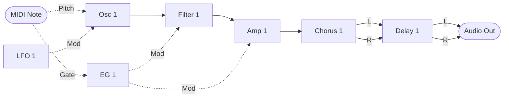
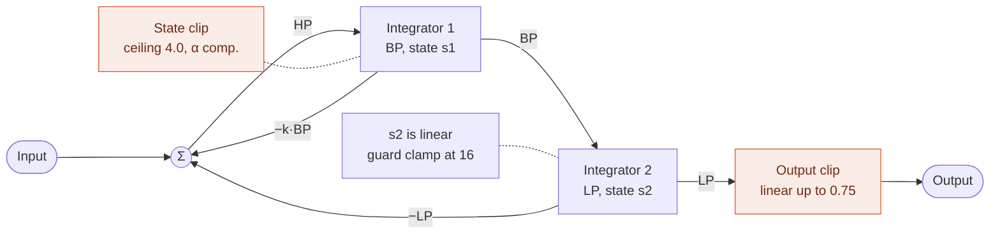
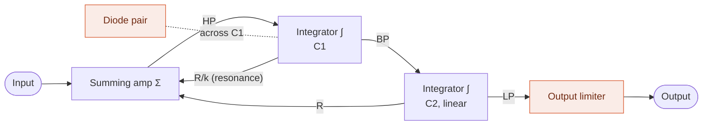
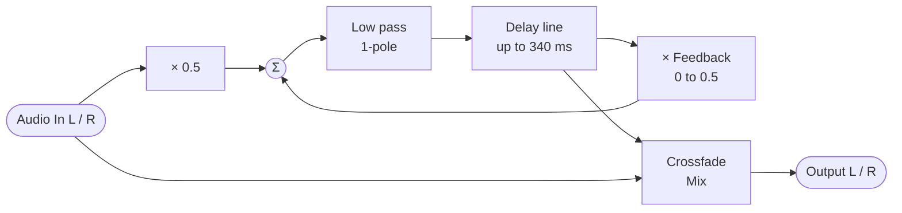

MIDI Synthesizer SPMS-1 (type-2) v0.0.1
=======================================

- Monophonic semi-modular MIDI Synthesizer for Raspberry Pi Pico 2, made with Spinel (Ruby AOT Compiler)
- Controlled by MIDI as a sound module
- 48 kHz audio output: 24 bit through an I2S DAC, or PWM Audio (no DAC needed)
- Filter: ZDF/TPT State Variable Filter (with delayed soft clipping)
- Chorus: mono in, stereo out, as a module in the run order
- Delay: stereo, with feedback, as a module in the run order (up to 340 ms)
- Stereo output: the chorus spreads the mono voice into a left and a right, and the delay keeps them apart
- Developed by ISGK Instruments (Ryo Ishigaki)
- <https://github.com/risgk/midi_synthesizer_spms1>
- [日本語版 README](./README.ja.md)


Required Hardware
-----------------

- Raspberry Pi Pico 2 (RP2350)
    - [Raspberry Pi Pico 2](https://www.raspberrypi.com/products/raspberry-pi-pico-2/)
    - I2S DAC hardware (48 kHz/24 bit): uncomment `SPMS1_USE_I2S_INSTEAD_OF_PWM_AUDIO`
        - Pimoroni [Pico Audio Pack](https://shop.pimoroni.com/products/pico-audio-pack) (PIM544)
        - [Adafruit PCM5102 I2S DAC](https://www.adafruit.com/product/6250) (Product ID: 6250)
        - GY-PCM5102 (PCM5102A I2S DAC Module)
    - Or PWM Audio output, without a DAC (the default of the sketch)
        - L on GP20 and R on GP21: the D20 port of Seeed Studio [Grove Shield for Pi Pico](https://www.seeedstudio.com/Grove-Shield-for-Pi-Pico-v1-0-p-4846.html),
          with the yellow wire L and the white wire R
            - For the Pimoroni [Pico VGA Demo Base](https://shop.pimoroni.com/products/pimoroni-pico-vga-demo-base) (PIM553),
              set `SPMS1_PWM_AUDIO_L_PIN` to 28 and `SPMS1_PWM_AUDIO_R_PIN` to 27
        - Parts for the audio connection, as in the photo of the [top-level README](../README.md) (no RC filter):
            - A Grove to jumper wire cable, from the D20 port (the red wire, VCC, is not connected)
            - A 3.5 mm stereo jack with screw terminals (L, R, and GND)
            - A 3.5 mm stereo cable with an inline volume control (a passive stereo volume dial),
              between the jack and the amplifier or the active speaker
        - Without an RC filter, the PWM ripple (3.3 V square waves) reaches the connected device along with the audio,
          and may saturate its input (e.g. of an audio interface) and cause beeps or noises, even when its level meter looks fine
            - The volume dial lowers the ripple together with the audio. Start with it turned down:
              at the top, the full 3.3 V square waves reach the device
            - Resistors, or the input gain (volume) of the connected device, can lower the level instead
        - Optional: an RC low pass filter on each output takes out the PWM ripple itself
            - It also reduces the radio noise (EMI) radiated from the cables carrying the square waves:
              put it close to the pins (e.g. at the screw terminals of the jack, not after the cable)
        - The PWM level (3200 steps) is quantized with 1st-order noise shaping and TPDF dither
        - Each sample is split into 4 PWM periods (PWM carrier: 192 kHz instead of 48 kHz), so the carrier is easier to filter out
          and less likely to cause beeps or whines in active speakers (`SPMS1_PWM_AUDIO_SUBPERIODS`: 1, 2, 4, or 8)
    - NOTE: The RP2350 system clock (sysclk) changes to overclocked 153.6 MHz, set by the sketch's own I2S or PWM Audio output
      ("spms1_pico2_i2s.h" or "spms1_pico2_pwm_audio.h", the same as PRA32-U2's), not by the Arduino-Pico I2S library


Required Software for Modification
----------------------------------

- [Arduino IDE](https://www.arduino.cc/en/software)
- Arduino-Pico = Raspberry Pi Pico/RP2040/RP2350 (by Earle F. Philhower, III) core
    - Additional Board Manager URL: <https://github.com/earlephilhower/arduino-pico/releases/download/global/package_rp2040_index.json>
    - This sketch is tested with version 6.2.0: <https://github.com/earlephilhower/arduino-pico/releases/tag/6.2.0>
    - Info: <https://github.com/earlephilhower/arduino-pico>
    - Board: "Raspberry Pi Pico 2", with USB Stack: "Adafruit TinyUSB" in the "Tools" menu
- Arduino MIDI Library (by Francois Best, lathoub)
    - This sketch is tested with version 5.0.2: <https://github.com/FortySevenEffects/arduino_midi_library/releases/tag/5.0.2>
    - Info: <https://github.com/FortySevenEffects/arduino_midi_library>
- Spinel
    - Release: 2026.09.12 <https://github.com/matz/spinel/tree/2026.09.12>
    - The Spinel output file "spms1_main.c" needs no editing. "spinel_rt.h" in this sketch
      carries `#define main __attribute__((section(".time_critical"), flatten)) Spms1_main`,
      which renames it and puts the synth core in RAM at the same time. Renaming it by hand
      instead leaves the macro with nothing to match, and the core runs from flash
    - "spms1_main.c" is generated with `spinel spms1_main.rb -c --rbs sig`. The type seeds in "sig"
      keep the filter states unboxed; "sig/spms1_filter.rbs" says why they are needed


Usage
-----

### Prebuilt Binary

- "spms1_type2_i2s.ino.uf2" (in the "bin" folder) is for Raspberry Pi Pico 2 and Pimoroni Pico Audio Pack,
  Adafruit PCM5102 I2S DAC, or GY-PCM5102
- "spms1_type2_pwm_audio.ino.uf2" (in the "bin" folder) is for Raspberry Pi Pico 2 with PWM Audio output (L on GP20 and R on GP21)


### Web Editor

- Cross-platform web-based parameter controller via Web MIDI API: "spms1_editor.html"
- Built-in software keyboard for note input and testing
- Graphical patch editor on its Patch tab
    - Wires module outputs to inputs and parameters, and sets the run order and CC assignments
    - Saves and loads patches as JSON
    - Copies the patch as MIDI bytes or as an NRPN list, or sends it through Web MIDI
- SPMS-1 Web: the synth itself, built into the editor ("spms1_web_synth.js")
    - Select "SPMS-1 Web (Built-in)" in "MIDI Out", and play the soft keyboard (or a MIDI keyboard in "MIDI In")
    - "spms1_main.c" runs in the Web browser as WebAssembly, so it sounds the same as the device
    - See [web/README.md](./web/README.md)


### MIDI Settings

- MIDI Channel: Channel 1
- USB MIDI Input
    - Manufacturer Descriptor: "ISGK Instruments"
    - Device Name: "SPMS-1 (type-2)"
- UART MIDI Input
    - Speed: 31250 bps
    - GP4 and GP5 pins are used by TX and RX, through `SoftwareSerial`
    - Any pins can be used, TX and RX swapped included, by changing `SPMS1_UART_MIDI_TX_PIN` and
      `SPMS1_UART_MIDI_RX_PIN`
    - DIN/TRS MIDI is available by using (and modifying) Adafruit MIDI FeatherWing Kit, for example
        - Adafruit [MIDI FeatherWing Kit](https://www.adafruit.com/product/4740) (Product ID: 4740)
        - M5Stack [Midi Unit with DIN Connector (SAM2695)](https://shop.m5stack.com/products/midi-unit-with-din-connector-sam2695) (SKU: U187) in Separate mode
        - Kinoshita Laboratory [MIDI-UART interface-san Kit](https://www.tindie.com/products/kinoshitalab/midi-uart-interface-san-kit/)
        - 木下研究所 [MIDI-UARTインターフェースさん キット](https://www.switch-science.com/products/8117) (Shipping to Japan only)
        - necobit電子 [MIDI Unit for GROVE](https://necobit.com/denshi/grove-midi-unit/) (Shipping to Japan only)
        - necobit電子 [MIDI Unit Mini for GROVE](https://necobit.com/denshi/midi-unit-mini-for-grove/) (Shipping to Japan only)


### Latency

About 4 ms from a MIDI message to the sound that answers it:

- Two output buffers of 64 samples each: 2.7 ms
- MIDI is read once per buffer, so a message waits up to one more: 1.3 ms

That is the synth's own; what the MIDI link and the DAC add sits on top of it.


### [MIDI Implementation Chart](./spms1_midi_chart.md)


### Block Diagram

The default patch. Solid arrows carry audio, dashed arrows carry control.



Each module is processed once per sample, in the run order below. Their parameters -- waveform,
cutoff, gain and the rest -- arrive from CC and are left out of the diagram.

The LFO goes straight to the oscillator, and LFO 1 Polarity reads the constant 0.1, which brings
it down to a vibrato depth. Osc 1 Mod Amt spans the whole pitch range, as every modulation
depth here does, so bringing a source down to a musical depth is left to the source rather than
built into the oscillator.

The voice is mono up to the amp. The chorus takes it and puts out a left and a right, the delay
takes the two sides and keeps them apart, and its two outputs are the two sides of the final
output.

None of this is fixed. NRPN rewrites the run order, every arrow above, and which CC feeds each
parameter.

#### The run order

Every module is in it, one of each kind that makes a sound, a mixer between the modulation
sources and the oscillator, and the chorus and the delay last:


The mixer has nothing routed to it, so it costs its slot every sample and changes nothing until
a patch gives it something. Where it sits is what it buys: a module sees the current sample's
value only from something ahead of it in this line, and last sample's from anything behind.
Mixer 1 can reach the LFO and the envelope, and the oscillator, the filter and the amp can reach
Mixer 1.

A mixer is what lets two of anything meet, and what makes a signal that runs one way, such as the
envelope, swing both ways. See the examples below.

#### Filter 1

A zero-delay feedback state variable filter: at the sum, the loop equation is solved in closed
form, so the high pass is found in one step. The soft clip acts only where the band pass state is
read back, and it is what holds the resonance down; the low pass state stays linear, with a
clamp at 16 as a guard that ordinary use never reaches. The output clip comes last. At the top of
the resonance dial k turns negative and the loop oscillates.



The same structure redrawn as an op-amp integrator filter. The diode pair stands for the state
clip and the output limiter for the output clip. It is an interpretation, not a reproduction of
an actual circuit.



#### Chorus 1

A mono-in, stereo-out chorus, after PRA32-U2's Chorus FX, put in the chain as an insert, as the
delay is: Mix sets the balance of dry and chorused, rather than a send level. The input goes through a gentle low pass
filter into one short delay line, which is read at two taps. A triangle LFO swings the two taps in
opposite directions about 5.33 ms, so the left and right delayed signals bend in pitch against
each other. Each output is a crossfade of the input with its own tap, so a mono source comes out
spread across the stereo field.


It needs no limiter and no clip after it: the input is held to one unit on the way in, and the
filter, the reading between two samples and the crossfades are all weighted averages, which cannot
reach past what they average. The delay the taps swing about is fixed, as PRA32-U2 keeps its own
internal.

#### Delay 1

A stereo delay with feedback, after PRA32-U2's Delay FX in its Stereo Delay mode. Each side has a
delay line and a loop of its own: half its input and its delayed signal at the Feedback gain go
through a gentle low pass filter into its line, and its output is a crossfade of its input with
its delayed signal. Time, Feedback and Mix are shared, so the two sides repeat together and keep
the stereo image they came in with.



The diagram is one side; the other is the same. It needs no limiter and no clip after it. With
half the input coming in and at most half the delayed signal going round again, what is written
back stays within one unit as long as the delayed signal does, and it starts from silence; the
filter, the reading between two samples and the crossfade are all weighted averages, which cannot
reach past what they average. The price is that the first repeat comes 6 dB under the dry signal.
Each input is held to one unit on the way in, as the amp holds its modulation input, so whatever
is routed to it the bound holds.

### Patch Editing (NRPN)

The patch is data, and NRPN rewrites it while the synth is running: which modules run and in what
order, what feeds each module input, where each parameter takes its value from, and which CC fills
each control slot. Every module reads from a numbered signal slot and writes to one, so rewiring is
a matter of changing slot numbers.

#### Sending

- CC 99 selects the category, CC 98 the entry within it, in either order
- CC 6 (Data Entry MSB) commits the value, and takes effect on the next audio buffer
- CC 38 (Data Entry LSB) is ignored: every value here is 7-bit
- CC 101 and CC 100 (RPN select) suspend data entry, so an RPN is never taken as a patch edit.
  Send CC 99 or CC 98 again to resume
- Edits are not saved. The default patch is restored at power-on

#### Categories (CC 99)

| CC 99 | CC 98 | Sets | CC 6 value |
| ----- | ----- | ---- | ---------- |
| 0 | 0-31 | Run order, slot by slot | Module ID |
| 1 | 0-13 | What feeds a module input | Signal ID |
| 2 | 0-28 | Where a parameter takes its value | Signal ID |
| 3 | 0-33 | Which CC fills a control slot | CC number, or 0 for none |

The run order is read from slot 0 upwards and stops at the first Module ID 0, so a patch shorter
than 32 modules ends itself. It is separate from the module numbering: a module only sees the
current sample's value from something listed before it, and last sample's from something after.

In category 3, CC number 0 means the parameter has no CC. Its control slot then holds 0.0, whatever
CC it had before, so the patch alone sets what the parameter reads.

There is one of every module that makes a sound, one mixer, one chorus and one delay, and **all
eight are in the default run order**, so a patch only ever has to route, never to switch something
on first. Taking the chorus or the delay out of the order saves its share of the time, which
leaves what read it to be pointed elsewhere; see the examples below.
A mixer is the only kind with no CC on any of its parameters: the default patch points them at
constants instead, each level at 1.0 and each polarity at +0.5, so a mixer with one input routed
passes it through rather than muting it.

#### Entries (CC 98), category 1

| CC 98 | Module input | | CC 98 | Module input |
| ----- | ------ | - | ----- | ------ |
| 0 | EG 1 Gate | | 7 | Mixer 1 In 1 |
| 1 | Osc 1 Pitch | | 8 | Mixer 1 In 2 |
| 2 | Osc 1 Mod In | | 9 | Chorus 1 Audio In |
| 3 | Filter 1 Audio In | | 10 | Delay 1 Audio In L |
| 4 | Filter 1 Mod In | | 11 | Delay 1 Audio In R |
| 5 | Amp 1 Audio In | | 12 | Final Output L |
| 6 | Amp 1 Mod In | | 13 | Final Output R |

Most of these take what their name suggests, but three do not say it on their face. A Gate is a
threshold rather than a level: an envelope triggers as the signal reaches 0.25 and releases as it
falls back. A Pitch is -0.5 to +0.5 across MIDI notes 0 to 120, so 0.0 is note 60 and a tenth of
a unit is an octave. And a Mod In is taken as it arrives: nothing is held to a range on the way
in, and what gets clamped is the value the module ends up with -- cutoff to the ends of its dial,
pitch to -0.5 and +0.5. A mixer adds without a ceiling, so a loud modulation pins its
destination at one end rather than being trimmed on the way in. The amp is the exception, and
holds its modulation input to -1.0 and +1.0: it is an attenuator, so a modulation may scale its
gain down but never up. The chorus and the delay hold their audio inputs to the same one unit.

The two sides of the final output are read separately, so either can be pointed anywhere; point
both at the same signal for a mono output.

#### Entries (CC 98), categories 2 and 3

| CC 98 | Parameter | | CC 98 | Parameter | | CC 98 | Parameter |
| ----- | ------ | - | ----- | ------ | - | ----- | ------ |
| 0 | LFO 1 Rate | | 10 | Osc 1 Fine Tune | | 20 | Mixer 1 Polarity 1 |
| 1 | LFO 1 Level | | 11 | Osc 1 Mod Amt | | 21 | Mixer 1 Level 2 |
| 2 | LFO 1 Polarity | | 12 | Osc 1 Mod Polarity | | 22 | Mixer 1 Polarity 2 |
| 3 | EG 1 Attack | | 13 | Filter 1 Cutoff | | 23 | Chorus 1 Rate |
| 4 | EG 1 Decay | | 14 | Filter 1 Resonance | | 24 | Chorus 1 Depth |
| 5 | EG 1 Sustain | | 15 | Filter 1 Gain | | 25 | Chorus 1 Mix |
| 6 | EG 1 Level | | 16 | Filter 1 Mod Amt | | 26 | Delay 1 Time |
| 7 | EG 1 Polarity | | 17 | Filter 1 Mod Polarity | | 27 | Delay 1 Feedback |
| 8 | Osc 1 Wave | | 18 | Amp 1 Gain | | 28 | Delay 1 Mix |
| 9 | Osc 1 Coarse Tune | | 19 | Mixer 1 Level 1 | |  |  |

#### Entries (CC 98), category 3 only

These CCs belong to no parameter, so category 2 has no entry for them. Each of General 1-4 fills
two slots, a unipolar and a bipolar one. See the General slots below.

| CC 98 | CC for | Fills |
| ----- | ------ | ----- |
| 29 | General Mod Wheel | General Mod Wheel |
| 30 | General 1 | General Unipolar 1, General Bipolar 1 |
| 31 | General 2 | General Unipolar 2, General Bipolar 2 |
| 32 | General 3 | General Unipolar 3, General Bipolar 3 |
| 33 | General 4 | General Unipolar 4, General Bipolar 4 |

#### Module IDs

| ID | Module |
| ----- | ------ |
| 0 | None (ends the run order) |
| 1 | LFO 1 |
| 2 | EG 1 |
| 3 | Osc 1 |
| 4 | Filter 1 |
| 5 | Amp 1 |
| 6 | Mixer 1 |
| 7 | Chorus 1 |
| 8 | Delay 1 |

#### Signal IDs

| ID | Signal | | ID | Signal | | ID | Signal |
| ----- | ------ | - | ----- | ------ | - | ----- | ------ |
| 0 | None (constant 0.0) | | 20 | LFO 1 Level | | 40 | Mixer 1 Level 2 |
| 1 | Constant 1.0 | | 21 | LFO 1 Polarity ± | | 41 | Mixer 1 Polarity 2 ± |
| 2 | Constant 0.5 | | 22 | EG 1 Attack | | 42 | Chorus 1 Rate |
| 3 | Constant 0.2 | | 23 | EG 1 Decay | | 43 | Chorus 1 Depth |
| 4 | Constant 0.1 | | 24 | EG 1 Sustain | | 44 | Chorus 1 Mix |
| 5 | Constant -0.1 | | 25 | EG 1 Level | | 45 | Delay 1 Time |
| 6 | Constant -0.2 | | 26 | EG 1 Polarity ± | | 46 | Delay 1 Feedback |
| 7 | Constant -0.5 | | 27 | Osc 1 Wave | | 47 | Delay 1 Mix |
| 8 | Constant -1.0 | | 28 | Osc 1 Coarse Tune ± | | 48 | Note Pitch ± |
| 9 | LFO 1 Output ± | | 29 | Osc 1 Fine Tune ± | | 49 | Note Gate |
| 10 | EG 1 Output ± | | 30 | Osc 1 Mod Amt | | 50 | Pitch Bend ± |
| 11 | Osc 1 Output ± | | 31 | Osc 1 Mod Polarity ± | | 51 | General Mod Wheel |
| 12 | Filter 1 Output ± | | 32 | Filter 1 Cutoff | | 52 | General Unipolar 1 |
| 13 | Amp 1 Output ± | | 33 | Filter 1 Resonance | | 53 | General Unipolar 2 |
| 14 | Mixer 1 Output ± | | 34 | Filter 1 Gain | | 54 | General Unipolar 3 |
| 15 | Chorus 1 Output L ± | | 35 | Filter 1 Mod Amt | | 55 | General Unipolar 4 |
| 16 | Chorus 1 Output R ± | | 36 | Filter 1 Mod Polarity ± | | 56 | General Bipolar 1 ± |
| 17 | Delay 1 Output L ± | | 37 | Amp 1 Gain | | 57 | General Bipolar 2 ± |
| 18 | Delay 1 Output R ± | | 38 | Mixer 1 Level 1 | | 58 | General Bipolar 3 ± |
| 19 | LFO 1 Rate | | 39 | Mixer 1 Polarity 1 ± | | 59 | General Bipolar 4 ± |

A **±** marks a signal that swings both ways: a module output reaches -0.5 and +0.5 at full
scale, a bipolar control slot runs -0.5 to +0.5, and a mixer sums two of them and stops at one.
The envelope is the exception: 0.0 to 1.0 at the default Polarity of +0.5, and down to -1.0 once
its Polarity is turned negative. Everything unmarked runs 0.0 to 1.0 -- Note Gate and every
unipolar control slot. The bus carries both kinds under one numbering, so the range belongs to the slot
rather than to the sort of thing that wrote it.

Slots 19-47 hold the values arriving from CC, so a parameter reads its own CC by default. Each
parameter is unipolar or bipolar, and its slot takes the same range. A unipolar one runs 0.0 to
1.0 from CC 4 to CC 124, the span of an envelope, so an envelope pointed at one sweeps the whole
of its dial. A bipolar one runs -0.5 to +0.5 with CC 64 at 0.0, the span of an LFO, so a bipolar
source pointed at one swings it about the middle. The two tune controls are bipolar, since their
middle is no change at all, and so is every Polarity -- the LFO's, the EG's, the mixer's and the two
Mod Polarity controls -- since its sign is what it sets. Pointing a parameter at another slot is what
makes a modulation. A slot with no CC holds 0.0.

Slots 51-59, the General slots, are control slots that no parameter owns: a CC put on the bus for
any module input or parameter to read. General Mod Wheel reads CC 1, runs 0.0 to 1.0 and powers
up at CC 4, so it is at 0.0 until the wheel moves; nothing is routed to it by default. General 1-4
read CC 16-19 by default, and each puts its CC on the bus both ways at once: General Unipolar 1-4
run 0.0 to 1.0 and General Bipolar 1-4 run -0.5 to +0.5. All four power up at CC 64, so the
unipolar slots start at 0.5 and the bipolar ones at 0.0.

Note Pitch, Note Gate and Pitch Bend are what the keyboard puts on the bus. Note Pitch carries
MIDI notes 0 to 120 as -0.5 to +0.5, the same span the oscillator reads as its whole pitch
range, and Pitch Bend is bipolar too, one unit across the whole wheel: exactly -0.5 and +0.5 at
the ends of its travel and exactly zero at the centre detent, so it can feed a module input
without a mixer to shift it. Note Gate is 0.0 or 1.0, and an envelope triggers at 0.25. Nothing
is routed to Pitch Bend by default.

Slots 0-8 are constants that nothing writes, for inputs that want a fixed value rather than a
source. Signal 0 is also what an entry nobody has set reads as, so an unrouted input is silent
rather than wired to whatever sits in the first slot. Signal 1 is the value an unmodulated input
wants: routing an amp's modulation input to it leaves the amp at full level. Signals 0 and 1 are
the two ends of a unipolar parameter's range and Signals 7 and 2 of a bipolar one, for pinning
one there; Signal 2 is also the middle of a unipolar dial. Signal 3 is a fifth of full scale and
Signal 6 its negative. Signal 4 is the LFO 1 Polarity the default patch uses, which brings the
LFO down to a vibrato depth, and Signal 5 its negative. A constant on a mixer's second input
shifts a signal between the two kinds: -0.5 turns one that runs one way into one that swings
both, and +0.5 the other way round.

The ID numbers are not stable across firmware versions. A patch is never saved, so a new module
type, another instance of one, or another signal may renumber everything after it. Read these
tables again after an update.

#### Ranges worth knowing

Both tune controls are centred on CC 64 and move one whole unit per CC step: Coarse Tune a
semitone, reaching 5 octaves either way, and Fine Tune a cent, reaching 60 either way. They are
summed, so any pitch is reachable.

LFO 1 Level and LFO 1 Polarity scale the LFO's output together, as a mixer's Level and Polarity
scale its input: Level from silent at 0.0 (CC 4) to full at 1.0 (CC 124), and Polarity from
negated at -0.5 (CC 4), through silence at 0.0 (CC 64), to unchanged at +0.5 (CC 124). Neither has a
CC: the default patch points Level at the constant 1.0 and Polarity at the constant 0.1, a fifth
of the way to its top.

EG 1 Level and EG 1 Polarity scale the envelope's output the same way, over the same ranges.
Neither has a CC, and the default patch points them at the constants 1.0 and +0.5, which pass
the envelope through as it is.

Each modulation depth is Mod Amt times Mod Polarity, the second doubled: Mod Polarity passes
Mod Amt through at +0.5 (CC 124), silences it at 0.0 (CC 64) and negates it at -0.5 (CC 4), and
the way between scales it, so it sets depth as well as direction. Mod Polarity has no CC and the
default patch points it at the constant 0.5, so either can be the one that is turned: Mod Amt for
a depth in one direction, Mod Polarity for one that crosses zero.

Osc 1 Mod Amt is a depth, not an offset, and it reaches the whole pitch range: at its top a
bipolar source swings the pitch five octaves up and five down. That is a coarse dial for vibrato,
half a semitone per CC step, which is why the default patch brings the LFO down to a fifth with
LFO 1 Polarity. There a semitone of vibrato sits at CC 14 and an octave at the top of the dial.

Filter 1 Gain sets how hard the audio input drives the filter, which is also what decides how far
the filter runs into its own saturation. Its default of CC 64 is the level the oscillator used to
be scaled to on its own. The saturation sits on the resonance rather than the pass band: a low
cutoff passes a loud note nearly clean, while turning the gain up rounds off the resonant peak.

Filter 1 Resonance raises the resonant peak 6 dB every 30 CC steps, Q doubling each time, up to
Q 5.66 at CC 94, and from there Q rises faster and faster, without a sudden step, through Q 29
at CC 109 to Q 256 at CC 118. Above that the filter oscillates on its own: a sine at the cutoff
frequency, growing to its full level of about 0.5 by CC 123 and holding it to the top of the
dial. Low in that range the oscillation builds slowly and shares the filter with the input; at
the top it takes the input over. Its level holds across the cutoff range down to about 150 Hz
and falls below that. Near the top of the cutoff range it fades out, before its 3rd harmonic
folds back as an inharmonic tone: at 48 kHz, from 8 kHz (CC 108) to 10 kHz (CC 112), modulation
included. Above that the resonance acts as at Q 256. With the cutoff following the keyboard, as
in the examples below, it plays as a sine voice.

A mixer takes each input at its own level and its own polarity, then adds them. Level runs from
silent at 0.0 (CC 4) to full at 1.0 (CC 124), and Polarity from negated at -0.5 (CC 4), through
silence at 0.0 (CC 64), to unchanged at +0.5 (CC 124). Levels default to full and polarities to
unchanged, so a mixer with one input routed is a buffer; inverting that one input makes it an
inverter; and inverting only the second makes the mixer a subtractor.

The sum is held to -1.0 and +1.0. Two full-scale signals reach exactly that, so nothing ordinary
is cut; what it stops is a mixer wired back to its own input, which would otherwise double every
sample until the number stopped being a number and took the oscillator or the filter with it.
The filter is held to the same one unit, by a curve rather than a corner: its output passes
untouched up to three quarters of a unit, well above anything the default patch reaches, and
above that bends smoothly onto the limit. Its resonant peak can climb past one unit on a sweep,
and rounding that off makes far weaker high harmonics than a hard edge would fold back down into
the note.

The three Chorus 1 parameters are unipolar and move in steps of 1/120. Rate is read as a note
number, a semitone a step, as LFO 1 Rate is: 0.015 Hz at CC 4, 0.48 Hz at CC 64 and 15.4 Hz at
CC 124, the default divided and multiplied by 32. Depth is how far each tap swings either side of 5.33 ms, in a straight line from not at
all at CC 4, through 2.63 ms at CC 64, to 5.25 ms at CC 124. Mix is each tap's share of its side's
crossfade: the dry input alone at CC 4, half and half at CC 64 -- the chorus PRA32-U2 makes at full
Chorus Level -- and only the taps at CC 124, a vibrato on each side, the two moving opposite ways.
All three power up at CC 64. The halves of the crossfade are what hold the chorus to one unit, so
at the default the dry signal is 6 dB down, and the sum with the tap makes up some of it.

The three Delay 1 parameters are unipolar and move in steps of 1/120, as every unipolar dial
does. Time runs in a straight line, 2.83 ms a step, from 0 at CC 4 to 340 ms at CC 124, and is
clipped to 2.83 ms at the bottom, so it holds 2.83 ms up to CC 5; it is 170 ms at CC 64. Turning
it bends the pitch of the repeats, by at most 25%, as a tape delay's would, and they reach the new
time a moment later. Feedback is the gain from the repeats back into the line, from 0 at CC 4, a
single repeat, to 0.5 at CC 124, where each repeat comes back 6 dB down and a little darker; it is
0.25 at CC 64. Mix is the repeats' share of the crossfade, from the dry input alone at CC 4 to the
repeats alone at CC 124, half and half at CC 64. Time and Feedback power up at CC 64 and Mix at
CC 34, 0.25: the dry signal is 2.5 dB down and the first repeat about 16 dB under it.

#### Examples

- Vibrato is wired by default -- the LFO goes straight to the oscillator's modulation input --
  so CC 13 sets the depth and CC 3 the rate. CC 99 = 2, CC 98 = 1, CC 6 = 51 takes LFO 1 Level
  from General Mod Wheel, so the wheel brings the vibrato in up to the depth CC 13 sets
- Filter cutoff follows note pitch (keyboard tracking): CC 99 = 1, CC 98 = 4, CC 6 = 48 puts
  Note Pitch on the filter's modulation input in the envelope's place. With the cutoff at CC 64
  and Mod Amt at CC 124, note 60 leaves the cutoff at the middle of its dial and each note moves
  it a semitone
- Filter cutoff swept by the LFO about the middle of its dial: CC 99 = 1, CC 98 = 4, CC 6 = 9.
  A module input is read every sample, so the LFO can run at any rate
- Filter cutoff driven by the envelope instead of its CC: CC 99 = 2, CC 98 = 13, CC 6 = 10. The
  envelope and the cutoff are both unipolar, so it opens the cutoff from the bottom of its dial
  to the top
- Amp gain and filter cutoff share one CC: CC 99 = 3, CC 98 = 18, CC 6 = 74
- Amp at full level with no envelope: CC 99 = 1, CC 98 = 6, CC 6 = 1
- Disconnect the filter's modulation input: CC 99 = 1, CC 98 = 4, CC 6 = 0
- A pitch envelope 60 cents deep: CC 99 = 2, CC 98 = 10, CC 6 = 10 points Osc 1 Fine Tune at the
  envelope, which then sweeps the tuning from in tune up to 60 cents sharp, reached at half the
  envelope's peak
- The envelope drives the filter harder as a note starts: CC 99 = 2, CC 98 = 15, CC 6 = 10 takes
  the filter's input level from silence up to the top of its dial and back
- Pitch swept by the envelope instead of the LFO: CC 99 = 1, CC 98 = 2, CC 6 = 10 puts the
  envelope on the oscillator's modulation input in the LFO's place, then set the depth on CC 13.
  Nothing scales the envelope down on this path, so a semitone is at CC 5 and an octave at CC 16
- Pitch bend, which nothing is routed to by default. CC 99 = 1 with CC 98 = 7 and 8, CC 6 = 48
  and 50 puts Note Pitch and Pitch Bend on Mixer 1's two inputs, and CC 99 = 1, CC 98 = 1,
  CC 6 = 14 makes that sum the oscillator's pitch. Mixer 1 runs ahead of the oscillator, so the
  wheel moves the note in the same sample. Both levels are full, so the wheel reaches five
  octaves either way; CC 99 = 2, CC 98 = 21, CC 6 = 52 takes Mixer 1's second level from General
  Unipolar 1, so CC 16 trims that down to a bend range worth playing
- A CC that bends pitch both ways through the modulation input. Mixer 1 runs ahead of the
  oscillator and is free: CC 99 = 1, CC 98 = 7, CC 6 = 32 puts the filter cutoff's control slot on
  its first input, CC 98 = 8, CC 6 = 7 the constant -0.5 on its second, and CC 98 = 2, CC 6 = 14
  points the oscillator's modulation input at Mixer 1 in the LFO's place. The slot is unipolar, so
  that constant is what centres it on CC 64 as the LFO is on zero. CC 74 now bends the pitch down
  and up around the note, as far as CC 13 allows: a semitone either way at CC 6, an octave at
  CC 28
- A CC that works backwards, which needs a mixer to invert it. Mixer 1 is already running, so it
  only needs wiring: CC 99 = 1, CC 98 = 7, CC 6 = 32 puts the cutoff's control slot on its first
  input and CC 98 = 8, CC 6 = 1 the constant 1.0 on its second, and CC 99 = 2, CC 98 = 20,
  CC 6 = 7 pins the first input's polarity to -0.5, the negating end of its dial, so the mixer
  outputs 1.0 less the CC: the CC mirrored about CC 64. Point the cutoff's own source at the
  mixer with CC 99 = 2, CC 98 = 13, CC 6 = 14 and CC 74 now closes the filter as it rises
- Take the filter out of the chain: CC 99 = 1, CC 98 = 5, CC 6 = 11 points the amp's audio input
  at the oscillator. The filter keeps running and keeps its slot; nothing reads it
- Echoes that only come in with the mod wheel: CC 99 = 2, CC 98 = 28, CC 6 = 51 takes Delay 1 Mix
  from General Mod Wheel, which powers up at 0.0, so the output is dry until the wheel moves
- Chorus that only comes in with the mod wheel: CC 99 = 2, CC 98 = 25, CC 6 = 51 takes Chorus 1
  Mix from General Mod Wheel, so the output stays mono until the wheel moves
- Take the chorus out, keeping the delay: CC 99 = 0, CC 98 = 6, CC 6 = 8 puts Delay 1 in the
  chorus's place in the run order and CC 98 = 7, CC 6 = 0 ends it there, and CC 99 = 1,
  CC 98 = 10 and 11, CC 6 = 13 feeds both sides of Delay 1 from the amp. The output is then mono
- Take the chorus and the delay out and save their time: CC 99 = 0, CC 98 = 6, CC 6 = 0 ends the
  run order after the amp, and CC 99 = 1, CC 98 = 12 and 13, CC 6 = 13 points both sides of the
  final output back at the amp
- Echoes ahead of the filter: CC 99 = 1, CC 98 = 10, CC 6 = 11 feeds Delay 1's left side from the
  oscillator, CC 98 = 3, CC 6 = 17 feeds the filter from it, and CC 98 = 12 and 13, CC 6 = 15 and
  16 points the final output at the chorus, which still takes the amp. The repeats then go
  through the filter and the amp's envelope as the note does, so they die away with it. Delay 1
  still runs after the filter, which reads it a sample late; for an echo that does not matter

#### Notes

- Module inputs (category 1) are read every sample and are not smoothed; parameters (category 2)
  are read once per buffer and are smoothed by their destination. Route a fast source through a
  module input, a stepped one through a parameter
- The smoothing takes two stages (10.7 ms average delay, 99% in 35 ms at 48 kHz), which round off
  the steps of a controller sending sparse CCs (e.g. every 20 ms). Osc 1 Coarse Tune and Fine Tune
  are not smoothed, so that the pitch follows right away
- A parameter source may point at any of the 128 slots. Slots above 59 read 0 until something
  writes them, which leaves a parameter pointed at one at the bottom of a unipolar dial or the
  middle of a bipolar one
- A parameter clamps its value to its own range, 0.0 to 1.0 or -0.5 to +0.5, and its control slot
  carries that same range onto the bus. A unipolar slot routed to a module input runs one way,
  as an envelope does; it takes a mixer and the constant -0.5 to swing both ways about CC 64
- The NRPN CCs are stored as ordinary controls too, so a parameter may be mapped to CC 6 -- which
  then moves it every time a patch edit is sent
- A feedback loop through the bus -- a mixer wired back to its own input at a level below full,
  directly or through other modules -- decays toward zero and can settle on a denormal, which
  x86 computes slowly, so the PC simulator there may slow down. Nothing in the loop flushes it

### Debug Print

- USB CDC (the serial port next to USB MIDI on the same cable)
- UART can be used instead: comment out `SPMS1_DEBUG_PRINT_USE_USB_SERIAL`
    - Speed: 115200 bps
    - GP0 and GP1 pins are used by UART0 TX and UART0 RX


### PC Simulators

The C hosts ("sim_spinel", "sim_render", and SPMS-1 Web in "web") keep the MIDI with the sketch's own
"spms1_midi_state.h", the tables "spms1_main.rb" reads and the handlers that fill them, so a change
there reaches the device and all of them at once. "sim_cruby" keeps a Ruby copy in "sim_cruby/spms1_c_midi.rb".

The simulators are developed and tested on Windows. macOS and Linux are supported on a best-effort
basis, written to their APIs but without the machines to try them on. The GitHub Actions workflow
("SPMS-1 (type-2) Checks") builds sim_spinel and sim_render on macOS and Linux and runs the offline
renders there, and compares them with CRuby on Linux; neither is tried with audio or MIDI hardware
(on Linux, sim_spinel was run once with a FIFO standing in for the MIDI device and ALSA's file
plugin for the audio).

- Spinel output (experimental): "sim_spinel" -- builds "spms1_main.c" and the runtime in this folder, unmodified,
  for Windows, macOS or Linux and runs it in real time, with audio out through PortAudio and MIDI in
  through WinMM, CoreMIDI, or the ALSA raw MIDI devices ("/dev/snd/midiC*D*"). Build with
  `sh sim_spinel/build.sh` (MinGW gcc in Git Bash on Windows, clang on macOS, cc on Linux), then run
  `build/sim_spinel/spms1_sim --midi-in NAME`; `--list` shows the MIDI inputs
    - The build first regenerates "spms1_main.c" with Spinel, found on the PATH or, on Windows,
      inside WSL, passing it the type seeds in "sig". `--no-spinel`, or no Spinel to be found,
      builds the one already here
    - PortAudio is loaded at run time. The PortAudio project releases source only; on Windows,
      install it into RubyInstaller's MSYS2 with
      `ridk exec pacman -S mingw-w64-ucrt-x86_64-portaudio` (the simulators look there), and on
      macOS with `brew install portaudio`, and on Linux with the package of the distribution
      (`sudo apt install libportaudio2` on Debian and Ubuntu). `SPMS1_PORTAUDIO_DLL` gives a path of your own
    - Linux: `--host alsa` or `--host jack` picks the PortAudio host API (PortAudio's default otherwise).
      A MIDI keyboard or interface on USB shows up as a raw MIDI device; a software port of the ALSA
      sequencer (a virtual keyboard) has none, so it cannot be used
- CRuby (experimental): "sim_cruby" -- runs "spms1_main.rb" itself on CRuby, with PortAudio
  through the ffi gem, installed as above, and MIDI in through WinMM on Windows and the unimidi
  gem on macOS: `ruby sim_cruby/spms1_sim.rb --midi-in NAME`. The interpreter does not keep up
  with the default patch in real time
    - Offline, with no gems: `ruby sim_cruby/spms1_render.rb` takes the same options as "sim_render" below
      and writes "spms1_render_cruby.wav". `ruby sim_cruby/spms1_compare.rb A.wav B.wav` compares two renders
- Offline render of the Spinel output: "sim_render" -- builds "spms1_main.c" and the runtime, unmodified,
  as "sim_spinel" does, and runs the whole synth faster than real time into a WAV file (48 kHz, 24 bit,
  stereo). The signals bus, the run order and the NRPN table are all there, so a routing is heard as
  the device plays it. Needs only a C compiler, on Linux, macOS, or Windows (MinGW gcc in Git Bash):
  `sh sim_render/build.sh`, then `build/sim_render/spms1_render`
    - `--patch FILE`: a patch copied from the editor with Format "MIDI bytes (hex)" (';' starts a comment),
      taken after the synth has written its default patch, as a patch sent after power-up is
    - `--score FILE`: the MIDI to play, a line each, the time in seconds and then the bytes in hex,
      e.g. `1.5 80 3C 40`. Without it, note 60 is held from 0 s to 1 s
    - `--seconds N` (default 4) and `--out FILE` (default "spms1_render.wav")
    - It prints the peaks and a hash of the samples, so two renders can be told apart at a glance:
      the editor's "Init" patch renders to the same hash as no patch at all. Compare hashes from the
      same compiler only: clang ignores the `single-precision-constant` of "spinel_rt.h", which GCC (as
      on the device) honors, so the last bits differ between them
    - The build regenerates "spms1_main.c" with Spinel first, as "sim_spinel" does (`--no-spinel` to skip)
    - `sh sim_render/compare_with_cruby.sh [--patch FILE] [--score FILE] [--seconds N]` renders the same
      patch and score with this and with CRuby running "spms1_main.rb" itself, and compares them, so it
      tells whether the C that Spinel made does what the Ruby says. The comparison is of short-time
      spectra, relative to the signal: float (Spinel's output) and double (CRuby) let the oscillators'
      phase drift apart, which differs sample by sample but not in the spectra. Precision stays below
      about -35 dB, and a different routing, or a CC value 4 steps away, lands above -10 dB; the limit
      is -25 dB (`ruby sim_cruby/spms1_compare.rb --limit DB` for another)


### Checking the Generated Code

What the compiler makes of a change to the per-sample path is worth looking at before flashing it,
and "branchless in Ruby" does not mean branchless in the binary -- the decision is GCC's, and it
depends on the whole function. Compile the
Spinel output on its own, from the sketch folder:

```
arm-none-eabi-gcc -c -g -mcpu=cortex-m33 -mthumb -march=armv8-m.main+fp+dsp -mfloat-abi=softfp -mcmse -std=gnu23 -Os -I. -o out.o spms1_main.c
```

The compiler ships with the Arduino-Pico core, under `packages/rp2040/tools/pqt-gcc`. It takes
about a minute. Then `arm-none-eabi-objdump -d out.o` and count the conditional branches inside
`Spms1_main`, and `arm-none-eabi-objdump --dwarf=decodedline out.o` to map an address back to the
line of Ruby it came from -- the generated C carries `#line` directives that point at the `.rb`
files, so the mapping survives all the way down.

Four things to know before reading the output:

- The `-Os` above is not what the synth is built with. "spinel_rt.h" carries
  `#pragma GCC optimize ("O3")`, which overrides whatever is on the command line for that
  translation unit. Passing `-O3` instead changes nothing, and neither does passing `-Os`
- The synth core is not in `.text`. The `#define main` in "spinel_rt.h" puts it in
  `.time_critical`. To prove two builds are the same code,
  `arm-none-eabi-objcopy -O binary --only-section=.time_critical` on each and compare the bytes.
  A comment-only edit moves every `#line` in "spms1_main.c" and nothing else, and this is how to
  confirm it
- A standalone compile runs about 2000 instructions lighter than the linked firmware, because
  `flatten` pulls the sketch's own functions into `Spms1_main` when it is built for real.
  Differences between two standalone builds are reliable; absolute totals are not. Take those
  from the `.elf` the Arduino build leaves in its sketch cache
- A shape that compiles well in a test function may not survive inlining into `Spms1_main`, which
  is about 12000 instructions. Measure the change in the real file, not in a small one


SPMS-1 (type-2) Licence
-----------------------

```
MIDI Synthesizer SPMS-1 (type-2) by ISGK Instruments (Ryo Ishigaki) is marked with CC0 1.0.
To view a copy of this license, visit https://creativecommons.org/publicdomain/zero/1.0/
```

- Target files: `spms1_*.*`


Spinel Licence
--------------

```
Copyright (c) 2024- Yukihiro Matsumoto (matz@ruby.or.jp)

Permission is hereby granted, free of charge, to any person obtaining a
copy of this software and associated documentation files (the "Software"),
to deal in the Software without restriction, including without limitation
the rights to use, copy, modify, merge, publish, distribute, sublicense,
and/or sell copies of the Software, and to permit persons to whom the
Software is furnished to do so, subject to the following conditions:

The above copyright notice and this permission notice shall be included in
all copies or substantial portions of the Software.

THE SOFTWARE IS PROVIDED "AS IS", WITHOUT WARRANTY OF ANY KIND, EXPRESS OR
IMPLIED, INCLUDING BUT NOT LIMITED TO THE WARRANTIES OF MERCHANTABILITY,
FITNESS FOR A PARTICULAR PURPOSE AND NONINFRINGEMENT. IN NO EVENT SHALL THE
AUTHORS OR COPYRIGHT HOLDERS BE LIABLE FOR ANY CLAIM, DAMAGES OR OTHER
LIABILITY, WHETHER IN AN ACTION OF CONTRACT, TORT OR OTHERWISE, ARISING
FROM, OUT OF OR IN CONNECTION WITH THE SOFTWARE OR THE USE OR OTHER
DEALINGS IN THE SOFTWARE.
```

- Base Release: 2026.09.12 <https://github.com/matz/spinel/tree/2026.09.12>
- Target files: `spinel_rt.h*`, `mruby_shim.h*`, `sp_*.*`, `re_*.*`
    - Note: Some files for runtime are modified for MCU by ISGK Instruments (Ryo Ishigaki)
