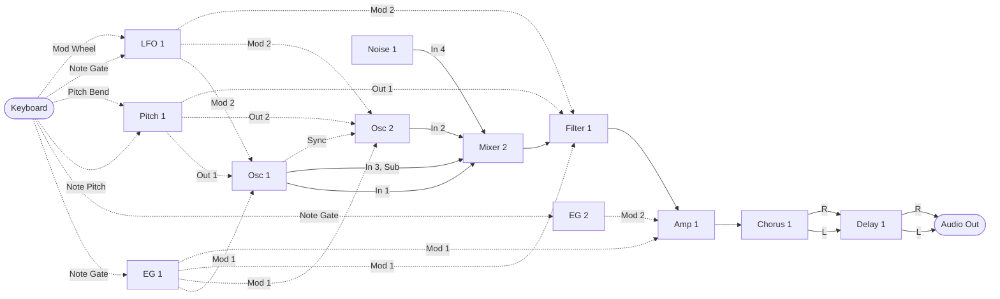
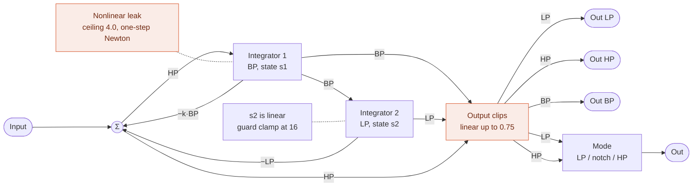
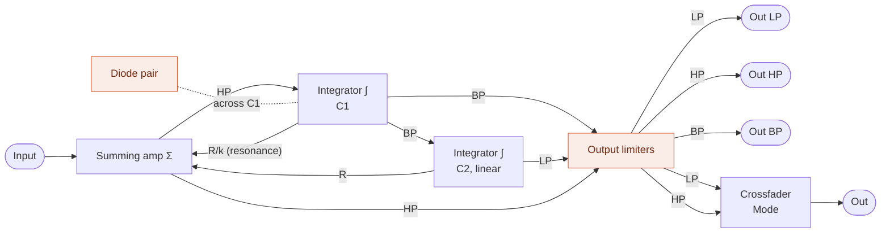

MIDI Synthesizer SPMS-1 (type-2) v0.0.4
=======================================

- Monophonic semi-modular MIDI Synthesizer for Raspberry Pi Pico 2, made with Spinel (Ruby AOT Compiler)
- Controlled by MIDI as a sound module
- Last-note priority with one note of memory: releasing the newest note while the one before it is still held goes back to that one, legato (for trills)
- 48 kHz audio output: 24 bit through an I2S DAC, or PWM Audio (no DAC needed)
- Oscillator: a sawtooth-to-square morph with pulse width (CC#114), and pulse width modulation (PWM) by the same two modulations as the pitch, the envelope and the LFO by default, on CC#8 and 103; and the sawtooth and the pulse on outputs of their own too, and on Osc 1 a sine sub an octave down
- Hard sync: Osc 2 restarts where Sync In, Osc 1's sawtooth by default, rises through zero, at the point between two samples it crosses (Sync Switch, CC#112)
- Envelopes: two ADS envelopes, EG 2 on the amp's Mod 2 In, an organ's at power-up, on CC#52, 53 and 54, with the release switch of both on CC#105
- LFO: triangle (PolyBLAMP) and unipolar square (PolyBLEP), each on an output of its own, and a main output crossfading from one to the other (Wave, CC#33); a reset input, on Note Gate by default, that restarts it at each note with Reset Switch (CC#113) on
- Filter: ZDF/TPT State Variable Filter (with a nonlinear leak on the band pass integrator, solved by the one-step Newton method), with low pass, high pass and band pass outputs and a main output crossfading from the low pass to the high pass through a notch (Mode, CC#39)
- Chorus: mono in, stereo out, as a module in the run order
- Delay: stereo, with feedback, as a module in the run order (up to 340 ms)
- Pitch: the note's pitch as a module in the run order, with portamento as an exponential lag (CC#5), pitch bend past it (range on CC#57) and a stretch of the keys (CC#22)
- Stereo output: the chorus spreads the mono voice into a left and a right, and the delay keeps them apart
- Developed by ISGK Instruments (Ryo Ishigaki)
- <https://github.com/risgk/midi_synthesizer_spms1>
- [日本語版 README](./README.ja.md)


Required Hardware
-----------------

- Raspberry Pi Pico 2 (RP2350)
    - [Raspberry Pi Pico 2](https://www.raspberrypi.com/products/raspberry-pi-pico-2/)
    - I2S DAC hardware (48 kHz/24 bit): uncomment `SPMS1_USE_I2S_INSTEAD_OF_PWM_AUDIO`
        - Pimoroni [Pico Audio Pack](https://shop.pimoroni.com/products/pico-audio-pack) (PIM544)
        - [Adafruit PCM5102 I2S DAC](https://www.adafruit.com/product/6250) (Product ID: 6250)
        - GY-PCM5102 (PCM5102A I2S DAC Module)
    - Or PWM Audio output, without a DAC (the default of the sketch)
        - L on GP28 and R on GP27, as on the Pimoroni [Pico VGA Demo Base](https://shop.pimoroni.com/products/pimoroni-pico-vga-demo-base) (PIM553)
        - An RC low pass filter on each output is recommended, to take out the PWM ripple
            - It also reduces the radio noise (EMI) radiated from the cables carrying the square waves:
              put it close to the pins, not after the cable
        - Without the RC filter, reduce the level with resistors or the input gain (volume) of the connected device:
          the PWM ripple (3.3 V square waves) may saturate the input (e.g. of an audio interface) and cause beeps or noises,
          even when its level meter looks fine
        - The PWM level (3200 steps) is quantized with 1st-order noise shaping and TPDF dither
        - Each sample is split into 4 PWM periods (PWM carrier: 192 kHz instead of 48 kHz), so the carrier is easier to filter out
          and less likely to cause beeps or whines in active speakers (`SPMS1_PWM_AUDIO_SUBPERIODS`: 1, 2, 4, or 8)
    - NOTE: The RP2350 system clock (sysclk) changes to overclocked 153.6 MHz, set by the sketch's own I2S or PWM Audio output
      ("spms1_pico2_i2s.h" or "spms1_pico2_pwm_audio.h"), not by the Arduino-Pico I2S library


Required Software for Modification
----------------------------------

- [Arduino IDE](https://www.arduino.cc/en/software)
    - The sketch is the "spms1" folder: open "spms1/spms1.ino". The editor, the READMEs and the
      tools stay in this folder, outside it
- Arduino-Pico = Raspberry Pi Pico/RP2040/RP2350 (by Earle F. Philhower, III) core
    - Additional Board Manager URL: <https://github.com/earlephilhower/arduino-pico/releases/download/global/package_rp2040_index.json>
    - This sketch is tested with version 6.2.0: <https://github.com/earlephilhower/arduino-pico/releases/tag/6.2.0>
    - Info: <https://github.com/earlephilhower/arduino-pico>
    - Board: "Raspberry Pi Pico 2", with USB Stack: "Adafruit TinyUSB" in the "Tools" menu
- Arduino MIDI Library (by Francois Best, lathoub)
    - This sketch is tested with version 5.0.2: <https://github.com/FortySevenEffects/arduino_midi_library/releases/tag/5.0.2>
    - Info: <https://github.com/FortySevenEffects/arduino_midi_library>
- Spinel
    - Release: 2026.09.12 <https://github.com/matz/spinel/tree/2026.09.12>
    - The Spinel output file "spms1_main.c" needs no editing. "spinel_rt_mcu_head.h" in this sketch,
      included at the top of "spinel_rt.h", carries `#define main __attribute__((section(".time_critical"), flatten)) Spms1_main`,
      which renames it and puts the synth core in RAM at the same time. Renaming it by hand
      instead leaves the macro with nothing to match, and the core runs from flash
    - What the core calls while it plays, the MIDI accessors in "spms1_midi_state.h" and the audio
      output in "spms1.ino", is put in RAM as well, with `SPMS1_RAM_FUNC`. From flash it would be
      fetched through the XIP cache, which core 0's MIDI and USB code shares, and a burst of MIDI
      would slow the synth's buffer by evicting it
    - "spms1_main.c" is generated in "spms1" with `spinel spms1_main.rb -c --rbs sig`. The type seeds
      in "spms1/sig" keep the filter states and the parameter smoothing unboxed;
      "spms1/sig/spms1_filter.rbs" and "spms1/sig/spms1_dsp.rbs" say why they are needed
- Ruby (CRuby), to change the patch's numbers or the default patch, or to add a module: they are
  kept in "spms1_patch.yaml", and `ruby patch_gen/spms1_patch_gen.rb` writes them out to
  "spms1/spms1_patch.rb" (read by "spms1/spms1_main.rb"), the tables of "spms1_editor.html", the NRPN
  tables of this README and "README.ja.md", and the wiring of the loop in "spms1/spms1_main.rb" (see
  [Adding a Module](#adding-a-module)). Run it, then regenerate "spms1/spms1_main.c"; `--check` only
  says whether the files are up to date


Usage
-----

### Prebuilt Binary

- "spms1_i2s.ino.uf2" (in the "bin" folder) is for Raspberry Pi Pico 2 and Pimoroni Pico Audio Pack,
  Adafruit PCM5102 I2S DAC, or GY-PCM5102
- "spms1_pwm_audio.ino.uf2" (in the "bin" folder) is for Raspberry Pi Pico 2 with PWM Audio output, built with L on GP28 and R on GP27


### Web Editor

- Cross-platform web-based parameter controller via Web MIDI API: "spms1_editor.html"
    - Its Controls tab shows a slider for each parameter, those with no CC in blue; they are hidden
      when "Show parameters with no CC", ticked by default, is cleared, until a CC is given to one,
      and the choice is remembered. The slider of one with no CC sets the value its slot holds,
      sent as NRPN
    - A note in parentheses follows a parameter's name there: its range, as "(White to Red)" on
      Noise 1 Color, or, on a level or a modulation amount, what the patch routes to the input it
      scales, as "(Osc 1 Sub)" on Mixer 2 Level 3, kept up to date as the routing changes. On the
      Patch tab it is in the name's tooltip
    - A click on the faint star left of a parameter's name marks it as a favorite, and the star turns
      gold and its row light gold; on the Patch tab its row is light gold too. The favorites are saved
      in the patch (JSON) and undone like any other change, but not sent to the synth
    - On its Patch tab a value is dragged up or down like a knob, with Shift for fine steps, or
      stepped by the wheel while it is being edited
    - Every value it sets or shows runs from 4 to 124, the range the synth uses; one outside it,
      from MIDI In or a patch file, is drawn in to the nearer end, which reads the same
    - Its Initialize & Send All sets each CC value and each parameter's value with no CC back to
      what it powers up at, and sends them
- Built-in software keyboard for note input and testing
    - Beside the keys, a pitch bend wheel, from -8192 to +8191, springs back to the centre when let go,
      and a mod wheel moves the CC that Mod Wheel is on in the patch
    - Click its heading to hide it, so the patch editor or the controls take its height; the editor remembers
      which, and the keys of the PC keyboard do not play while it is hidden
    - Panic sends All Sound Off and centres Pitch Bend. The editor follows the Channel Mode messages
      arriving at MIDI In as the synth takes them (below), and CC#120 to 127 cannot be given to a
      parameter
- Graphical patch editor on its Patch tab
    - Wires module outputs to inputs and parameters, and sets the run order and CC assignments
    - Shows every parameter of every module, those with no CC in blue, so a wire always ends on what
      it feeds
    - Saves and loads patches as JSON
    - Copies the patch as MIDI bytes or as an NRPN list, or sends it through Web MIDI
    - The side panels (Patch, Run Order, Export) fold to their headings with a click, each remembered;
      with all three folded, the canvas takes the width they leave
- SPMS-1 Web: the synth itself, built into the editor ("spms1_web_synth.js")
    - Select "SPMS-1 Web (Built-in)" in "MIDI Out", and play the soft keyboard (or a MIDI keyboard in "MIDI In")
    - "spms1_main.c" runs in the Web browser as WebAssembly, so it sounds the same as the device
    - See [web/README.md](./web/README.md)


### MIDI Settings

- MIDI Channel: Channel 1
- Channel Mode messages: All Sound Off (CC#120), All Notes Off (CC#123), and Omni Off, Omni On, Mono On
  and Poly On (CC#124 to 127), end every note as letting it go would, so the envelopes release;
  Reset All Controllers (CC#121) centres Pitch Bend, sets the Modulation Wheel (CC#1) to 0 and
  leaves no NRPN selected, and leaves the other CCs, the parameters', as they are. CC#120 to 127
  are not controls and are not stored as CC values
- USB MIDI Input
    - Manufacturer Descriptor: "ISGK Instruments"
    - Device Name: "SPMS-1 (type-2)"
- UART MIDI Input
    - Speed: 31250 bps
    - GP4 and GP5 pins are used by TX and RX, through `SerialPIO`
    - Any pins can be used, TX and RX swapped included, by changing `SPMS1_UART_MIDI_TX_PIN` and
      `SPMS1_UART_MIDI_RX_PIN`
    - DIN/TRS MIDI is available by using (and modifying) Adafruit MIDI FeatherWing Kit, for example
        - Adafruit [MIDI FeatherWing Kit](https://www.adafruit.com/product/4740) (Product ID: 4740)
        - M5Stack [Midi Unit with DIN Connector (SAM2695)](https://shop.m5stack.com/products/midi-unit-with-din-connector-sam2695) (SKU: U187) in Separate mode
        - Kinoshita Laboratory [MIDI-UART interface-san Kit](https://www.tindie.com/products/kinoshitalab/midi-uart-interface-san-kit/)
        - 木下研究所 [MIDI-UARTインターフェースさん キット](https://www.switch-science.com/products/8117) (Shipping to Japan only)
        - necobit電子 [MIDI Unit for GROVE](https://necobit.com/denshi/grove-midi-unit/) (Shipping to Japan only)
        - necobit電子 [MIDI Unit Mini for GROVE](https://necobit.com/denshi/midi-unit-mini-for-grove/) (Shipping to Japan only)


### Latency

About 4 ms from a MIDI message to the sound that answers it:

- Two output buffers of 64 samples each: 2.7 ms
- MIDI is read once per buffer, so a message waits up to one more: 1.3 ms

That is the synth's own; what the MIDI link and the DAC add sits on top of it.


### [MIDI Implementation Chart](./spms1_midi_chart.md)


### Block Diagram

The default patch. Solid arrows carry audio, dashed arrows carry control.



Osc 2's sync and LFO 1's reset are routed, from Osc 1's sawtooth and Note Gate, but their switches
power up off, so neither takes effect until it is turned on. The mod wheel reaches LFO 1's Level Mod In.

Each module is processed once per sample, in the run order below. Their parameters -- waveform,
cutoff, gain and the rest -- arrive from CC and are left out of the diagram. Parameter names
shorten Amount to Amt.

The note's pitch reaches the oscillator through Pitch 1, which glides from one note to the next:
portamento. Pitch 1 Glide is on CC#5, Portamento Time in the MIDI spec, and powers up at 0.0, where
the portamento is off and passes the pitch through exactly as it arrives. Pitch 1 has two
outputs from the one glide: Out 1 feeds Osc 1 and the filter's keyboard tracking, and Out 2 feeds
Osc 2. Out 1 Glide Switch and Out 2 Glide Switch, both on CC#34, turn the portamento on and off
for each output without moving Glide: on from value 64, as a MIDI switch is, and on at power-up,
at value 124. The glide moves only while Pitch 1 Gate In, Note Gate by default, is on: between
notes it holds where it is, so a note played after a rest goes on from there. Pitch Bend comes in on Pitch 1 Bend In, which is added to the outputs past the
glide, so the bend acts at once and reaches the oscillators and the filter's keyboard tracking
alike. Out 1 Bend Switch and Out 2 Bend Switch have no CC and power up on; one set off, in
category 4, leaves its output unbent, so the bend can move Osc 2 alone. Pitch 1 Bend Amt is the
bend range, half a semitone a step: on CC#57, 2 semitones either way at value 8, an octave at
value 28, where it powers up, and 5 octaves at value 124.

The LFO goes straight to the oscillator, both to its pitch and to its pulse width, on Mod 2 In, and to the filter, where Filter 1 Mod 2 Amt (CC#25) powers up at 0.0 and
leaves the cutoff alone until it is turned up, as Filter 1 Mod 1 Amt (CC#24) does the envelope's;
Filter 1 Cutoff (CC#74) powers up at 0.9 (value 112). Osc 1 Pitch Mod 2 Amt (CC#13) takes the
LFO to the pitch and powers up at its top, value 124, which with Osc 1 Pitch Mod Range at 0.2 makes
the LFO at full level swing the pitch an octave either way; Osc 1 PW Mod 2 Amt (CC#103) takes it
to the pulse width and powers up at 0.0. LFO 1 Level powers up at 0.0, so the swing is the mod
wheel's, from none to an octave. The pitch from Pitch 1 reaches the filter too, on Filter 1 Pitch In, for keyboard tracking: CC#9
(Filter 1 Pitch Amt) at its top has the cutoff follow the note a semitone for a semitone,
unmoved at note 60. Filter 1 Pitch Amt powers up at 0.0, with the tracking off.
The envelope reaches the oscillator too, on Osc 1 Mod 1 In, for a pitch envelope: Pitch Mod 1
Amt (CC#89) and PW Mod 1 Amt (CC#8) power up at 0.0, with it off. Each modulation depth spans the
whole range of what it moves, so bringing a source down to a musical depth is left to the patch
rather than built into the modules.

Mixer 2 sums the audio ahead of the filter: Osc 1 on In 1, Osc 2 on In 2, Osc 1's sub on In 3 and
Noise 1's Out on In 4, each at its own level: Level 1 (CC#19) and Level 2 (CC#20) power up at 0.7, so the default patch
plays both oscillators, about as loud together as one at full level, and Level 3 (CC#21) and
Level 4 (CC#23) at 0.0, so the sub and the noise are silent until they are turned up. Osc 2 plays the note from Pitch 1 as Osc
1 does, tuned against it by its own Pitch Coarse (CC#85) and Pitch Fine (CC#76), 12 cents sharp at
power-up for a slow beat. Its Wave is its own as well, on CC#104 beside Osc 1's on CC#102. It
follows Osc 1 in everything else: its Mod Amts and its PW are on Osc 1's CCs, so one CC moves
both.

The voice is mono up to the amp. The chorus takes it and puts out a left and a right, the delay
takes the two sides and keeps them apart, and its two outputs are the two sides of the final
output.

None of this is fixed. NRPN rewrites the run order, every arrow above, and which CC feeds each
parameter.

#### The run order

Every module is in it: Pitch 1 first, so that every module after it reads the note in the same
sample, then the modulation sources -- the envelopes ahead of the LFO, so that the LFO's Mod Ins can
read them in the same sample, as a vibrato fading in with an envelope does -- Mixer 1 between them and the oscillators, Noise 1 after the oscillators, as it is mostly a sound of its own (a modulation
taking it is a sample late, which it does not hear), Mixer 2 between them and the filter, and the
chorus and the delay last:


The mixer has nothing routed to it, so it costs its slot every sample and changes nothing until
a patch gives it something. Where it sits is what it buys: a module sees the current sample's
value only from something ahead of it in this line, and last sample's from anything behind.
Mixer 1 can reach the envelopes and the LFO, and the oscillators, the filter and the amp can reach
Mixer 1. Pitch 1 comes before them all, so that every module reads the note in the same sample:
the oscillators and the filter, and a modulation source that follows the keys. A modulation of
Pitch 1 itself -- a bend from the LFO through Bend In, say -- is then a sample late, which it does
not hear. Mixer 2 sits between the oscillators and the filter, where it gathers the
audio.

A mixer is what lets two of anything meet, and what makes a signal that runs one way, such as the
envelope, swing both ways. See the examples below.

#### Filter 1

A zero-delay feedback state variable filter. The band pass integrator leaks, more and more as the
band pass bends into a soft clip curve, and that is what holds the resonance down; at small levels
the leak is next to nothing, so the pass band passes nearly clean. The loop equation, leak
included, is solved every sample by the one-step Newton method from the linear solution, which
lands almost on the root. The leak's rate is fixed in time, so the sound does not change with the
sample rate. The low pass state stays linear, with a
clamp at 16 as a guard that ordinary use never reaches. The output clip comes last. At the top of
the resonance dial k turns negative and the loop oscillates.

The filter puts out its low pass and high pass at once, as Out LP and Out HP, each through a DC
blocker and an output clip of its own, and Out, the two crossfaded by Filter 1 Mode (CC#39). Each side stays at full over its own half and falls to nothing over the other.
At 0.0 (value 4), where it powers up, Out is the low
pass alone; at 1.0 (value 124) the high pass alone; and at 0.5 (value 64) both at full, whose sum, the
input less k·BP, is a notch at the cutoff with both sides of it passed whole. In between the notch
moves off the cutoff, above it toward the low pass and below it toward the high pass, with the
other side at up to 6 dB down. Out is the one the default patch uses, feeding Amp 1, so it plays the
low pass until Mode is turned up. Out is not clipped again: in the pass band one side is all there is, and around the cutoff,
where both are, the notch takes them down. The two factors are smoothed as the other levels
are.

The band pass leaves too, as Out BP, through a DC blocker and an output clip of its own, outside
the Mode crossfade. It is the integrator's state as it is, not normalized, so its peak at the
cutoff is Q times the input: 0.707 times at Resonance 0.0, and into the output clip's shoulder at
a high resonance on a loud input, which Mixer 2 Out Level takes down. The default patch leaves it
unconnected.



The same structure redrawn as an op-amp integrator filter. The diode pair stands for the
nonlinear leak and the output limiter for the output clip. It is an interpretation, not a reproduction of
an actual circuit.



#### Chorus 1

A mono-in, stereo-out chorus, put in the chain as an insert, as the
delay is: Mix sets the balance of dry and chorused, rather than a send level. The input goes through a gentle low pass
filter into one short delay line, which is read at two taps. A triangle LFO swings the two taps in
opposite directions about 5.33 ms, so the left and right delayed signals bend in pitch against
each other. Each output is a crossfade of the input with its own tap, so a mono source comes out
spread across the stereo field.


It needs no limiter and no clip after it: the input is held to one unit on the way in, and the
filter, the reading between two samples and the crossfades are all weighted averages, which cannot
reach past what they average. The delay the taps swing about is fixed.

Out Mono, a sub output, is the average of Out L and Out R, for a mono destination such as a
mixer input or the filter. The two taps summed make a gentler chorus than the spread, with some
comb filtering where they meet.

#### Delay 1

A stereo delay with feedback. Each side has a
delay line and a loop of its own: half its input and its delayed signal at the Feedback gain go
through a gentle low pass filter into its line, and its output is a crossfade of its input with
its delayed signal. Time, Feedback and Mix are shared, so the two sides repeat together and keep
the stereo image they came in with.


The diagram is one side; the other is the same. It needs no limiter and no clip after it. With
half the input coming in and at most half the delayed signal going round again, what is written
back stays within one unit as long as the delayed signal does, and it starts from silence; the
filter, the reading between two samples and the crossfade are all weighted averages, which cannot
reach past what they average. The price is that the first repeat comes 6 dB under the dry signal.
Each input is held to one unit on the way in, as the amp holds its modulation, so whatever
is routed to it the bound holds.

Out Mono, a sub output, is the average of Out L and Out R, for a mono destination.

### Patch Editing (NRPN)

The patch is data, and NRPN rewrites it while the synth is running: which modules run and in what
order, what feeds each module input, where each parameter takes its value from, which CC fills
each control slot, and the value of each parameter that has no CC. Every module reads from a numbered signal slot and writes to one, so rewiring is
a matter of changing slot numbers. Each parameter also has a control slot of its own, which its CC
fills, or with no CC its value in category 4, and which only it can read: a parameter source of 127 names it, and no slot number reaches
it from anywhere else.

#### Sending

- CC#99 selects the category, CC#98 the entry within it, in either order
- CC#6 (Data Entry MSB) commits the value, and takes effect on the next audio buffer
- CC#38 (Data Entry LSB) is ignored: every value here is 7-bit
- CC#101 and CC#100 (RPN select) suspend data entry, so an RPN is never taken as a patch edit.
  Send CC#99 or CC#98 again to resume
- Edits are not saved. The default patch is restored at power-on

#### Categories (CC#99)

| CC#99 | CC#98 | Sets | CC#6 value |
| ----- | ----- | ---- | ---------- |
| 0 | 0-31 | Run order, slot by slot | Module ID |
| 1 | 0-33 | What feeds a module input | Signal ID |
| 2 | 0-65 | Where a parameter takes its value | Signal ID, or 127 for its own control slot |
| 3 | 0-66 | Which CC fills a control slot | CC number, or 0 for none |
| 4 | 0-65 | What a parameter's control slot holds while it has no CC | CC value |

The run order is read from slot 0 upwards and stops at the first Module ID 0, so a patch shorter
than 32 modules ends itself. It is separate from the module numbering: a module only sees the
current sample's value from something listed before it, and last sample's from something after.
A module listed more than once runs once, at the slot written last, as if its other slots were
not there: the last write wins, whether its slot is ahead of the others or after them. A module
written to a new slot moves there, and the module that slot held leaves the order.

In category 3, CC number 0 means the control has no CC. A parameter's control slot then holds its
value in category 4, whatever CC it had before, so the patch alone sets what the parameter reads; the
Mod Wheel and General slots hold 0.0. Category 4 takes a value as a CC would and is read the same way, so value 64
is 0.0 on a bipolar parameter. While the parameter has a CC, its category 4 value is kept but not
read. Each powers up at the parameter's power-up value.

There are two oscillators, two envelopes, one LFO, one filter, one amp, two mixers, one chorus,
one delay, one pitch module and one noise source, and **all thirteen are in the default run order**, so a patch only ever has to route, never to switch something
on first. The synth is built to keep time with every module running, so taking one out of the
order is never what makes a patch fit; to leave one out of the sound, route around it and let it
run unread (see the examples below).
Mixer 1 has no CC: its levels hold 0.0, so it is silent until a patch turns them up, as its
category 4 values or by giving them CCs. Mixer 2 has a CC on each level, CC#19 to 21 and 23, of which
Level 1 and 2 power up at 0.7 and Level 3 and 4 at 0.0, so those inputs start closed. Each mixer's Out Level has no CC and holds 0.5; Mixer 2's sets how hard the
audio drives the filter.

#### Entries (CC#98), category 1

<!-- patch_gen inputs -->

| CC#98 | Module input | | CC#98 | Module input |
| ----- | ------ | - | ----- | ------ |
| 0 | Pitch 1 Pitch In | | 18 | Osc 2 Sync In |
| 1 | Pitch 1 Bend In | | 19 | Mixer 2 In 1 |
| 2 | Pitch 1 Gate In | | 20 | Mixer 2 In 2 |
| 3 | EG 1 Gate In | | 21 | Mixer 2 In 3 |
| 4 | EG 2 Gate In | | 22 | Mixer 2 In 4 |
| 5 | LFO 1 Rate Mod In | | 23 | Filter 1 Audio In |
| 6 | LFO 1 Level Mod In | | 24 | Filter 1 Pitch In |
| 7 | LFO 1 Reset In | | 25 | Filter 1 Mod 1 In |
| 8 | Mixer 1 In 1 | | 26 | Filter 1 Mod 2 In |
| 9 | Mixer 1 In 2 | | 27 | Amp 1 Audio In |
| 10 | Mixer 1 In 3 | | 28 | Amp 1 Mod 1 In |
| 11 | Mixer 1 In 4 | | 29 | Amp 1 Mod 2 In |
| 12 | Osc 1 Pitch In | | 30 | Chorus 1 Audio In |
| 13 | Osc 1 Mod 1 In | | 31 | Delay 1 Audio In L |
| 14 | Osc 1 Mod 2 In | | 32 | Delay 1 Audio In R |
| 15 | Osc 2 Pitch In | | 33 | Final Output L |
| 16 | Osc 2 Mod 1 In | | 34 | Final Output R |
| 17 | Osc 2 Mod 2 In | |  |  |

<!-- patch_gen end -->

Most of these take what their name suggests, but three do not say it on their face. A Gate is a
threshold rather than a level: an envelope triggers as the signal reaches 0.25 and releases as it
falls back. A pitch, as Note Pitch carries one to Pitch In, is -0.5 to +0.5 across MIDI notes
0 to 120, so 0.0 is note 60 and a tenth of a unit is an octave. And a Mod In is taken as it arrives:
nothing is held to a range on the way in, and what gets clamped is the value the module ends up with
-- cutoff to the ends of its dial, pitch to -0.5 and +0.5, pulse width to -0.5 and +0.5. The
oscillator's Pitch In, Mod 1 In and Mod 2 In are Mod Ins too. A mixer adds without a
ceiling, so a loud modulation pins its destination at one
end rather than being trimmed on the way in. The amp is the exception, and holds its modulation,
the crossfade of its two Mod Ins, to -1.0 and +1.0: it is an attenuator, so a modulation may scale its gain down but never up;
a negative one inverts. The chorus and the delay hold their audio inputs to the same one unit. Pitch 1 Pitch In takes anything,
as a Mod In does, and puts out what it takes, glided and bent, held to -1.0 and +1.0
as a mixer's output is.

The two sides of the final output are read separately, so either can be pointed anywhere; point
both at the same signal for a mono output.

#### Entries (CC#98), categories 2, 3 and 4

<!-- patch_gen params -->

| CC#98 | Parameter | | CC#98 | Parameter | | CC#98 | Parameter |
| ----- | ------ | - | ----- | ------ | - | ----- | ------ |
| 0 | Pitch 1 Glide | | 25 | Mixer 1 Level 3 | | 50 | Osc 2 Sync Switch |
| 1 | Pitch 1 Out 1 Glide Switch | | 26 | Mixer 1 Level 4 | | 51 | Noise 1 Color |
| 2 | Pitch 1 Out 2 Glide Switch | | 27 | Mixer 1 Out Level | | 52 | Noise 1 Level |
| 3 | Pitch 1 Bend Amt | | 28 | Osc 1 Wave | | 53 | Mixer 2 Level 1 |
| 4 | Pitch 1 Out 1 Bend Switch | | 29 | Osc 1 PW | | 54 | Mixer 2 Level 2 |
| 5 | Pitch 1 Out 2 Bend Switch | | 30 | Osc 1 Pitch Coarse | | 55 | Mixer 2 Level 3 |
| 6 | Pitch 1 Stretch | | 31 | Osc 1 Pitch Fine | | 56 | Mixer 2 Level 4 |
| 7 | EG 1 Attack | | 32 | Osc 1 Pitch Mod 1 Amt | | 57 | Mixer 2 Out Level |
| 8 | EG 1 Decay | | 33 | Osc 1 Pitch Mod 2 Amt | | 58 | Filter 1 Cutoff |
| 9 | EG 1 Sustain | | 34 | Osc 1 Pitch Mod 1 Switch | | 59 | Filter 1 Resonance |
| 10 | EG 1 Release Switch | | 35 | Osc 1 Pitch Mod 2 Switch | | 60 | Filter 1 Mode |
| 11 | EG 1 Level | | 36 | Osc 1 Pitch Mod Range | | 61 | Filter 1 Pitch Amt |
| 12 | EG 2 Attack | | 37 | Osc 1 PW Mod 1 Amt | | 62 | Filter 1 Mod 1 Amt |
| 13 | EG 2 Decay | | 38 | Osc 1 PW Mod 2 Amt | | 63 | Filter 1 Mod 2 Amt |
| 14 | EG 2 Sustain | | 39 | Osc 2 Wave | | 64 | Filter 1 Mod Polarity |
| 15 | EG 2 Release Switch | | 40 | Osc 2 PW | | 65 | Amp 1 Gain |
| 16 | EG 2 Level | | 41 | Osc 2 Pitch Coarse | | 66 | Amp 1 Mod 1/2 Mix |
| 17 | LFO 1 Wave | | 42 | Osc 2 Pitch Fine | | 67 | Chorus 1 Mix |
| 18 | LFO 1 Rate | | 43 | Osc 2 Pitch Mod 1 Amt | | 68 | Chorus 1 Rate |
| 19 | LFO 1 Level | | 44 | Osc 2 Pitch Mod 2 Amt | | 69 | Chorus 1 Depth |
| 20 | LFO 1 Rate Mod Amt | | 45 | Osc 2 Pitch Mod 1 Switch | | 70 | Delay 1 Mix |
| 21 | LFO 1 Level Mod Amt | | 46 | Osc 2 Pitch Mod 2 Switch | | 71 | Delay 1 Time |
| 22 | LFO 1 Reset Switch | | 47 | Osc 2 Pitch Mod Range | | 72 | Delay 1 Feedback |
| 23 | Mixer 1 Level 1 | | 48 | Osc 2 PW Mod 1 Amt | |  |  |
| 24 | Mixer 1 Level 2 | | 49 | Osc 2 PW Mod 2 Amt | |  |  |

<!-- patch_gen end -->

#### Entries (CC#98), category 3 only

These CCs belong to no parameter, so category 2 has no entry for them. They fill the Mod Wheel
slot and the general slots on the bus; see below.

<!-- patch_gen controllers -->

| CC#98 | CC for | Fills |
| ----- | ------ | ----- |
| 73 | Mod Wheel | Mod Wheel |
| 74 | General 1 | General 1, General 1 Rev, General 1 Inv, General 1 Rev Inv, General 1 Bipolar, General 1 Bipolar Inv |
| 75 | General 2 | General 2, General 2 Rev, General 2 Inv, General 2 Rev Inv, General 2 Bipolar, General 2 Bipolar Inv |

<!-- patch_gen end -->

#### Module IDs

<!-- patch_gen modules -->

| ID | Module |
| ----- | ------ |
| 0 | None (ends the run order) |
| 1 | Pitch 1 |
| 2 | EG 1 |
| 3 | EG 2 |
| 4 | LFO 1 |
| 5 | Mixer 1 |
| 6 | Osc 1 |
| 7 | Osc 2 |
| 8 | Noise 1 |
| 9 | Mixer 2 |
| 10 | Filter 1 |
| 11 | Amp 1 |
| 12 | Chorus 1 |
| 13 | Delay 1 |

<!-- patch_gen end -->

#### Signal IDs

<!-- patch_gen signals -->

| ID | Signal | | ID | Signal | | ID | Signal |
| ----- | ------ | - | ----- | ------ | - | ----- | ------ |
| 0 | None (constant 0.0) | | 20 | General 2 Bipolar Inv ± | | 40 | Osc 2 Output Saw ± |
| 1 | Constant 1.0 | | 21 | Pitch 1 Output 1 ± | | 41 | Osc 2 Output Pulse ± |
| 2 | Constant 0.5 | | 22 | Pitch 1 Output 2 ± | | 42 | Noise 1 Output ± |
| 3 | Constant -0.5 | | 23 | EG 1 Output | | 43 | Noise 1 Output White ± |
| 4 | Constant -1.0 | | 24 | EG 1 Output Inv | | 44 | Noise 1 Output Red ± |
| 5 | Note Pitch ± | | 25 | EG 2 Output | | 45 | Mixer 2 Output ± |
| 6 | Note Gate | | 26 | EG 2 Output Inv | | 46 | Mixer 2 Output Inv ± |
| 7 | Pitch Bend ± | | 27 | LFO 1 Output ± | | 47 | Filter 1 Output ± |
| 8 | Mod Wheel | | 28 | LFO 1 Output Inv ± | | 48 | Filter 1 Output LP ± |
| 9 | General 1 | | 29 | LFO 1 Output Triangle ± | | 49 | Filter 1 Output HP ± |
| 10 | General 1 Rev | | 30 | LFO 1 Output Triangle Inv ± | | 50 | Filter 1 Output BP ± |
| 11 | General 1 Inv | | 31 | LFO 1 Output Square | | 51 | Amp 1 Output ± |
| 12 | General 1 Rev Inv | | 32 | LFO 1 Output Square Inv | | 52 | Chorus 1 Output L ± |
| 13 | General 1 Bipolar ± | | 33 | Mixer 1 Output ± | | 53 | Chorus 1 Output R ± |
| 14 | General 1 Bipolar Inv ± | | 34 | Mixer 1 Output Inv ± | | 54 | Chorus 1 Output Mono ± |
| 15 | General 2 | | 35 | Osc 1 Output ± | | 55 | Delay 1 Output L ± |
| 16 | General 2 Rev | | 36 | Osc 1 Output Saw ± | | 56 | Delay 1 Output R ± |
| 17 | General 2 Inv | | 37 | Osc 1 Output Pulse ± | | 57 | Delay 1 Output Mono ± |
| 18 | General 2 Rev Inv | | 38 | Osc 1 Output Sub ± | |  |  |
| 19 | General 2 Bipolar ± | | 39 | Osc 2 Output ± | |  |  |

<!-- patch_gen end -->

A **±** marks a signal that swings both ways: a module output reaches -0.5 and +0.5 at full
scale, and a mixer sums two of them and stops at one.
Everything unmarked runs 0.0 to 1.0 -- the envelope, Note Gate and Mod Wheel. The
bus carries both kinds under one numbering, so the range belongs to the slot rather than to the
sort of thing that wrote it. The numbers missing from the table are free; 127 is not a slot but a
parameter's own control slot.

A parameter's own control slot holds the value arriving from its CC, or with no CC its value in
category 4, off the bus, and a parameter reads it by default: Signal ID 127 in category 2. Each parameter is unipolar or bipolar, and its
slot takes the same range. A unipolar one
runs 0.0 to 1.0 from value 4 to value 124, the span of an envelope, so an envelope pointed at one sweeps
the whole of its dial. A bipolar one runs -0.5 to +0.5 with value 64 at 0.0, the span of an LFO, so a
bipolar source pointed at one swings it about the middle. Osc 1 Pitch Coarse and Fine are
bipolar, since their middle is no change at all. Pointing a parameter at a
slot on the bus is what makes a modulation. No input or other
parameter can read a parameter's control slot: a CC meant for more than one parameter, or for a
module input, is given to each parameter in category 3, as Osc 1 and Osc 2 share theirs, or, as
the mod wheel, goes on the Mod Wheel slot.

Slot 8, Mod Wheel, is a control slot that no parameter owns: a CC put on the bus for any module
input or parameter to read. It reads CC#1 by default, runs 0.0 to 1.0 and powers up at value 4, so
it is at 0.0 until the wheel moves; the default patch puts it on LFO 1 Level Mod In. The editor
shows it with the keyboard's signals, on its Controller node, and as a wheel beside the soft
keyboard.

Slots 9 to 20 are General 1 and General 2, two more control slots that no parameter owns, read
from CC#16 and CC#17, General Purpose Controllers 1 and 2. Each CC fills six slots at once, each
a form of its value u, which runs 0.0 to 1.0 from value 4 to value 124: General n itself, Rev
1 - u, Inv -u, Rev Inv u - 1, Bipolar u - 0.5 and Bipolar Inv 0.5 - u. So one knob can bring
one thing in as it takes another out, or swing a bipolar parameter about its middle, with no
mixer to turn it round. They power up at value 4, so u is 0.0, and with no CC u stays 0.0; the
default patch routes none of them. The editor shows them on the Controller node, the forms as
outputs below each, and as sliders in the Controls tab.

Note Pitch, Note Gate and Pitch Bend are what the keyboard puts on the bus. Note Pitch carries
MIDI notes 0 to 120 as -0.5 to +0.5, the same span the oscillator reads as its whole pitch
range, and Pitch Bend is bipolar too, one unit across the whole wheel: exactly -0.5 and +0.5 at
the ends of its travel and exactly zero at the centre detent, so it can feed a module input
without a mixer to shift it. Note Gate is 0.0 or 1.0, and an envelope triggers at 0.25. Pitch Bend
is routed to Pitch 1 Bend In by default.

The newest note sounds, and the note it took over from is remembered while it is still held: one
note, no more. When the newest note is released, the remembered one comes back with Note Gate
left at 1.0, so the envelopes go on without a new attack, and holding one key while tapping
another plays a trill. Releasing the remembered note only forgets it, and with three keys held,
releasing the newest goes back to the second, and releasing that closes the gate, even with the
first still held.

Slots 0-4 are constants that nothing writes, for inputs that want a fixed value rather than a
source, from the top down. Signal 0 is also what an entry nobody has set reads as, so an unrouted
input is silent rather than wired to whatever sits in the first slot. Signal 1 is the value an
unmodulated input wants: routing an amp's modulation input to it leaves that side at full level.
Signals 0 and 1 are the two ends of a unipolar parameter's range and Signals 3 and 2 of a bipolar
one, for pinning one there; Signal 2 is also the middle of a unipolar dial, and Signal 4 is the
negative of Signal 1. A constant on a mixer's second input shifts
a signal between the two kinds: -0.5 turns one that runs one way into one that swings both, and +0.5
the other way round.

The ID numbers are not stable across firmware versions. Each list is numbered in order --
modules in the default run order, the bus from the constants through MIDI to the module outputs,
inputs and parameters module by module -- with no gaps, so a new module type, another instance of
one, or another signal renumbers everything after it. A patch sent as NRPN bytes is for the
version it was made for; the editor keeps a patch by name, and sends it numbered for the version
it is built with. Read these tables again after an update.

#### Ranges worth knowing

Osc 1 Pitch Coarse and Pitch Fine transpose the oscillator. Both are centred on value 64 and move one
whole unit per CC step: Coarse a semitone, reaching 5 octaves either way, and Fine a cent,
reaching 60 either way. They are summed, so any pitch is reachable. They have no CC and hold 0.0
by default; Osc 2's, on CC#85 and 76, set the interval or the detune between the oscillators.

Pitch 1 Stretch, on CC#22, widens the keys about note 60, last, by multiplying the pitch
after the glide and the bend: every interval from note 60 grows by the same share, so the stretch is often given as how
much an octave widens. At 0.0 (value 4), where it powers up, the keys are as they are; from value 5 the
widening grows by a semitone's ratio a step, as the envelope's times do: 1.2 cents an octave at
value 5, 38 at value 64, and a whole octave at value 124, which doubles every interval and turns the
keyboard into whole tones. The low end is a piano's stretch tuning, a few cents an octave. The
glide and the bend are widened with the keys, so a bend of an octave becomes two at the top, and
turning it glides the pitch rather than stepping it. At its top, notes more than 30 semitones from note 60 run past the
oscillator's range.

LFO 1 puts out a triangle and a square at once, each on an output of its own, Out Triangle and
Out Square, and the two crossfaded on Out. The triangle has its corners rounded off by PolyBLAMP
and the square its steps by PolyBLEP, so at the top of the rate range, 220 Hz, where the LFO is an
audible tone, the square's aliases are 41 dB down on it, rather than 24 dB without. The square is
unipolar: 1.0 while the triangle is above zero and 0.0 while it is below, stepping where it
crosses, so it gates, or trills up from the note on an oscillator's pitch, where the triangle
swings about zero for a vibrato; its inverted output runs 0.0 and -1.0. LFO 1 Wave (CC#33) crossfades Out in a straight line from the triangle at 0.0 (value 4), where it
powers up, to the square at 1.0 (value 124), and is smoothed as the level is, so on the way the
middle of the swing moves up from zero to 0.5. Out is what the default patch routes, so the LFO
is a triangle until Wave is turned up.

LFO 1 Level scales the LFO's outputs, as a mixer's Level scales its input: from silent at 0.0
(value 4) to full at 1.0 (value 124). It is on CC#116 and powers up at 0.0, so the LFO is still until
something brings it in. LFO 1 Level Mod In adds to it, held to the same range, by Level Mod Amt, and it takes
Mod Wheel by default at a depth of 1.0 (Level Mod Amt has no CC and holds 1.0), so the
wheel brings the LFO in, up to full at its top. Turning the LFO the
other way up is for Out Inv, Out negated, or for a mixer's Out Inv; the triangle and the square
have theirs too, Out Triangle Inv and Out Square Inv. The default patch leaves them unrouted.

LFO 1 Rate Mod In moves the rate by LFO 1 Rate Mod Amt, as Osc 1 Mod 2 In moves the oscillator's
pitch: a unit of input times depth is the whole rate range, ten octaves, so 0.1 is an octave.
Rate Mod Amt has no CC and holds 1.0, and the default patch leaves Rate Mod In unrouted, so routing a source to it is all it takes. Both of the LFO's Mod Ins
are read every fourth sample,
where the LFO works out its rate, rather than every sample as most module inputs are.

LFO 1 Reset In restarts the LFO's cycle where it rises above zero, from the start, where Out is
0.0 and the triangle on its way up. It takes Note Gate by default, so every note starts its
vibrato the same way (key sync), but only with LFO 1 Reset Switch on: on CC#113, it takes Reset In
at value 64 and above and ignores it below, and powers up off (value 4), so the LFO runs free until
it is turned on. Reset In is read every fourth sample too, where a gate changes only between
buffers, which are a whole number of those steps; an audio signal on it is read only at those
steps.

EG 1 Level scales the envelope's output the same way, over the same range. It has no CC, and
holds 1.0, which passes the envelope through as it is. The
envelope runs one way, 0.0 to 1.0; turning it the other way up is for Out Inv, the envelope
negated, from 0.0 down to -1.0, or for a mixer's Out Inv. The default patch leaves
Out Inv unrouted.

EG 1 Release Switch, on CC#105, picks the release, after the note's gate falls: on from value 64,
as a MIDI switch is, it runs at the decay's rate, set by EG 1 Decay; off, below value 64, it runs at
the shortest decay's, 10 ms, whatever the decay is, so a long decay still ends a note short. It
powers up on, at value 124. It is a switch, so it is not smoothed.

EG 2 is a second envelope of the same kind, on Note Gate too, for the amp: the default patch puts
it on Amp 1 Mod 2 In (below). Its Attack, Decay and Sustain are on CC#52, 53 and 54, and power up as an organ's: Attack and Decay at 0.0 (value 4), Sustain at
1.0 (value 124), so it opens at once to full and holds while a key is held. Its Release Switch is
on EG 1's CC#105 as well, one switch for both envelopes, and powers up on, so the
release runs at its decay's rate, 10 ms at power-up: the note stops short, as an organ's does. Its
Level has no CC and holds 1.0, as EG 1's does.

Osc 1 takes each of its two modulations, Mod 1 In and Mod 2 In, to the pitch and to the pulse
width by a depth of its own: Pitch Mod 1 Amt and Pitch Mod 2 Amt, PW Mod 1 Amt and PW Mod 2 Amt,
all unipolar. Pitch Mod 1 Amt and Pitch Mod 2 Amt are on CC#89 and 13, and PW Mod 1 Amt and PW Mod 2 Amt on CC#8 and 103; Pitch Mod 2 Amt powers up at its top, value 124, and the other three at 0.0. There is no Polarity: each modulation runs the way its source does,
and one the other way up takes an inverted source, such as EG 1 Out Inv or LFO 1 Out Inv. So a
source goes to the pulse width as well as the pitch, or to either alone, with no rewiring.

Each pitch depth is its Pitch Mod Amt times Pitch Mod Range, both unipolar and plain
multipliers: Pitch Mod Range is what the top of a Pitch Mod Amt is worth. At a depth of 1.0 a
modulation reaches the whole pitch range: a bipolar source at full depth swings the pitch five
octaves up and five down. That is a coarse range for vibrato, which is why Pitch Mod Range has no
CC and holds 0.2 (CC value 28), the depth at the top of a Pitch Mod Amt. So Pitch Mod 2 Amt puts
50 cents of vibrato at value 9, a semitone at value 14 and an octave at the top of the dial, where it
powers up, a step being 10 cents, and Pitch Mod 1 Amt sweeps
the pitch from the envelope a semitone at value 9, an octave at value 64 and two octaves at the top.

Osc 1 Pitch In is where the note comes in, from Pitch 1 in the default patch. It has no depth:
the pitch it takes is added whole, so the note plays in tune, a key a semitone.

Osc 1 Mod 1 In takes the envelope in the default patch, for a pitch envelope, and Mod 2 In the
LFO, for vibrato. Pitch Mod 2 Amt powers up at its top, an octave, and the LFO at Level 0.0, so
the vibrato waits for the mod wheel; every other Mod Amt powers up at 0.0, so the envelope
leaves the oscillator alone until one is turned up.

Osc 1 PW, the pulse width, shifts the second of the two sawtooths that the morph is made of, either way
from half a cycle: it is bipolar, -0.5 (value 4) to +0.5 (value 124), and powers up at 0.0 (value 64). At
the square end of Osc 1 Wave that is a pulse of 50% at value 64, 25% at value 94 and 75% at value 34, and
silence at either end, a pulse of 0% or 100%; it is on CC#114.
The modulations move it by PW Mod 1 Amt (CC#8) and PW Mod 2 Amt (CC#103), which power up at 0.0.
A unit of input is the whole pulse width range, so with PW Mod 2 Amt at the top the LFO swings
the pulse width half the range either way: with PW at value 64, from nearly 100% to nearly 0%; and
with PW Mod 1 Amt at the top the envelope sweeps it across the whole range, from PW up, or down
from an inverted envelope. The pulse width the modulation adds
up to is held to -0.5 to +0.5.

Each oscillator puts out the two ends of its morph on their own as well, whatever Wave is: Out
Saw, the sawtooth, and Out Pulse, the pulse at the pulse width, as Out is at the square end of
Wave. Both run at the same level as Out, -0.5 to +0.5, and the default patch uses neither, so a
mixer can take the two from one oscillator at levels of their own, or one oscillator can feed a
saw to one place and a pulse to another.

Osc 1 also puts out a sub, Out Sub: a sine an octave down, at the same level, -0.5 to
+0.5. It is locked to the oscillator's phase, starting each of its cycles where every other cycle
of the sawtooth starts, so it follows the pitch, the glide and the modulation exactly. A sine has
nothing to alias, so it is clean however high it goes. The default patch puts Osc 1's on Mixer 2
In 3, whose Level 3 (CC#21) powers up at 0.0: turning it up brings the sub in under the note.
Osc 2 has none: it is the one that syncs, and is lighter without it.

Osc 2 syncs to Osc 1 (hard sync). Osc 2 Sync In restarts Osc 2's phase where it rises through
zero, from zero or below on one sample to above zero on the next, as the comparator on an analog
oscillator's sync input does, and it takes Osc 1 Out Saw by default, which rises through zero
once a cycle, at its wrap. Where between the two samples it crossed is found by drawing a line
between them, and Osc 2 starts again from that point, so the synced wave repeats at Osc 1's pitch
with a period as exact as Osc 1's; a restart rounded to a sample would make the period jitter by
one, which is heard as roughness. The sawtooth's step is rounded off evenly about where it falls,
so the line crosses close to it. The step the restart makes in Osc 2's wave is left as it is, not
smoothed. Any signal can be routed there instead: a pulse rises once a cycle too, though at the
ends of its width it has no step to rise at; a wave that rises through zero more than once a
cycle restarts Osc 2 each time. Osc 2 Sync Switch, on CC#112, takes Sync In at value 64 and above
and ignores it below; it powers up off (value 4), so the default patch is unsynced until it is
turned on. Raise Osc 2's pitch above Osc 1's (Pitch Coarse, CC#85, or a pitch modulation) to hear
the sync sweep. A gate on Sync In, which rises from 0.0 to 1.0, restarts Osc 2 on that sample:
Note Gate there, with the switch on, starts every note at the same point of the wave.

Noise 1 puts out two noises from one generator, at Noise 1 Level, each on an output of its own
and the two crossfaded on Out. Out White is white noise,
flat across the spectrum: from silence at 0.0 to noise filling -0.5 to +0.5 at 1.0, the
oscillator's range. Out Red is the same noise through a one-pole low pass, falling 6 dB an octave
above a fixed cutoff on the A of a MIDI note number, note 21 (A0, 27.5 Hz), so across the whole
audible band. A gain holds it at the white's RMS over the square root of 2, and it is held to -0.5
to +0.5, which cuts the rarest peaks, 1.5% of the samples. Noise 1 Color (CC#115) crossfades Out
in a straight line from the white at 0.0 (value 4), where it powers up, to the red at 1.0 (value 124),
each end as its own output is, so the red end is 3 dB down. Out keeps the slot the white had, and
is what the default patch puts on Mixer 2, so the noise there is white until Color is turned up,
and darkens as it is. Color is smoothed as the level is. The level has no CC and holds 1.0, so
the noise runs at full level and Mixer 2 Level 4 (CC#23), or the depth of whatever it modulates,
sets how much of it is heard. The level is smoothed as the other levels are. The noise repeats only after 2^32 samples,
over a day at 48 kHz, and starts the same every time, so a render comes out the same.

Filter 1 takes its audio input as it arrives, so how hard the input drives it, which is also what
decides how far it runs into its own saturation, is set ahead of it: by Mixer 2 Out Level in the
default patch, which has no CC and holds 0.5. Two oscillators at full level on Mixer 2 drive
the filter twice as hard as one: turn Out Level down to keep the level, or leave it up to drive
the saturation. The saturation sits on the resonance rather than the pass band: a low cutoff
passes a loud note nearly clean, while turning the drive up rounds off the resonant peak.

Filter 1 moves the cutoff by each of its two modulations at a depth of its own, Mod 1 Amt and
Mod 2 Amt, as Osc 1's PW Mod Amts move the pulse width. They are unipolar, on CC#24 and 25: both power up at 0.0 (value 4). A unit of input is the whole cutoff range, so with Mod 2 Amt at the top the
LFO swings the cutoff five octaves either way. Mod Polarity, on CC#117, multiplies both at once, from
-1.0 at value 4 through none at value 64 to +1.0 at value 124, where it powers up: below value 64 the
envelope closes the filter as it rises, and the LFO swings the other way. To turn over only
one of the two, take an inverted source instead, such as EG 1 Out Inv on Mod 1 In.
Pitch In, the keyboard tracking, is added on its own by Pitch Amt (CC#9), as an oscillator's
Pitch In is outside its Pitch Mod Amts: unipolar, a semitone for a
semitone at the top, unmoved at note 60.

Filter 1 Resonance raises the resonant peak 6 dB every 24 CC steps, Q doubling each time, from
Q 0.71 at value 4 up to Q 9.51 at value 94, and from there Q rises faster and faster, without a sudden
step, through Q 35 at value 108 to Q 256 at value 118. It powers up at value 64, Q 4.0. Above value 118 the filter oscillates on its own: a sine at the cutoff
frequency, growing to its full level of about 0.5 by value 123 and holding it to the top of the
dial. Low in that range the oscillation builds slowly and shares the filter with the input; at
the top it takes the input over. Its level holds across the cutoff range down to about 150 Hz
and falls below that. Near the top of the cutoff range it fades out, before its 3rd harmonic
folds back as an inharmonic tone: at 48 kHz, from 8 kHz (value 108) to 10 kHz (value 112), modulation
included. Above that the resonance acts as at Q 256. With the cutoff following the keyboard, as
in the examples below, it plays as a sine voice.

Amp 1 Gain (CC#15) is doubled into the gain: silent at value 4, unity at
value 64, where it powers up, and twice, 6 dB up, at value 124, so a quiet sound can be brought up as
well as a loud one taken down. The amp holds its output to -1.0 and +1.0, as a mixer holds its
sum, so the gain cannot take the output past one unit, which the default patch, peaking near
0.68 there, stays below.

Amp 1 takes two modulations, Mod 1 In and Mod 2 In, and scales the gain by a crossfade of the
two: Amp 1 Mod 1/2 Mix (CC#36) runs in a straight line from Mod 1 In alone at 0.0 (value 4) to Mod 2 In
alone at 1.0 (value 124). The default patch puts EG 1 on Mod 1 In and EG 2 on Mod 2 In, and Mod 1/2
Mix powers up at 0.0, so EG 1 shapes the note, as it shapes the filter; value 124 hands the amp to
EG 2, an organ's envelope at power-up, and anything between blends the two, for a sustain that EG
1's short decay does not take down to nothing. Mod 1/2 Mix is smoothed as the gain is.

A mixer takes each of its four inputs at its own level, then adds them. Level runs from silent
at 0.0 (value 4) to full at 1.0 (value 124). Out Level then scales the sum, over the same range and at
0.5 by default, so one control can take a blend of two sources up and down together; it is
applied before the sum is held to its range, so turning it down also brings a sum that would have
been cut back inside it. The mixer puts out the sum on Out and the sum negated on Out Inv, so a
mixer with one input routed is a buffer, an attenuator or an inverter. A negative constant on
another input shifts a unipolar signal down.

The sum, after Out Level, is held to -1.0 and +1.0. An oscillator or the noise at full level
reaches half of that, so at Out Level's 0.5 even three of them at full level, 1.5 at most, come
to 0.75 and nothing ordinary is cut; Out Level keeps that up to 0.67 (value 84). A narrow pulse is
the exception: its peak-to-peak stays one unit, but held round zero it spends most of its time
just below zero and spikes up to 0.95. Two of them stay inside at 0.5, but with the noise at full
level as well their spikes can meet its peaks and be cut, which an Out Level of 0.42 (value 54) or
less, or lower levels, prevents. What the limit stops is a mixer wired back to its own input, which would otherwise double every
sample until the number stopped being a number and took the oscillator or the filter with it.
The filter is held to the same one unit, by a curve rather than a corner: its output passes
untouched up to three quarters of a unit, well above anything the default patch reaches, and
above that bends smoothly onto the limit. Its resonant peak can climb past one unit on a sweep,
and rounding that off makes far weaker high harmonics than a hard edge would fold back down into
the note.

The three Chorus 1 parameters are unipolar and move in steps of 1/120. Rate is read as a note
number, a semitone a step, as LFO 1 Rate is: 0.015 Hz at value 4, 0.48 Hz at value 64 and 15.4 Hz at
value 124, the default divided and multiplied by 32. Depth is how far each tap swings either side of 5.33 ms, in a straight line from not at
all at value 4, through 2.63 ms at value 64, to 5.25 ms at value 124. Mix is each tap's share of its side's
crossfade: the dry input alone at value 4, half and half at value 64, and only the taps at value 124, a vibrato on each side, the two moving opposite ways.
All three power up at value 64. The halves of the crossfade are what hold the chorus to one unit, so
at the default the dry signal is 6 dB down, and the sum with the tap makes up some of it.

The three Delay 1 parameters are unipolar and move in steps of 1/120, as every unipolar dial
does. Time runs in a straight line, 2.83 ms a step, from 0 at value 4 to 340 ms at value 124, and is
clipped to 2.83 ms at the bottom, so it holds 2.83 ms up to value 5; it is 170 ms at value 64. Turning
it bends the pitch of the repeats, by at most 25%, as a tape delay's would, and they reach the new
time a moment later. Feedback is the gain from the repeats back into the line, from 0 at value 4, a
single repeat, to 0.5 at value 124, where each repeat comes back 6 dB down and a little darker; it is
0.25 at value 64. Mix is the repeats' share of the crossfade, from the dry input alone at value 4 to the
repeats alone at value 124, half and half at value 64. Time and Feedback power up at value 64 and Mix at
value 34, 0.25: the dry signal is 2.5 dB down and the first repeat about 16 dB under it.

Pitch 1 Glide is unipolar and moves in steps of 1/120, a semitone of time a step, as EG 1 Decay
does and over the same range: from about 10 ms at value 5 through 320 ms at value 64 to 10.24 s at value 124,
each the time to come within 1/1024 of the way, where a glide of an octave is a hundredth of a
semitone short; nine tenths of the way take a third of it. At value 4 and below, 0.0, the portamento
is off, and its output is its input exactly. The glide is exponential, quick at first and slowing
as it lands, as an analog synth's portamento is, and it starts from wherever the output is, so a
note played during a glide takes it over from there. It moves only while Gate In is on, from
0.25 up, as an envelope's gate is; with the gate off it holds, and Glide at 0.0 still passes the
input whatever the gate does. Gate In at Constant 1.0 glides on through the rests. The time is not smoothed: a change in it
changes only how fast the output moves, so it cannot step it. An output's Glide Switch off, below
value 64, takes that output to the input at once, mid-glide too, as Glide at 0.0 does; each
output has a glide of its own, so one switched on again glides on from where it is, with no step.

Osc 1 and Osc 2 each have a Pitch Mod 1 Switch and a Pitch Mod 2 Switch, with no CC, on at
power-up. One set off, below value 64, takes its Mod In off the pitch, the depth going to 0.0 as
smoothly as a Pitch Mod Amt moves, and keeps the Pitch Mod Amt for when it is on again; the pulse
width's modulation is not switched. So the envelope on Mod 1 In can sweep Osc 2 alone for a sync
sweep while Osc 1 holds the note.

#### Examples

- Vibrato is wired by default -- the LFO goes straight to the oscillator's Mod 2 input --
  and the mod wheel brings it in: LFO 1 Level (CC#116) powers up at value 4, and the wheel adds to
  it, up to the depth CC#13 (Osc 1 Pitch Mod 2 Amt) sets, an octave either way at its power-up
  value 124. CC#3 sets the rate, and CC#116 turned up gives a vibrato without the wheel
- A vibrato as deep as a GM2 sound module's: CC#13 = 9 brings the wheel's top down to 50 cents
  either way, the Modulation Depth Range GM2 powers up at, and CC#13 = 14 to a semitone
- A bend range of 2 semitones, as a GM sound module's: CC#57 = 8 sets Pitch 1 Bend Amt to 8
- The LFO reaches the filter's Mod 2 input by default too, so CC#25 sweeps the cutoff with it, on
  top of the envelope on Mod 1
- A second oscillator plays by default too, on Mixer 2's second input at the level of the first,
  CC#19 and CC#20 both at 0.7, beating slowly against Osc 1 from the 12 cents of CC#76's power-up
  value; CC#20 = 4 takes it out. CC#85 and 76 tune it: CC#85 = 76 an octave up, CC#85 = 71 a fifth, CC#76 = 64 in unison
- Noise is wired by default too, its Out on Mixer 2's fourth input beside the oscillators, so CC#23
  brings it in under the note, at a level of 0.1 at value 16. CC#19 = 4 and CC#20 = 4 take the
  oscillators out, leaving the noise alone, through the filter. CC#115 (Color) turns it from
  white to red
- Keyboard tracking is wired by default as well, the pitch from Pitch 1 on the filter's Pitch input,
  so CC#9 sets how far the cutoff follows the keys: all the way at value 124, not at all at value 4,
  where it powers up
- The filter as a sine voice, playing its own oscillation in tune: CC#71 = 124 makes it oscillate,
  CC#9 = 124 has the cutoff follow the keys, and CC#74 = 49 puts it on note 60 at note 60, and so
  on the note played everywhere. CC#24 stays at value 4, where it powers up, keeping the envelope
  off the cutoff, and CC#19 = 4 and CC#20 = 4 take the oscillators out,
  leaving the sine alone. It is within 5 cents of the note from middle C up, and 17 cents flat an octave below
- A pitch envelope is wired by default too -- the envelope on the oscillator's Mod 1 input --
  so CC#89 (Osc 1 Pitch Mod 1 Amt) sets its depth: the note starts a semitone sharp at value 9, an
  octave at value 64 and two octaves at the top, and with CC#30 (Sustain) turned down it falls back
  to pitch with the decay
- Noise as a modulation source, a random jitter of the cutoff: CC#99 = 1, CC#98 = 26,
  CC#6 = 44 puts Noise 1's red output on the filter's Mod 2 input in the LFO's place, and CC#25
  sets how much. CC#6 = 43 takes the white instead, finer still. The red is on no mixer, and the
  white is heard only once CC#23 brings it up, so neither is heard as well
- Filter cutoff driven by the envelope instead of its CC: CC#99 = 2, CC#98 = 58, CC#6 = 23. The
  envelope and the cutoff are both unipolar, so it opens the cutoff from the bottom of its dial
  to the top
- Amp gain and filter cutoff share one CC: CC#99 = 3, CC#98 = 65, CC#6 = 74
- Amp at full level with no envelope: CC#99 = 1, CC#98 = 28, CC#6 = 1
- Amp opened and closed by the note as an organ's, while EG 1 still sweeps the filter: CC#36 = 124
  crossfades Amp 1's modulation to Mod 2 In, EG 2
- Disconnect the filter's Mod 1 input, and with it the envelope: CC#99 = 1, CC#98 = 25, CC#6 = 0
- A finer pitch envelope, 60 cents deep: CC#99 = 2, CC#98 = 31, CC#6 = 23 points Osc 1 Pitch Fine at the
  envelope, which then sweeps the tuning from in tune up to 60 cents sharp, reached at half the
  envelope's peak
- The envelope drives the filter harder as a note starts: CC#99 = 2, CC#98 = 57, CC#6 = 23 takes
  Mixer 2 Out Level, the filter's input level, from silence up to the top of its dial and back
- Portamento is wired by default -- Note Pitch reaches the oscillator through Pitch 1 -- so CC#5
  sets the time; at value 64 a glide covers nine tenths of the way in about a tenth of a second. Every note glides, played legato
  or not. CC#99 = 2, CC#98 = 0, CC#6 = 8 takes the time from Mod Wheel instead, so the
  wheel brings the portamento in
- A mod wheel that bends the pitch up: CC#99 = 1, CC#98 = 14 and 17, CC#6 = 8 points both
  oscillators' Mod 2 input at Mod Wheel in the LFO's place. The wheel is unipolar, so it bends
  only up from the note, as far as CC#13 allows: two octaves at its power-up value 124, two semitones
  at value 14
- A pitch envelope that rises into the note: CC#99 = 1, CC#98 = 13, CC#6 = 24 puts EG 1 Out Inv,
  the envelope negated, on the oscillator's Mod 1 input. With CC#89 at the top the note starts two
  octaves flat, and with CC#30 (Sustain) turned down it
  rises back to pitch with the decay
- A mod wheel that closes the filter as it rises, turned over by Mixer 1: CC#99 = 1, CC#98 = 8,
  CC#6 = 8 puts Mod Wheel on the mixer's first input, and CC#99 = 4, CC#98 = 23, CC#6 =
  124 sets its Level 1 to 1.0, which passes it at half, the mixer's Out Level. CC#99 = 1, CC#98 = 26, CC#6 = 34 puts the mixer's Out Inv on the filter's Mod 2 input in the LFO's place. With
  CC#25 at value 124, the wheel closes the filter from Filter 1 Cutoff down, five octaves at its top
- A knob that detunes Osc 2: CC#99 = 2, CC#98 = 42, CC#6 = 13 points Osc 2 Pitch Fine at
  General 1 Bipolar, so CC#16 moves it from -60 to +60 cents, in tune at value 64
- A knob that crossfades the oscillators: CC#99 = 2, CC#98 = 53, CC#6 = 9 and CC#98 = 54,
  CC#6 = 10 point Mixer 2 Level 1 at General 1 and Level 2 at General 1 Rev, so CC#16 takes Osc 2
  out as it brings Osc 1 in
- A pitch bend for Osc 2 alone: CC#99 = 4, CC#98 = 4, CC#6 = 4 sets Pitch 1 Out 1 Bend Switch
  off, so the wheel bends Osc 2 against Osc 1, which holds its note with the filter
- A sync sweep: CC#112 at value 124 turns Osc 2 Sync Switch on, CC#99 = 4, CC#98 = 34, CC#6 = 4
  sets Osc 1 Pitch Mod 1 Switch off, and CC#89 turned up then sweeps Osc 2 alone with the
  envelope, Osc 1 holding the note it is synced to
- Take the filter out of the chain: CC#99 = 1, CC#98 = 27, CC#6 = 45 points the amp's audio input
  at Mixer 2. The filter keeps running and keeps its slot; nothing reads it
- Echoes that only come in with the mod wheel: CC#99 = 2, CC#98 = 70, CC#6 = 8 takes Delay 1 Mix
  from Mod Wheel, which powers up at 0.0, so the output is dry until the wheel moves
- Chorus that only comes in with the mod wheel: CC#99 = 2, CC#98 = 67, CC#6 = 8 takes Chorus 1
  Mix from Mod Wheel, so the output stays mono until the wheel moves
- Leave the chorus out of the sound, keeping the delay: CC#99 = 1, CC#98 = 31 and 32, CC#6 = 51
  feeds both sides of Delay 1 from the amp. The chorus keeps running and nothing reads it, and the
  output is then mono
- Echoes ahead of the filter: CC#99 = 1, CC#98 = 31, CC#6 = 35 feeds Delay 1's left side from the
  oscillator, CC#98 = 23, CC#6 = 55 feeds the filter from it, and CC#98 = 33 and 34, CC#6 = 52 and
  53 points the final output at the chorus, which still takes the amp. The repeats then go
  through the filter and the amp's envelope as the note does, so they die away with it. Delay 1
  still runs after the filter, which reads it a sample late; for an echo that does not matter

#### Notes

- Module inputs (category 1) are read every sample (EG 1's and EG 2's Gate In, LFO 1's three inputs and Filter 1's three every fourth) and are not
  smoothed; parameters (category 2) are read once per buffer and are smoothed by their
  destination. Route a fast source through a module input, a stepped one through a parameter
- The smoothing takes two stages (10.7 ms average delay, 99% in 35 ms at 48 kHz), which round off
  the steps of a controller sending sparse CCs (e.g. every 20 ms). The oscillators' Pitch Coarse and Pitch Fine
  are not smoothed, so that the pitch follows right away, and neither is Pitch 1 Glide, which
  cannot step what it sets, nor the envelopes' Attack, Decay and Sustain, which each envelope's own curve
  already moves between
- A source may point at any slot number. A free one reads 0 until something writes it, which
  leaves a parameter pointed at one at the bottom of a unipolar dial or the middle of a bipolar
  one; 127, a parameter's own control slot, reads 0 as a module input's source
- A parameter clamps its value to its own range, 0.0 to 1.0 or -0.5 to +0.5, and its control slot
  holds that same range. Mod Wheel routed to a module input runs one way, as an envelope does
- The NRPN CCs are stored as ordinary controls too, so a parameter may be mapped to CC#6 -- which
  then moves it every time a patch edit is sent
- A feedback loop through the bus -- a mixer wired back to its own input at a level below full,
  directly or through other modules -- decays toward zero and lands on it: the synth runs with
  flush-to-zero, on the device and in the C simulators alike, so a denormal comes out as 0.0. The
  CRuby simulator has no such mode, and there it can settle on a denormal, which x86 computes
  slowly

### Debug Print

- USB CDC (the serial port next to USB MIDI on the same cable)
- UART can be used instead: comment out `SPMS1_DEBUG_PRINT_USE_USB_SERIAL`
    - Speed: 115200 bps
    - GP0 and GP1 pins are used by UART0 TX and UART0 RX


### PC Simulators

The C hosts ("sim_spinel", "sim_render", and SPMS-1 Web in "web") keep the MIDI with the sketch's own
"spms1_midi_state.h", the tables "spms1_main.rb" reads and the handlers that fill them, so a change
there reaches the device and all of them at once. "sim_cruby" keeps a Ruby copy in "sim_cruby/spms1_c_midi.rb".

The simulators are developed and tested on Windows. macOS and Linux are supported on a best-effort
basis, written to their APIs but without the machines to try them on. The GitHub Actions workflow
("SPMS-1 (type-2) Build (UF2 and Web)") builds sim_spinel and sim_render on Windows, macOS and Linux and runs
the offline renders there, and compares them with CRuby on Linux; neither is tried with audio or MIDI hardware
(on Linux, sim_spinel was run once with a FIFO standing in for the MIDI device and ALSA's file
plugin for the audio).

- Spinel output (experimental): "sim_spinel" -- builds "spms1_main.c" and the runtime in "spms1", unmodified,
  for Windows, macOS or Linux and runs it in real time, with audio out through PortAudio and MIDI in
  through WinMM, CoreMIDI, or the ALSA raw MIDI devices ("/dev/snd/midiC*D*"). Build with
  `sh sim_spinel/build.sh` (MinGW gcc in Git Bash on Windows, clang on macOS, cc on Linux), then run
  `build/sim_spinel/spms1_sim --midi-in NAME`; `--list` shows the MIDI inputs
    - The build first regenerates "spms1_main.c" with Spinel, found on the PATH or, on Windows,
      inside WSL, passing it the type seeds in "spms1/sig". `--no-spinel`, or no Spinel to be found,
      builds the one already here
    - PortAudio is loaded at run time. The PortAudio project releases source only; on Windows,
      install it into RubyInstaller's MSYS2 with
      `ridk exec pacman -S mingw-w64-ucrt-x86_64-portaudio` (the simulators look there), and on
      macOS with `brew install portaudio`, and on Linux with the package of the distribution
      (`sudo apt install libportaudio2` on Debian and Ubuntu). `SPMS1_PORTAUDIO_DLL` gives a path of your own
    - Linux: `--host alsa` or `--host jack` picks the PortAudio host API (PortAudio's default otherwise).
      A MIDI keyboard or interface on USB shows up as a raw MIDI device; a software port of the ALSA
      sequencer (a virtual keyboard) has none, so it cannot be used
- CRuby (experimental): "sim_cruby" -- runs "spms1_main.rb" itself on CRuby, with PortAudio
  through the ffi gem, installed as above, and MIDI in through WinMM on Windows and the unimidi
  gem on macOS: `ruby sim_cruby/spms1_sim.rb --midi-in NAME`. The interpreter does not keep up
  with the default patch in real time
    - Offline, with no gems: `ruby sim_cruby/spms1_render.rb` takes the same options as "sim_render" below
      and writes "spms1_render_cruby.wav". `ruby sim_cruby/spms1_compare.rb A.wav B.wav` compares two renders
- Offline render of the Spinel output: "sim_render" -- builds "spms1_main.c" and the runtime, unmodified,
  as "sim_spinel" does, and runs the whole synth faster than real time into a WAV file (48 kHz, 24 bit,
  stereo). The signals bus, the run order and the NRPN table are all there, so a routing is heard as
  the device plays it. Needs only a C compiler, on Linux, macOS, or Windows (MinGW gcc in Git Bash):
  `sh sim_render/build.sh`, then `build/sim_render/spms1_render`
    - `--patch FILE`: a patch copied from the editor with Format "MIDI bytes (hex)" (';' starts a comment),
      taken after the synth has written its default patch, as a patch sent after power-up is
    - `--score FILE`: the MIDI to play, a line each, the time in seconds and then the bytes in hex,
      e.g. `1.5 80 3C 40`. Without it, note 60 is held from 0 s to 1 s
    - `--seconds N` (default 4) and `--out FILE` (default "spms1_render.wav")
    - It prints the peaks and a hash of the samples, so two renders can be told apart at a glance:
      the editor's "Init" patch renders to the same hash as no patch at all. Compare hashes from the
      same compiler only: clang ignores the `single-precision-constant` of "spinel_rt_mcu_head.h", which GCC (as
      on the device) honors, so the last bits differ between them
    - It also checks the GC, and exits with 1 (failing "compare_with_cruby.sh" and the GitHub Actions
      workflow) unless both hold: that nothing is allocated while the synth plays,
      as a collection would interrupt the audio on the device, and that no GC root is dropped for want
      of room in `sp_gc_roots`, which "sp_gc.h" sizes for the MCU (`SP_GC_STACK_MAX`). A Spinel
      release that boxes a value the previous one kept unboxed fails the first; the second is checked
      only here, with `SP_GC_ROOT_OVERFLOW_CHECK`, so as to cost the device nothing
    - The build regenerates "spms1_main.c" with Spinel first, as "sim_spinel" does (`--no-spinel` to skip)
    - `sh sim_render/compare_with_cruby.sh [--patch FILE] [--score FILE] [--seconds N]` renders the same
      patch and score with this and with CRuby running "spms1_main.rb" itself, and compares them, so it
      tells whether the C that Spinel made does what the Ruby says. The comparison is of short-time
      spectra, relative to the signal: float (Spinel's output) and double (CRuby) let the oscillators'
      phase drift apart, which differs sample by sample but not in the spectra. Precision stays below
      about -35 dB, and a different routing, or a CC value 4 steps away, lands above -10 dB; the limit
      is -25 dB (`ruby sim_cruby/spms1_compare.rb --limit DB` for another)


### Adding a Module

The synth is built as a framework, and its sound is the modules on it:

- "spms1/spms1_framework.rb": what any synth on this base shares -- the functions the host provides
  (`Spms1::C`, implemented by "spms1.ino" and every simulator), the conversions from MIDI to the
  values a module takes, and the rules below
- "spms1/spms1_main.rb": the loop that runs a patch -- the run order, the routing, the CCs and the
  dispatch -- most of it written by patch_gen
- "spms1_patch.yaml" and "patch_gen": every number of the patch, and the wiring of each module
- The modules ("spms1_osc.rb" and the rest): a class each, knowing nothing of MIDI or of the patch

A module is added without writing anything in the loop:

1. Write its class in "spms1", in a file named after it: "spms1_" and the class name in snake
   case, as `EnvGen` is in "spms1_env_gen.rb". "spms1_amp.rb" is the smallest to start from. The
   class has:
    - `initialize(sample_rate)`
    - a setter for each parameter, called once a buffer with the value its source holds: unipolar
      0.0..1.0 or bipolar -0.5..0.5, as the parameter is marked in the YAML. It clamps the value
      and keeps it as a target
    - `process(control_tick, input, ...)`, called once a sample with its inputs, in the order the
      YAML lists them, returning its main output. `control_tick` is true every 4th sample, the
      same samples for every module: the parameters are smoothed toward their targets there, with
      `Dsp.smooth`
    - a method for each further output, read just after `process`
2. Add it to "spms1_patch.yaml", each item where it belongs in its list. Every list is numbered
   in its order, from 0 (from 1 for the modules) with no gaps, as patch_gen checks;
   `ruby patch_gen/spms1_patch_gen.rb --renumber` numbers them again after an addition:
    - under `modules`: its id, its `class`, and `process`, the keys of its inputs in the order
      `process` takes them
    - under `signals`: a slot for each output, with `module` and `output`, and `get`, the method
      that reads it, for each output but the one `process` returns
    - under `inputs`: an entry for each input
    - under `controls`: an entry for each parameter, with `set`, its setter
    - in `default_order`, where the default patch is to run it; the modules are numbered in this
      order
3. Run `ruby patch_gen/spms1_patch_gen.rb` (with `--renumber`) and regenerate "spms1/spms1_main.c"
   (`sh sim_render/build.sh`), then listen (a render with a patch file that routes it) and
   measure (`sh sim_load/estimate.sh`)

patch_gen writes the `require_relative` of the module's file, its instance, the reads of its routing and its CCs, the calls to its
setters and its `when` in the dispatch into "spms1/spms1_main.rb", as plain straight-line Ruby, the
same as it would be written by hand, so Spinel compiles it to the same: a module costs what its
own code costs and no more. The editor and the NRPN tables of the READMEs take it up as well.

#### Writing a Module

The worst case of a buffer is guaranteed, not hoped for: what "sim_load" measures, every module
running, is the longest a buffer can take, whatever patch, CC or note comes. A module keeps to
that:

- The same work every sample and every buffer, whatever the values: work out each parameter's
  coefficients every buffer or every control tick, never only when it changes
- No branches on values: clamp with nested ternaries, `(x < 0.0) ? 0.0 : ((x > 1.0) ? 1.0 : x)`,
  which compile to selects. A branch on `control_tick` is fine, every module taking it on the
  same samples, all of which the measure includes
- Curves from lookup tables with linear interpolation, worked out once in the class, not library
  calls (`Math.sqrt`, `Math.exp` and the like), whose time depends on the input
- Nothing allocated while playing: make every array in `initialize`
- Literals rather than named constants in the per-sample code: Spinel emits a named Integer or
  Float constant as a runtime global, loaded each time it is read
- A state that decays toward zero through `Dsp.flush_tiny`, so that it lands on zero rather than
  sinking into the denormals
- If Spinel leaves something untyped and boxes the arithmetic, a type seed in "spms1/sig" fixes it
  ("spms1/sig/spms1_dsp.rbs" says how)


### Load Estimate

"sim_load" estimates how much of each audio buffer the synth takes on the Raspberry Pi Pico 2, without
the board: `sh sim_load/estimate.sh [--profile]` builds the sketch with arduino-cli, as the GitHub
Actions workflow does, and runs its `Spms1_main` in an emulator of the Cortex-M33 (Unicorn), counting
the instructions between `start_debug_measure` and `stop_debug_measure` -- the span Debug Print
measures on the device -- with the default patch and a note held.

- It prints the instructions per buffer, which are exact for the code as built, and the cycles and
  the time at 153.6 MHz against the 1333 us a buffer of 64 samples lasts at 48 kHz, which come from a
  first-order cost model and are an estimate (see `cost` in "sim_load/spms1_load_estimate.py")
- `--profile` lists the functions the cycles go to; `--elf FILE` estimates an ELF built elsewhere, from
  another commit say, so two versions can be compared; `--help` shows the rest
- Needs Python 3 and `pip install unicorn capstone pyelftools numpy`, installed by you and not shipped
  here: Unicorn's Python binding is under the BSD licence and its emulator under the GPLv2, Capstone
  and NumPy under the BSD licence, and pyelftools is in the public domain


### GitHub Actions

"SPMS-1 (type-2) Build (UF2 and Web)" in "../.github/workflows/spms1-type2.yml", run by hand
("Run workflow" in the Actions tab, e.g. at a release); every run does all of the following:

- UF2: compiles "spms1/spms1.ino" for PWM Audio and I2S with Arduino-Pico 6.2.0, and keeps the
  UF2 files as an artifact
- SPMS-1 Web: builds and tests "spms1_web_synth.js", and keeps it as an artifact
- Simulators: builds "sim_spinel" and "sim_render" on Linux, macOS and Windows, renders, and compares
  the renders with CRuby on Linux. On Linux it first checks that the files generated from
  "spms1_patch.yaml" are up to date ("patch_gen/spms1_patch_gen.rb --check"). On Linux it also checks that every function and variable of the
  runtime has the same type wherever it is declared ("spinel_mcu/lto_type_check.sh"): a function
  declared with float on one side and double on the other goes unnoticed otherwise, which the
  runtime is prone to, made float for the MCU with `#define double float`
- Spinel: builds the release named above and checks that "spms1_main.c" is what it makes of the .rb files,
  and that the runtime files are the release with "spinel_mcu/spinel_mcu.patch" applied (see below)
- With "commit_package" checked, and when all of the above pass, the UF2 files ("bin") and
  "spms1_web_synth.js" are committed on the selected branch (not if the sources were changed after
  the build, nor if nothing changed)


### Updating Spinel

The runtime files in "spms1" are all of Spinel's `lib` (and `lib/regexp`) of the release named
above, with the changes for the MCU kept in two places:

- "spinel_rt_mcu_head.h", "spinel_rt_mcu_libm.h" and "spinel_rt_mcu_cold.h": what the MCU adds -- the
  section and the pragmas of the synth core, Integer arithmetic without the overflow check
  (`SP_INT_OVERFLOW_MODE_WRAP`, as `spinel --int-overflow=wrap` builds it), the float versions of
  the math functions, and, at
  the end of "spinel_rt.h", what binds the generated code to a float runtime (below).
  "spinel_rt.h" carries only an `#include` line for each
- "spinel_mcu/spinel_mcu.patch": what is changed in Spinel's own files -- the runtime written in
  `sp_float` where it said `double` for a Float, the POSIX parts left out with `#if 0` (a release
  changing what is inside them seldom stops the patch from applying), the files that need POSIX
  throughout left out whole with `SPINEL_BARE_METAL` (below), the GC's buffers made to fit
  SRAM, and the in-range path of an Array read or write (`sp_FloatArray_get`/`set`,
  `sp_IntArray_get`) put ahead of the other checks, which go out of line unchanged, and with no
  check for a nil array, which the sketch never indexes (nor does `sp_IntArray_set` check for one).
  That last is for this sketch only: a Ruby program indexing a nil array would crash rather than
  raise, so it is not a change Spinel could take as it is. Each file it
  changes sits next to its released copy, "NAME.orig"
- "sp_cold_bare_metal.c" and "spinel_mcu/sp_cold_bare_metal.patch": "sp_cold.c" for a bare-metal
  build (below), kept apart from the released one, which stays as it is but for its being left
  out whole

Float is float, the RP2350 having a single-precision FPU only. `SPINEL_FLOAT32` in "sp_types.h"
decides it for the whole runtime: 1 here, and 0 gives double, as Spinel has it, with the same
results as CRuby. The generated code still spells `double` in casts and temporaries and uses
`DBL_EPSILON` and the like for the Float constants, so "spinel_rt_mcu_cold.h" ends with
`#define double float` and `FLT_*` for `DBL_*`, which reach the generated code only. `Float#to_s`
prints the shortest digits that read back as the same float (`0.1`, `0.33333334`).

There is no OS under the synth. `SPINEL_BARE_METAL` in "sp_types.h", 1 here, leaves out what in the
runtime needs more than the C library: whole, the files that need POSIX throughout ("sp_cold.c",
"sp_fiber.c", "sp_io.c", "sp_net.c", "sp_process.c", "sp_process_status.c", "sp_sched.c" and
"sp_system.c"). "sp_cold.c" is built instead as "sp_cold_bare_metal.c", which is "sp_cold.c" with
the functions that need more than the C library left out (files, directories, processes,
sockets, and what uses the files left out), made from it by "spinel_mcu/sp_cold_bare_metal.patch"
when a release is taken. `Float#to_i`, which a synth calls every sample, is inline in
"sp_alloc.h" there, so that it is inlined into the synth core rather than called from flash. The
rest is built as it is; the linker drops what the synth does not use. The simulators and SPMS-1
Web build the runtime the same way.

A new release is taken on GitHub Actions, so it needs no particular OS:

1. Run "SPMS-1 (type-2) Try a Spinel Release" ("../.github/workflows/spms1-type2-spinel-try.yml")
   by hand on the branch, with the release's tag. It takes the release with
   `sh spinel_mcu/update.sh update TAG`, which copies its files in, applies the patch and names the
   release in this README and README.ja.md; regenerates "spms1_main.c"; checks that types agree
   across the runtime ("spinel_mcu/lto_type_check.sh", see "GitHub Actions"); compares the renders with
   CRuby, which fails if the release makes the synth allocate while it plays or need more GC roots
   than there is room for; and builds the UF2 before and after, which stops if `sp_float` is no
   longer `float`. Nothing is committed: what it changed is kept as an artifact
2. Look at the summary of the run. "spinel_mcu/size_report.sh" compares the two builds: how much
   the synth core in RAM (`Spms1_main`), the RAM and the flash grew, with a warning above 2%. A
   larger core runs more instructions a sample, which neither the sound nor the simulators show.
   Files the release adds to its `lib` are listed there too, copied in like the rest: one that
   needs POSIX does not build, and is to be left out with `SPINEL_BARE_METAL` as the others are
   (copy it to "NAME.orig", put its text between `#include "sp_types.h"` `#if !SPINEL_BARE_METAL`
   and `#endif`, and `sh spinel_mcu/update.sh save`)
3. Apply "spinel-TAG.diff" from the artifact at the top of the repository (`git apply
   spinel-TAG.diff`), commit it, and run the build workflow, whose Spinel job checks the result
   (`sh spinel_mcu/update.sh check`)
4. A hunk that no longer applies is in the artifact as "NAME.rej", and the run fails; the diff holds
   everything else. Make the change by hand after applying the diff, and write the patch again with
   `sh spinel_mcu/update.sh save`, which needs only diff (Git Bash has it on Windows). Then run
   step 1 again on the branch

The workflow can be run only once it is on the default branch, as GitHub runs a manual workflow
from there; it then runs on whichever branch is chosen.

To change a runtime file further, copy it to "NAME.orig" first if it has none, edit it, and
`sh spinel_mcu/update.sh save`.

The scripts can also be run locally, from this folder: `sh spinel_mcu/update.sh update TAG`,
`sh spinel_mcu/update.sh check` (both with `--spinel DIR` to take Spinel from a checkout instead of
cloning it), and `sh spinel_mcu/size_report.sh BEFORE.elf AFTER.elf` (the .elf that
`arduino-cli compile --output-dir DIR` leaves in DIR). They need git, diff and GNU patch, and
size_report.sh the tools of the Arduino-Pico core. They are tested on Linux only; on Windows,
Git Bash has all of them, and on macOS, `brew install gpatch` adds GNU patch.

Most of the patch would go away with a few build options in Spinel itself.
"spinel_mcu/UPSTREAM_PROPOSAL_DRAFT.md" is a **draft** of an issue proposing them, **not filed**.


### Checking the Generated Code

What the compiler makes of a change to the per-sample path is worth looking at before flashing it,
and "branchless in Ruby" does not mean branchless in the binary -- the decision is GCC's, and it
depends on the whole function. Compile the
Spinel output on its own, from the sketch folder, "spms1":

```
arm-none-eabi-gcc -c -g -mcpu=cortex-m33 -mthumb -march=armv8-m.main+fp+dsp -mfloat-abi=softfp -mcmse -std=gnu23 -Os -I. -o out.o spms1_main.c
```

The compiler ships with the Arduino-Pico core, under `packages/rp2040/tools/pqt-gcc`. It takes
about a minute. Then `arm-none-eabi-objdump -d out.o` and count the conditional branches inside
`Spms1_main`, and `arm-none-eabi-objdump --dwarf=decodedline out.o` to map an address back to the
line of Ruby it came from -- the generated C carries `#line` directives that point at the `.rb`
files, so the mapping survives all the way down.

Four things to know before reading the output:

- The `-Os` above is not what the synth is built with. "spinel_rt_mcu_head.h" carries
  `#pragma GCC optimize ("O3")`, which overrides whatever is on the command line for that
  translation unit. Passing `-O3` instead changes nothing, and neither does passing `-Os`
- The synth core is not in `.text`. The `#define main` in "spinel_rt_mcu_head.h" puts it in
  `.time_critical`. To prove two builds are the same code,
  `arm-none-eabi-objcopy -O binary --only-section=.time_critical` on each and compare the bytes.
  A comment-only edit moves every `#line` in "spms1_main.c" and nothing else, and this is how to
  confirm it
- A standalone compile runs about 2000 instructions lighter than the linked firmware, because
  `flatten` pulls the sketch's own functions into `Spms1_main` when it is built for real.
  Differences between two standalone builds are reliable; absolute totals are not. Take those
  from the `.elf` the Arduino build leaves in its sketch cache
- A shape that compiles well in a test function may not survive inlining into `Spms1_main`, which
  is about 12000 instructions. Measure the change in the real file, not in a small one


SPMS-1 (type-2) Licence
-----------------------

```
MIDI Synthesizer SPMS-1 (type-2) by ISGK Instruments (Ryo Ishigaki) is marked with CC0 1.0.
To view a copy of this license, visit https://creativecommons.org/publicdomain/zero/1.0/
```

- Target files: `spms1_*.*`, `spms1/spms1.ino`, `spms1/spms1_*.*`


Spinel Licence
--------------

```
Copyright (c) 2024- Yukihiro Matsumoto (matz@ruby.or.jp)

Permission is hereby granted, free of charge, to any person obtaining a
copy of this software and associated documentation files (the "Software"),
to deal in the Software without restriction, including without limitation
the rights to use, copy, modify, merge, publish, distribute, sublicense,
and/or sell copies of the Software, and to permit persons to whom the
Software is furnished to do so, subject to the following conditions:

The above copyright notice and this permission notice shall be included in
all copies or substantial portions of the Software.

THE SOFTWARE IS PROVIDED "AS IS", WITHOUT WARRANTY OF ANY KIND, EXPRESS OR
IMPLIED, INCLUDING BUT NOT LIMITED TO THE WARRANTIES OF MERCHANTABILITY,
FITNESS FOR A PARTICULAR PURPOSE AND NONINFRINGEMENT. IN NO EVENT SHALL THE
AUTHORS OR COPYRIGHT HOLDERS BE LIABLE FOR ANY CLAIM, DAMAGES OR OTHER
LIABILITY, WHETHER IN AN ACTION OF CONTRACT, TORT OR OTHERWISE, ARISING
FROM, OUT OF OR IN CONNECTION WITH THE SOFTWARE OR THE USE OR OTHER
DEALINGS IN THE SOFTWARE.
```

- Base Release: 2026.09.12 <https://github.com/matz/spinel/tree/2026.09.12>
- Target files: `spms1/spinel_rt*.h*`, `spms1/mruby_shim.h*`, `spms1/sp_*.*`, `spms1/re_*.*`, `spinel_mcu/*`
    - Note: Some files for runtime are modified for MCU by ISGK Instruments (Ryo Ishigaki)
