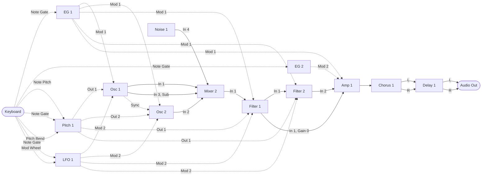

MIDI Synthesizer SPMS-1 (type-2) v0.3.4
=======================================

- Monophonic semi-modular MIDI Synthesizer for Raspberry Pi Pico 2, made with Spinel (Ruby AOT Compiler)
- Controlled by MIDI as a sound module
- Last-note priority with one note of memory: releasing the newest note while the one before it is still held goes back to that one, legato (for trills)
- 48 kHz audio output: 24 bit through an I2S DAC, or PWM Audio (no DAC needed)
- Oscillator: a sawtooth-to-square morph with pulse width (CC#114), and pulse width modulation (PWM) by the same two modulations as the pitch, the envelope and the LFO by default, on CC#8 and 103; and the sawtooth and the pulse on outputs of their own too, and on Osc 1 a sine sub an octave down
- Hard sync: Osc 2 restarts where Sync In, Osc 1's sawtooth by default, rises through zero, at the point between two samples it crosses, with the step rounded off by PolyBLEP as a wrap's is (Sync Sw, CC#112)
- Envelopes: two ADS envelopes, EG 2 on the amp's Mod 2 In, an organ's at power-up, on CC#52, 53 and 54, with the release switch of both on CC#105
- LFO: triangle (PolyBLAMP) and unipolar square (PolyBLEP), each on an output of its own, and a main output crossfading from one to the other (Wave, CC#33); a reset input, on Note Gate by default, that restarts it at each note with Reset Sw (CC#113) on
- Filters: two ZDF/TPT State Variable Filters (with a nonlinear leak on the band pass integrator, solved by the one-step Newton method), each with low pass, high pass and band pass outputs and a main output crossfading from the low pass to the high pass through a notch (Mode, CC#39), and two audio inputs, each with a gain; in series on the same CCs by default, a low pass of the fourth order (24 dB/oct), the first with a resonance of its own (CC#119)
- Amp: two audio inputs, each with a gain of up to +12 dB (CC#15), with a look-ahead limiter that holds the peaks under the one-unit clamp, rounded off rather than cut (Limiter Sw, no CC, on at power-up)
- Chorus: mono in, stereo out, as a module in the run order
- Delay: stereo, with feedback, as a module in the run order (up to 340 ms)
- Pitch: the note's pitch as a module in the run order, with portamento as an exponential lag (CC#5), pitch bend past it (range on CC#57) and a stretch of the keys (CC#22)
- Stereo output: the chorus spreads the mono voice into a left and a right, and the delay keeps them apart
- Developed by ISGK Instruments (Ryo Ishigaki)
- <https://github.com/risgk/midi_synthesizer_spms1>
- [日本語版 README](./README.ja.md)
- [Change History](./spms1_change_history.md)


Required Hardware
-----------------

- Raspberry Pi Pico 2 (RP2350)
    - [Raspberry Pi Pico 2](https://www.raspberrypi.com/products/raspberry-pi-pico-2/)
    - I2S DAC hardware (48 kHz/24 bit): uncomment `SPMS1_USE_I2S_INSTEAD_OF_PWM_AUDIO`
        - Pimoroni [Pico Audio Pack](https://shop.pimoroni.com/products/pico-audio-pack) (PIM544)
        - [Adafruit PCM5102 I2S DAC](https://www.adafruit.com/product/6250) (Product ID: 6250)
        - GY-PCM5102 (PCM5102A I2S DAC Module)
    - Or PWM Audio output, without a DAC (the default of the sketch)
        - L on GP28 and R on GP27, as on the Pimoroni [Pico VGA Demo Base](https://shop.pimoroni.com/products/pimoroni-pico-vga-demo-base) (PIM553)
        - An RC low pass filter on each output is recommended, to take out the PWM ripple
            - It also reduces the radio noise (EMI) radiated from the cables carrying the square waves:
              put it close to the pins, not after the cable
        - Without the RC filter, reduce the level with resistors or the input gain (volume) of the connected device:
          the PWM ripple (3.3 V square waves) may saturate the input (e.g. of an audio interface) and cause beeps or noises,
          even when its level meter looks fine
        - The PWM level (3200 steps) is quantized with 1st-order noise shaping and TPDF dither
        - Each sample is split into 4 PWM periods (PWM carrier: 192 kHz instead of 48 kHz), so the carrier is easier to filter out
          and less likely to cause beeps or whines in active speakers (`SPMS1_PWM_AUDIO_SUBPERIODS`: 1, 2, 4, or 8)
    - NOTE: The RP2350 system clock (sysclk) changes to overclocked 153.6 MHz, set by the sketch's own I2S or PWM Audio output
      ("spms1_pico2_i2s.h" or "spms1_pico2_pwm_audio.h"), not by the Arduino-Pico I2S library


Required Software for Modification
----------------------------------

- [Arduino IDE](https://www.arduino.cc/en/software)
    - The sketch is the "spms1" folder: open "spms1/spms1.ino". The editor, the READMEs and the
      tools stay in this folder, outside it
- Arduino-Pico = Raspberry Pi Pico/RP2040/RP2350 (by Earle F. Philhower, III) core
    - Additional Board Manager URL: <https://github.com/earlephilhower/arduino-pico/releases/download/global/package_rp2040_index.json>
    - This sketch is tested with version 6.3.0: <https://github.com/earlephilhower/arduino-pico/releases/tag/6.3.0>
    - Info: <https://github.com/earlephilhower/arduino-pico>
    - Board: "Raspberry Pi Pico 2", with USB Stack: "Adafruit TinyUSB" in the "Tools" menu
- Arduino MIDI Library (by Francois Best, lathoub)
    - This sketch is tested with version 5.0.2: <https://github.com/FortySevenEffects/arduino_midi_library/releases/tag/5.0.2>
    - Info: <https://github.com/FortySevenEffects/arduino_midi_library>
- Spinel
    - Release: 2026.09.12 <https://github.com/matz/spinel/tree/2026.09.12>
    - The Spinel output file "spms1_main.c" needs no editing. "spinel_rt_mcu_head.h" in this sketch,
      included at the top of "spinel_rt.h", carries `#define main __attribute__((section(".time_critical"), flatten)) Spms1_main`,
      which renames it and puts the synth core in RAM at the same time. Renaming it by hand
      instead leaves the macro with nothing to match, and the core runs from flash
    - What the core calls while it plays, the MIDI accessors in "spms1_midi_state.h" and the audio
      output in "spms1.ino", is put in RAM as well, with `SPMS1_RAM_FUNC`. From flash it would be
      fetched through the XIP cache, which core 0's MIDI and USB code shares, and a burst of MIDI
      would slow the synth's buffer by evicting it
    - The signal bus is a C array of the sketch's, in "spms1_bus.h", which "spinel_rt_mcu_cold.h"
      includes at the end of "spinel_rt.h", so that a bus read or write inlines as one load or store
      rather than going through a checked Spinel Array; so is the run order of the modules, which the
      per-sample dispatch reads for every module, and the reads of the CC values and the NRPN table
      that the synth makes for every parameter once a buffer inline from "spms1_midi_read.h"
    - "spms1_main.c" is generated in "spms1" with `spinel spms1_main.rb -c --rbs sig`. The type seeds
      in "spms1/sig" keep the filter states, the parameter smoothing and the bus writes unboxed;
      "spms1/sig/spms1_filter.rbs", "spms1/sig/spms1_dsp.rbs" and "spms1/sig/spms1_framework.rbs" say
      why they are needed
- Ruby (CRuby), to change the patch's numbers or the default patch, or to add a module: they are
  kept in "spms1_patch.yaml", and `ruby patch_gen/spms1_patch_gen.rb` writes them out to
  "spms1/spms1_patch.rb" (read by "spms1/spms1_main.rb"), the default patch of "spms1/spms1_default_patch.h"
  (for Reset, read by "spms1/spms1_midi_state.h"), the tables of "spms1_editor.html", the NRPN
  tables of "spms1_patching.md" and "spms1_patching.ja.md", and the wiring of the loop in
  "spms1/spms1_main.rb" (see [Adding a Module](./spms1_development.md#adding-a-module)). Run it, then regenerate "spms1/spms1_main.c"; `--check` only
  says whether the files are up to date


Usage
-----

### Prebuilt Binary

- "spms1_i2s.ino.uf2" (in the "bin" folder) is for Raspberry Pi Pico 2 and Pimoroni Pico Audio Pack,
  Adafruit PCM5102 I2S DAC, or GY-PCM5102
- "spms1_pwm_audio.ino.uf2" (in the "bin" folder) is for Raspberry Pi Pico 2 with PWM Audio output, built with L on GP28 and R on GP27


### Getting Started

A path from the sound the synth powers up with to a patch of your own, a step at a time, with the
[Block Diagram](#block-diagram) of the default patch at hand: its modules are the panels of the
editor's Controls tab and the nodes of its Patch tab. Open "spms1_editor.html" (see
[Web Editor](#web-editor)) and choose the synth, or SPMS-1 Web (Built-in), in "MIDI Out".

1. Favorites: the Controls tab opens with "Show favorites only" ticked, showing the 19 parameters
   the default patch marks as favorites, those that change the sound the most:
   Pitch 1 Glide; EG 1 Attack, Decay and Sustain; LFO 1 Rate; Osc 1 Wave, Pitch Mod 1 Amt and
   Pitch Mod 2 Amt; Osc 2 Wave and Pitch; Mixer 2 Level 1 and 2;
   Filter 2 Cutoff, Resonance, Mod 1 Amt and Mod 2 Amt; Amp 1 Gain 2; Chorus 1 Mix; and Delay 1 Mix.
   Mark more with the star as you find them. Osc 2's PW and Mod Amts are on Osc 1's CCs, and each
   parameter of Filter 1 on Filter 2's but its Resonance (CC 119), so a slider of Osc 1 or Filter 2 moves the other's with it,
   though that one is hidden with favorites only
2. Parameters with a CC: clear "Show favorites only" to show every parameter with a CC. What each
   does in the default patch, and what it powers up at, is told below the Block Diagram; the knobs
   of a MIDI controller reach them too
3. Parameters with no CC: tick "Show parameters with no CC" to show the rest, in blue, such as
   Mixer 1's levels and Pitch 1's Out 1 and Out 2 Bend Sw; a slider of one sets the value its slot holds, sent
   as NRPN
4. Patch changes: the Patch tab shows the patch as a diagram of its own, every input and parameter
   included; drag a wire from an output to an input or a parameter to change what feeds it. The
   [Examples](./spms1_patching.md#examples) of Patching give ideas, each with what to wire

Undo takes a change back, Initialize Values puts the values back and keeps the wiring, and Init
puts the default patch back. Keep a patch with Save JSON, or in the synth with Save to Device.


### Web Editor

- Cross-platform web-based parameter controller via Web MIDI API: "spms1_editor.html"
    - If Web MIDI is not available or not allowed, a note under the MIDI settings says so; SPMS-1 Web (Built-in)
      can still be played
    - Its Controls tab shows a slider for each parameter, those with no CC in blue; these are
      hidden until a CC is given to one or it is marked as a favorite, unless "Show parameters with
      no CC", cleared by default, is ticked, and the choice is remembered. The slider of one with no
      CC sets the value its slot holds, sent as NRPN
    - "Show favorites only", ticked by default, shows the parameters marked as favorites (the star)
      alone, with or without a CC, and the choice is remembered
    - A panel there is moved by dragging its heading, within its column or to another, with the
      columns two or four to a row, and in one column (as on a phone) by the arrows at the right of
      its heading, changing places with the panel next to it in the order of the columns one after
      another. Where the panels are is kept in the browser, the same for every patch, and Reset Layout puts them back:
      Osc 1 and Osc 2 heading the first two columns, then Filter 1 to Delay 1, and the modulation,
      Controller to LFO 1, last
    - A note in parentheses follows a parameter's name there: its range, as "(White to Red)" on
      Noise 1 Color, or, on a level or a modulation amount, what the patch routes to the input it
      scales, as "(Osc 1 Sub)" on Mixer 2 Level 3, kept up to date as the routing changes. On the
      Patch tab it is in the name's tooltip
    - A click on the faint star left of a parameter's name marks it as a favorite, and the star turns
      the color of its module and its row a light tint of it; on the Patch tab its row is tinted too. The favorites are saved
      in the patch (JSON) and undone like any other change, but not sent to the synth
    - On its Patch tab a value is dragged up or down like a knob, with Shift for fine steps, or
      stepped by the wheel while it is being edited
    - On the Patch tab, far nodes are wired without zooming out: a wire dragged near an edge of the
      canvas moves the view that way; an output clicked is held, while the view is panned, zoomed or
      pinched, until an input is clicked (Esc or a click on the background lets go); and a click on
      an input or a parameter, on its port or on what it reads, lists the outputs to pick its source
      from, node by node, narrowed by what is typed
    - Every value it sets or shows runs from 4 to 124, the range the synth uses; one outside it,
      from MIDI In or a patch file, is drawn in to the nearer end, which reads the same
    - Its Initialize Values sets each CC value and each parameter's value with no CC back to what it
      powers up at, and sends them, as every change is sent; the wiring is kept
- Built-in software keyboard for note input and testing
    - Beside the keys, a pitch bend wheel, from -8192 to +8191, springs back to the center when let go,
      and a mod wheel moves the CC that Mod Wheel is on in the patch
    - Click its heading to hide it, so the patch editor or the controls take its height; the editor remembers
      which, and the keys of the PC keyboard do not play while it is hidden
    - Panic sends All Sound Off and centers Pitch Bend. The editor follows the Channel Mode messages
      arriving at MIDI In as the synth takes them (below), and CC#120 to 127 cannot be given to a
      parameter
- Graphical patch editor on its Patch tab
    - Wires module outputs to inputs and parameters, and sets the run order and CC assignments
    - Shows every parameter of every module, those with no CC in blue, so a wire always ends on what
      it feeds
    - Saves and loads patches as JSON
    - A patch saved as JSON or copied keeps a CC that only the Mod Wheel has at what it powers up
      at, 0.0, as Save to Device does: the mod wheel is played rather than set; Send Patch sends
      where it is
    - Copies the patch as MIDI bytes or as an NRPN list, or sends it through Web MIDI
    - Sends the whole patch (Send Patch, or a device newly chosen), and what Init and Load change (also by Undo and Redo), between Mute on and off (NRPN
      Mute), so that the patch is not heard half sent, and so does the patch it copies with "Mute
      while loading" (on by default); every other change goes out as it is. The default patch is about
      2,000 bytes, which take about 0.6 s at 31250 bps (UART MIDI) and about 0.5 s by USB MIDI
    - Its Mute button mutes the synth (NRPN Mute), to change the patch unheard, and shows a Mute
      arriving at MIDI In; a Reset (NRPN) arriving at MIDI In puts the patch shown back to the default too
    - Its Save to Device keeps the patch in the synth's flash (NRPN Save), which the synth loads at power-on
    - It does not read the patch from the synth (e.g. the one saved, which the synth loads at power-on): the synth
      takes the editor's when a device is chosen in "MIDI Out", or by Send Patch, in place of its own
    - The side panels (Patch, Run Order, Export) fold to their headings with a click, each remembered;
      with all three folded, the canvas takes the width they leave
- SPMS-1 Web: the synth itself, built into the editor ("spms1_web_synth.js")
    - Select "SPMS-1 Web (Built-in)" in "MIDI Out", and play the soft keyboard (or a MIDI keyboard in "MIDI In")
    - "spms1_main.c" runs in the Web browser as WebAssembly, so it sounds the same as the device
    - See [web/README.md](./web/README.md)


### MIDI Settings

- MIDI Channel: Channel 1
- Channel Mode messages: All Sound Off (CC#120), All Notes Off (CC#123), and Omni Off, Omni On, Mono On
  and Poly On (CC#124 to 127), end every note as letting it go would, so the envelopes release;
  Reset All Controllers (CC#121) centers Pitch Bend, sets the Modulation Wheel (CC#1) to 0 and
  leaves no NRPN selected, and leaves the other CCs, the parameters', as they are. CC#120 to 127
  are not controls and are not stored as CC values
- USB MIDI Input
    - Manufacturer Descriptor: "ISGK Instruments"
    - Device Name: "SPMS-1 (type-2)"
- UART MIDI Input
    - Speed: 31250 bps
    - GP4 and GP5 pins are used by TX and RX, through `SerialPIO`
    - Any pins can be used, TX and RX swapped included, by changing `SPMS1_UART_MIDI_TX_PIN` and
      `SPMS1_UART_MIDI_RX_PIN`
    - DIN/TRS MIDI is available by using (and modifying) Adafruit MIDI FeatherWing Kit, for example
        - Adafruit [MIDI FeatherWing Kit](https://www.adafruit.com/product/4740) (Product ID: 4740)
        - M5Stack [Midi Unit with DIN Connector (SAM2695)](https://shop.m5stack.com/products/midi-unit-with-din-connector-sam2695) (SKU: U187) in Separate mode
        - Kinoshita Laboratory [MIDI-UART interface-san Kit](https://www.tindie.com/products/kinoshitalab/midi-uart-interface-san-kit/)
        - 木下研究所 [MIDI-UARTインターフェースさん キット](https://www.switch-science.com/products/8117) (Shipping to Japan only)
        - necobit電子 [MIDI Unit for GROVE](https://necobit.com/denshi/grove-midi-unit/) (Shipping to Japan only)
        - necobit電子 [MIDI Unit Mini for GROVE](https://necobit.com/denshi/midi-unit-mini-for-grove/) (Shipping to Japan only)


### Latency

About 4 ms from a MIDI message to the sound that answers it:

- Two output buffers of 64 samples each: 2.7 ms
- MIDI is read once per buffer, so a message waits up to one more: 1.3 ms

That is the synth's own; what the MIDI link and the DAC add sits on top of it.


### [MIDI Implementation Chart](./spms1_midi_chart.md)


### Block Diagram

The default patch. Solid arrows carry audio, dashed arrows carry control.



Osc 2's sync and LFO 1's reset are routed, from Osc 1's sawtooth and Note Gate, but their switches
power up off, so neither takes effect until it is turned on. The mod wheel reaches LFO 1's Level Mod In.
Each filter has an Audio In 2, unrouted, for a second path. The amp takes Filter 1 on its Audio In 1 at
a gain of 0.0 and Filter 2 on its Audio In 2, so that the fourth order is heard alone until Gain 1 brings the
second order in beside it.

Each module is processed once per sample, in the [run order](./spms1_patching.md#the-run-order). Their parameters -- waveform,
cutoff, gain and the rest -- arrive from CC and are left out of the diagram. Parameter names
shorten Amount to Amt, Switch to Sw and Polarity to Pol.

The note's pitch reaches the oscillator through Pitch 1, which glides from one note to the next:
portamento. Pitch 1 Glide is on CC#5, Portamento Time in the MIDI spec, and powers up at 0.0, where
the portamento is off and passes the pitch through exactly as it arrives. Pitch 1 has two
outputs from the one glide: Out 1 feeds Osc 1 and the filters' keyboard tracking, and Out 2 feeds
Osc 2. Out 1 Glide Sw and Out 2 Glide Sw, both on CC#34, turn the portamento on and off
for each output without moving Glide: on from value 64, as a MIDI switch is, and on at power-up,
at value 124. The glide moves only while Pitch 1 Gate In, Note Gate by default, is on: between
notes it holds where it is, so a note played after a rest goes on from there. Pitch Bend comes in on Pitch 1 Bend In, which is added to the outputs past the
glide, so the bend acts at once and reaches the oscillators and the filters' keyboard tracking
alike. Out 1 Bend Sw and Out 2 Bend Sw have no CC and power up on; one set off, in
category 4, leaves its output unbent, so the bend can move Osc 2 alone. Pitch 1 Bend Amt is the
bend range, half a semitone a step: on CC#57, 2 semitones either way at value 8, an octave at
value 28, where it powers up, and 5 octaves at value 124.

The LFO goes straight to the oscillator, both to its pitch and to its pulse width, on Mod 2 In, and to the filters, where Mod 2 Amt (CC#25) powers up at 0.0 and
leaves the cutoff alone until it is turned up. The envelope moves the cutoff by Mod 1 Amt
(CC#24), which powers up at 0.2 (value 28), two octaves up from Cutoff (CC#74) at its
peak; the cutoff powers up at 0.8 (value 100). Osc 1 Pitch Mod 2 Amt (CC#13) takes the
LFO to the pitch and powers up at 0.0; at its top, value 124, with Osc 1 Pitch Mod 2 Pol at +0.2,
the LFO at full level swings the pitch an octave either way. Osc 1 PW Mod 2 Amt (CC#103) takes it
to the pulse width and powers up at 0.0. LFO 1 Level powers up at 1.0, so CC#13 alone sets the
vibrato, from none to an octave. The pitch from Pitch 1 reaches the filters too, on their Pitch In, for keyboard tracking: CC#9
(Pitch Amt) at its top has the cutoff follow the note a semitone for a semitone,
unmoved at note 60. Pitch Amt powers up at 0.0 (value 4), so the cutoff stays where CC#74 puts
it whatever the note until CC#9 is turned up.
The envelope reaches the oscillator too, on Osc 1 Mod 1 In, for a pitch envelope: Pitch Mod 1
Amt (CC#89) and PW Mod 1 Amt (CC#8) power up at 0.0, with it off. Each modulation depth spans the
whole range of what it moves, so bringing a source down to a musical depth is left to the patch
rather than built into the modules.

Mixer 2 sums the audio ahead of the filters: Osc 1 on In 1, Osc 2 on In 2, Osc 1's sub on In 3 and
Noise 1's Out on In 4, each at its own level: Level 1 (CC#19) and Level 2 (CC#20) power up at 0.7, so the default patch
plays both oscillators, about as loud together as one at full level, and Level 3 (CC#21) and
Level 4 (CC#23) at 0.0, so the sub and the noise are silent until they are turned up. Osc 2 plays the note from Pitch 1 as Osc
1 does, tuned against it by its own Pitch (CC#85) and Pitch Fine (CC#76), 11 cents sharp at
power-up for a slow beat. Its Wave is its own as well, on CC#104 beside Osc 1's on CC#102. It
follows Osc 1 in everything else: its Mod Amts and its PW are on Osc 1's CCs, so one CC moves
both.

Filter 1 and Filter 2 run in series, one low pass of the fourth order (24 dB/oct): the two are on
the same CCs and power up alike, so each of those CCs moves both, but for the Resonance:
Filter 2's, on CC#71, powers up at its bottom, Q 0.71, and Filter 1's, on CC#119, at Q 4.0, so that
the resonant peak is Filter 1's. Each filter takes Audio In 1 and Audio In 2 at Gain 1 and Gain 2, which have no CC and
power up at unity. Amp 1 takes Filter 1 on Audio In 1 at Gain 1, which has no CC and powers up at
0.0, silent, and Filter 2 on Audio In 2 at Gain 2, on CC#15.

The voice is mono up to the amp. The chorus takes it and puts out a left and a right, the delay
takes the two sides and keeps them apart, and its two outputs are the two sides of the final
output.

None of this is fixed. NRPN rewrites the run order, every arrow above, and which CC feeds each
parameter: see [Patching](./spms1_patching.md).


Documents
---------

- [Patching](./spms1_patching.md): the run order, the filters, Chorus 1 and Delay 1 in detail, and
  editing the patch by NRPN, with its tables, ranges, examples and notes
- [Development](./spms1_development.md): the debug print, the PC simulators, adding a module, the
  load estimate, GitHub Actions, updating Spinel and checking the generated code
- [MIDI Implementation Chart](./spms1_midi_chart.md)


SPMS-1 (type-2) License
-----------------------

```
MIDI Synthesizer SPMS-1 (type-2) by ISGK Instruments (Ryo Ishigaki) is marked with CC0 1.0.
To view a copy of this license, visit https://creativecommons.org/publicdomain/zero/1.0/
```

- Target files: `spms1_*.*`, `spms1/spms1.ino`, `spms1/spms1_*.*`


Spinel License
--------------

```
Copyright (c) 2024- Yukihiro Matsumoto (matz@ruby.or.jp)

Permission is hereby granted, free of charge, to any person obtaining a
copy of this software and associated documentation files (the "Software"),
to deal in the Software without restriction, including without limitation
the rights to use, copy, modify, merge, publish, distribute, sublicense,
and/or sell copies of the Software, and to permit persons to whom the
Software is furnished to do so, subject to the following conditions:

The above copyright notice and this permission notice shall be included in
all copies or substantial portions of the Software.

THE SOFTWARE IS PROVIDED "AS IS", WITHOUT WARRANTY OF ANY KIND, EXPRESS OR
IMPLIED, INCLUDING BUT NOT LIMITED TO THE WARRANTIES OF MERCHANTABILITY,
FITNESS FOR A PARTICULAR PURPOSE AND NONINFRINGEMENT. IN NO EVENT SHALL THE
AUTHORS OR COPYRIGHT HOLDERS BE LIABLE FOR ANY CLAIM, DAMAGES OR OTHER
LIABILITY, WHETHER IN AN ACTION OF CONTRACT, TORT OR OTHERWISE, ARISING
FROM, OUT OF OR IN CONNECTION WITH THE SOFTWARE OR THE USE OR OTHER
DEALINGS IN THE SOFTWARE.
```

- Base Release: 2026.09.12 <https://github.com/matz/spinel/tree/2026.09.12>
- Target files: `spms1/spinel_rt*.h*`, `spms1/mruby_shim.h*`, `spms1/sp_*.*`, `spms1/re_*.*`, `spinel_mcu/*`
    - Note: Some files for runtime are modified for MCU by ISGK Instruments (Ryo Ishigaki)

