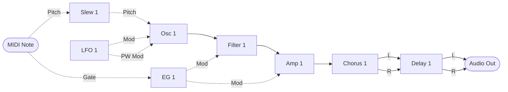
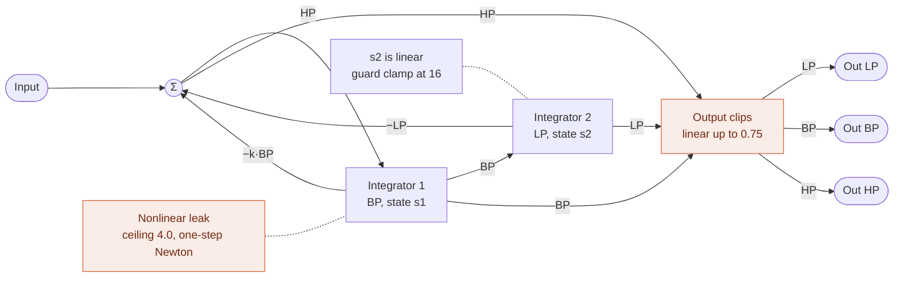
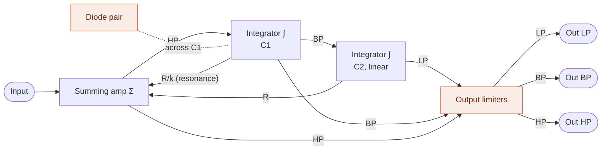

MIDI Synthesizer SPMS-1 (type-2) v0.0.3
=======================================

- Monophonic semi-modular MIDI Synthesizer for Raspberry Pi Pico 2, made with Spinel (Ruby AOT Compiler)
- Controlled by MIDI as a sound module
- Last-note priority with one note of memory: releasing the newest note while the one before it is still held goes back to that one, legato (for trills)
- 48 kHz audio output: 24 bit through an I2S DAC, or PWM Audio (no DAC needed)
- Oscillator: a sawtooth-to-square morph with pulse width (CC 19), and a modulation input of its own for the pulse width (PWM, CC 103)
- Filter: ZDF/TPT State Variable Filter (with a nonlinear leak on the band pass integrator, solved by the one-step Newton method), with low pass, band pass and high pass outputs
- Chorus: mono in, stereo out, as a module in the run order
- Delay: stereo, with feedback, as a module in the run order (up to 340 ms)
- Slew: an exponential lag, as a module in the run order; the default patch puts it on the note pitch as portamento (CC 5)
- Stereo output: the chorus spreads the mono voice into a left and a right, and the delay keeps them apart
- Developed by ISGK Instruments (Ryo Ishigaki)
- <https://github.com/risgk/midi_synthesizer_spms1>
- [日本語版 README](./README.ja.md)


Required Hardware
-----------------

- Raspberry Pi Pico 2 (RP2350)
    - [Raspberry Pi Pico 2](https://www.raspberrypi.com/products/raspberry-pi-pico-2/)
    - I2S DAC hardware (48 kHz/24 bit): uncomment `SPMS1_USE_I2S_INSTEAD_OF_PWM_AUDIO`
        - Pimoroni [Pico Audio Pack](https://shop.pimoroni.com/products/pico-audio-pack) (PIM544)
        - [Adafruit PCM5102 I2S DAC](https://www.adafruit.com/product/6250) (Product ID: 6250)
        - GY-PCM5102 (PCM5102A I2S DAC Module)
    - Or PWM Audio output, without a DAC (the default of the sketch)
        - L on GP28 and R on GP27, as on the Pimoroni [Pico VGA Demo Base](https://shop.pimoroni.com/products/pimoroni-pico-vga-demo-base) (PIM553)
        - An RC low pass filter on each output is recommended, to take out the PWM ripple
            - It also reduces the radio noise (EMI) radiated from the cables carrying the square waves:
              put it close to the pins, not after the cable
        - Without the RC filter, reduce the level with resistors or the input gain (volume) of the connected device:
          the PWM ripple (3.3 V square waves) may saturate the input (e.g. of an audio interface) and cause beeps or noises,
          even when its level meter looks fine
        - The PWM level (3200 steps) is quantized with 1st-order noise shaping and TPDF dither
        - Each sample is split into 4 PWM periods (PWM carrier: 192 kHz instead of 48 kHz), so the carrier is easier to filter out
          and less likely to cause beeps or whines in active speakers (`SPMS1_PWM_AUDIO_SUBPERIODS`: 1, 2, 4, or 8)
    - NOTE: The RP2350 system clock (sysclk) changes to overclocked 153.6 MHz, set by the sketch's own I2S or PWM Audio output
      ("spms1_pico2_i2s.h" or "spms1_pico2_pwm_audio.h", the same as PRA32-U2's), not by the Arduino-Pico I2S library


Required Software for Modification
----------------------------------

- [Arduino IDE](https://www.arduino.cc/en/software)
- Arduino-Pico = Raspberry Pi Pico/RP2040/RP2350 (by Earle F. Philhower, III) core
    - Additional Board Manager URL: <https://github.com/earlephilhower/arduino-pico/releases/download/global/package_rp2040_index.json>
    - This sketch is tested with version 6.2.0: <https://github.com/earlephilhower/arduino-pico/releases/tag/6.2.0>
    - Info: <https://github.com/earlephilhower/arduino-pico>
    - Board: "Raspberry Pi Pico 2", with USB Stack: "Adafruit TinyUSB" in the "Tools" menu
- Arduino MIDI Library (by Francois Best, lathoub)
    - This sketch is tested with version 5.0.2: <https://github.com/FortySevenEffects/arduino_midi_library/releases/tag/5.0.2>
    - Info: <https://github.com/FortySevenEffects/arduino_midi_library>
- Spinel
    - Release: 2026.09.12 <https://github.com/matz/spinel/tree/2026.09.12>
    - The Spinel output file "spms1_main.c" needs no editing. "spinel_rt_mcu_head.h" in this sketch,
      included at the top of "spinel_rt.h", carries `#define main __attribute__((section(".time_critical"), flatten)) Spms1_main`,
      which renames it and puts the synth core in RAM at the same time. Renaming it by hand
      instead leaves the macro with nothing to match, and the core runs from flash
    - "spms1_main.c" is generated with `spinel spms1_main.rb -c --rbs sig`. The type seeds in "sig"
      keep the filter states and the parameter smoothing unboxed; "sig/spms1_filter.rbs" and
      "sig/spms1_dsp.rbs" say why they are needed
- Ruby (CRuby), to change the patch's numbers or the default patch: they are kept in "spms1_patch.yaml",
  and `ruby patch_gen/spms1_patch_gen.rb` writes them out to "spms1_patch.rb" (read by "spms1_main.rb"),
  the tables of "spms1_editor.html", the NRPN tables of this README and "README.ja.md", and the module
  ids and output slots of the dispatch in "spms1_main.rb" (literals, each marked with its constant's
  name). Run it, then regenerate "spms1_main.c"; `--check` only says whether the files are up to date


Usage
-----

### Prebuilt Binary

- "spms1_type2_i2s.ino.uf2" (in the "bin" folder) is for Raspberry Pi Pico 2 and Pimoroni Pico Audio Pack,
  Adafruit PCM5102 I2S DAC, or GY-PCM5102
- "spms1_type2_pwm_audio.ino.uf2" (in the "bin" folder) is for Raspberry Pi Pico 2 with PWM Audio output, built with L on GP28 and R on GP27


### Web Editor

- Cross-platform web-based parameter controller via Web MIDI API: "spms1_editor.html"
- Built-in software keyboard for note input and testing
    - Click its heading to hide it, so the patch editor or the controls take its height; the editor remembers
      which, and the keys of the PC keyboard do not play while it is hidden
- Graphical patch editor on its Patch tab
    - Wires module outputs to inputs and parameters, and sets the run order and CC assignments
    - Saves and loads patches as JSON
    - Copies the patch as MIDI bytes or as an NRPN list, or sends it through Web MIDI
    - The side panels (Patch, Run Order, Export) fold to their headings with a click, each remembered;
      with all three folded, the canvas takes the width they leave
- SPMS-1 Web: the synth itself, built into the editor ("spms1_web_synth.js")
    - Select "SPMS-1 Web (Built-in)" in "MIDI Out", and play the soft keyboard (or a MIDI keyboard in "MIDI In")
    - "spms1_main.c" runs in the Web browser as WebAssembly, so it sounds the same as the device
    - See [web/README.md](./web/README.md)


### MIDI Settings

- MIDI Channel: Channel 1
- USB MIDI Input
    - Manufacturer Descriptor: "ISGK Instruments"
    - Device Name: "SPMS-1 (type-2)"
- UART MIDI Input
    - Speed: 31250 bps
    - GP4 and GP5 pins are used by TX and RX, through `SerialPIO`
    - Any pins can be used, TX and RX swapped included, by changing `SPMS1_UART_MIDI_TX_PIN` and
      `SPMS1_UART_MIDI_RX_PIN`
    - DIN/TRS MIDI is available by using (and modifying) Adafruit MIDI FeatherWing Kit, for example
        - Adafruit [MIDI FeatherWing Kit](https://www.adafruit.com/product/4740) (Product ID: 4740)
        - M5Stack [Midi Unit with DIN Connector (SAM2695)](https://shop.m5stack.com/products/midi-unit-with-din-connector-sam2695) (SKU: U187) in Separate mode
        - Kinoshita Laboratory [MIDI-UART interface-san Kit](https://www.tindie.com/products/kinoshitalab/midi-uart-interface-san-kit/)
        - 木下研究所 [MIDI-UARTインターフェースさん キット](https://www.switch-science.com/products/8117) (Shipping to Japan only)
        - necobit電子 [MIDI Unit for GROVE](https://necobit.com/denshi/grove-midi-unit/) (Shipping to Japan only)
        - necobit電子 [MIDI Unit Mini for GROVE](https://necobit.com/denshi/midi-unit-mini-for-grove/) (Shipping to Japan only)


### Latency

About 4 ms from a MIDI message to the sound that answers it:

- Two output buffers of 64 samples each: 2.7 ms
- MIDI is read once per buffer, so a message waits up to one more: 1.3 ms

That is the synth's own; what the MIDI link and the DAC add sits on top of it.


### [MIDI Implementation Chart](./spms1_midi_chart.md)


### Block Diagram

The default patch. Solid arrows carry audio, dashed arrows carry control.



Each module is processed once per sample, in the run order below. Their parameters -- waveform,
cutoff, gain and the rest -- arrive from CC and are left out of the diagram.

The note's pitch reaches the oscillator through Slew 1, which glides from one note to the next:
portamento. Slew 1 Time is on CC 5, Portamento Time in the MIDI spec, and powers up at 0.0, where
the slew is off and passes the pitch through exactly as it arrives.

The LFO goes straight to the oscillator, both to its pitch and to its pulse width, at its full
level: LFO 1 Polarity reads the constant 0.5. Osc 1 Pitch Mod Polarity reads the constant 0.1, which
brings it down to a vibrato depth on the pitch, while Osc 1 PW Mod Polarity reads 0.5 and takes
the LFO whole. Each modulation depth spans the whole range of what it moves, so bringing a source
down to a musical depth is left to the patch rather than built into the oscillator.

The voice is mono up to the amp. The chorus takes it and puts out a left and a right, the delay
takes the two sides and keeps them apart, and its two outputs are the two sides of the final
output.

None of this is fixed. NRPN rewrites the run order, every arrow above, and which CC feeds each
parameter.

#### The run order

Every module is in it: the slew first, one of each kind that makes a sound, a mixer between the
modulation sources and the oscillator, and the chorus and the delay last:


The mixer has nothing routed to it, so it costs its slot every sample and changes nothing until
a patch gives it something. Where it sits is what it buys: a module sees the current sample's
value only from something ahead of it in this line, and last sample's from anything behind.
Mixer 1 can reach the LFO and the envelope, and the oscillator, the filter and the amp can reach
Mixer 1. The slew comes first so that whatever reads it, in its default place or another, sees it
in the same sample.

A mixer is what lets two of anything meet, and what makes a signal that runs one way, such as the
envelope, swing both ways. See the examples below.

#### Filter 1

A zero-delay feedback state variable filter. The band pass integrator leaks, more and more as the
band pass bends into a soft clip curve, and that is what holds the resonance down; at small levels
the leak is next to nothing, so the pass band passes nearly clean. The loop equation, leak
included, is solved every sample by the one-step Newton method from the linear solution, which
lands almost on the root. The leak's rate is fixed in time, so the sound does not change with the
sample rate. The low pass state stays linear, with a
clamp at 16 as a guard that ordinary use never reaches. The output clip comes last. At the top of
the resonance dial k turns negative and the loop oscillates.

The filter puts out its low pass, band pass and high pass at once, as Out LP, Out BP and Out HP,
each through a DC blocker and an output clip of its own. Out LP is the one the default patch
uses, in the slot the single output had. The three add up as a state variable filter's do, the
input being LP + k·BP + HP, so the band pass peaks at Q times the input at the cutoff, as the
low pass does; with the resonance up it is the loudest of the three.



The same structure redrawn as an op-amp integrator filter. The diode pair stands for the
nonlinear leak and the output limiter for the output clip. It is an interpretation, not a reproduction of
an actual circuit.



#### Chorus 1

A mono-in, stereo-out chorus, after PRA32-U2's Chorus FX, put in the chain as an insert, as the
delay is: Mix sets the balance of dry and chorused, rather than a send level. The input goes through a gentle low pass
filter into one short delay line, which is read at two taps. A triangle LFO swings the two taps in
opposite directions about 5.33 ms, so the left and right delayed signals bend in pitch against
each other. Each output is a crossfade of the input with its own tap, so a mono source comes out
spread across the stereo field.


It needs no limiter and no clip after it: the input is held to one unit on the way in, and the
filter, the reading between two samples and the crossfades are all weighted averages, which cannot
reach past what they average. The delay the taps swing about is fixed, as PRA32-U2 keeps its own
internal.

#### Delay 1

A stereo delay with feedback, after PRA32-U2's Delay FX in its Stereo Delay mode. Each side has a
delay line and a loop of its own: half its input and its delayed signal at the Feedback gain go
through a gentle low pass filter into its line, and its output is a crossfade of its input with
its delayed signal. Time, Feedback and Mix are shared, so the two sides repeat together and keep
the stereo image they came in with.


The diagram is one side; the other is the same. It needs no limiter and no clip after it. With
half the input coming in and at most half the delayed signal going round again, what is written
back stays within one unit as long as the delayed signal does, and it starts from silence; the
filter, the reading between two samples and the crossfade are all weighted averages, which cannot
reach past what they average. The price is that the first repeat comes 6 dB under the dry signal.
Each input is held to one unit on the way in, as the amp holds its modulation input, so whatever
is routed to it the bound holds.

### Patch Editing (NRPN)

The patch is data, and NRPN rewrites it while the synth is running: which modules run and in what
order, what feeds each module input, where each parameter takes its value from, and which CC fills
each control slot. Every module reads from a numbered signal slot and writes to one, so rewiring is
a matter of changing slot numbers.

#### Sending

- CC 99 selects the category, CC 98 the entry within it, in either order
- CC 6 (Data Entry MSB) commits the value, and takes effect on the next audio buffer
- CC 38 (Data Entry LSB) is ignored: every value here is 7-bit
- CC 101 and CC 100 (RPN select) suspend data entry, so an RPN is never taken as a patch edit.
  Send CC 99 or CC 98 again to resume
- Edits are not saved. The default patch is restored at power-on

#### Categories (CC 99)

| CC 99 | CC 98 | Sets | CC 6 value |
| ----- | ----- | ---- | ---------- |
| 0 | 0-31 | Run order, slot by slot | Module ID |
| 1 | 0-14 | What feeds a module input | Signal ID |
| 2 | 0-28, 34 | Where a parameter takes its value | Signal ID |
| 3 | 0-34 | Which CC fills a control slot | CC number, or 0 for none |

The run order is read from slot 0 upwards and stops at the first Module ID 0, so a patch shorter
than 32 modules ends itself. It is separate from the module numbering: a module only sees the
current sample's value from something listed before it, and last sample's from something after.
A module listed more than once runs once, at the slot written last, as if its other slots were
not there: the last write wins, whether its slot is ahead of the others or after them. A module
written to a new slot moves there, and the module that slot held leaves the order.

In category 3, CC number 0 means the parameter has no CC. Its control slot then holds 0.0, whatever
CC it had before, so the patch alone sets what the parameter reads.

There is one of every module that makes a sound, one mixer, one chorus, one delay and one slew,
and **all nine are in the default run order**, so a patch only ever has to route, never to switch something
on first. Taking the chorus or the delay out of the order saves its share of the time, which
leaves what read it to be pointed elsewhere; see the examples below.
A mixer is the only kind with no CC on any of its parameters: the default patch points them at
constants instead, each level at 1.0 and each polarity at +0.5, so a mixer with one input routed
passes it through rather than muting it.

#### Entries (CC 98), category 1

<!-- patch_gen inputs -->

| CC 98 | Module input | | CC 98 | Module input |
| ----- | ------ | - | ----- | ------ |
| 0 | EG 1 Gate | | 9 | Chorus 1 Audio In |
| 1 | Osc 1 Pitch | | 10 | Delay 1 Audio In L |
| 2 | Osc 1 Pitch Mod In | | 11 | Delay 1 Audio In R |
| 3 | Filter 1 Audio In | | 12 | Final Output L |
| 4 | Filter 1 Mod In | | 13 | Final Output R |
| 5 | Amp 1 Audio In | | 14 | Slew 1 In |
| 6 | Amp 1 Mod In | | 15 | Osc 1 PW Mod In |
| 7 | Mixer 1 In 1 | | 16 | LFO 1 Rate Mod In |
| 8 | Mixer 1 In 2 | |  |  |

<!-- patch_gen end -->

Most of these take what their name suggests, but three do not say it on their face. A Gate is a
threshold rather than a level: an envelope triggers as the signal reaches 0.25 and releases as it
falls back. A Pitch is -0.5 to +0.5 across MIDI notes 0 to 120, so 0.0 is note 60 and a tenth of
a unit is an octave. And a Mod In is taken as it arrives: nothing is held to a range on the way
in, and what gets clamped is the value the module ends up with -- cutoff to the ends of its dial,
pitch to -0.5 and +0.5, pulse width to 0.0 and 1.0. A PW Mod In is a Mod In too. A mixer adds without a ceiling, so a loud modulation pins its
destination at one end rather than being trimmed on the way in. The amp is the exception, and
holds its modulation input to -1.0 and +1.0: it is an attenuator, so a modulation may scale its
gain down but never up. The chorus and the delay hold their audio inputs to the same one unit.
The slew's In takes anything, as a Mod In does, and puts out what it takes, only later.

The two sides of the final output are read separately, so either can be pointed anywhere; point
both at the same signal for a mono output.

#### Entries (CC 98), categories 2 and 3

<!-- patch_gen params -->

| CC 98 | Parameter | | CC 98 | Parameter | | CC 98 | Parameter |
| ----- | ------ | - | ----- | ------ | - | ----- | ------ |
| 0 | LFO 1 Rate | | 13 | Filter 1 Cutoff | | 26 | Delay 1 Time |
| 1 | LFO 1 Level | | 14 | Filter 1 Resonance | | 27 | Delay 1 Feedback |
| 2 | LFO 1 Polarity | | 15 | Filter 1 Gain | | 28 | Delay 1 Mix |
| 3 | EG 1 Attack | | 16 | Filter 1 Mod Amt | | 34 | Slew 1 Time |
| 4 | EG 1 Decay | | 17 | Filter 1 Mod Polarity | | 35 | Osc 1 Pulse Width |
| 5 | EG 1 Sustain | | 18 | Amp 1 Gain | | 36 | Osc 1 PW Mod Amt |
| 6 | EG 1 Level | | 19 | Mixer 1 Level 1 | | 37 | Osc 1 PW Mod Polarity |
| 7 | EG 1 Polarity | | 20 | Mixer 1 Polarity 1 | | 38 | EG 1 Release Switch |
| 8 | Osc 1 Wave | | 21 | Mixer 1 Level 2 | | 39 | Amp 1 Mod Amt |
| 9 | Osc 1 Coarse Tune | | 22 | Mixer 1 Polarity 2 | | 40 | Amp 1 Mod Polarity |
| 10 | Osc 1 Fine Tune | | 23 | Chorus 1 Rate | | 41 | LFO 1 Rate Mod Amt |
| 11 | Osc 1 Pitch Mod Amt | | 24 | Chorus 1 Depth | | 42 | LFO 1 Rate Mod Polarity |
| 12 | Osc 1 Pitch Mod Polarity | | 25 | Chorus 1 Mix | |  |  |

<!-- patch_gen end -->

#### Entries (CC 98), category 3 only

These CCs belong to no parameter, so category 2 has no entry for them. Each of General 1-4 fills
two slots, a unipolar and a bipolar one. See the General slots below.

<!-- patch_gen generals -->

| CC 98 | CC for | Fills |
| ----- | ------ | ----- |
| 29 | General Mod Wheel | General Mod Wheel |
| 30 | General 1 | General Unipolar 1, General Bipolar 1 |
| 31 | General 2 | General Unipolar 2, General Bipolar 2 |
| 32 | General 3 | General Unipolar 3, General Bipolar 3 |
| 33 | General 4 | General Unipolar 4, General Bipolar 4 |

<!-- patch_gen end -->

#### Module IDs

<!-- patch_gen modules -->

| ID | Module |
| ----- | ------ |
| 0 | None (ends the run order) |
| 1 | LFO 1 |
| 2 | EG 1 |
| 3 | Osc 1 |
| 4 | Filter 1 |
| 5 | Amp 1 |
| 6 | Mixer 1 |
| 7 | Chorus 1 |
| 8 | Delay 1 |
| 9 | Slew 1 |

<!-- patch_gen end -->

#### Signal IDs

<!-- patch_gen signals -->

| ID | Signal | | ID | Signal | | ID | Signal |
| ----- | ------ | - | ----- | ------ | - | ----- | ------ |
| 0 | None (constant 0.0) | | 24 | EG 1 Sustain | | 48 | Note Pitch ± |
| 1 | Constant 1.0 | | 25 | EG 1 Level | | 49 | Note Gate |
| 2 | Constant 0.5 | | 26 | EG 1 Polarity ± | | 50 | Pitch Bend ± |
| 3 | Constant 0.2 | | 27 | Osc 1 Wave | | 51 | General Mod Wheel |
| 4 | Constant 0.1 | | 28 | Osc 1 Coarse Tune ± | | 52 | General Unipolar 1 |
| 5 | Constant -0.1 | | 29 | Osc 1 Fine Tune ± | | 53 | General Unipolar 2 |
| 6 | Constant -0.2 | | 30 | Osc 1 Pitch Mod Amt | | 54 | General Unipolar 3 |
| 7 | Constant -0.5 | | 31 | Osc 1 Pitch Mod Polarity ± | | 55 | General Unipolar 4 |
| 8 | Constant -1.0 | | 32 | Filter 1 Cutoff | | 56 | General Bipolar 1 ± |
| 9 | LFO 1 Output ± | | 33 | Filter 1 Resonance | | 57 | General Bipolar 2 ± |
| 10 | EG 1 Output ± | | 34 | Filter 1 Gain | | 58 | General Bipolar 3 ± |
| 11 | Osc 1 Output ± | | 35 | Filter 1 Mod Amt | | 59 | General Bipolar 4 ± |
| 12 | Filter 1 Output LP ± | | 36 | Filter 1 Mod Polarity ± | | 60 | Slew 1 Output ± |
| 13 | Amp 1 Output ± | | 37 | Amp 1 Gain | | 61 | Slew 1 Time |
| 14 | Mixer 1 Output ± | | 38 | Mixer 1 Level 1 | | 62 | Osc 1 Pulse Width |
| 15 | Chorus 1 Output L ± | | 39 | Mixer 1 Polarity 1 ± | | 63 | Osc 1 PW Mod Amt |
| 16 | Chorus 1 Output R ± | | 40 | Mixer 1 Level 2 | | 64 | Osc 1 PW Mod Polarity ± |
| 17 | Delay 1 Output L ± | | 41 | Mixer 1 Polarity 2 ± | | 65 | Filter 1 Output BP ± |
| 18 | Delay 1 Output R ± | | 42 | Chorus 1 Rate | | 66 | Filter 1 Output HP ± |
| 19 | LFO 1 Rate | | 43 | Chorus 1 Depth | | 67 | EG 1 Release Switch |
| 20 | LFO 1 Level | | 44 | Chorus 1 Mix | | 68 | Amp 1 Mod Amt |
| 21 | LFO 1 Polarity ± | | 45 | Delay 1 Time | | 69 | Amp 1 Mod Polarity ± |
| 22 | EG 1 Attack | | 46 | Delay 1 Feedback | | 70 | LFO 1 Rate Mod Amt |
| 23 | EG 1 Decay | | 47 | Delay 1 Mix | | 71 | LFO 1 Rate Mod Polarity ± |

<!-- patch_gen end -->

A **±** marks a signal that swings both ways: a module output reaches -0.5 and +0.5 at full
scale, a bipolar control slot runs -0.5 to +0.5, and a mixer sums two of them and stops at one.
The envelope is the exception: 0.0 to 1.0 at the default Polarity of +0.5, and down to -1.0 once
its Polarity is turned negative. Everything unmarked runs 0.0 to 1.0 -- Note Gate and every
unipolar control slot. The bus carries both kinds under one numbering, so the range belongs to the slot
rather than to the sort of thing that wrote it.

Slots 19-47, 61, 62-64 and 67-71 hold the values arriving from CC, so a parameter reads its own CC by default. Each
parameter is unipolar or bipolar, and its slot takes the same range. A unipolar one runs 0.0 to
1.0 from CC 4 to CC 124, the span of an envelope, so an envelope pointed at one sweeps the whole
of its dial. A bipolar one runs -0.5 to +0.5 with CC 64 at 0.0, the span of an LFO, so a bipolar
source pointed at one swings it about the middle. The two tune controls are bipolar, since their
middle is no change at all, and so is every Polarity -- the LFO's, the EG's, the mixer's and the five
Mod Polarity controls -- since its sign is what it sets. Pointing a parameter at another slot is what
makes a modulation. A slot with no CC holds 0.0.

Slots 51-59, the General slots, are control slots that no parameter owns: a CC put on the bus for
any module input or parameter to read. General Mod Wheel reads CC 1, runs 0.0 to 1.0 and powers
up at CC 4, so it is at 0.0 until the wheel moves; nothing is routed to it by default. General 1-4
read CC 16, 17, 18 and 113 by default, and each puts its CC on the bus both ways at once: General Unipolar 1-4
run 0.0 to 1.0 and General Bipolar 1-4 run -0.5 to +0.5. All four power up at CC 64, so the
unipolar slots start at 0.5 and the bipolar ones at 0.0.

Note Pitch, Note Gate and Pitch Bend are what the keyboard puts on the bus. Note Pitch carries
MIDI notes 0 to 120 as -0.5 to +0.5, the same span the oscillator reads as its whole pitch
range, and Pitch Bend is bipolar too, one unit across the whole wheel: exactly -0.5 and +0.5 at
the ends of its travel and exactly zero at the centre detent, so it can feed a module input
without a mixer to shift it. Note Gate is 0.0 or 1.0, and an envelope triggers at 0.25. Nothing
is routed to Pitch Bend by default.

The newest note sounds, and the note it took over from is remembered while it is still held: one
note, no more. When the newest note is released, the remembered one comes back with Note Gate
left at 1.0, so the envelopes go on without a new attack, and holding one key while tapping
another plays a trill. Releasing the remembered note only forgets it, and with three keys held,
releasing the newest goes back to the second, and releasing that closes the gate, even with the
first still held.

Slots 0-8 are constants that nothing writes, for inputs that want a fixed value rather than a
source. Signal 0 is also what an entry nobody has set reads as, so an unrouted input is silent
rather than wired to whatever sits in the first slot. Signal 1 is the value an unmodulated input
wants: routing an amp's modulation input to it leaves the amp at full level. Signals 0 and 1 are
the two ends of a unipolar parameter's range and Signals 7 and 2 of a bipolar one, for pinning
one there; Signal 2 is also the middle of a unipolar dial. Signal 3 is a fifth of full scale and
Signal 6 its negative. Signal 4 is the Osc 1 Pitch Mod Polarity the default patch uses, which brings the
LFO down to a vibrato depth, and Signal 5 its negative. A constant on a mixer's second input
shifts a signal between the two kinds: -0.5 turns one that runs one way into one that swings
both, and +0.5 the other way round.

The ID numbers are not stable across firmware versions. A patch is never saved, so a new module
type, another instance of one, or another signal may renumber everything after it. Read these
tables again after an update.

#### Ranges worth knowing

Both tune controls are centred on CC 64 and move one whole unit per CC step: Coarse Tune a
semitone, reaching 5 octaves either way, and Fine Tune a cent, reaching 60 either way. They are
summed, so any pitch is reachable.

LFO 1 Level and LFO 1 Polarity scale the LFO's output together, as a mixer's Level and Polarity
scale its input: Level from silent at 0.0 (CC 4) to full at 1.0 (CC 124), and Polarity from
negated at -0.5 (CC 4), through silence at 0.0 (CC 64), to unchanged at +0.5 (CC 124). Neither has a
CC: the default patch points Level at the constant 1.0 and Polarity at the constant 0.5, which
pass the LFO through as it is.

LFO 1 Rate Mod In moves the rate by Rate Mod Amt times Rate Mod Polarity, as Pitch Mod In moves the
oscillator's pitch: a unit of input times depth is the whole rate range, ten octaves, so 0.1 is an
octave. Neither has a CC, and the default patch points them at 1.0 and +0.5, a depth of 1.0, and
leaves Rate Mod In unrouted, so routing a source to it is all it takes. It is read every fourth
sample, where the LFO works out its rate, rather than every sample as the other module inputs are.

EG 1 Level and EG 1 Polarity scale the envelope's output the same way, over the same ranges.
Neither has a CC, and the default patch points them at the constants 1.0 and +0.5, which pass
the envelope through as it is.

Amp 1 Mod Amt and Amp 1 Mod Polarity scale what Mod In does to the gain, as the other modules' Mod
Amt and Mod Polarity do, but the amp multiplies by its modulation rather than adding it: at a
depth of 1.0 the envelope passes as it arrives, at 0.5 the amp is 6 dB down, at 0.0 it is shut,
and a negative depth inverts the output. Neither has a CC, and the default patch points them at
the constants 1.0 and +0.5, a depth of 1.0.

EG 1 Release Switch, on CC 105 as in PRA32-U2, picks the release, after the note's gate falls: on
from 0.5 up (CC 64-124), it runs at the decay's rate, set by EG 1 Decay; off below 0.5 (CC 4-63), it
runs at the shortest decay's, 10 ms, whatever the decay is, so a long decay still ends a note
short. It powers up on. It is a switch, so it is not smoothed.

Each modulation depth is Mod Amt times Mod Polarity, the second doubled: Mod Polarity passes
Mod Amt through at +0.5 (CC 124), silences it at 0.0 (CC 64) and negates it at -0.5 (CC 4), and
the way between scales it, so it sets depth as well as direction. Mod Polarity has no CC and the
default patch points it at a constant, so either can be the one that is turned: Mod Amt for
a depth in one direction, Mod Polarity for one that crosses zero.

Osc 1 Pitch Mod Amt is a depth, not an offset, and it reaches the whole pitch range: at its top a
bipolar source swings the pitch five octaves up and five down. That is a coarse dial for vibrato,
half a semitone per CC step, which is why the default patch brings the LFO down to a fifth with
Osc 1 Pitch Mod Polarity. There a semitone of vibrato sits at CC 14 and an octave at the top of the dial.

Osc 1 Pulse Width shifts the second of the two sawtooths that the morph is made of, from half a
cycle at 0.0 (CC 4) toward a whole one at 1.0 (CC 124). At the square end of Osc 1 Wave that is a
pulse of 50% at CC 4, 25% at CC 64 and 0%, silence, at CC 124; it is CC 19, where PRA32-U2 has
Osc 1 Shape. Osc 1 PW Mod In moves it, by PW Mod Amt (CC 103) times PW Mod Polarity, the same
way as Pitch Mod In, Pitch Mod Amt and Pitch Mod Polarity move the pitch. A unit of modulation is the whole pulse
width range, so at the top of PW Mod Amt the LFO, which the default patch feeds it, swings the
pulse width half the range either way: with Pulse Width at CC 64, from 50% to nearly 0%. The pulse
width the modulation adds up to is held to 0.0 to 1.0.

Filter 1 Gain sets how hard the audio input drives the filter, which is also what decides how far
the filter runs into its own saturation. Its default of CC 64 is the level the oscillator used to
be scaled to on its own. The saturation sits on the resonance rather than the pass band: a low
cutoff passes a loud note nearly clean, while turning the gain up rounds off the resonant peak.

Filter 1 Resonance raises the resonant peak 6 dB every 30 CC steps, Q doubling each time, up to
Q 5.66 at CC 94, and from there Q rises faster and faster, without a sudden step, through Q 29
at CC 109 to Q 256 at CC 118. Above that the filter oscillates on its own: a sine at the cutoff
frequency, growing to its full level of about 0.5 by CC 123 and holding it to the top of the
dial. Low in that range the oscillation builds slowly and shares the filter with the input; at
the top it takes the input over. Its level holds across the cutoff range down to about 150 Hz
and falls below that. Near the top of the cutoff range it fades out, before its 3rd harmonic
folds back as an inharmonic tone: at 48 kHz, from 8 kHz (CC 108) to 10 kHz (CC 112), modulation
included. Above that the resonance acts as at Q 256. With the cutoff following the keyboard, as
in the examples below, it plays as a sine voice.

A mixer takes each input at its own level and its own polarity, then adds them. Level runs from
silent at 0.0 (CC 4) to full at 1.0 (CC 124), and Polarity from negated at -0.5 (CC 4), through
silence at 0.0 (CC 64), to unchanged at +0.5 (CC 124). Levels default to full and polarities to
unchanged, so a mixer with one input routed is a buffer; inverting that one input makes it an
inverter; and inverting only the second makes the mixer a subtractor.

The sum is held to -1.0 and +1.0. Two full-scale signals reach exactly that, so nothing ordinary
is cut; what it stops is a mixer wired back to its own input, which would otherwise double every
sample until the number stopped being a number and took the oscillator or the filter with it.
The filter is held to the same one unit, by a curve rather than a corner: its output passes
untouched up to three quarters of a unit, well above anything the default patch reaches, and
above that bends smoothly onto the limit. Its resonant peak can climb past one unit on a sweep,
and rounding that off makes far weaker high harmonics than a hard edge would fold back down into
the note.

The three Chorus 1 parameters are unipolar and move in steps of 1/120. Rate is read as a note
number, a semitone a step, as LFO 1 Rate is: 0.015 Hz at CC 4, 0.48 Hz at CC 64 and 15.4 Hz at
CC 124, the default divided and multiplied by 32. Depth is how far each tap swings either side of 5.33 ms, in a straight line from not at
all at CC 4, through 2.63 ms at CC 64, to 5.25 ms at CC 124. Mix is each tap's share of its side's
crossfade: the dry input alone at CC 4, half and half at CC 64 -- the chorus PRA32-U2 makes at full
Chorus Level -- and only the taps at CC 124, a vibrato on each side, the two moving opposite ways.
All three power up at CC 64. The halves of the crossfade are what hold the chorus to one unit, so
at the default the dry signal is 6 dB down, and the sum with the tap makes up some of it.

The three Delay 1 parameters are unipolar and move in steps of 1/120, as every unipolar dial
does. Time runs in a straight line, 2.83 ms a step, from 0 at CC 4 to 340 ms at CC 124, and is
clipped to 2.83 ms at the bottom, so it holds 2.83 ms up to CC 5; it is 170 ms at CC 64. Turning
it bends the pitch of the repeats, by at most 25%, as a tape delay's would, and they reach the new
time a moment later. Feedback is the gain from the repeats back into the line, from 0 at CC 4, a
single repeat, to 0.5 at CC 124, where each repeat comes back 6 dB down and a little darker; it is
0.25 at CC 64. Mix is the repeats' share of the crossfade, from the dry input alone at CC 4 to the
repeats alone at CC 124, half and half at CC 64. Time and Feedback power up at CC 64 and Mix at
CC 34, 0.25: the dry signal is 2.5 dB down and the first repeat about 16 dB under it.

Slew 1 Time is unipolar and moves in steps of 1/120, a semitone of time a step, as EG 1 Decay
does and over the same range: from 10 ms at CC 5 through 320 ms at CC 64 to 10.24 s at CC 124,
each the time to come within 1/1024 of the way, where a glide of an octave is a hundredth of a
semitone short; nine tenths of the way take a third of it. At CC 4 and below, 0.0, the slew is
off, and its output is its input exactly. The glide is exponential, quick at first and slowing
as it lands, as an analog synth's portamento is, and it starts from wherever the output is, so a
note played during a glide takes it over from there. The time is not smoothed: a change in it
changes only how fast the output moves, so it cannot step it.

#### Examples

- Vibrato is wired by default -- the LFO goes straight to the oscillator's pitch modulation input --
  so CC 13 sets the depth and CC 3 the rate. CC 99 = 2, CC 98 = 1, CC 6 = 51 takes LFO 1 Level
  from General Mod Wheel, so the wheel brings the vibrato in up to the depth CC 13 sets
- Filter cutoff follows note pitch (keyboard tracking): CC 99 = 1, CC 98 = 4, CC 6 = 48 puts
  Note Pitch on the filter's modulation input in the envelope's place. With the cutoff at CC 64
  and Mod Amt at CC 124, note 60 leaves the cutoff at the middle of its dial and each note moves
  it a semitone
- Filter cutoff swept by the LFO about the middle of its dial: CC 99 = 1, CC 98 = 4, CC 6 = 9.
  A module input is read every sample, so the LFO can run at any rate
- Filter cutoff driven by the envelope instead of its CC: CC 99 = 2, CC 98 = 13, CC 6 = 10. The
  envelope and the cutoff are both unipolar, so it opens the cutoff from the bottom of its dial
  to the top
- Amp gain and filter cutoff share one CC: CC 99 = 3, CC 98 = 18, CC 6 = 74
- Amp at full level with no envelope: CC 99 = 1, CC 98 = 6, CC 6 = 1
- Disconnect the filter's modulation input: CC 99 = 1, CC 98 = 4, CC 6 = 0
- A pitch envelope 60 cents deep: CC 99 = 2, CC 98 = 10, CC 6 = 10 points Osc 1 Fine Tune at the
  envelope, which then sweeps the tuning from in tune up to 60 cents sharp, reached at half the
  envelope's peak
- The envelope drives the filter harder as a note starts: CC 99 = 2, CC 98 = 15, CC 6 = 10 takes
  the filter's input level from silence up to the top of its dial and back
- Pitch swept by the envelope instead of the LFO: CC 99 = 1, CC 98 = 2, CC 6 = 10 puts the
  envelope on the oscillator's pitch modulation input in the LFO's place, and CC 99 = 2, CC 98 = 12,
  CC 6 = 2 sets Osc 1 Pitch Mod Polarity back to +0.5 from the LFO's vibrato depth; then set the depth on
  CC 13. Nothing scales the envelope down on this path, so a semitone is at CC 5 and an octave at
  CC 16
- Portamento is wired by default -- Note Pitch reaches the oscillator through Slew 1 -- so CC 5
  sets the time; CC 64 is a glide of about a tenth of a second. Every note glides, played legato
  or not. CC 99 = 2, CC 98 = 34, CC 6 = 51 takes the time from General Mod Wheel instead, so the
  wheel brings the portamento in
- Pitch bend, which nothing is routed to by default. CC 99 = 1 with CC 98 = 7 and 8, CC 6 = 48
  and 50 puts Note Pitch and Pitch Bend on Mixer 1's two inputs, and CC 99 = 1, CC 98 = 1,
  CC 6 = 14 makes that sum the oscillator's pitch, in Slew 1's place. Mixer 1 runs ahead of the oscillator, so the
  wheel moves the note in the same sample. Both levels are full, so the wheel reaches five
  octaves either way; CC 99 = 2, CC 98 = 21, CC 6 = 52 takes Mixer 1's second level from General
  Unipolar 1, so CC 16 trims that down to a bend range worth playing
- A CC that bends pitch both ways through the modulation input. Mixer 1 runs ahead of the
  oscillator and is free: CC 99 = 1, CC 98 = 7, CC 6 = 32 puts the filter cutoff's control slot on
  its first input, CC 98 = 8, CC 6 = 7 the constant -0.5 on its second, and CC 98 = 2, CC 6 = 14
  points the oscillator's pitch modulation input at Mixer 1 in the LFO's place, and CC 99 = 2,
  CC 98 = 12, CC 6 = 2 sets Osc 1 Pitch Mod Polarity back to +0.5. The slot is unipolar, so
  that constant is what centres it on CC 64 as the LFO is on zero. CC 74 now bends the pitch down
  and up around the note, as far as CC 13 allows: a semitone either way at CC 6, an octave at
  CC 28
- A CC that works backwards, which needs a mixer to invert it. Mixer 1 is already running, so it
  only needs wiring: CC 99 = 1, CC 98 = 7, CC 6 = 32 puts the cutoff's control slot on its first
  input and CC 98 = 8, CC 6 = 1 the constant 1.0 on its second, and CC 99 = 2, CC 98 = 20,
  CC 6 = 7 pins the first input's polarity to -0.5, the negating end of its dial, so the mixer
  outputs 1.0 less the CC: the CC mirrored about CC 64. Point the cutoff's own source at the
  mixer with CC 99 = 2, CC 98 = 13, CC 6 = 14 and CC 74 now closes the filter as it rises
- Take the filter out of the chain: CC 99 = 1, CC 98 = 5, CC 6 = 11 points the amp's audio input
  at the oscillator. The filter keeps running and keeps its slot; nothing reads it
- Echoes that only come in with the mod wheel: CC 99 = 2, CC 98 = 28, CC 6 = 51 takes Delay 1 Mix
  from General Mod Wheel, which powers up at 0.0, so the output is dry until the wheel moves
- Chorus that only comes in with the mod wheel: CC 99 = 2, CC 98 = 25, CC 6 = 51 takes Chorus 1
  Mix from General Mod Wheel, so the output stays mono until the wheel moves
- Take the chorus out, keeping the delay: CC 99 = 0, CC 98 = 6, CC 6 = 8 puts Delay 1 in the
  chorus's place in the run order and CC 98 = 7, CC 6 = 0 ends it there, and CC 99 = 1,
  CC 98 = 10 and 11, CC 6 = 13 feeds both sides of Delay 1 from the amp. The output is then mono
- Take the chorus and the delay out and save their time: CC 99 = 0, CC 98 = 6, CC 6 = 0 ends the
  run order after the amp, and CC 99 = 1, CC 98 = 12 and 13, CC 6 = 13 points both sides of the
  final output back at the amp
- Echoes ahead of the filter: CC 99 = 1, CC 98 = 10, CC 6 = 11 feeds Delay 1's left side from the
  oscillator, CC 98 = 3, CC 6 = 17 feeds the filter from it, and CC 98 = 12 and 13, CC 6 = 15 and
  16 points the final output at the chorus, which still takes the amp. The repeats then go
  through the filter and the amp's envelope as the note does, so they die away with it. Delay 1
  still runs after the filter, which reads it a sample late; for an echo that does not matter

#### Notes

- Module inputs (category 1) are read every sample (LFO 1 Rate Mod In every fourth) and are not
  smoothed; parameters (category 2) are read once per buffer and are smoothed by their
  destination. Route a fast source through a module input, a stepped one through a parameter
- The smoothing takes two stages (10.7 ms average delay, 99% in 35 ms at 48 kHz), which round off
  the steps of a controller sending sparse CCs (e.g. every 20 ms). Osc 1 Coarse Tune and Fine Tune
  are not smoothed, so that the pitch follows right away, and neither is Slew 1 Time, which
  cannot step what it sets
- A parameter source may point at any of the 128 slots. Slots above 71 read 0 until something
  writes them, which leaves a parameter pointed at one at the bottom of a unipolar dial or the
  middle of a bipolar one
- A parameter clamps its value to its own range, 0.0 to 1.0 or -0.5 to +0.5, and its control slot
  carries that same range onto the bus. A unipolar slot routed to a module input runs one way,
  as an envelope does; it takes a mixer and the constant -0.5 to swing both ways about CC 64
- The NRPN CCs are stored as ordinary controls too, so a parameter may be mapped to CC 6 -- which
  then moves it every time a patch edit is sent
- A feedback loop through the bus -- a mixer wired back to its own input at a level below full,
  directly or through other modules -- decays toward zero and can settle on a denormal, which
  x86 computes slowly, so the PC simulator there may slow down. Nothing in the loop flushes it

### Debug Print

- USB CDC (the serial port next to USB MIDI on the same cable)
- UART can be used instead: comment out `SPMS1_DEBUG_PRINT_USE_USB_SERIAL`
    - Speed: 115200 bps
    - GP0 and GP1 pins are used by UART0 TX and UART0 RX


### PC Simulators

The C hosts ("sim_spinel", "sim_render", and SPMS-1 Web in "web") keep the MIDI with the sketch's own
"spms1_midi_state.h", the tables "spms1_main.rb" reads and the handlers that fill them, so a change
there reaches the device and all of them at once. "sim_cruby" keeps a Ruby copy in "sim_cruby/spms1_c_midi.rb".

The simulators are developed and tested on Windows. macOS and Linux are supported on a best-effort
basis, written to their APIs but without the machines to try them on. The GitHub Actions workflow
("SPMS-1 (type-2) Build (UF2 and Web)") builds sim_spinel and sim_render on macOS and Linux and runs
the offline renders there, and compares them with CRuby on Linux; neither is tried with audio or MIDI hardware
(on Linux, sim_spinel was run once with a FIFO standing in for the MIDI device and ALSA's file
plugin for the audio).

- Spinel output (experimental): "sim_spinel" -- builds "spms1_main.c" and the runtime in this folder, unmodified,
  for Windows, macOS or Linux and runs it in real time, with audio out through PortAudio and MIDI in
  through WinMM, CoreMIDI, or the ALSA raw MIDI devices ("/dev/snd/midiC*D*"). Build with
  `sh sim_spinel/build.sh` (MinGW gcc in Git Bash on Windows, clang on macOS, cc on Linux), then run
  `build/sim_spinel/spms1_sim --midi-in NAME`; `--list` shows the MIDI inputs
    - The build first regenerates "spms1_main.c" with Spinel, found on the PATH or, on Windows,
      inside WSL, passing it the type seeds in "sig". `--no-spinel`, or no Spinel to be found,
      builds the one already here
    - PortAudio is loaded at run time. The PortAudio project releases source only; on Windows,
      install it into RubyInstaller's MSYS2 with
      `ridk exec pacman -S mingw-w64-ucrt-x86_64-portaudio` (the simulators look there), and on
      macOS with `brew install portaudio`, and on Linux with the package of the distribution
      (`sudo apt install libportaudio2` on Debian and Ubuntu). `SPMS1_PORTAUDIO_DLL` gives a path of your own
    - Linux: `--host alsa` or `--host jack` picks the PortAudio host API (PortAudio's default otherwise).
      A MIDI keyboard or interface on USB shows up as a raw MIDI device; a software port of the ALSA
      sequencer (a virtual keyboard) has none, so it cannot be used
- CRuby (experimental): "sim_cruby" -- runs "spms1_main.rb" itself on CRuby, with PortAudio
  through the ffi gem, installed as above, and MIDI in through WinMM on Windows and the unimidi
  gem on macOS: `ruby sim_cruby/spms1_sim.rb --midi-in NAME`. The interpreter does not keep up
  with the default patch in real time
    - Offline, with no gems: `ruby sim_cruby/spms1_render.rb` takes the same options as "sim_render" below
      and writes "spms1_render_cruby.wav". `ruby sim_cruby/spms1_compare.rb A.wav B.wav` compares two renders
- Offline render of the Spinel output: "sim_render" -- builds "spms1_main.c" and the runtime, unmodified,
  as "sim_spinel" does, and runs the whole synth faster than real time into a WAV file (48 kHz, 24 bit,
  stereo). The signals bus, the run order and the NRPN table are all there, so a routing is heard as
  the device plays it. Needs only a C compiler, on Linux, macOS, or Windows (MinGW gcc in Git Bash):
  `sh sim_render/build.sh`, then `build/sim_render/spms1_render`
    - `--patch FILE`: a patch copied from the editor with Format "MIDI bytes (hex)" (';' starts a comment),
      taken after the synth has written its default patch, as a patch sent after power-up is
    - `--score FILE`: the MIDI to play, a line each, the time in seconds and then the bytes in hex,
      e.g. `1.5 80 3C 40`. Without it, note 60 is held from 0 s to 1 s
    - `--seconds N` (default 4) and `--out FILE` (default "spms1_render.wav")
    - It prints the peaks and a hash of the samples, so two renders can be told apart at a glance:
      the editor's "Init" patch renders to the same hash as no patch at all. Compare hashes from the
      same compiler only: clang ignores the `single-precision-constant` of "spinel_rt_mcu_head.h", which GCC (as
      on the device) honors, so the last bits differ between them
    - It also checks the GC, and exits with 1 (failing "compare_with_cruby.sh" and the GitHub Actions
      workflow) unless both hold: that nothing is allocated while the synth plays,
      as a collection would interrupt the audio on the device, and that no GC root is dropped for want
      of room in `sp_gc_roots`, which "sp_gc.h" sizes for the MCU (`SP_GC_STACK_MAX`). A Spinel
      release that boxes a value the previous one kept unboxed fails the first; the second is checked
      only here, with `SP_GC_ROOT_OVERFLOW_CHECK`, so as to cost the device nothing
    - The build regenerates "spms1_main.c" with Spinel first, as "sim_spinel" does (`--no-spinel` to skip)
    - `sh sim_render/compare_with_cruby.sh [--patch FILE] [--score FILE] [--seconds N]` renders the same
      patch and score with this and with CRuby running "spms1_main.rb" itself, and compares them, so it
      tells whether the C that Spinel made does what the Ruby says. The comparison is of short-time
      spectra, relative to the signal: float (Spinel's output) and double (CRuby) let the oscillators'
      phase drift apart, which differs sample by sample but not in the spectra. Precision stays below
      about -35 dB, and a different routing, or a CC value 4 steps away, lands above -10 dB; the limit
      is -25 dB (`ruby sim_cruby/spms1_compare.rb --limit DB` for another)


### GitHub Actions

"SPMS-1 (type-2) Build (UF2 and Web)" in "../.github/workflows/spms1-type2.yml", run by hand
("Run workflow" in the Actions tab, e.g. at a release); every run does all of the following:

- UF2: compiles "spms1_type2.ino" for PWM Audio and I2S with Arduino-Pico 6.2.0, and keeps the
  UF2 files as an artifact
- SPMS-1 Web: builds and tests "spms1_web_synth.js", and keeps it as an artifact
- Simulators: builds "sim_spinel" and "sim_render" on Linux, macOS and Windows, renders, and compares
  the renders with CRuby on Linux. On Linux it also checks that every function and variable of the
  runtime has the same type wherever it is declared ("spinel_mcu/lto_type_check.sh"): a function
  declared with float on one side and double on the other goes unnoticed otherwise, as two did
  when the MCU changes made the runtime float with `#define double float`
- Spinel: builds the release named above and checks that "spms1_main.c" is what it makes of the .rb files,
  and that the runtime files are the release with "spinel_mcu/spinel_mcu.patch" applied (see below)
- With "commit_package" checked, and when all of the above pass, the UF2 files ("bin") and
  "spms1_web_synth.js" are committed on the selected branch (not if the sources were changed after
  the build, nor if nothing changed)


### Updating Spinel

The runtime files in this folder are all of Spinel's `lib` (and `lib/regexp`) of the release named
above, with the changes for the MCU kept in two places:

- "spinel_rt_mcu_head.h", "spinel_rt_mcu_libm.h" and "spinel_rt_mcu_cold.h": what the MCU adds -- the
  section and the pragmas of the synth core, Integer arithmetic without the overflow check
  (`SP_INT_OVERFLOW_MODE_WRAP`, as `spinel --int-overflow=wrap` builds it), the float versions of
  the math functions, and, at
  the end of "spinel_rt.h", what binds the generated code to a float runtime (below).
  "spinel_rt.h" carries only an `#include` line for each
- "spinel_mcu/spinel_mcu.patch": what is changed in Spinel's own files -- the runtime written in
  `sp_float` where it said `double` for a Float, the POSIX parts left out with `#if 0` (a release
  changing what is inside them seldom stops the patch from applying), the files that need POSIX
  throughout left out whole with `SPINEL_BARE_METAL` (below), the GC's buffers made to fit
  SRAM, and the in-range path of an Array read or write (`sp_FloatArray_get`/`set`,
  `sp_IntArray_get`) put ahead of the other checks, which go out of line unchanged. Each file it
  changes sits next to its released copy, "NAME.orig"
- "sp_cold_bare_metal.c" and "spinel_mcu/sp_cold_bare_metal.patch": "sp_cold.c" for a bare-metal
  build (below), kept apart from the released one, which stays as it is but for its being left
  out whole

Float is float, the RP2350 having a single-precision FPU only. `SPINEL_FLOAT32` in "sp_types.h"
decides it for the whole runtime: 1 here, and 0 gives double, as Spinel has it, with the same
results as CRuby. The generated code still spells `double` in casts and temporaries and uses
`DBL_EPSILON` and the like for the Float constants, so "spinel_rt_mcu_cold.h" ends with
`#define double float` and `FLT_*` for `DBL_*`, which reach the generated code only. `Float#to_s`
prints the shortest digits that read back as the same float (`0.1`, `0.33333334`).

There is no OS under the synth. `SPINEL_BARE_METAL` in "sp_types.h", 1 here, leaves out what in the
runtime needs more than the C library: whole, the files that need POSIX throughout ("sp_cold.c",
"sp_fiber.c", "sp_io.c", "sp_net.c", "sp_process.c", "sp_process_status.c", "sp_sched.c" and
"sp_system.c"). "sp_cold.c" is built instead as "sp_cold_bare_metal.c", which is "sp_cold.c" with
the functions that need more than the C library left out (files, directories, processes,
sockets, and what uses the files left out), made from it by "spinel_mcu/sp_cold_bare_metal.patch"
when a release is taken. `Float#to_i`, which a synth calls every sample, is inline in
"sp_alloc.h" there, so that it is inlined into the synth core rather than called from flash. The
rest is built as it is; the linker drops what the synth does not use. The simulators and SPMS-1
Web build the runtime the same way.

A new release is taken on GitHub Actions, so it needs no particular OS:

1. Run "SPMS-1 (type-2) Try a Spinel Release" ("../.github/workflows/spms1-type2-spinel-try.yml")
   by hand on the branch, with the release's tag. It takes the release with
   `sh spinel_mcu/update.sh update TAG`, which copies its files in, applies the patch and names the
   release in this README and README.ja.md; regenerates "spms1_main.c"; checks that types agree
   across the runtime ("spinel_mcu/lto_type_check.sh", see "GitHub Actions"); compares the renders with
   CRuby, which fails if the release makes the synth allocate while it plays or need more GC roots
   than there is room for; and builds the UF2 before and after, which stops if `sp_float` is no
   longer `float`. Nothing is committed: what it changed is kept as an artifact
2. Look at the summary of the run. "spinel_mcu/size_report.sh" compares the two builds: how much
   the synth core in RAM (`Spms1_main`), the RAM and the flash grew, with a warning above 2%. A
   larger core runs more instructions a sample, which neither the sound nor the simulators show.
   Files the release adds to its `lib` are listed there too, copied in like the rest: one that
   needs POSIX does not build, and is to be left out with `SPINEL_BARE_METAL` as the others are
   (copy it to "NAME.orig", put its text between `#include "sp_types.h"` `#if !SPINEL_BARE_METAL`
   and `#endif`, and `sh spinel_mcu/update.sh save`)
3. Apply "spinel-TAG.diff" from the artifact at the top of the repository (`git apply
   spinel-TAG.diff`), commit it, and run the build workflow, whose Spinel job checks the result
   (`sh spinel_mcu/update.sh check`)
4. A hunk that no longer applies is in the artifact as "NAME.rej", and the run fails; the diff holds
   everything else. Make the change by hand after applying the diff, and write the patch again with
   `sh spinel_mcu/update.sh save`, which needs only diff (Git Bash has it on Windows). Then run
   step 1 again on the branch

The workflow can be run only once it is on the default branch, as GitHub runs a manual workflow
from there; it then runs on whichever branch is chosen.

To change a runtime file further, copy it to "NAME.orig" first if it has none, edit it, and
`sh spinel_mcu/update.sh save`.

The scripts can also be run locally, from this folder: `sh spinel_mcu/update.sh update TAG`,
`sh spinel_mcu/update.sh check` (both with `--spinel DIR` to take Spinel from a checkout instead of
cloning it), and `sh spinel_mcu/size_report.sh BEFORE.elf AFTER.elf` (the .elf that
`arduino-cli compile --output-dir DIR` leaves in DIR). They need git, diff and GNU patch, and
size_report.sh the tools of the Arduino-Pico core. They are tested on Linux only; on Windows,
Git Bash has all of them, and on macOS, `brew install gpatch` adds GNU patch.

Most of the patch would go away with a few build options in Spinel itself.
"spinel_mcu/UPSTREAM_PROPOSAL_DRAFT.md" is a **draft** of an issue proposing them, **not filed**.


### Checking the Generated Code

What the compiler makes of a change to the per-sample path is worth looking at before flashing it,
and "branchless in Ruby" does not mean branchless in the binary -- the decision is GCC's, and it
depends on the whole function. Compile the
Spinel output on its own, from the sketch folder:

```
arm-none-eabi-gcc -c -g -mcpu=cortex-m33 -mthumb -march=armv8-m.main+fp+dsp -mfloat-abi=softfp -mcmse -std=gnu23 -Os -I. -o out.o spms1_main.c
```

The compiler ships with the Arduino-Pico core, under `packages/rp2040/tools/pqt-gcc`. It takes
about a minute. Then `arm-none-eabi-objdump -d out.o` and count the conditional branches inside
`Spms1_main`, and `arm-none-eabi-objdump --dwarf=decodedline out.o` to map an address back to the
line of Ruby it came from -- the generated C carries `#line` directives that point at the `.rb`
files, so the mapping survives all the way down.

Four things to know before reading the output:

- The `-Os` above is not what the synth is built with. "spinel_rt_mcu_head.h" carries
  `#pragma GCC optimize ("O3")`, which overrides whatever is on the command line for that
  translation unit. Passing `-O3` instead changes nothing, and neither does passing `-Os`
- The synth core is not in `.text`. The `#define main` in "spinel_rt_mcu_head.h" puts it in
  `.time_critical`. To prove two builds are the same code,
  `arm-none-eabi-objcopy -O binary --only-section=.time_critical` on each and compare the bytes.
  A comment-only edit moves every `#line` in "spms1_main.c" and nothing else, and this is how to
  confirm it
- A standalone compile runs about 2000 instructions lighter than the linked firmware, because
  `flatten` pulls the sketch's own functions into `Spms1_main` when it is built for real.
  Differences between two standalone builds are reliable; absolute totals are not. Take those
  from the `.elf` the Arduino build leaves in its sketch cache
- A shape that compiles well in a test function may not survive inlining into `Spms1_main`, which
  is about 12000 instructions. Measure the change in the real file, not in a small one


SPMS-1 (type-2) Licence
-----------------------

```
MIDI Synthesizer SPMS-1 (type-2) by ISGK Instruments (Ryo Ishigaki) is marked with CC0 1.0.
To view a copy of this license, visit https://creativecommons.org/publicdomain/zero/1.0/
```

- Target files: `spms1_*.*`


Spinel Licence
--------------

```
Copyright (c) 2024- Yukihiro Matsumoto (matz@ruby.or.jp)

Permission is hereby granted, free of charge, to any person obtaining a
copy of this software and associated documentation files (the "Software"),
to deal in the Software without restriction, including without limitation
the rights to use, copy, modify, merge, publish, distribute, sublicense,
and/or sell copies of the Software, and to permit persons to whom the
Software is furnished to do so, subject to the following conditions:

The above copyright notice and this permission notice shall be included in
all copies or substantial portions of the Software.

THE SOFTWARE IS PROVIDED "AS IS", WITHOUT WARRANTY OF ANY KIND, EXPRESS OR
IMPLIED, INCLUDING BUT NOT LIMITED TO THE WARRANTIES OF MERCHANTABILITY,
FITNESS FOR A PARTICULAR PURPOSE AND NONINFRINGEMENT. IN NO EVENT SHALL THE
AUTHORS OR COPYRIGHT HOLDERS BE LIABLE FOR ANY CLAIM, DAMAGES OR OTHER
LIABILITY, WHETHER IN AN ACTION OF CONTRACT, TORT OR OTHERWISE, ARISING
FROM, OUT OF OR IN CONNECTION WITH THE SOFTWARE OR THE USE OR OTHER
DEALINGS IN THE SOFTWARE.
```

- Base Release: 2026.09.12 <https://github.com/matz/spinel/tree/2026.09.12>
- Target files: `spinel_rt*.h*`, `mruby_shim.h*`, `sp_*.*`, `re_*.*`, `spinel_mcu/*`
    - Note: Some files for runtime are modified for MCU by ISGK Instruments (Ryo Ishigaki)
