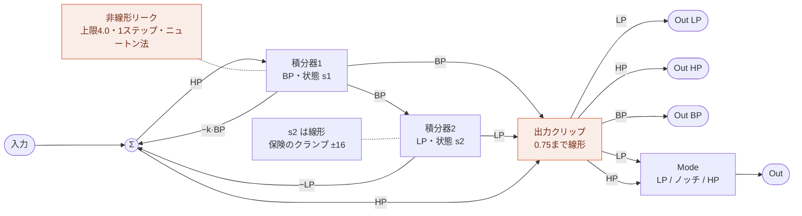
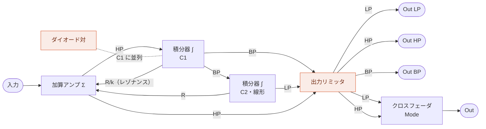
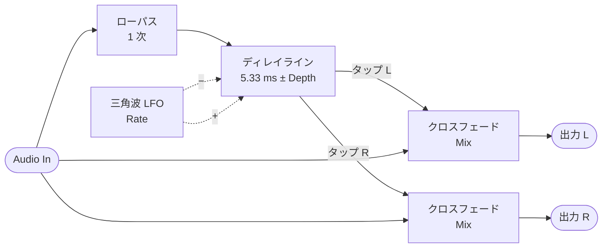
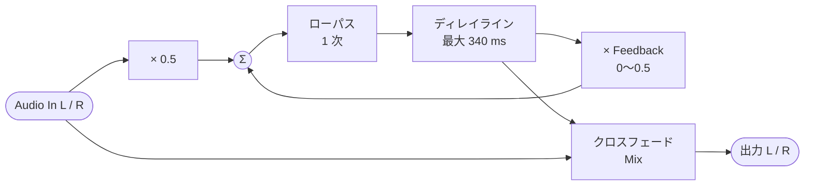

MIDI Synthesizer SPMS-1 (type-2): パッチ
========================================

- [README](./README.ja.md) / [English](./spms1_patching.md)


## 実行順

すべてのモジュールが入っています。先頭に Pitch 1（後のどのモジュールも同じサンプルでノートを読めるように）、
次にモジュレーションのソース（2 つのエンベロープ、その後に LFO を置くのは、エンベロープでビブラートを掛けていくときのように、
LFO の Mod In がエンベロープを同じサンプルで読めるようにするためです）、それとオシレータの間に Mixer 1、オシレータの後に
Noise 1（主に音として使うためで、モジュレーションに使うと 1 サンプル遅れますが、聞き分けられる差ではありません）、
それとフィルタの間に Mixer 2、続いて 2 つのフィルタ、最後にコーラスとディレイです。

1. Pitch 1
2. EG 1
3. EG 2
4. LFO 1
5. Mixer 1
6. Osc 1
7. Osc 2
8. Noise 1
9. Mixer 2
10. Filter 1
11. Filter 2
12. Amp 1
13. Chorus 1
14. Delay 1

Mixer 1 には何も結線されていないので、毎サンプル自分のスロットぶんのコストを払うだけで、パッチが
何かを与えるまでは何も変えません。意味があるのは置かれている位置です。あるモジュールが今サンプルの
値を見られるのは、この順で自分より前にあるものからだけで、後ろにあるものからは前サンプルの値を受け取ります。
Mixer 1 は 2 つのエンベロープと LFO に手が届き、オシレータ、フィルタ、アンプは Mixer 1 に手が届きます。
Mixer 2 はオシレータとフィルタの間で、オーディオをまとめます。Filter 1 は同じサンプルで Filter 2 に、Filter 2 はアンプに入ります。
Mixer 2 は Filter 2 にも、Filter 1 はアンプにもゲイン 0.0 で入っているので、フィルタを並列にもできます。
Pitch 1 が先頭にあるのは、オシレータやフィルタ、鍵盤に追従させたいモジュレーションのソースなど、どのモジュールも
同じサンプルでノートを読めるようにするためです。Pitch 1 自身への変調（LFO を Bend In に入れたベンドなど）は
そのぶん 1 サンプル遅れますが、聞き分けられる差ではありません。

ミキサーは 2 つの信号を合流させるための道具であり、エンベロープのように片側にしか振れない信号を正負
どちらにも振れるようにする手段でもあります。下の例を参照してください。

## モジュール

### Filter 1 と Filter 2

同じ種類のフィルタが 2 つあり、デフォルトでは Filter 1 → Filter 2 → Amp 1 と直列につながって、
4 次（24 dB/oct）のローパスになります。デフォルトのパッチは並列用にもゲイン 0.0 で結線してあります。Mixer 2 が
Filter 2 の Audio In 1 に（Filter 1 は Audio In 2）、Filter 1 が Amp 1 の Audio In 1 に（Filter 2 は Audio In 2）入っています。
Filter 2 の Gain 1 と Amp 1 の Gain 1 を上げ、Filter 2 の Gain 2 を下げれば、結線し直さずに、どちらのフィルタもオシレータを
受け取る並列になります。

2 つは同じ CC と起動時の値を持つので、それらの CC で
両方が一緒に動きます。ただし Resonance だけは別で、Filter 2 のもの（CC#71）は起動時に値 64（Q 4.0）、Filter 1 のもの（CC#119）は
最小の値 4（Q 0.71）です。レゾナンスのピークは 2 つが重なったものではなく、Filter 2 のものになります。NRPN や専用の CC で、
どちらかを別に動かすこともできます（下のパッチの編集を参照）。

どちらのフィルタも 2 つのオーディオ入力 Audio In 1 と Audio In 2 を持ち、それぞれのゲイン Gain 1 と Gain 2 を
掛けてから足し合わせます。Gain 1 と Gain 2 はパラメータの先頭にあり、CC はありません。ゲインは Amp 1 と
同じく 2 乗して 4 倍したもので、起動時の値 64 で等倍（ただし Filter 2 の Gain 1 は値 4 で無音）、値 124 で +12 dB になり、
フィルタを強く駆動します。Filter 1 の Audio In 2 はデフォルトでは何もつながっていないので、ノイズなどを、ミキサーなしで
加えられます。

それぞれのフィルタは、ゼロディレイ・フィードバックの状態変数フィルタです。BP の積分器は、BP がソフトクリップの曲線に
入るほど強く漏れ (リーク)、これがレゾナンスを抑えます。小さな信号ではリークはほぼゼロなので、
通過帯域はほぼクリーンです。リークを含むループの式はサンプルごとに 1 ステップ・ニュートン法で解きます。
初期値はリークを除いた線形の解で、そこから 1 ステップでほぼ収束します。リークの速さは時間で
決まっているので、サンプルレートを変えても音は変わりません。
LP の状態は線形のままで、通常の使い方では届かない保険として ±16 のクランプだけがあります。出力
クリップはフィルタの最後にあります。レゾナンスのつまみの上端では k が負になり、ループが発振します。

フィルタはローパスとハイパスを Out LP、Out HP として同時に出力し、それぞれに専用の
DC ブロッカーと出力クリップがあります。さらに、この 2 つを Mode (CC#39)
でクロスフェードしたものを Out として出力します。それぞれ自分の側の半分ではフルのまま、
反対側の半分でゼロまで下がります。起動時の 0.0 (値 4) ではローパスだけ、
1.0 (値 124) ではハイパスだけ、0.5 (値 64) では両方フルで、その和 (入力 − k·BP) がカットオフにノッチを持ち、
その両側はそのまま通ります。その間ではノッチがカットオフからずれ (ローパス寄りでは上、ハイパス寄りでは下)、
反対側は最大 6 dB 下がって残ります。デフォルトのパッチが使うのは Out で、Filter 1 のものは Filter 2 の Audio In 2 に（Amp 1 の Audio In 1 にもゲイン 0.0 で）、Filter 2 のものは Amp 1 の Audio In 2 に入ります。そのため、Mode を上げるまでは
ローパスが鳴ります。
Out はもう一度クリップしません。通過帯域ではどちらか一方しかなく、両方があるカットオフ付近ではノッチが
それを下げるからです。2 つの係数はほかのレベルと同じくスムージングします。

バンドパスも Out BP として、専用の DC ブロッカーと出力クリップを通って出力されます。Mode のクロスフェードには
入りません。積分器の状態そのままで正規化していないので、カットオフでのピークは入力の Q 倍です。Resonance 0.0 では
0.707 倍で、レゾナンスが高く入力が大きいと出力クリップの肩に入ります。そのときは Mixer 2 Out Level で下げます。
デフォルトのパッチではつながっていません。



同じ構造を、オペアンプ積分器によるフィルタに置き換えて描いたものです。ダイオード対は非線形リーク、
出力リミッタは出力クリップに対応します。解釈として描いたもので、実在の回路を再現したものでは
ありません。



### Chorus 1

モノラル入力・ステレオ出力のコーラスです。ディレイと同じくインサート
式で経路に入り、センドレベルではなく Mix でドライとコーラスのバランスを決めます。入力は穏やかなローパス
フィルタを通って 1 本の短いディレイラインに入り、そこを 2 つのタップで読み出します。三角波の LFO が
2 つのタップを 5.33 ms を挟んで逆向きに揺らすので、左右の遅延信号のピッチは互いに逆方向に
揺れます。それぞれの出力は入力と自分のタップのクロスフェードなので、モノラルの音源がステレオに広がって
出てきます。



後ろにリミッタもクリップも要りません。入力は入口で 1.0 に収め、フィルタも 2 サンプル間の読み出しも
クロスフェードも重み付き平均で、平均するもの以上にはなりません。タップが揺れる中心の遅延は
固定です。

サブ出力の Out Mono は Out L と Out R の平均で、ミキサーの入力やフィルタなどモノラルの行き先に
使います。2 つのタップを足すので、ステレオに広げたときよりおとなしいコーラスになり、タップが重なる
ところで多少コムフィルタがかかります。

### Delay 1

フィードバック付きのステレオディレイです。左右
それぞれが自分のディレイラインとループを持ちます。入力の半分と、Feedback を掛けた遅延信号が、穏やかな
ローパスフィルタを通ってディレイラインに入り、出力は入力と遅延信号のクロスフェードです。Time、Feedback、
Mix は左右で共通なので、左右は一緒に繰り返し、入ってきたときのステレオ像を保ちます。



図は片側で、もう片側も同じです。後ろにリミッタもクリップも要りません。入ってくるのが入力の半分、戻るのが
遅延信号の高々半分なので、遅延信号が 1.0 以内なら書き戻すものも 1.0 以内で、始まりは無音です。フィルタも
2 サンプル間の読み出しもクロスフェードも重み付き平均で、平均するもの以上にはなりません。代わりに、最初の
繰り返しはドライ信号より 6 dB 小さくなります。入力は、アンプがモジュレーションにするのと同じく入口で 1.0 に収める
ので、何を結線してもこの上限は保たれます。

サブ出力の Out Mono は Out L と Out R の平均で、モノラルの行き先に使います。

## パッチの編集 (NRPN)

パッチはデータであり、NRPN は動いているシンセのそれを書き換えます。どのモジュールがどの順で走るか、各
モジュール入力に何が入るか、各パラメータがどこから値を取るか、どの CC がどのコントロールスロットを埋める
か、CC のない各パラメータの値。すべてのモジュールは番号の付いたシグナルスロットから読み、番号の付いたスロットへ書くので、配線し直すことは
スロット番号を変えることです。各パラメータには、それとは別に自分専用のコントロールスロットがあり、その CC の
値が、CC がなければカテゴリ 4 の値が入ります。読めるのはそのパラメータだけで、ソースに 127 を指定するとそこを指します。ほかからスロット番号で
指す方法はありません。

### 送り方

- CC#99 でカテゴリを、CC#98 でその中のエントリを選びます。順序はどちらが先でも構いません
- CC#99 は 112 (0x70) + カテゴリ番号です。GS や XG の NRPN (MSB 1 と 20-31) や、ほかのシンセが
  よく使う小さい MSB と重ならないようにしています。112 より小さい MSB で届いた CC#6 は無視されます
- CC#6 (Data Entry MSB) で値が確定し、次のオーディオバッファから効きます
- CC#38 (Data Entry LSB) は無視されます。ここで扱う値はすべて 7 ビットです
- CC#101 と CC#100 (RPN セレクト) はデータ入力を中断させるので、RPN がパッチ編集と取り違えられることは
  ありません。再開するには CC#99 か CC#98 をもう一度送ります
- 編集内容は、保存 (Save、下記) しない限り電源を切るまでです。電源投入時には最後に保存したパッチを、
  保存がなければデフォルトのパッチを読み込みます。Reset (下記) でデフォルトのパッチに戻ります。電源投入時に
  デフォルトのパッチを読み込むよう戻すには、Reset してから Save します

### SysEx で送る

カテゴリ 0-4 のエントリは System Exclusive でも送れます。値 1 つが 1 バイトなので、デフォルトのパッチは
CC と Mute を含めて約 600 バイトで、NRPN の約 2,300 バイトより少なくなります。NRPN はこれまでどおり使え、
混ぜても構いません。エディタは、ブラウザが許せば SysEx で、SPMS-1 Web にはいつも SysEx で送り、それ以外は
NRPN で送ります。Export パネルの Format "MIDI bytes, SysEx (hex)" で、この形でコピーできます。

```
F0 7D 53 31 ch 01 h0 h1 h2 h3 h4 category entry value ... F7
```

- `7D` は非商用の ID、`53 31` は "S1" です
- `ch`: 書き込むパッチの MIDI チャンネル。0-15 がチャンネル 1-16 です
- `01`: コマンド。NRPN の値です
- `h0`-`h4`: スケッチのパッチ仕様ハッシュ。1 バイト 7 ビットずつ、下位から並べます。番号付けの違う
  スケッチ (モジュール ID、シグナル ID、エントリが違うもの) は、保存パッチと同じく、別の意味に読んでしまう
  メッセージを無視します。エディタ (Format "MIDI bytes, SysEx (hex)") が、そのバージョンのハッシュを入れるので、
  そこからコピーしてください
- `category`: 0-4。CC#99 から 112 を引いた値です
- `entry`: 最初のエントリ。CC#98 の値です
- `value ...`: 最初のエントリと、それに続くエントリの値。エントリ 127 までです。CC#6 と同じく 1 つずつ順に
  書き込まれ、実行順もそうです (最後の書き込みが優先されます)
- メッセージは全体を受け付けるか、まったく受け付けないかです。エントリ 127 を越えるもの、128 以上のバイトを
  含むもの、途中で切れたものは無視されます。実機が受け取れるのは F0 と F7 を含めて 128 バイトまでなので、
  値は 114 個までです。エディタはカテゴリごとに 1 通送り、112 個を越えれば分けます
- システムエントリ (カテゴリ 5) は NRPN だけです。NRPN と同じく、パッチの前に Mute オン、後に Mute オフを
  送ります

### カテゴリ (CC#99)

| CC#99 (カテゴリ) | CC#98 | 設定する対象 | CC#6 の値 |
| ----- | ----- | ---- | ---------- |
| 112 (0) | 0-31 | 実行順、スロットごとに | モジュール ID |
| 113 (1) | 0-41 | モジュール入力に何を入れるか | シグナル ID |
| 114 (2) | 0-94, 98 | パラメータがどこから値を取るか | シグナル ID、127 なら自分のコントロールスロット |
| 115 (3) | 0-98 | どの CC がコントロールスロットを埋めるか | CC 番号、0 なら割り当てなし |
| 116 (4) | 0-94, 98 | CC がないときにパラメータのコントロールスロットが保持する値 | CC の値 |
| 117 (5) | 0-3 | システム: Mute、Reset、Save、Load (下記)。パッチには含まれません | 0-63 か 64-127 |

カテゴリ 5 はシステム用のエントリで、パッチの一部を設定するのではなく、シンセ自体に働きかけます。

- エントリ 0、Mute: 64-127 で出力を 4 ms でフェードアウトして、少なくとも 11 ms 無音に保ちます。
  0-63 でフェードインします (ディレイの反復音はそのまま戻ります)。パッチ全体は Mute のオンとオフの間に送ると、送信途中のパッチの音が聞こえません。
  間に待ち時間は要りません。Mute オフがすぐ後に届いても Mute オンは必ず受け取り、音が戻るのは早くても
  Mute オフの約 15 ms 後です。フェード (それぞれ 4 ms) の間にパッチが変わった分は、かすかに聞こえることがあります。
  電源投入時はオフです。オフにするのは Mute オフか電源の入れ直しだけで、Reset でもオフになりません。Mute オンの後で
  送る側が止まると、シンセは無音のままです
- エントリ 1、Reset: 64-127 で、パッチをスケッチのデフォルトに戻します。カテゴリ 0-4 のすべてのエントリと、
  すべての CC の値です。ノート、ピッチベンド、Mute、保存したパッチはそのままです。Mute なしではリセット途中のパッチが
  バッファ 1 つぶん鳴ることがあるので、無音にするには Mute のオンとオフの間に送ります
- エントリ 2、Save: Mute がオンの間に 64-127 で、パッチ (カテゴリ 0-4 のすべてのエントリと、コントロールに割り当てた
  CC の値) をフラッシュに保存します。前に保存したパッチは置き換わり、電源投入時にはこれを読み込みます。
  Mod Wheel は設定するものではなく演奏で動かすものなので、Mod Wheel だけに割り当てた CC は何番であっても 0 で保存し、
  どのコントロールにも割り当てていない CC も 0 で保存します。パラメータや General にも割り当てた CC は、そのまま
  保存します。番号の割り当て (モジュール ID、シグナル ID、エントリ) が違う
  バージョンのスケッチは、別のバージョンで保存したパッチを違う意味に読んでしまうので、読み込まずにデフォルトのパッチで
  起動します。保存したパッチは、次に Save するまでフラッシュに残ります。UF2 ファイルのコピー (新しいバージョンへの
  更新など) でも残ります。UF2 ファイルはフラッシュのその部分を書き込まないためです。書き込みは出力が
  無音になってから行い、その間の約 0.1 秒はシンセも MIDI 入力も止まります。その間に送った MIDI は失われることが
  あるので、Save の後に Mute オフを送り、次の送信まで少し待ちます。保存済みと同じパッチは書き込みません。
  まぎれ込んだ CC#6 で保存されないよう、Mute がオンの間だけ受け付けます。エディタの Save to Device は、
  Mute オン、パッチ全体、Save、Mute オフを送ります
- エントリ 3、Load: Mute がオンの間に 64-127 で、電源投入時と同じように、保存したパッチをデフォルトのパッチの上に
  読み込みます。保存がなければ何もしません

実行順はスロット 0 から上へ読まれ、最初に現れたモジュール ID 0 で止まります。32 個に満たないパッチは
そこで自ら終わるわけです。実行順はモジュールの番号付けとは別物です。あるモジュールが今サンプルの値を
見られるのは自分より前に並んでいるものからだけで、後ろにあるものからは前サンプルの値を受け取ります。
同じモジュールを複数のスロットに並べると、最後に書き込んだスロットで 1 回だけ処理され、ほかのスロットは
無いものとして扱われます (後勝ち)。前のスロットでも後ろのスロットでも、書き込んだ方に移ります。そのスロットに
あったモジュールは実行順から外れます。

カテゴリ 3 で CC 番号 0 を指定すると、そのコントロールには CC がない状態になります。パラメータのコントロール
スロットはそれまでの CC にかかわらずカテゴリ 4 の値を保持するので、パラメータが読む値はパッチだけで決まります。
Mod Wheel と General のスロットは 0.0 になります。カテゴリ 4 の値は CC の値と同じように受け取って同じように読むので、
バイポーラのパラメータでは値 64 が 0.0 です。CC があるあいだ、カテゴリ 4 の値は保たれますが読まれません。
起動時はどれもパラメータの起動時の値です。

オシレータとエンベロープとフィルタが 2 つずつ、LFO とアンプが 1 つずつ、ミキサーが 2 つ、コーラスとディレイとピッチのモジュールとノイズ源が 1 つずつあり、**この 14 個すべてがデフォルトの
実行順に入っています**。パッチは結線するだけでよく、何かを先に有効化する必要はありません。シンセは
すべてのモジュールが走った状態で処理時間に収まるよう作ってあるので、パッチを収めるためにモジュールを
実行順から外す必要はありません。音から外したいモジュールは、結線で迂回して、誰も読まないまま走らせておきます。
下の例を参照してください。Mixer 1 には CC がありません。レベルは 0.0 を保持するので、パッチがカテゴリ 4 の値か CC の割り当てで
上げるまで無音です。Mixer 2 はすべての Level に CC（CC#19〜21 と 23）があり、起動時は Level 1 と 2 が 0.7、Level 3 と 4 が 0.0 なので、
この 2 つの入力は閉じた状態で始まります。Out Level はどちらのミキサーも CC がなく 0.5 を保持します。Mixer 2 の Out Level は、オーディオがフィルタをどれだけ強く駆動するかを決めます。

### エントリ (CC#98)、カテゴリ 1

<!-- patch_gen inputs -->

| CC#98 | モジュール入力 | | CC#98 | モジュール入力 |
| ----- | ------ | - | ----- | ------ |
| 0 | Pitch 1 Pitch In | | 21 | Mixer 2 In 3 |
| 1 | Pitch 1 Gate In | | 22 | Mixer 2 In 4 |
| 2 | Pitch 1 Bend In | | 23 | Filter 1 Audio In 1 |
| 3 | EG 1 Gate In | | 24 | Filter 1 Audio In 2 |
| 4 | EG 2 Gate In | | 25 | Filter 1 Pitch In |
| 5 | LFO 1 Rate Mod In | | 26 | Filter 1 Mod 1 In |
| 6 | LFO 1 Level Mod In | | 27 | Filter 1 Mod 2 In |
| 7 | LFO 1 Reset In | | 28 | Filter 2 Audio In 1 |
| 8 | Mixer 1 In 1 | | 29 | Filter 2 Audio In 2 |
| 9 | Mixer 1 In 2 | | 30 | Filter 2 Pitch In |
| 10 | Mixer 1 In 3 | | 31 | Filter 2 Mod 1 In |
| 11 | Mixer 1 In 4 | | 32 | Filter 2 Mod 2 In |
| 12 | Osc 1 Pitch In | | 33 | Amp 1 Audio In 1 |
| 13 | Osc 1 Mod 1 In | | 34 | Amp 1 Audio In 2 |
| 14 | Osc 1 Mod 2 In | | 35 | Amp 1 Mod 1 In |
| 15 | Osc 2 Pitch In | | 36 | Amp 1 Mod 2 In |
| 16 | Osc 2 Mod 1 In | | 37 | Chorus 1 Audio In |
| 17 | Osc 2 Mod 2 In | | 38 | Delay 1 Audio In L |
| 18 | Osc 2 Sync In | | 39 | Delay 1 Audio In R |
| 19 | Mixer 2 In 1 | | 40 | 最終出力 L |
| 20 | Mixer 2 In 2 | | 41 | 最終出力 R |

<!-- patch_gen end -->

ほとんどは名前のとおりのものを受け取りますが、3 つだけ名前からは分からない決まりがあります。Gate はレベル
ではなく閾値で、信号が 0.25 以上になるとエンベロープがトリガし、下回るとリリースします。ピッチ（Note Pitch が Pitch In に運ぶもの）は MIDI ノート
0〜120 を -0.5〜+0.5 で表すので、0.0 がノート 60、0.1 が 1 オクターブです。そして Mod In は届いたままの値を
受け取ります。入口では何も制限せず、クランプされるのはモジュールが最終的に得た値のほうです。カットオフは
つまみの両端、ピッチは -0.5〜+0.5、パルス幅は -0.5〜+0.5 に収まります。オシレータの Pitch In、Mod 1 In、Mod 2 In も Mod In の一種です。ミキサーは上限なしで足し算をするので、大きすぎる変調は入口で
削られるのではなく、行き先を端に貼り付かせます。アンプだけは例外で、2 つの Mod In をクロスフェードしたモジュレーションを -1.0〜+1.0 でクランプします。
アンプはアッテネータなので、変調でゲインを下げることはできても、上げることはできません。負の変調は反転させます。コーラスとディレイ
もオーディオ入力を同じく 1.0 に収めます。Pitch 1 の Pitch In は Mod In と同じく何でも受け取り、受け取ったものを
グライド、ベンド、ストレッチして出します。出力はミキサーと同じく -1.0〜+1.0 に収めます。

最終出力の左右は別々に読まれるので、どちらもどこへでも向けられます。両方を同じシグナルに向ければモノラル
出力になります。

### エントリ (CC#98)、カテゴリ 2、3、4

<!-- patch_gen params -->

| CC#98 | パラメータ | | CC#98 | パラメータ | | CC#98 | パラメータ |
| ----- | ------ | - | ----- | ------ | - | ----- | ------ |
| 0 | Pitch 1 Glide | | 32 | Osc 1 Pitch Fine | | 64 | Mixer 2 Level 4 |
| 1 | Pitch 1 Out 1 Glide Sw | | 33 | Osc 1 Pitch Mod 1 Amt | | 65 | Mixer 2 Out Level |
| 2 | Pitch 1 Out 2 Glide Sw | | 34 | Osc 1 Pitch Mod 1 Pol | | 66 | Filter 1 Gain 1 |
| 3 | Pitch 1 Bend Amt | | 35 | Osc 1 Pitch Mod 1 Sw | | 67 | Filter 1 Gain 2 |
| 4 | Pitch 1 Out 1 Bend Sw | | 36 | Osc 1 Pitch Mod 2 Amt | | 68 | Filter 1 Cutoff |
| 5 | Pitch 1 Out 2 Bend Sw | | 37 | Osc 1 Pitch Mod 2 Pol | | 69 | Filter 1 Resonance |
| 6 | Pitch 1 Stretch | | 38 | Osc 1 Pitch Mod 2 Sw | | 70 | Filter 1 Mode |
| 7 | EG 1 Attack | | 39 | Osc 1 PW Mod 1 Amt | | 71 | Filter 1 Pitch Amt |
| 8 | EG 1 Decay | | 40 | Osc 1 PW Mod 1 Pol | | 72 | Filter 1 Mod 1 Amt |
| 9 | EG 1 Sustain | | 41 | Osc 1 PW Mod 2 Amt | | 73 | Filter 1 Mod 1 Pol |
| 10 | EG 1 Release Sw | | 42 | Osc 1 PW Mod 2 Pol | | 74 | Filter 1 Mod 2 Amt |
| 11 | EG 1 Level | | 43 | Osc 2 Wave | | 75 | Filter 1 Mod 2 Pol |
| 12 | EG 2 Attack | | 44 | Osc 2 PW | | 76 | Filter 2 Gain 1 |
| 13 | EG 2 Decay | | 45 | Osc 2 Pitch Coarse | | 77 | Filter 2 Gain 2 |
| 14 | EG 2 Sustain | | 46 | Osc 2 Pitch | | 78 | Filter 2 Cutoff |
| 15 | EG 2 Release Sw | | 47 | Osc 2 Pitch Fine | | 79 | Filter 2 Resonance |
| 16 | EG 2 Level | | 48 | Osc 2 Pitch Mod 1 Amt | | 80 | Filter 2 Mode |
| 17 | LFO 1 Wave | | 49 | Osc 2 Pitch Mod 1 Pol | | 81 | Filter 2 Pitch Amt |
| 18 | LFO 1 Rate | | 50 | Osc 2 Pitch Mod 1 Sw | | 82 | Filter 2 Mod 1 Amt |
| 19 | LFO 1 Level | | 51 | Osc 2 Pitch Mod 2 Amt | | 83 | Filter 2 Mod 1 Pol |
| 20 | LFO 1 Rate Mod Amt | | 52 | Osc 2 Pitch Mod 2 Pol | | 84 | Filter 2 Mod 2 Amt |
| 21 | LFO 1 Level Mod Amt | | 53 | Osc 2 Pitch Mod 2 Sw | | 85 | Filter 2 Mod 2 Pol |
| 22 | LFO 1 Reset Sw | | 54 | Osc 2 PW Mod 1 Amt | | 86 | Amp 1 Gain 1 |
| 23 | Mixer 1 Level 1 | | 55 | Osc 2 PW Mod 1 Pol | | 87 | Amp 1 Gain 2 |
| 24 | Mixer 1 Level 2 | | 56 | Osc 2 PW Mod 2 Amt | | 88 | Amp 1 Mod 1/2 Mix |
| 25 | Mixer 1 Level 3 | | 57 | Osc 2 PW Mod 2 Pol | | 89 | Chorus 1 Mix |
| 26 | Mixer 1 Level 4 | | 58 | Osc 2 Sync Sw | | 90 | Chorus 1 Rate |
| 27 | Mixer 1 Out Level | | 59 | Noise 1 Color | | 91 | Chorus 1 Depth |
| 28 | Osc 1 Wave | | 60 | Noise 1 Level | | 92 | Delay 1 Mix |
| 29 | Osc 1 PW | | 61 | Mixer 2 Level 1 | | 93 | Delay 1 Time |
| 30 | Osc 1 Pitch Coarse | | 62 | Mixer 2 Level 2 | | 94 | Delay 1 Feedback |
| 31 | Osc 1 Pitch | | 63 | Mixer 2 Level 3 | | 98 | Amp 1 Limiter Sw |

<!-- patch_gen end -->

### エントリ (CC#98)、カテゴリ 3 のみ

これらの CC はどのパラメータにも属さないので、カテゴリ 2 には対応するエントリがありません。バス上の
Mod Wheel スロットと General スロットを埋めます。後述を参照してください。

<!-- patch_gen controllers -->

| CC#98 | CC の割り当て先 | 埋めるスロット |
| ----- | ------ | ----- |
| 95 | Mod Wheel | Mod Wheel、Mod Wheel Rev、Mod Wheel Inv、Mod Wheel Rev Inv |
| 96 | General 1 | General 1、General 1 Rev、General 1 Inv、General 1 Rev Inv、General 1 Bipolar、General 1 Bipolar Inv、General 1 Sin、General 1 Cos、General 1 Lo、General 1 Hi、General 1 Neg、General 1 Mid、General 1 Pos |
| 97 | General 2 | General 2、General 2 Rev、General 2 Inv、General 2 Rev Inv、General 2 Bipolar、General 2 Bipolar Inv、General 2 Sin、General 2 Cos、General 2 Lo、General 2 Hi、General 2 Neg、General 2 Mid、General 2 Pos |

<!-- patch_gen end -->

### モジュール ID

<!-- patch_gen modules -->

| ID | モジュール |
| ----- | ------ |
| 0 | なし（実行順の終端） |
| 1 | Pitch 1 |
| 2 | EG 1 |
| 3 | EG 2 |
| 4 | LFO 1 |
| 5 | Mixer 1 |
| 6 | Osc 1 |
| 7 | Osc 2 |
| 8 | Noise 1 |
| 9 | Mixer 2 |
| 10 | Filter 1 |
| 11 | Filter 2 |
| 12 | Amp 1 |
| 13 | Chorus 1 |
| 14 | Delay 1 |

<!-- patch_gen end -->

### シグナル ID

<!-- patch_gen signals -->

| ID | シグナル | | ID | シグナル | | ID | シグナル |
| ----- | ------ | - | ----- | ------ | - | ----- | ------ |
| 0 | なし（定数 0.0） | | 27 | General 2 Inv | | 54 | Osc 1 Output Pulse ± |
| 1 | 定数 1.0 | | 28 | General 2 Rev Inv | | 55 | Osc 1 Output Sub ± |
| 2 | 定数 0.5 | | 29 | General 2 Bipolar ± | | 56 | Osc 2 Output ± |
| 3 | 定数 -0.5 | | 30 | General 2 Bipolar Inv ± | | 57 | Osc 2 Output Saw ± |
| 4 | 定数 -1.0 | | 31 | General 2 Sin | | 58 | Osc 2 Output Pulse ± |
| 5 | Note Pitch ± | | 32 | General 2 Cos | | 59 | Noise 1 Output ± |
| 6 | Note Gate | | 33 | General 2 Lo | | 60 | Noise 1 Output White ± |
| 7 | Pitch Bend ± | | 34 | General 2 Hi | | 61 | Noise 1 Output Red ± |
| 8 | Mod Wheel | | 35 | General 2 Neg | | 62 | Mixer 2 Output ± |
| 9 | Mod Wheel Rev | | 36 | General 2 Mid | | 63 | Mixer 2 Output Inv ± |
| 10 | Mod Wheel Inv | | 37 | General 2 Pos | | 64 | Filter 1 Output ± |
| 11 | Mod Wheel Rev Inv | | 38 | Pitch 1 Output 1 ± | | 65 | Filter 1 Output LP ± |
| 12 | General 1 | | 39 | Pitch 1 Output 2 ± | | 66 | Filter 1 Output HP ± |
| 13 | General 1 Rev | | 40 | EG 1 Output | | 67 | Filter 1 Output BP ± |
| 14 | General 1 Inv | | 41 | EG 1 Output Inv | | 68 | Filter 2 Output ± |
| 15 | General 1 Rev Inv | | 42 | EG 2 Output | | 69 | Filter 2 Output LP ± |
| 16 | General 1 Bipolar ± | | 43 | EG 2 Output Inv | | 70 | Filter 2 Output HP ± |
| 17 | General 1 Bipolar Inv ± | | 44 | LFO 1 Output ± | | 71 | Filter 2 Output BP ± |
| 18 | General 1 Sin | | 45 | LFO 1 Output Inv ± | | 72 | Amp 1 Output ± |
| 19 | General 1 Cos | | 46 | LFO 1 Output Triangle ± | | 73 | Chorus 1 Output L ± |
| 20 | General 1 Lo | | 47 | LFO 1 Output Triangle Inv ± | | 74 | Chorus 1 Output R ± |
| 21 | General 1 Hi | | 48 | LFO 1 Output Square | | 75 | Chorus 1 Output Mono ± |
| 22 | General 1 Neg | | 49 | LFO 1 Output Square Inv | | 76 | Delay 1 Output L ± |
| 23 | General 1 Mid | | 50 | Mixer 1 Output ± | | 77 | Delay 1 Output R ± |
| 24 | General 1 Pos | | 51 | Mixer 1 Output Inv ± | | 78 | Delay 1 Output Mono ± |
| 25 | General 2 | | 52 | Osc 1 Output ± | |  |  |
| 26 | General 2 Rev | | 53 | Osc 1 Output Saw ± | |  |  |

<!-- patch_gen end -->

**±** は、正負どちらにも振れるシグナルを表します。モジュール出力はフルスケールで -0.5 と +0.5 に届き、
ミキサーはそれを 2 つ足して 1.0 で止まります。
印のないものは片側だけに振れ、0.0〜1.0 か（エンベロープ、Note Gate、Mod Wheel）、Inv の形なら 0.0〜-1.0 です。
バスは両方を 1 つの番号空間で運ぶので、レンジは「何が書いたか」ではなくスロットごとの性質です。表にない番号は
空きです。127 はスロットではなく、パラメータ自身のコントロールスロットを指します。

パラメータ自身のコントロールスロットには、バスの外で、その CC から届いた値が、CC がなければカテゴリ 4 の値が入ります。パラメータはデフォルトで
それを読みます（カテゴリ 2 でシグナル ID 127）。パラメータはそれぞれユニポーラかバイポーラで、スロットも同じ
レンジを取ります。ユニポーラは値 4〜124 で
0.0〜1.0 と、エンベロープと同じ幅なので、エンベロープを向ければつまみの全域を動かせます。バイポーラは
値 64 を 0.0 とする -0.5〜+0.5 と、LFO と同じ幅なので、バイポーラのソースを向ければ中央を挟んで上下に
振れます。Osc 1 Pitch Coarse と Pitch Fine は中央が「変化なし」を意味するのでバイポーラです。パラメータにバス上の
スロットを指させることがモジュレーションになります。パラメータの
コントロールスロットは、モジュール入力からもほかのパラメータからも読めません。1 つの CC を複数のパラメータや
モジュール入力に届けたいときは、Osc 1 と Osc 2 のように、カテゴリ 3 でそれぞれのパラメータに同じ CC を
割り当てるか、モジュレーションホイールのように Mod Wheel スロットに載せます。逆に、Osc 2 や Filter 1 の
ように Osc 1 や Filter 2 と CC を共有しているパラメータを別に動かしたいときは、カテゴリ 3 で専用の CC を
割り当てます。たとえば CC#40 からいくつかは空いています。

スロット 8 の Mod Wheel は、どのパラメータにも属さないコントロールスロットです。CC をバスに載せるだけで、
どのモジュール入力やパラメータからも読めます。デフォルトで CC#1 を読む 0.0〜1.0 のスロットで、起動時は
値 4 なので、ホイールを動かすまで 0.0 です。デフォルトのパッチでは LFO 1 Level Mod In につながっていますが、LFO 1 Level が起動時の 1.0 の間は何も足しません。
スロット 9〜11 は、その値 u をさらに 3 つの形で運びます: Mod Wheel Rev 1 - u、Inv -u、Rev Inv u - 1。
これでホイールで何かを抜いたり、逆向きに動かしたりでき、向きを変えるミキサーは要りません。エディタでは
鍵盤のシグナルと並べて Controller ノードに表示し、形はその下に出力として並べ、ソフトキーボードの横に
ホイールとしても置いています。

スロット 12〜37 の General 1 と General 2 も、どのパラメータにも属さないコントロールスロットで、
CC#16 と CC#17（General Purpose Controller 1 と 2）を読みます。1 つの CC が 13 のスロットを同時に埋め、
それぞれが値 4〜124 で 0.0〜1.0 を取る値 u の形の 1 つです: General n そのもの、Rev 1 - u、Inv -u、
Rev Inv u - 1、Bipolar u - 0.5、Bipolar Inv 0.5 - u、Sin sin(u * pi / 2)、Cos cos(u * pi / 2)、
Lo min(1, 2 - 2u)、Hi min(1, 2u)、Neg max(0, 1 - 2u)、Mid 1 - |2u - 1|、
Pos max(0, 2u - 1)。
これで 1 つのつまみで何かを入れながら別の何かを抜いたり、バイポーラのパラメータを中央の上下に振ったり
でき、向きを変えるミキサーは要りません。Sin と Cos は等電力の組で、どの値でも 2 乗の和が 1 なので、
この 2 つを取る 2 つのレベルは中央でも音量が下がらずにクロスフェードします。値 64 で両方 0.707 です。
General n と Rev の直線のクロスフェードは中央で両方 0.5 になり、2 つの音源の位相がそろっていなければ
3 dB 下がって聞こえます。Lo と Hi はフィルタの Mode と同じクロスフェードの組で、
それぞれ自分の側の半分では 1.0、反対側の半分で 0.0 まで下がり、中央では両方 1.0 です。Neg と Pos は
Bipolar の負と正の側をそれぞれ 2 倍にしたもので、中央で 0.0、Neg は下端で、Pos は上端で 1.0 になります。
1 つのつまみで、中央から下げると何かを、上げると別の何かを入れられます。Mid は中央で 1.0、両端で 0.0 なので、
Neg、Pos と合わせると 1 つのつまみで 3 つをクロスフェードできます。これらのスロットを
ミキサーのレベルや Mod Amt などのパラメータにつなぐと、パラメータが CC と同じくスムージングします
(形はスムージングの前に作られます)。自分ではスムージングしないモジュール入力には、同じ 2 段でスムージングした
u から 1 バッファごとに作った写しが入るので、ホイールやつまみで段なく動きます。ゲート入力 (Gate In、Reset In、
Sync In) だけは、すぐ反応するようにスロットの値をそのまま受け取ります。Mod Wheel とその形も同じです。起動時は値 4
で u は 0.0、CC がなければ u は 0.0 のままです。デフォルトのパッチはどれもつないでいません。エディタでは
Controller ノードに表示し、形は各 General の下に出力として並べ、Controls タブにはスライダーとして置いています。

Note Pitch、Note Gate、Pitch Bend の 3 つは鍵盤がバスに載せるものです。Note Pitch は MIDI ノート 0〜120 を
-0.5〜+0.5 で運びます。オシレータがピッチの全域として読むのと同じ幅です。Pitch Bend も同じくバイポーラで、
ホイールの端から端までがちょうど 1 単位で、両端がちょうど -0.5 と +0.5、中央のディテントがちょうど 0 に
なるので、ミキサーで下駄を履かせなくてもモジュール入力へ入れられます。Note Gate は 0.0 か 1.0 で、
エンベロープは 0.25 以上でトリガします。Pitch Bend はデフォルトでは Pitch 1 Bend In に結線されています。

鳴るのは最後に押したノートで、それに置き換わったノートは、まだ押さえられている間は記憶されます (1 ノート
分だけです)。最後のノートを離すと記憶していたノートが Note Gate を 1.0 のまま戻ってくるので、エンベロープは
アタックをやり直さずに続き、1 つのキーを押さえたまま別のキーを叩くとトリルになります。記憶しているノートを
離したときは記憶から消すだけです。3 つのキーを押さえたときは、最後のキーを離すと 2 番目に戻り、それを離すと
1 番目がまだ押さえられていても Gate が閉じます。

スロット 0〜4 は何も書き込まない定数で、ソースではなく固定値を入れたい入力のためにあり、0.0、1.0、0.5、-0.5、-1.0
の順に並んでいます。シグナル 0 は誰も設定していないエントリが読む値でもあるので、未結線の入力は最初のスロットに
入っているものに繋がるのではなく、無音になります。シグナル 1 はモジュレーションのかかっていない入力が
欲しがる値で、アンプのモジュレーション入力をここへ向ければ、その側はフルレベルのままです。シグナル 0 と 1 は
ユニポーラの、シグナル 3 と 2 はバイポーラのパラメータのレンジの両端なので、パラメータをそこに固定するのに
使えます。シグナル 2 はユニポーラのつまみの中央でもあり、シグナル 4 はシグナル 1 の負の値です。ミキサーの 2 番目の入力に定数を置けば、信号を 2 種類の間で
ずらせます。-0.5 なら片側にしか振れない信号を正負どちらにも振れるものへ、+0.5 ならその逆です。

ID 番号はファームウェアのバージョンをまたいで安定ではありません。どの一覧も欠番なしに順に番号が振られて
います（モジュールはデフォルトの実行順、バスは定数、MIDI、モジュール出力の順、入力とパラメータは
モジュールごと）。そのため、モジュールの種類が増えたり、あるモジュールのインスタンスが増えたり、シグナルが
増えたりすると、それ以降がすべて振り直されます。NRPN のバイト列として送るパッチは、作ったときの
バージョン用です。エディタはパッチを名前で保持し、自分が対応するバージョンの番号にして送ります。
アップデート後はこれらの表を読み直してください。

### 知っておきたいレンジ

Osc 1 Pitch Coarse と Pitch Fine はオシレータを移調します。どちらも値 64 を中心とし、値 1 ステップで
ちょうど 1 単位動きます。Coarse は半音で上下 5 オクターブまで、Fine は 1 セントで上下 60 セントまでです。
両者は加算されるので、どのピッチにも届きます。各オシレータの Pitch は、その上に上へ 1 オクターブまでを
1 ステップ 1/10 半音で足します。シンクスイープのように、手でピッチを動かすためのものです。ユニポーラで、
値 4 で 0.0 です。Osc 1 の 3 つはデフォルトで 0.0 を保持し、CC がありません。Osc 2 の Pitch と Pitch Fine
（CC#85 と 76）で、オシレータ間の音程差やデチューンを決め、起動時は 11 セント高くなります（値 5 と 65）。Osc 2 の Pitch Coarse は CC がなく、0.0 を保持します。
どれもスムージングしません。

Pitch 1 Stretch（CC#22）は、グライドとベンドの後のピッチに最後に係数を掛け、
ノート 60 を中心に鍵盤を引き伸ばします。
ノート 60 からの音程がすべて同じ割合で広がるので、量は 1 オクターブがどれだけ広がるかで表します。
起動時の 0.0 (値 4) では鍵盤はそのままです。値 5 からは、エンベロープのタイムと同じく 1 ステップごとに
半音の比率で広がり方が増えます。値 5 で 1 オクターブあたり 1.2 セント、値 64 で 38 セント、値 124 で
ちょうど 1 オクターブで、そこではすべての音程が 2 倍になり、鍵盤が全音音階になります。下の方は、
1 オクターブあたり数セントのピアノのストレッチチューニングにあたります。グライドとベンドも鍵盤と一緒に
引き伸ばされるので、最大では 1 オクターブのベンドが 2 オクターブになります。回したときはピッチが段差なく滑らかに動きます。最大では、ノート 60 から 30 半音より
離れた音がオシレータのレンジを超えます。

LFO 1 は三角波と矩形波を同時に、それぞれ Out Triangle、Out Square として出力し、2 つをクロスフェードしたものを
Out として出力します。三角波は角を PolyBLAMP で、矩形波は段差を PolyBLEP で丸めているので、LFO が可聴音になる
レートの上端 220 Hz でも、矩形波の折り返しは信号に対して -41 dB です（丸めなしでは -24 dB）。矩形波はユニポーラで、
三角波が 0 より上のあいだ 1.0、下のあいだ 0.0 で、0 を横切るところで切り替わります。そのため、0 を中心に揺れる
三角波がビブラートになるのに対し、矩形波はゲートとして、またオシレータのピッチではノートから上へのトリルとして
働きます。反転出力は 0.0 と -1.0 です。LFO 1 Wave（CC#33）は Out を直線で
クロスフェードし、起動時の 0.0（値 4）では三角波、1.0（値 124）では矩形波です。Level と同じくスムージングし、
途中では揺れの中心が 0 から 0.5 へ上がっていきます。デフォルトのパッチがつないでいるのは Out なので、Wave を
上げるまでは三角波です。

LFO 1 Level は、ミキサーの Level が入力に掛かるのと同じく、LFO の出力に掛かります。0.0 (値 4) で無音、
1.0 (値 124) で最大です。CC#116 にあり、起動時は 1.0 なので、LFO は最大のレベルで動き、深さは掛け先で決まります。LFO 1 Level Mod In は
Level Mod Amt だけ Level に足され、同じレンジに収められます。デフォルトでは
Mod Wheel が深さ 1.0 で入ります（Level Mod Amt は CC がなく、1.0 を保持します）。そのため
Level を下げておけば、ホイールで LFO を掛けられ、ホイールの上端で最大レベルになります。
LFO を反転させたいときは、Out を反転した Out Inv か、ミキサーの Out Inv を使います。三角波と矩形波にも
Out Triangle Inv と Out Square Inv があります。デフォルトのパッチではどれも何にもつながっていません。

LFO 1 Rate Mod In は、Mod 2 In がオシレータのピッチを動かすのと同じく、Rate Mod Amt だけ
周波数を動かします。入力と深さの積の 1 単位が周波数の全域 (10 オクターブ) なので、0.1 で 1 オクターブ
です。Rate Mod Amt は CC がなく 1.0 を保持し、デフォルトのパッチは Rate Mod In に
何もつないでいないので、ソースをつなぐだけで効きます。LFO の 2 つの Mod In は、多くのモジュール入力が
毎サンプル読まれるのに対し、LFO が周波数を計算する 4 サンプルごとに読まれます。

LFO 1 Reset In は、0 から上がったところで LFO の周期を最初からやり直させます。最初は Out が 0.0 で、
三角波が上がっていくところです。デフォルトでは Note Gate につながっているので、どのノートでもビブラートが
同じように始まります (キーシンク)。ただし LFO 1 Reset Sw がオンのときだけです。CC#113 で、値 64 以上で
Reset In を受け、それ未満では無視します。起動時はオフ（値 4）なので、オンにするまで LFO は自由に回ります。
Reset In も 4 サンプルごとに読まれます。ゲートはバッファの切れ目でしか変わらず、バッファはその倍数なので
取りこぼしません。オーディオをつないでも、読まれるのはその時点の値だけです。

EG 1 Level も、同じレンジで同じようにエンベロープの出力に掛かります。CC がなく、
1.0 を保持するので、エンベロープはそのまま出ます。エンベロープは 0.0〜1.0 の片側にだけ振れます。
反転させたいときは、エンベロープを反転した Out Inv（0.0 から -1.0 まで）か、ミキサーの Out Inv を
使います。デフォルトのパッチでは Out Inv は何にもつながっていません。

EG 1 Release Sw（CC#105）はノートのゲートが落ちた後のリリースを選びます。MIDI のスイッチと同じく
値 64 以上でオンになり、EG 1 Decay で決まるディケイの速さでリリースします。値 64 未満でオフになり、
ディケイの値にかかわらず最短のディケイ、10 ms でリリースするので、ディケイが長くてもノートは短く切れます。
起動時は値 124 でオンです。スイッチなのでスムージングしません。

EG 2 は同じ種類の 2 つ目のエンベロープで、これも Note Gate を受け、アンプに使います。デフォルトのパッチは
Amp 1 Mod 2 In につなぎます (後述)。Attack、Decay、Sustain は CC#52、53、54 です。起動時はオルガン型で、Attack と Decay は 0.0（値 4）、Sustain は 1.0（値 124）なので、すぐに最大まで開き、
鍵盤を押している間そのまま保ちます。Release Sw は EG 1 と同じ CC#105 で、1 つのスイッチが 2 つのエンベロープに効きます。起動時はオンなので、リリースは Decay の速さ、起動時は 10 ms で、
オルガンのように音がすぐ止まります。Level は EG 1 と同じく CC がなく、1.0 を保持します。

Osc 1 は 2 つのモジュレーション、Mod 1 In と Mod 2 In を、それぞれ自分の深さでピッチとパルス幅に掛けます。
Pitch Mod 1 Amt と Pitch Mod 2 Amt、PW Mod 1 Amt と PW Mod 2 Amt で、どれもユニポーラです。Pitch Mod 1 Amt と
Pitch Mod 2 Amt は CC#89 と 13、PW Mod 1 Amt と PW Mod 2 Amt は CC#8 と 103 です。起動時は 4 つとも 0.0 です。それぞれの後に
CC のないバイポーラの Mod Pol があり、値 4 で -1.0、値 64 で 0、値 124 で +1.0 の倍率を掛けます。モジュレーションの
向き（ソースと同じ向きか逆向きか）と、Mod Amt を最大にしたときの深さを決めます。ソースをピッチとパルス幅の両方に、
あるいは片方だけに、どちら向きにでも掛けるのに、結線の変更は要りません。

ピッチへの深さは、それぞれの Pitch Mod Amt と Pitch Mod Pol の積です。深さ 1.0 ではモジュレーションがピッチの全域に届き、
深さいっぱいのバイポーラのソースがピッチを 5 オクターブ上下に振ります。ビブラートには粗すぎるので、
Pitch Mod Pol は起動時 +0.2（値 76）です。PW Mod Pol は起動時 +1.0（値 124）です。そのため Pitch Mod 2 Amt は 1 ステップが
10 セントで、値 9 で 50 セント、値 14 で半音、つまみの上端で 1 オクターブのビブラートになり、Pitch Mod 1 Amt ではエンベロープがピッチを値 9 で半音、値 64 で
1 オクターブ、上端で 2 オクターブ動かします。

Osc 1 Pitch In はノートが入ってくる入力で、デフォルトのパッチでは Pitch 1 からつながっています。
深さはなく、受け取ったピッチをそのまま足すので、ノートは鍵盤どおりの音程 (1 鍵で半音) で鳴ります。

デフォルトのパッチでは、Osc 1 Mod 1 In にエンベロープがつながっていてピッチエンベロープに、Mod 2 In に LFO が
つながっていてビブラートになります。Mod Amt はどれも起動時 0.0 なので、上げるまで Level 1.0 の LFO も
エンベロープもオシレータを動かしません。CC#13 でビブラートが掛かります。

Osc 1 PW（パルス幅）は、モーフを作る 2 つのノコギリ波のうち 2 つ目を半周期からずらす量です。バイポーラで、
-0.5 (値 4) から +0.5 (値 124) まで両方向にずれ、起動時は 0.0 (値 64) です。Osc 1 Wave の矩形波側の端では、
値 64 でパルス幅 50%、値 94 で 75%、値 34 で 25%、両端はパルス幅 0% または 100% で無音です。CC は CC#114 です。パルス幅は、
モジュレーションが PW Mod 1 Amt（CC#8）と PW Mod 2 Amt（CC#103）だけ動かします。どちらも起動時は 0.0 です。
入力の 1 単位がパルス幅のレンジ全体なので、PW Mod 2 Amt を最大にすると、LFO がパルス幅をレンジの半分ずつ
上下に振ります。PW が値 64 なら、ほぼ 0% からほぼ 100% までです。PW Mod 1 Amt を最大にすると、
エンベロープがパルス幅を PW からレンジ全体にわたって動かします（反転したエンベロープなら逆向き）。モジュレーションを足したパルス幅は -0.5〜+0.5 に収められます。

各オシレータは、Wave の値にかかわらず、モーフの両端を個別にも出力します。Out Saw はノコギリ波、
Out Pulse はパルス幅に応じたパルス波で、Wave を矩形波側の端にしたときの Out と同じです。どちらも Out と同じく
-0.5〜+0.5 で、デフォルトのパッチでは使っていません。1 つのオシレータの 2 つをミキサーで別々のレベルで混ぜたり、
ノコギリ波とパルス波を別々の行き先に送ったりできます。

ノコギリ波の段差は（つまりパルス波の段差も）、前後 1 サンプルずつの PolyBLEP で丸めています。これで、
どの音でも 5 kHz 未満への折り返しは -59 dB 以下、10 kHz 未満は -47 dB 以下に収まります。それより上は、
音が高いほど抑えが効かなくなります。折り返した成分は 10 kHz から帯域の上端までにたまり、C8（4.2 kHz）から
上では 16 kHz 未満で -36 dB、それより上で -24 dB、波形そのものが 24 kHz 未満にほとんど残らない C9（8.4 kHz）
から上では、16 kHz 未満で -29〜-31 dB、それより上で -13〜-18 dB になります。これらは音程と関係なく、
グライドやベンドでは逆向きに動くので、最上部のオクターブでは音の上に笛のような音が聞こえることがあります。
これは手を入れていません。長い BLEP にするとオシレータがさらに遅れ、低い音域でもこもった音になり、
最上部でサイン波に寄せるとすべての音に負荷がかかるためです。C8 以下で弾くか、高い音域でフィルタを
閉じれば聞こえません。

Osc 1 は、サブ Out Sub も出力します。1 オクターブ下のサイン波で、レベルは同じく -0.5〜+0.5 です。
オシレータの位相に同期していて、ノコギリ波の 1 周期おきの始まりで自分の周期を始めるので、ピッチやグライド、
モジュレーションにそのまま従います。サイン波は折り返しが出ないので、高い音でもきれいなままです。デフォルトのパッチは
Osc 1 のサブを Mixer 2 の In 3 につなぎます。Level 3（CC#21）は起動時 0.0 なので、上げるとノートの下にサブが加わります。
Osc 2 にはサブがありません。シンクする側なので、その分を軽くしています。

Osc 2 は Osc 1 にシンクします (ハードシンク)。Osc 2 の Sync In は、0 以下から 0 より上へ横切ったところで
Osc 2 の位相をやり直させます。アナログ・オシレータのシンク入力のコンパレータと同じ動きです。デフォルトでは
Osc 1 の Out Saw につながっていて、これは 1 周期に 1 回、周期の始まりに戻るところで 0 を上へ横切ります。
Osc 2 は 2 つのサンプルの間で横切った位置からやり直すので、シンクした波形は Osc 1 のピッチで、
Osc 1 と同じ正確さの周期で繰り返します。やり直しをサンプル単位に丸めると周期が 1 サンプルずつ揺れ、
ざらつきとして聞こえます。横切った位置は、ノコギリ波の段差のように PolyBLEP で丸めた段差がどこにあるかとして
求めます。2 点を結ぶ直線では、最大で 1/12 サンプルずれるためです。やり直しで Osc 2 の波形にできる段差も
PolyBLEP で丸めます。横切った直後のサンプルと直前のサンプルの両方を直すので、Osc 2 の出力はすべて
1 サンプル (21 µs) 遅れて出ます。丸めないと、この段差はオシレータのほかの部分より 30 dB ほど多く折り返し、
C5 あたりから上のシンクスイープでザラつきとして聞こえていました。今は、シンクした Osc 2 のエイリアスも
シンクしないときと同程度で、C8 まで 5 kHz 以下で -50 dB 以下です。遅れが聞こえるのは、Osc 2 を Osc 1 と
デチューンなしのユニゾンで鳴らしたときだけで、合わせた音は 5 kHz で 0.5 dB、10 kHz で 2 dB 下がります。
ほかの信号をつなぐこともできますが、0 をはさんで同じ高さどうしの段差でない信号 (ゆっくりした波形や、
中心からずれたパルスなど) では、横切った位置が毎周期同じだけ少しずれます。パルス波も 1 周期に 1 回上へ横切りますが、
パルス幅が端に寄ると横切る段差がなくなります。1 周期に何度も 0 を上へ横切る波形では、そのたびにやり直します。Osc 2 の
Sync Sw（CC#112）は、値 64 以上で Sync In を受け、それ未満では無視します。起動時はオフ（値 4）なので、
デフォルトのパッチはオンにするまでシンクしません。Osc 2 のピッチを Osc 1 より上げると (Pitch の
CC#85 や Pitch Coarse、ピッチのモジュレーションで) シンクらしい音になります。Sync In にゲートをつなぐと、0.0 から 1.0 に上がった
サンプルで Osc 2 をやり直させます。スイッチをオンにして Note Gate をつなげば、どのノートも波形の
同じ位置から始まります。

Noise 1 は 1 つの発生器から 2 種類のノイズを Noise 1 Level の大きさで出します。それぞれの出力と、
2 つをクロスフェードした Out があります。Out White はスペクトルの平坦な
ホワイトノイズで、0.0 では無音、1.0 ではオシレータと同じ -0.5〜+0.5 いっぱいのノイズです。Out Red は
同じノイズを 1 次ローパスに通したもので、MIDI ノート番号の A に合わせた固定のカットオフ、ノート 21（A0、27.5 Hz）から上は
1 オクターブにつき 6 dB 下がるので、可聴帯域全体で下がっていきます。
ゲインで RMS をホワイトの 1/√2 にそろえ、-0.5〜+0.5 に収めます。まれなピーク（サンプルの 1.5%）が切られます。
Noise 1 Color（CC#115）は Out を直線でクロスフェードし、起動時の 0.0（値 4）ではホワイト、1.0（値 124）ではレッドです。
両端はそれぞれの出力と同じなので、レッド側は 3 dB 小さくなります。Out はホワイトがいたスロットを引き継ぎ、デフォルトの
パッチで Mixer 2 に入っているのも Out なので、そこのノイズは Color を上げるまではホワイトで、上げるほど暗くなります。
Color も Level と同じくスムージングします。Level には CC がなく 1.0 を保持するので、
ノイズは常にフルレベルで出ていて、どれだけ聞こえるかは Mixer 2 Level 4（CC#23）か、変調先の深さで決めます。レベルはほかのレベルと同じく
スムージングします。ノイズが繰り返すのは 2^32 サンプル後（48 kHz で 1 日以上）で、毎回同じところから始まるので、
レンダリング結果は毎回同じです。

入力がフィルタをどれだけ強く駆動するか（それがそのままフィルタ自身のサチュレーションの深さにもなります）は、
フィルタの Gain 1 と Gain 2 と、その手前で決まります。デフォルトのパッチでは Mixer 2 の Out Level（CC がなく 0.5 を保持）と、
等倍の Filter 1 Gain 1 です。Mixer 2 で 2 つのオシレータを最大にすると、フィルタを 1 つのときの
2 倍強く駆動します。レベルを保つなら Out Level か Gain 1 を下げ、サチュレーションを深くするなら上げたままにします。
サチュレーションが掛かるのは通過帯域ではなくレゾナンスです。カットオフが低くても大きな音はほぼ
そのまま通り、駆動を強くするとレゾナンスのピークが丸くなります。

フィルタは 2 つのモジュレーションを、それぞれ自分の深さ Mod 1 Amt と Mod 2 Amt でカットオフに掛けます。
Osc 1 の PW Mod Amt がパルス幅を動かすのと同じです。どちらもユニポーラで、CC#24 と 25 です。起動時は Mod 1 Amt が 0.2（値 28、エンベロープのピークで 2 オクターブ）、
Mod 2 Amt が 0.0（値 4）です。
入力の 1 単位がカットオフのレンジ全体なので、倍率 1.0 で Mod 2 Amt を最大にすると LFO がカットオフを上下に 5 オクターブ
振ります。Mod 1 Pol と Mod 2 Pol は、それぞれのモジュレーションに掛かる倍率で、値 4 で -1.0、値 64 で 0
（モジュレーションなし）、値 124 で +1.0 です。Mod 1 Pol（CC#117）は起動時 +1.0 で、値 64 より下げると
エンベロープが上がるほどフィルタが閉じます。Mod 2 Pol は CC がなく、起動時 +0.2（値 76）なので、Mod 2 Amt を
最大にすると LFO がカットオフを上下に 1 オクターブ振ります。
キーボードトラッキングの Pitch In は、Pitch Amt（CC#9）だけ別に足されます。オシレータの Pitch In が Pitch Mod Amt の外にあるのと
同じです。ユニポーラで、最大でノートに半音ずつ追従し、ノート 60 では動きません。

Resonance は値 4 の Q 0.71 から値 94 の Q 9.51 までは値 24 ごとにピークが 6 dB（Q が 2 倍）
上がり、そこから Q は段差なしに次第に速く上がって、値 108 で Q 35、値 118 で Q 256 になります。
起動時は Filter 2（CC#71）が値 64、Q 4.0、Filter 1（CC#119）が値 4、Q 0.71 です。値 118 より上ではフィルタが
自己発振し、カットオフ周波数のサイン波を出します。発振は値 123 までに約 0.5 の最大レベルに達し、
つまみの上端までそのままです。この区間の下の方では発振がゆっくり立ち上がって入力と共存し、上端では
入力を押しのけます。レベルはカットオフが約 150 Hz まではほぼ一定で、それより下では小さくなります。
カットオフの上の方では、3 倍音が折り返して非整数次の音になる前に発振がフェードアウトします。48 kHz では
変調込みで 8 kHz（値 108）から 10 kHz（値 112）までで、それより上では Q 256 のレゾナンスとして働きます。
下の例のようにカットオフを鍵盤に追従させると、サイン波の音源として弾けます。

Amp 1 は Audio In 1 と Audio In 2 を足し合わせ、それぞれに Gain 1 と Gain 2 を掛けます。ゲインは 2 乗して 4 倍したものです。値 4 で無音、値 46 で半分（-6 dB）、
値 64 で等倍、値 89 で 2 倍（+6 dB）、値 124 で 4 倍（+12 dB）なので、大きすぎる音を下げるだけでなく、
小さい音を大きく上げることもできます。デフォルトのパッチは Audio In 2 に 4 次の Filter 2 をつなぎ、Gain 2（CC#15）は
起動時 値 88 の 1.96 倍（+5.8 dB）で、ピークは約 -5 dBFS になります。Audio In 1 には 2 次の Filter 1 がつながり、
Gain 1 は CC がなく起動時 値 4 で無音なので、Gain 1 を上げるまでは 4 次の音だけが鳴り、上げると 2 次の音が同じ
エンベロープとリミッターを通って並んで加わります。アンプは出力を、ミキサーが和をそうするのと同じく -1.0〜+1.0 に収めるので、ゲインを
上げても出力が 1 単位を超えることはありません。

そこを超えそうな音は、その前に先読み型のリミッター（Amp 1 Limiter Sw）が下げます。CC はなく、起動時は
オン（値 124。値 64 未満でオフ）です。アンプの出力はすべて 1 ms（48 サンプル）遅れて出て、その遅れの
間にリミッターはもう音を見ています。レベルが 0.9（-0.9 dB）を超えそうなところでは、その 1 ms の間に
ピークが来る前にゲインを下げてピークを 0.9 に収め、約 100 ms かけて戻します。ピークは直近 25〜50 ms の
最大値から取ります。20 Hz の音の 1 周期より長いので、伸ばした音でも山と山の間でゲインを戻しては山ごとに
下げることがなく、音の高さの周期で音が揺れることはありません。ゲインは滑らかに動くので、
クランプのように音に角を作って倍音を可聴帯域に折り返すことはありません。ノコギリ波を A4〜A7 で 1 単位の
12 dB 上まで上げたとき、5 kHz 未満のエイリアスはリミッターありで -46〜-53 dB、クランプでは -29〜-37 dB です。
オフでも出力の遅れは同じで、クランプに届きます。リミッターがかかると、大きな部分のピークが揃って聞こえ、
戻るときに音が持ち上がって聞こえます。デフォルトのパッチは、2 つのオシレータがノコギリ波でも矩形波でも
リミッターにかからず、Amp 1 Gain 2 を起動時から数ステップ上げるとかかり始めます。
フィルタの出力クリップとミキサーの和にはクリップの上限が残っていて、ノコギリ波を A6〜A7 で 6 dB 超え
させると 5 kHz 未満で約 -30 dB 折り返します。フィルタより前のレベルはピークが 1 単位にわずかに届く程度に
して、音量はアンプで上げてください。

Amp 1 は 2 つのモジュレーション、Mod 1 In と Mod 2 In を受け取り、その 2 つをクロスフェードしたものでゲインを
スケールします。Amp 1 Mod 1/2 Mix（CC#36）は、0.0（値 4）の Mod 1 In だけから、1.0（値 124）の Mod 2 In だけまで
直線で変わります。デフォルトのパッチは Mod 1 In に EG 1、Mod 2 In に EG 2 をつなぎ、Mod 1/2 Mix は起動時 0.0 なので、
フィルタと同じく EG 1 が音を形づくります。値 124 にするとアンプは起動時オルガン型の EG 2 に移り、その間の値では
2 つが混ざるので、EG 1 のディケイが短くても音がゼロまで落ちないサステインになります。Mod 1/2 Mix は
ゲインと同じくスムージングします。

ミキサーは 4 つの入力をそれぞれのレベルで受け取り、足し合わせます。Level は 0.0 (値 4) で
無音、1.0 (値 124) で最大です。そのうえで Out Level が和に掛かります。レンジは Level と同じで、
初期値は 0.5 です。2 つのソースを混ぜたものを 1 つのつまみでまとめて増減でき、和を -1.0〜+1.0 に収める前に
掛かるので、絞れば切られるはずだった和も範囲内に戻せます。ミキサーは和を Out に、反転した和を Out Inv に
出すので、入力を 1 つだけ結線したミキサーはバッファ、アッテネータ、インバータになります。別の入力に負の定数を
置けば、ユニポーラの信号を下にずらせます。

Out Level を掛けた後の和は -1.0〜+1.0 に収められます。オシレータやノイズは最大でもその半分なので、
Out Level 0.5 なら 3 つを最大にしても（和は最大 1.5）0.75 で、普通の使い方では何も切られません。Out Level が
0.67（値 84）までならそうです。例外は幅の狭いパルス波です。ピーク間は 1.0 のままですが、0 を中心に保つため、
ほとんどの時間は 0 のすぐ下にいて、パルスの瞬間だけ 0.95 まで跳ね上がります。0.5 なら 2 つ重ねても収まりますが、
ノイズも最大にすると、その山とパルスの先端が重なった瞬間に切られることがあります。防ぐには Out Level を
0.42（値 54）以下にするか、レベルを下げます。上限が止めているのは、ミキサーを自分の入力に戻した場合です。放っておけば毎サンプル 2 倍になり、
やがて数値でなくなって、オシレータやフィルタを道連れにします。フィルタも同じ 1.0 に収まりますが、
こちらは角ではなく曲線です。出力は 0.75 まではまったく手を加えずに通し（デフォルトのパッチはそこまで
届きません）、その先で滑らかに上限へ寄せます。レゾナンスのピークはスイープ中に 1.0 を超えることがあり、そこを
丸めても、角で切った場合に音の中へ折り返してくる高次の倍音よりずっと弱いもので済みます。

Chorus 1 の 3 つのパラメータはユニポーラで、1/120 刻みで動きます。Rate は LFO 1 Rate と同じくノート番号
として読まれ、1 ステップが半音です。値 4 で 0.015 Hz、値 64 で 0.48 Hz、値 124 で 15.4 Hz、つまり初期値の 1/32 倍から 32 倍までです。Depth は
それぞれのタップが 5.33 ms を挟んで揺れる幅で、値 4 の 0 から、値 64 の 2.63 ms を通って、値 124 の 5.25 ms
までの直線です。Mix は左右それぞれのクロスフェードのタップの割合で、値 4 でドライ入力だけ、値 64 で半々、
値 124 でタップだけになり、左右で逆向きに揺れる
ビブラートになります。起動時は 3 つとも値 64 です。コーラスを 1.0 に収めているのはクロスフェードの半分ずつ
なので、デフォルトではドライ信号が 6 dB 下がり、タップとの和がその一部を補います。

Delay 1 の 3 つのパラメータはユニポーラで、ほかのユニポーラのつまみと同じく 1/120 刻みで動きます。Time は
1 ステップ 2.83 ms の直線で値 4 の 0 から値 124 の 340 ms までを取り、下は 2.83 ms でクリップします。
値 5 までは 2.83 ms のままで、値 64 で 170 ms です。回すと、テープディレイのように繰り返しのピッチが
最大 25% 曲がり、少し遅れて新しい時間に着きます。
Feedback は繰り返しをラインに戻すゲインで、値 4 の 0（繰り返しは 1 回）から値 124 の 0.5（繰り返す
たびに 6 dB 下がり、少しずつ暗くなる）までです。値 64 で 0.25 です。Mix はクロスフェードの繰り返しの
割合で、値 4 でドライ入力だけ、値 64 で半々、値 124 で繰り返しだけです。起動時は Time と Feedback が
値 64、Mix が値 34（0.25）で、ドライ信号は 2.5 dB 下がり、最初の繰り返しはその約 16 dB 下に来ます。

Pitch 1 Glide はユニポーラで、1/120 刻み、1 ステップで時間が半音ぶん動きます。EG 1 Decay と同じで、レンジも
同じです。値 5 で約 10 ms、値 64 で 320 ms、値 124 で 10.24 s で、どれも残りの 1/1024 まで近づく時間です。
1 オクターブのグライドなら半音の 1/100 手前にあたります。9 割まではその 3 分の 1 で進みます。値 4 以下の
0.0 ではポルタメントはオフで、出力は入力そのままです。グライドは指数カーブで、アナログシンセのポルタメントと同じく
最初は速く、着地に向かって遅くなります。出力がその時いる所から動き出すので、グライド中に弾いたノートは
そこから引き継ぎます。グライドは、エンベロープのゲートと同じく Gate In が 0.25 以上のオンの間だけ進み、オフの間は
止まります。Glide が 0.0 なら、ゲートに関係なく入力をそのまま通します。Gate In を Constant 1.0 にすると、休符の間も
グライドが進みます。時間はスムージングしません。時間を変えても出力の動く速さが変わるだけなので、出力に
段差は生じません。出力の Glide Sw を値 64 未満にしてオフにすると、Glide が 0.0 のときと同じく、グライドの
途中でもその出力はすぐに入力に移ります。グライドは出力ごとに持っているので、オンに戻した出力は、その時いる所から
段差なく滑り始めます。

Osc 1 と Osc 2 には、それぞれ Pitch Mod 1 Sw と Pitch Mod 2 Sw があり、起動時はオンです。Osc 1 の
Pitch Mod 1 Sw は CC#118 にあり、ほかは CC を持ちません。値 64 未満にしてオフにすると、その Mod In はピッチに掛からなくなります。深さは Pitch Mod Amt と
同じく滑らかに 0.0 へ移り、Pitch Mod Amt はオンに戻すときのために保たれます。パルス幅のモジュレーションは
切り替わりません。これで Mod 1 In のエンベロープで Osc 2 だけを動かし、Osc 1 はノートを保ったまま
シンクスイープができます。

### 例

それぞれ送る MIDI で示します。配線するものは、エディタの Patch タブでの配線も併記します（同じものが送られます）。

- ビブラートはデフォルトで結線済みです。最大レベルの LFO（LFO 1 Level、CC#116。起動時は値 124）が
  オシレータの Mod 2 入力に直接届き、CC#13（Osc 1 Pitch Mod 2 Amt）で掛かります。起動時の値 4 でなし、
  値 9 で上下 50 セント、値 14 で半音、上端で 1 オクターブです。CC#3 でレートを決められます
- GM2 音源のようにモジュレーションホイールで掛かるビブラート: CC#116 = 4 で LFO 1 Level を 0.0 にすると、
  Level Mod In のホイールで LFO が掛かります。CC#13 = 9 でホイール上端の深さが上下 50 セント、GM2 の起動時の
  Modulation Depth Range になり、CC#13 = 14 なら半音です
- GM 音源と同じ 2 半音のベンドレンジ: CC#57 = 8 で Pitch 1 Bend Amt を 8 にします
- LFO はデフォルトで両フィルタの Mod 2 入力にも届いているので、CC#25 で、Mod 1 のエンベロープに重ねて
  カットオフを LFO で揺らせます
- 2 つ目のオシレータもデフォルトで鳴っています。Mixer 2 の 2 番目の入力に 1 つ目と同じレベル（CC#19 と CC#20 は
  どちらも 0.7）で届き、CC#85 と CC#76 の起動時の値で 11 セント高いので、Osc 1 とゆっくりうなります。CC#20 = 4 で外せます。音程は CC#85 と 76 で決めます。
  CC#85 = 124 で 1 オクターブ上、CC#85 = 74 で 5 度上、CC#85 = 4 と CC#76 = 64 でユニゾンです
- ノイズもデフォルトで結線済みです。Out がオシレータと並んで Mixer 2 の 4 番目の入力に届いているので、CC#23 で
  ノートの下に混ぜられます。値 16 でレベル 0.1 です。CC#19 = 4 と CC#20 = 4 で
  オシレータを外せば、フィルタを通ったノイズだけになります。CC#115（Color）でホワイトからレッドに変わります
- キーボードトラッキングもデフォルトで結線済みです。Pitch 1 からのピッチが両フィルタの Pitch 入力に届くので、
  CC#9 でカットオフが鍵盤にどれだけ追従するかを決められます。値 124 で完全に、値 64 で半分追従し、起動時の値 4 では追従しません
- フィルタの自己発振を、音程の合ったサイン波の音源として弾く: CC#71 = 124 で Filter 2 を発振させ、CC#9 = 124 でカットオフを
  鍵盤に追従させ、CC#74 = 49 でノート 60 のときカットオフをノート 60 に置けば、どのノートでも弾いた音程になります。
  CC#24 = 4 でエンベロープをカットオフから外し、CC#19 = 4 と CC#20 = 4 で
  オシレータを外せば、サイン波だけが残ります。中央の C から上ではノートとのずれは 5 セント以内、その 1 オクターブ下では 17 セント低めです
- ピッチエンベロープもデフォルトで結線済みです（エンベロープがオシレータの Mod 1 入力に届いています）。
  CC#89（Osc 1 Pitch Mod 1 Amt）で深さを決められます。値 9 で半音、値 64 で 1 オクターブ、上端で 2 オクターブ高く始まり、Sustain を 0.0（CC#30 = 4）まで下げればディケイとともに元の音程に戻ります
- ノイズをモジュレーションソースにして、カットオフをランダムに震わせる: CC#99 = 113, CC#98 = 27 と 32, CC#6 = 61 で
  LFO の代わりに Noise 1 のレッド出力を両フィルタの Mod 2 入力に置きます（Patch タブでは Noise 1 Out Red から
  Filter 1 と Filter 2 の Mod 2 In へのワイヤー）。あとは CC#25 で量を決めます。CC#6 を 60 に
  すればホワイトになり、さらに細かく震えます。レッドはどのミキサーにも入っておらず、Noise 1 Out（起動時はホワイト）も CC#23 を上げるまでは鳴らないので、
  どちらも音としては聞こえません
- フィルタのカットオフを、自分の CC ではなくエンベロープで動かす: CC#99 = 114, CC#98 = 68 と 78, CC#6 = 40
  （Patch タブでは EG 1 Out から Filter 1 と Filter 2 の Cutoff へのワイヤー）。
  エンベロープもカットオフもユニポーラなので、カットオフはつまみの下端から上端まで開きます
- アンプのゲインとフィルタのカットオフで 1 つの CC を共有する: CC#99 = 115, CC#98 = 87, CC#6 = 74
- エンベロープなしでアンプをフルレベルにする: CC#99 = 113, CC#98 = 35, CC#6 = 1
- オルガンのようにノートでアンプを開閉し、フィルタは EG 1 で動かす: CC#36 = 124 で Amp 1 のモジュレーションを
  Mod 2 In の EG 2 に切り替えます
- 両フィルタの Mod 1 入力を切り離し、エンベロープを外す: CC#99 = 113, CC#98 = 26 と 31, CC#6 = 0
- より細かい、深さ 60 セントのピッチエンベロープ: CC#99 = 114, CC#98 = 32, CC#6 = 40 で Osc 1 Pitch Fine をエンベロープに
  向けると、チューニングが元の音程から 60 セント高いところまで動き、エンベロープのピークの半分でそこに
  届きます
- ノートの出だしでエンベロープがフィルタをより強く駆動する: CC#99 = 114, CC#98 = 65, CC#6 = 40 で、フィルタの
  入力レベルである Mixer 2 Out Level が無音からつまみの上端まで上がって戻ります
- ポルタメントはデフォルトで結線済みです。Note Pitch が Pitch 1 を通ってオシレータに届くので、CC#5 で時間を
  決められます。値 64 では 0.1 秒ほどで 9 割まで進みます。レガートで弾いてもそうでなくても、どのノートも
  グライドします。CC#99 = 114, CC#98 = 0, CC#6 = 8 で時間を Mod Wheel から取るようにすれば、
  ホイールでポルタメントを掛けられます
- ピッチを上に曲げるモジュレーションホイール: CC#99 = 113, CC#98 = 14 と 17 に CC#6 = 8 を送って、LFO の代わりに
  Mod Wheel を両オシレータの Mod 2 入力に向けます。ホイールはユニポーラなので、CC#13 の許す範囲でノートから
  上にだけ曲がります。CC#13 が値 124 で 2 オクターブ、値 14 で 2 半音です
- 下から上がってくるピッチエンベロープ: CC#99 = 113, CC#98 = 13 と 16, CC#6 = 41 で、エンベロープを反転した EG 1 Out Inv を
  両オシレータの Mod 1 入力に置きます。CC#89 を最大にすると、ノートは 2 オクターブ低く
  始まり、Sustain を 0.0（CC#30 = 4）まで下げればディケイとともに元の音程に戻ります
- 上げるほどフィルタを閉じるモジュレーションホイール: CC#99 = 113, CC#98 = 27 と 32, CC#6 = 10 で LFO の代わりに
  Mod Wheel Inv を両フィルタの Mod 2 入力に置きます。CC#25 を値 64 にすると、ホイールは上げるほど
  Cutoff から下へフィルタを閉じ、上端で 1 オクターブ下がります（CC#25 も最大なら 2 オクターブ）
- Osc 2 をデチューンするつまみ: CC#99 = 114, CC#98 = 47, CC#6 = 16 で Osc 2 Pitch Fine を
  General 1 Bipolar に向けます。CC#16 で -60〜+60 セント動き、値 64 で音程が合います
- オシレータをクロスフェードするつまみ: CC#99 = 114, CC#98 = 61, CC#6 = 18 と CC#98 = 62, CC#6 = 19 で
  Mixer 2 Level 1 を General 1 Sin に、Level 2 を General 1 Cos に向けます。CC#16 を上げるほど Osc 1 が入り、
  Osc 2 が抜けます。等電力なので、値 64 では両方 0.707 で、デフォルトのパッチの 0.7 と同じ音量です
- Osc 2 だけのピッチベンド: CC#99 = 116, CC#98 = 4, CC#6 = 4 で Pitch 1 Out 1 Bend Sw をオフにします。
  ホイールは Osc 2 だけを Osc 1 に対してベンドし、Osc 1 はフィルタとともにノートを保ちます
- シンクスイープ: CC#112 を値 124 にして Osc 2 Sync Sw をオンにし、CC#118 を値 4 にして
  Osc 1 Pitch Mod 1 Sw をオフにします。CC#89 を上げると、エンベロープが Osc 2 だけをスイープし、
  Osc 1 はシンク元のノートを保ちます
- フィルタを経路から外す: CC#99 = 113, CC#98 = 34, CC#6 = 62 でアンプの 2 つ目のオーディオ入力（鳴っている方）を Mixer 2 に向けます
  （Patch タブでは Mixer 2 Out から Amp 1 Audio In 2 へのワイヤー）。
  2 つのフィルタは走り続けスロットも占めたままですが、誰も読みません
- 2 つのフィルタを並列にして、ローパスとハイパスを並べる: CC#99 = 116, CC#98 = 76, CC#6 = 64 と CC#98 = 77, CC#6 = 4 で
  Filter 2 の Gain 1 を上げて Gain 2 を下げ、Filter 1 ではなく Mixer 2 を受け取るようにし、CC#98 = 86, CC#6 = 88 で
  Amp 1 の Gain 1 を上げて Filter 1 を並べます。さらに CC#99 = 115, CC#98 = 70, CC#6 = 0 で Filter 1 Mode を CC#39 から
  外し、CC#99 = 116, CC#98 = 70, CC#6 = 124 でハイパスにすれば、CC#74 でローパスとハイパスが同時に動きます
- モジュレーションホイールで掛かるエコー: CC#99 = 114, CC#98 = 92, CC#6 = 8 で Delay 1 Mix を Mod Wheel
  から取ります。起動時は 0.0 なので、ホイールを動かすまで出力はドライです
- モジュレーションホイールで掛かるコーラス: CC#99 = 114, CC#98 = 89, CC#6 = 8 で Chorus 1 Mix を Mod Wheel
  から取ります。ホイールを動かすまで出力はモノラルのままです
- ディレイを残してコーラスを音から外す: CC#99 = 113, CC#98 = 38 と 39 に CC#6 = 72 を送って Delay 1 の左右に
  アンプを入れます。コーラスは走り続けますが誰も読まず、出力はモノラルになります
- フィルタの前に置くエコー: CC#99 = 113, CC#98 = 38, CC#6 = 52 で Delay 1 の左にオシレータを入れ、CC#98 = 23,
  CC#6 = 76 でフィルタにその出力を入れ、CC#98 = 40 と 41 に CC#6 = 73 と 74 を送って最終出力を、アンプを
  受け取ったままのコーラスに向けます。繰り返しもノートと同じくフィルタとアンプのエンベロープを通るので、
  音と一緒に消えていきます。Delay 1 はフィルタの後ろで走ったままなので、フィルタは 1 サンプル遅れて読み
  ますが、エコーには関係ありません

### 注意点

- モジュール入力（カテゴリ 1）は毎サンプル（EG 1 と EG 2 の Gate In、LFO 1 の 3 つの入力、各フィルタの Pitch In、Mod 1 In、Mod 2 In は 4 サンプルごと）読まれ、スムージングされません。ただし Mod Wheel と General は、ゲート入力以外のモジュール入力にはスムージングして
  入ります。パラメータ（カテゴリ 2）は 1 バッファに 1 回読まれ、受け取る側でスムージングされます。速いソースはモジュール入力へ、段階的なものは
  パラメータへ通してください
- スムージングは 2 段（48 kHz で平均遅れ 10.7 ms、35 ms で 99%）で、CC をまばらに（例えば 20 ms ごとに）
  送るコントローラの段差を丸めます。音に掛け算されるもの（レベル、ゲイン、Mix、オシレータの Wave、フィルタの Mode）は
  4 サンプルごとに、レート、深さ、時間は 16 サンプルごとにスムージングします。後者は同じ時間のまま負荷が 1/4 で、
  聞こえる段差も生じません。オシレータの Pitch Coarse、Pitch、Pitch Fine は、音程がすぐ追従するように
  スムージングしません。Pitch 1 Glide も、設定する対象に段差を生じさせないのでスムージングしません。エンベロープの Attack、
  Decay、Sustain も、エンベロープ自身のカーブがその間をつなぐのでスムージングしません
- ソースはどのスロット番号でも指せます。空き番号は何かが書き込むまで 0 を返すので、そこを指したパラメータは
  ユニポーラならつまみの下端、バイポーラなら中央に留まります。127（パラメータ自身のコントロールスロット）を
  モジュール入力のソースにすると 0 を読みます
- パラメータは自分の値を自分のレンジ、0.0〜1.0 か -0.5〜+0.5 にクランプし、コントロールスロットも同じレンジを
  取ります。Mod Wheel をモジュール入力に結線するとエンベロープと同じく片側にしか振れません
- NRPN 用の CC も通常のコントロールとして保存されるので、パラメータを CC#6 に割り当てることもできます。
  その場合、パッチ編集を送るたびにそのパラメータが動きます
- バスを通したフィードバック（ミキサーの出力を、直接か他のモジュールを経由して、最大未満のレベルで自分の
  入力に戻すもの）は 0 に向かって減衰し、0 に着地します。実機でも C のシミュレーターでも flush-to-zero で
  動かしているので、デノーマルは 0.0 になります。CRuby のシミュレーターにはこのモードがないので、そこでは
  デノーマルに張り付くことがあり、x86 はその計算が遅くなります
