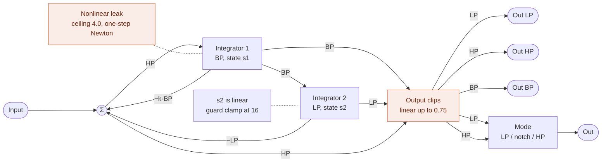
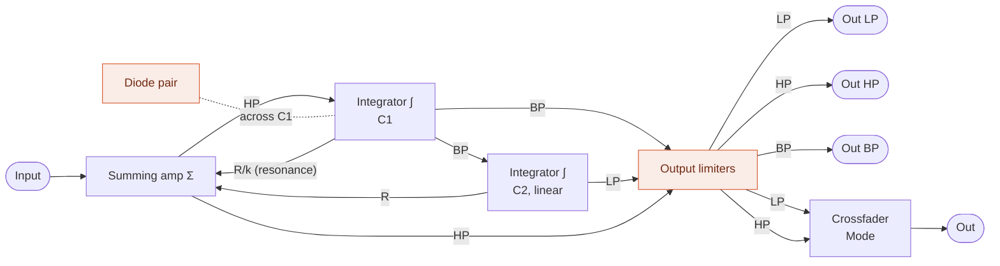
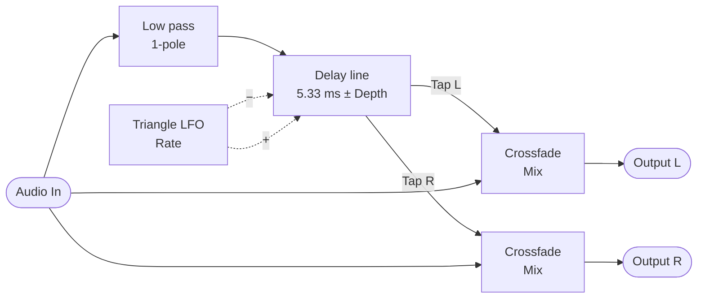
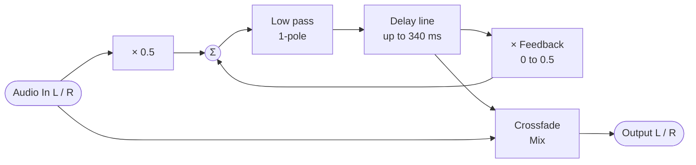

MIDI Synthesizer SPMS-1 (type-2): Patching
==========================================

- [README](./README.md) / [日本語版](./spms1_patching.ja.md)

## The run order

Every module is in it: Pitch 1 first, so that every module after it reads the note in the same
sample, then the modulation sources -- the envelopes ahead of the LFO, so that the LFO's Mod Ins can
read them in the same sample, as a vibrato fading in with an envelope does -- Mixer 1 between them and the oscillators, Noise 1 after the oscillators, as it is mostly a sound of its own (a modulation
taking it is a sample late, which it does not hear), Mixer 2 between them and the filter, and the
chorus and the delay last:

1. Pitch 1
2. EG 1
3. EG 2
4. LFO 1
5. Mixer 1
6. Osc 1
7. Osc 2
8. Noise 1
9. Mixer 2
10. Filter 1
11. Amp 1
12. Chorus 1
13. Delay 1

Mixer 1 has nothing routed to it, so it costs its slot every sample and changes nothing until
a patch gives it something. Where it sits is what it buys: a module sees the current sample's
value only from something ahead of it in this order, and last sample's from anything behind.
Mixer 1 can reach the envelopes and the LFO, and the oscillators, the filter and the amp can reach
Mixer 1. Pitch 1 comes before them all, so that every module reads the note in the same sample:
the oscillators and the filter, and a modulation source that follows the keys. A modulation of
Pitch 1 itself -- a bend from the LFO through Bend In, say -- is then a sample late, which it does
not hear. Mixer 2 sits between the oscillators and the filter, where it gathers the
audio.

A mixer is what lets two of anything meet, and what makes a signal that runs one way, such as the
envelope, swing both ways. See the examples below.

## Modules

### Filter 1

A zero-delay feedback state variable filter. The band pass integrator leaks, more and more as the
band pass bends into a soft clip curve, and that is what holds the resonance down; at small levels
the leak is next to nothing, so the pass band passes nearly clean. The loop equation, leak
included, is solved every sample by the one-step Newton method from the linear solution, which
lands almost on the root. The leak's rate is fixed in time, so the sound does not change with the
sample rate. The low pass state stays linear, with a
clamp at 16 as a guard that ordinary use never reaches. The output clip comes last. At the top of
the resonance dial k turns negative and the loop oscillates.

The filter puts out its low pass and high pass at once, as Out LP and Out HP, each through a DC
blocker and an output clip of its own, and Out, the two crossfaded by Filter 1 Mode (CC#39). Each side stays at full over its own half and falls to nothing over the other.
At 0.0 (value 4), where it powers up, Out is the low
pass alone; at 1.0 (value 124) the high pass alone; and at 0.5 (value 64) both at full, whose sum, the
input less k·BP, is a notch at the cutoff with both sides of it passed whole. In between the notch
moves off the cutoff, above it toward the low pass and below it toward the high pass, with the
other side at up to 6 dB down. Out is the one the default patch uses, feeding Amp 1, so it plays the
low pass until Mode is turned up. Out is not clipped again: in the pass band one side is all there is, and around the cutoff,
where both are, the notch takes them down. The two factors are smoothed as the other levels
are.

The band pass leaves too, as Out BP, through a DC blocker and an output clip of its own, outside
the Mode crossfade. It is the integrator's state as it is, not normalized, so its peak at the
cutoff is Q times the input: 0.707 times at Resonance 0.0, and into the output clip's shoulder at
a high resonance on a loud input, which Mixer 2 Out Level takes down. The default patch leaves it
unconnected.

The same structure redrawn as an op-amp integrator filter. The diode pair stands for the
nonlinear leak and the output limiter for the output clip. It is an interpretation, not a reproduction of
an actual circuit.

### Chorus 1

A mono-in, stereo-out chorus, put in the chain as an insert, as the
delay is: Mix sets the balance of dry and chorused, rather than a send level. The input goes through a gentle low pass
filter into one short delay line, which is read at two taps. A triangle LFO swings the two taps in
opposite directions about 5.33 ms, so the left and right delayed signals bend in pitch against
each other. Each output is a crossfade of the input with its own tap, so a mono source comes out
spread across the stereo field.

It needs no limiter and no clip after it: the input is held to one unit on the way in, and the
filter, the reading between two samples and the crossfades are all weighted averages, which cannot
reach past what they average. The delay the taps swing about is fixed.

Out Mono, a sub output, is the average of Out L and Out R, for a mono destination such as a
mixer input or the filter. The two taps summed make a gentler chorus than the spread, with some
comb filtering where they meet.

### Delay 1

A stereo delay with feedback. Each side has a
delay line and a loop of its own: half its input and its delayed signal at the Feedback gain go
through a gentle low pass filter into its line, and its output is a crossfade of its input with
its delayed signal. Time, Feedback and Mix are shared, so the two sides repeat together and keep
the stereo image they came in with.

The diagram is one side; the other is the same. It needs no limiter and no clip after it. With
half the input coming in and at most half the delayed signal going round again, what is written
back stays within one unit as long as the delayed signal does, and it starts from silence; the
filter, the reading between two samples and the crossfade are all weighted averages, which cannot
reach past what they average. The price is that the first repeat comes 6 dB under the dry signal.
Each input is held to one unit on the way in, as the amp holds its modulation, so whatever
is routed to it the bound holds.

Out Mono, a sub output, is the average of Out L and Out R, for a mono destination.

## Patch Editing (NRPN)

The patch is data, and NRPN rewrites it while the synth is running: which modules run and in what
order, what feeds each module input, where each parameter takes its value from, which CC fills
each control slot, and the value of each parameter that has no CC. Every module reads from a numbered signal slot and writes to one, so rewiring is
a matter of changing slot numbers. Each parameter also has a control slot of its own, which its CC
fills, or with no CC its value in category 4, and which only it can read: a parameter source of 127 names it, and no slot number reaches
it from anywhere else.

### Sending

- CC#99 selects the category, CC#98 the entry within it, in either order
- CC#99 is 112 (0x70) + the category number, clear of the NRPNs of GS and XG (MSB 1 and 20-31)
  and of the low MSBs other synths tend to use. A CC#6 after an MSB below 112 is ignored
- CC#6 (Data Entry MSB) commits the value, and takes effect on the next audio buffer
- CC#38 (Data Entry LSB) is ignored: every value here is 7-bit
- CC#101 and CC#100 (RPN select) suspend data entry, so an RPN is never taken as a patch edit.
  Send CC#99 or CC#98 again to resume
- Edits are not saved. The default patch is restored at power-on, or by Reset (below)

### Categories (CC#99)

| CC#99 (category) | CC#98 | Sets | CC#6 value |
| ----- | ----- | ---- | ---------- |
| 112 (0) | 0-31 | Run order, slot by slot | Module ID |
| 113 (1) | 0-34 | What feeds a module input | Signal ID |
| 114 (2) | 0-81 | Where a parameter takes its value | Signal ID, or 127 for its own control slot |
| 115 (3) | 0-84 | Which CC fills a control slot | CC number, or 0 for none |
| 116 (4) | 0-81 | What a parameter's control slot holds while it has no CC | CC value |
| 117 (5) | 0-1 | System: Mute, Reset (below), not a part of the patch | 0-63 or 64-127 |

Category 5 has the system entries, which act on the synth rather than set a part of the patch:

- Entry 0, Mute: 64-127 fades the output out over 4 ms and holds it silent, and clears the delay
  and the chorus (11 ms), and 0-63 fades it in again. Send a whole patch between Mute on and off, so that what the synth plays while the patch is
  half sent is not heard: wait for the fade out (about 10 ms) before the patch, and for the
  parameters to settle on their new values (about 30 ms) before Mute off, as the editor does.
  Mute is off at power-on
- Entry 1, Reset: 64-127 puts the patch back to the default, as at power-on: every entry of
  categories 0-4 and every CC value. The notes, Pitch Bend and Mute are kept. Send it between Mute
  on and off for it to be heard as silence, since the synth may play a buffer of the patch half reset

The run order is read from slot 0 upwards and stops at the first Module ID 0, so a patch shorter
than 32 modules ends itself. It is separate from the module numbering: a module only sees the
current sample's value from something listed before it, and last sample's from something after.
A module listed more than once runs once, at the slot written last, as if its other slots were
not there: the last write wins, whether its slot is ahead of the others or after them. A module
written to a new slot moves there, and the module that slot held leaves the order.

In category 3, CC number 0 means the control has no CC. A parameter's control slot then holds its
value in category 4, whatever CC it had before, so the patch alone sets what the parameter reads; the
Mod Wheel and General slots hold 0.0. Category 4 takes a value as a CC would and is read the same way, so value 64
is 0.0 on a bipolar parameter. While the parameter has a CC, its category 4 value is kept but not
read. Each powers up at the parameter's power-up value.

There are two oscillators, two envelopes, one LFO, one filter, one amp, two mixers, one chorus,
one delay, one pitch module and one noise source, and **all thirteen are in the default run order**, so a patch only ever has to route, never to switch something
on first. The synth is built to keep time with every module running, so taking one out of the
order is never what makes a patch fit; to leave one out of the sound, route around it and let it
run unread (see the examples below).
Mixer 1 has no CC: its levels hold 0.0, so it is silent until a patch turns them up, as its
category 4 values or by giving them CCs. Mixer 2 has a CC on each level, CC#19 to 21 and 23, of which
Level 1 and 2 power up at 0.7 and Level 3 and 4 at 0.0, so those inputs start closed. Each mixer's Out Level has no CC and holds 0.5; Mixer 2's sets how hard the
audio drives the filter.

### Entries (CC#98), category 1

<!-- patch_gen inputs -->

| CC#98 | Module input | | CC#98 | Module input |
| ----- | ------ | - | ----- | ------ |
| 0 | Pitch 1 Pitch In | | 18 | Osc 2 Sync In |
| 1 | Pitch 1 Gate In | | 19 | Mixer 2 In 1 |
| 2 | Pitch 1 Bend In | | 20 | Mixer 2 In 2 |
| 3 | EG 1 Gate In | | 21 | Mixer 2 In 3 |
| 4 | EG 2 Gate In | | 22 | Mixer 2 In 4 |
| 5 | LFO 1 Rate Mod In | | 23 | Filter 1 Audio In |
| 6 | LFO 1 Level Mod In | | 24 | Filter 1 Pitch In |
| 7 | LFO 1 Reset In | | 25 | Filter 1 Mod 1 In |
| 8 | Mixer 1 In 1 | | 26 | Filter 1 Mod 2 In |
| 9 | Mixer 1 In 2 | | 27 | Amp 1 Audio In |
| 10 | Mixer 1 In 3 | | 28 | Amp 1 Mod 1 In |
| 11 | Mixer 1 In 4 | | 29 | Amp 1 Mod 2 In |
| 12 | Osc 1 Pitch In | | 30 | Chorus 1 Audio In |
| 13 | Osc 1 Mod 1 In | | 31 | Delay 1 Audio In L |
| 14 | Osc 1 Mod 2 In | | 32 | Delay 1 Audio In R |
| 15 | Osc 2 Pitch In | | 33 | Final Output L |
| 16 | Osc 2 Mod 1 In | | 34 | Final Output R |
| 17 | Osc 2 Mod 2 In | |  |  |

<!-- patch_gen end -->

Most of these take what their name suggests, but three do not say it on their face. A Gate is a
threshold rather than a level: an envelope triggers as the signal reaches 0.25 and releases as it
falls back. A pitch, as Note Pitch carries one to Pitch In, is -0.5 to +0.5 across MIDI notes
0 to 120, so 0.0 is note 60 and a tenth of a unit is an octave. And a Mod In is taken as it arrives:
nothing is held to a range on the way in, and what gets clamped is the value the module ends up with
-- cutoff to the ends of its dial, pitch to -0.5 and +0.5, pulse width to -0.5 and +0.5. The
oscillator's Pitch In, Mod 1 In and Mod 2 In are Mod Ins too. A mixer adds without a
ceiling, so a loud modulation pins its destination at one
end rather than being trimmed on the way in. The amp is the exception, and holds its modulation,
the crossfade of its two Mod Ins, to -1.0 and +1.0: it is an attenuator, so a modulation may scale its gain down but never up;
a negative one inverts. The chorus and the delay hold their audio inputs to the same one unit. Pitch 1 Pitch In takes anything,
as a Mod In does, and puts out what it takes, glided, bent and stretched, held to -1.0 and +1.0
as a mixer's output is.

The two sides of the final output are read separately, so either can be pointed anywhere; point
both at the same signal for a mono output.

### Entries (CC#98), categories 2, 3 and 4

<!-- patch_gen params -->

| CC#98 | Parameter | | CC#98 | Parameter | | CC#98 | Parameter |
| ----- | ------ | - | ----- | ------ | - | ----- | ------ |
| 0 | Pitch 1 Glide | | 28 | Osc 1 Wave | | 56 | Osc 2 PW Mod 2 Amt |
| 1 | Pitch 1 Out 1 Glide Sw | | 29 | Osc 1 PW | | 57 | Osc 2 PW Mod 2 Pol |
| 2 | Pitch 1 Out 2 Glide Sw | | 30 | Osc 1 Pitch Coarse | | 58 | Osc 2 Sync Sw |
| 3 | Pitch 1 Bend Amt | | 31 | Osc 1 Pitch | | 59 | Noise 1 Color |
| 4 | Pitch 1 Out 1 Bend Sw | | 32 | Osc 1 Pitch Fine | | 60 | Noise 1 Level |
| 5 | Pitch 1 Out 2 Bend Sw | | 33 | Osc 1 Pitch Mod 1 Amt | | 61 | Mixer 2 Level 1 |
| 6 | Pitch 1 Stretch | | 34 | Osc 1 Pitch Mod 1 Pol | | 62 | Mixer 2 Level 2 |
| 7 | EG 1 Attack | | 35 | Osc 1 Pitch Mod 1 Sw | | 63 | Mixer 2 Level 3 |
| 8 | EG 1 Decay | | 36 | Osc 1 Pitch Mod 2 Amt | | 64 | Mixer 2 Level 4 |
| 9 | EG 1 Sustain | | 37 | Osc 1 Pitch Mod 2 Pol | | 65 | Mixer 2 Out Level |
| 10 | EG 1 Release Sw | | 38 | Osc 1 Pitch Mod 2 Sw | | 66 | Filter 1 Cutoff |
| 11 | EG 1 Level | | 39 | Osc 1 PW Mod 1 Amt | | 67 | Filter 1 Resonance |
| 12 | EG 2 Attack | | 40 | Osc 1 PW Mod 1 Pol | | 68 | Filter 1 Mode |
| 13 | EG 2 Decay | | 41 | Osc 1 PW Mod 2 Amt | | 69 | Filter 1 Pitch Amt |
| 14 | EG 2 Sustain | | 42 | Osc 1 PW Mod 2 Pol | | 70 | Filter 1 Mod 1 Amt |
| 15 | EG 2 Release Sw | | 43 | Osc 2 Wave | | 71 | Filter 1 Mod 1 Pol |
| 16 | EG 2 Level | | 44 | Osc 2 PW | | 72 | Filter 1 Mod 2 Amt |
| 17 | LFO 1 Wave | | 45 | Osc 2 Pitch Coarse | | 73 | Filter 1 Mod 2 Pol |
| 18 | LFO 1 Rate | | 46 | Osc 2 Pitch | | 74 | Amp 1 Gain |
| 19 | LFO 1 Level | | 47 | Osc 2 Pitch Fine | | 75 | Amp 1 Mod 1/2 Mix |
| 20 | LFO 1 Rate Mod Amt | | 48 | Osc 2 Pitch Mod 1 Amt | | 76 | Chorus 1 Mix |
| 21 | LFO 1 Level Mod Amt | | 49 | Osc 2 Pitch Mod 1 Pol | | 77 | Chorus 1 Rate |
| 22 | LFO 1 Reset Sw | | 50 | Osc 2 Pitch Mod 1 Sw | | 78 | Chorus 1 Depth |
| 23 | Mixer 1 Level 1 | | 51 | Osc 2 Pitch Mod 2 Amt | | 79 | Delay 1 Mix |
| 24 | Mixer 1 Level 2 | | 52 | Osc 2 Pitch Mod 2 Pol | | 80 | Delay 1 Time |
| 25 | Mixer 1 Level 3 | | 53 | Osc 2 Pitch Mod 2 Sw | | 81 | Delay 1 Feedback |
| 26 | Mixer 1 Level 4 | | 54 | Osc 2 PW Mod 1 Amt | | 85 | Amp 1 Limiter Sw |
| 27 | Mixer 1 Out Level | | 55 | Osc 2 PW Mod 1 Pol | |  |  |

<!-- patch_gen end -->

### Entries (CC#98), category 3 only

These CCs belong to no parameter, so category 2 has no entry for them. They fill the Mod Wheel
slot and the general slots on the bus; see below.

<!-- patch_gen controllers -->

| CC#98 | CC for | Fills |
| ----- | ------ | ----- |
| 82 | Mod Wheel | Mod Wheel, Mod Wheel Rev, Mod Wheel Inv, Mod Wheel Rev Inv |
| 83 | General 1 | General 1, General 1 Rev, General 1 Inv, General 1 Rev Inv, General 1 Bipolar, General 1 Bipolar Inv, General 1 Sin, General 1 Cos, General 1 Lo, General 1 Hi, General 1 Neg, General 1 Mid, General 1 Pos |
| 84 | General 2 | General 2, General 2 Rev, General 2 Inv, General 2 Rev Inv, General 2 Bipolar, General 2 Bipolar Inv, General 2 Sin, General 2 Cos, General 2 Lo, General 2 Hi, General 2 Neg, General 2 Mid, General 2 Pos |

<!-- patch_gen end -->

### Module IDs

<!-- patch_gen modules -->

| ID | Module |
| ----- | ------ |
| 0 | None (ends the run order) |
| 1 | Pitch 1 |
| 2 | EG 1 |
| 3 | EG 2 |
| 4 | LFO 1 |
| 5 | Mixer 1 |
| 6 | Osc 1 |
| 7 | Osc 2 |
| 8 | Noise 1 |
| 9 | Mixer 2 |
| 10 | Filter 1 |
| 11 | Amp 1 |
| 12 | Chorus 1 |
| 13 | Delay 1 |

<!-- patch_gen end -->

### Signal IDs

<!-- patch_gen signals -->

| ID | Signal | | ID | Signal | | ID | Signal |
| ----- | ------ | - | ----- | ------ | - | ----- | ------ |
| 0 | None (constant 0.0) | | 25 | General 2 | | 50 | Mixer 1 Output ± |
| 1 | Constant 1.0 | | 26 | General 2 Rev | | 51 | Mixer 1 Output Inv ± |
| 2 | Constant 0.5 | | 27 | General 2 Inv | | 52 | Osc 1 Output ± |
| 3 | Constant -0.5 | | 28 | General 2 Rev Inv | | 53 | Osc 1 Output Saw ± |
| 4 | Constant -1.0 | | 29 | General 2 Bipolar ± | | 54 | Osc 1 Output Pulse ± |
| 5 | Note Pitch ± | | 30 | General 2 Bipolar Inv ± | | 55 | Osc 1 Output Sub ± |
| 6 | Note Gate | | 31 | General 2 Sin | | 56 | Osc 2 Output ± |
| 7 | Pitch Bend ± | | 32 | General 2 Cos | | 57 | Osc 2 Output Saw ± |
| 8 | Mod Wheel | | 33 | General 2 Lo | | 58 | Osc 2 Output Pulse ± |
| 9 | Mod Wheel Rev | | 34 | General 2 Hi | | 59 | Noise 1 Output ± |
| 10 | Mod Wheel Inv | | 35 | General 2 Neg | | 60 | Noise 1 Output White ± |
| 11 | Mod Wheel Rev Inv | | 36 | General 2 Mid | | 61 | Noise 1 Output Red ± |
| 12 | General 1 | | 37 | General 2 Pos | | 62 | Mixer 2 Output ± |
| 13 | General 1 Rev | | 38 | Pitch 1 Output 1 ± | | 63 | Mixer 2 Output Inv ± |
| 14 | General 1 Inv | | 39 | Pitch 1 Output 2 ± | | 64 | Filter 1 Output ± |
| 15 | General 1 Rev Inv | | 40 | EG 1 Output | | 65 | Filter 1 Output LP ± |
| 16 | General 1 Bipolar ± | | 41 | EG 1 Output Inv | | 66 | Filter 1 Output HP ± |
| 17 | General 1 Bipolar Inv ± | | 42 | EG 2 Output | | 67 | Filter 1 Output BP ± |
| 18 | General 1 Sin | | 43 | EG 2 Output Inv | | 68 | Amp 1 Output ± |
| 19 | General 1 Cos | | 44 | LFO 1 Output ± | | 69 | Chorus 1 Output L ± |
| 20 | General 1 Lo | | 45 | LFO 1 Output Inv ± | | 70 | Chorus 1 Output R ± |
| 21 | General 1 Hi | | 46 | LFO 1 Output Triangle ± | | 71 | Chorus 1 Output Mono ± |
| 22 | General 1 Neg | | 47 | LFO 1 Output Triangle Inv ± | | 72 | Delay 1 Output L ± |
| 23 | General 1 Mid | | 48 | LFO 1 Output Square | | 73 | Delay 1 Output R ± |
| 24 | General 1 Pos | | 49 | LFO 1 Output Square Inv | | 74 | Delay 1 Output Mono ± |

<!-- patch_gen end -->

A **±** marks a signal that swings both ways: a module output reaches -0.5 and +0.5 at full
scale, and a mixer sums two of them and stops at one.
Everything unmarked runs one way: 0.0 to 1.0 -- the envelope, Note Gate and Mod Wheel -- or,
for an Inv form, 0.0 down to -1.0. The
bus carries both kinds under one numbering, so the range belongs to the slot rather than to the
sort of thing that wrote it. The numbers missing from the table are free; 127 is not a slot but a
parameter's own control slot.

A parameter's own control slot holds the value arriving from its CC, or with no CC its value in
category 4, off the bus, and a parameter reads it by default: Signal ID 127 in category 2. Each parameter is unipolar or bipolar, and its
slot takes the same range. A unipolar one
runs 0.0 to 1.0 from value 4 to value 124, the span of an envelope, so an envelope pointed at one sweeps
the whole of its dial. A bipolar one runs -0.5 to +0.5 with value 64 at 0.0, the span of an LFO, so a
bipolar source pointed at one swings it about the middle. Osc 1 Pitch Coarse and Fine are
bipolar, since their middle is no change at all. Pointing a parameter at a
slot on the bus is what makes a modulation. No input or other
parameter can read a parameter's control slot: a CC meant for more than one parameter, or for a
module input, is given to each parameter in category 3, as Osc 1 and Osc 2 share theirs, or, as
the mod wheel, goes on the Mod Wheel slot.

Slot 8, Mod Wheel, is a control slot that no parameter owns: a CC put on the bus for any module
input or parameter to read. It reads CC#1 by default, runs 0.0 to 1.0 and powers up at value 4, so
it is at 0.0 until the wheel moves; the default patch puts it on LFO 1 Level Mod In, where it adds nothing while LFO 1 Level is at
its power-up 1.0. Slots 9 to
11 carry it in three more forms of its value u: Mod Wheel Rev 1 - u, Inv -u and Rev Inv u - 1,
so the wheel can take something out, or the other way, with no mixer to turn it round. The editor
shows it with the keyboard's signals, on its Controller node, the forms as outputs below it, and
as a wheel beside the soft keyboard.

Slots 12 to 37 are General 1 and General 2, two more control slots that no parameter owns, read
from CC#16 and CC#17, General Purpose Controllers 1 and 2. Each CC fills thirteen slots at once, each
a form of its value u, which runs 0.0 to 1.0 from value 4 to value 124: General n itself, Rev
1 - u, Inv -u, Rev Inv u - 1, Bipolar u - 0.5, Bipolar Inv 0.5 - u, Sin sin(u * pi / 2), Cos
cos(u * pi / 2), Lo min(1, 2 - 2u), Hi min(1, 2u), Neg max(0, 1 - 2u), Mid 1 - |2u - 1|
and Pos max(0, 2u - 1). So one knob can bring one thing in as it takes another out, or swing a bipolar
parameter about its middle, with no mixer to turn it round. Sin and Cos are an equal-power pair:
their squares sum to one at every step, so two levels taking them crossfade with no dip in the
middle, where both are 0.707 at value 64; General n and Rev, a straight crossfade, are both 0.5
there, which sounds 3 dB down when the two sources are not in phase. Lo and Hi are the pair Filter 1
Mode crossfades by: each at 1.0 over its own half and falling to 0.0 over the other, both at
1.0 in the middle. Neg and Pos are the two sides of Bipolar doubled: 0.0 in the middle, rising
to 1.0 at the bottom for Neg and at the top for Pos, so one knob can bring in one thing turned
down from the middle and another turned up. Mid is 1.0 in the middle and 0.0 at both ends, so
with Neg and Pos one knob crossfades three things. A parameter taking one of these slots, a mixer
level or a Mod Amt, smooths it as it does its CC, the shape taken before the smoothing. A module
input, which smooths nothing itself, takes a copy smoothed in the same two stages, made once a
buffer from the smoothed value u, so a wheel or a knob moves it without steps; a gate input,
Gate In, Reset In or Sync In, takes the slot as it is, so that it acts at once. The same goes for
Mod Wheel and its forms. They power up at value 4, so u is 0.0, and with no CC u stays 0.0; the
default patch routes none of them. The editor shows them on the Controller node, the forms as
outputs below each, and as sliders in the Controls tab.

Note Pitch, Note Gate and Pitch Bend are what the keyboard puts on the bus. Note Pitch carries
MIDI notes 0 to 120 as -0.5 to +0.5, the same span the oscillator reads as its whole pitch
range, and Pitch Bend is bipolar too, one unit across the whole wheel: exactly -0.5 and +0.5 at
the ends of its travel and exactly zero at the center detent, so it can feed a module input
without a mixer to shift it. Note Gate is 0.0 or 1.0, and an envelope triggers at 0.25. Pitch Bend
is routed to Pitch 1 Bend In by default.

The newest note sounds, and the note it took over from is remembered while it is still held: one
note, no more. When the newest note is released, the remembered one comes back with Note Gate
left at 1.0, so the envelopes go on without a new attack, and holding one key while tapping
another plays a trill. Releasing the remembered note only forgets it, and with three keys held,
releasing the newest goes back to the second, and releasing that closes the gate, even with the
first still held.

Slots 0-4 are constants that nothing writes, for inputs that want a fixed value rather than a
source: 0.0, 1.0, 0.5, -0.5 and -1.0. Signal 0 is also what an entry nobody has set reads as, so an unrouted
input is silent rather than wired to whatever sits in the first slot. Signal 1 is the value an
unmodulated input wants: routing an amp's modulation input to it leaves that side at full level.
Signals 0 and 1 are the two ends of a unipolar parameter's range and Signals 3 and 2 of a bipolar
one, for pinning one there; Signal 2 is also the middle of a unipolar dial, and Signal 4 is the
negative of Signal 1. A constant on a mixer's second input shifts
a signal between the two kinds: -0.5 turns one that runs one way into one that swings both, and +0.5
the other way round.

The ID numbers are not stable across firmware versions. Each list is numbered in order --
modules in the default run order, the bus from the constants through MIDI to the module outputs,
inputs and parameters module by module -- with no gaps, so a new module type, another instance of
one, or another signal renumbers everything after it. A patch sent as NRPN bytes is for the
version it was made for; the editor keeps a patch by name, and sends it numbered for the version
it is built with. Read these tables again after an update.

### Ranges worth knowing

Osc 1 Pitch Coarse and Pitch Fine transpose the oscillator. Both are centered on value 64 and move one
whole unit per CC step: Coarse a semitone, reaching 5 octaves either way, and Fine a cent,
reaching 60 either way. They are summed, so any pitch is reachable. Pitch, on each oscillator,
adds up to an octave up on top, a tenth of a semitone a step, for a pitch swept by hand, as for a
sync sweep; it is unipolar, 0.0 at value 4. Osc 1's three hold 0.0 by default and have no CC; Osc 2's
Pitch and Pitch Fine, on CC#85 and 76, set the interval or the detune between the oscillators,
11 cents sharp at power-up (values 5 and 65), and its Pitch Coarse has no CC and holds 0.0. None of them is smoothed.

Pitch 1 Stretch, on CC#22, widens the keys about note 60, last, by multiplying the pitch
after the glide and the bend: every interval from note 60 grows by the same share, so the stretch is often given as how
much an octave widens. At 0.0 (value 4), where it powers up, the keys are as they are; from value 5 the
widening grows by a semitone's ratio a step, as the envelope's times do: 1.2 cents an octave at
value 5, 38 at value 64, and a whole octave at value 124, which doubles every interval and turns the
keyboard into whole tones. The low end is a piano's stretch tuning, a few cents an octave. The
glide and the bend are widened with the keys, so a bend of an octave becomes two at the top, and
turning it glides the pitch rather than stepping it. At its top, notes more than 30 semitones from note 60 run past the
oscillator's range.

LFO 1 puts out a triangle and a square at once, each on an output of its own, Out Triangle and
Out Square, and the two crossfaded on Out. The triangle has its corners rounded off by PolyBLAMP
and the square its steps by PolyBLEP, so at the top of the rate range, 220 Hz, where the LFO is an
audible tone, the square's aliases are 41 dB down on it, rather than 24 dB without. The square is
unipolar: 1.0 while the triangle is above zero and 0.0 while it is below, stepping where it
crosses, so it gates, or trills up from the note on an oscillator's pitch, where the triangle
swings about zero for a vibrato; its inverted output runs 0.0 and -1.0. LFO 1 Wave (CC#33) crossfades Out in a straight line from the triangle at 0.0 (value 4), where it
powers up, to the square at 1.0 (value 124), and is smoothed as the level is, so on the way the
middle of the swing moves up from zero to 0.5. Out is what the default patch routes, so the LFO
is a triangle until Wave is turned up.

LFO 1 Level scales the LFO's outputs, as a mixer's Level scales its input: from silent at 0.0
(value 4) to full at 1.0 (value 124). It is on CC#116 and powers up at 1.0, so the LFO runs at
full level and what it moves sets the depth. LFO 1 Level Mod In adds to it, held to the same range, by Level Mod Amt, and it takes
Mod Wheel by default at a depth of 1.0 (Level Mod Amt has no CC and holds 1.0), so with Level
turned down the wheel brings the LFO in, up to full at its top. Turning the LFO the
other way up is for Out Inv, Out negated, or for a mixer's Out Inv; the triangle and the square
have theirs too, Out Triangle Inv and Out Square Inv. The default patch leaves them unrouted.

LFO 1 Rate Mod In moves the rate by LFO 1 Rate Mod Amt, as Osc 1 Mod 2 In moves the oscillator's
pitch: a unit of input times depth is the whole rate range, ten octaves, so 0.1 is an octave.
Rate Mod Amt has no CC and holds 1.0, and the default patch leaves Rate Mod In unrouted, so routing a source to it is all it takes. Both of the LFO's Mod Ins
are read every fourth sample,
where the LFO works out its rate, rather than every sample as most module inputs are.

LFO 1 Reset In restarts the LFO's cycle where it rises above zero, from the start, where Out is
0.0 and the triangle on its way up. It takes Note Gate by default, so every note starts its
vibrato the same way (key sync), but only with LFO 1 Reset Sw on: on CC#113, it takes Reset In
at value 64 and above and ignores it below, and powers up off (value 4), so the LFO runs free until
it is turned on. Reset In is read every fourth sample too, where a gate changes only between
buffers, which are a whole number of those steps; an audio signal on it is read only at those
steps.

EG 1 Level scales the envelope's output the same way, over the same range. It has no CC, and
holds 1.0, which passes the envelope through as it is. The
envelope runs one way, 0.0 to 1.0; turning it the other way up is for Out Inv, the envelope
negated, from 0.0 down to -1.0, or for a mixer's Out Inv. The default patch leaves
Out Inv unrouted.

EG 1 Release Sw, on CC#105, picks the release, after the note's gate falls: on from value 64,
as a MIDI switch is, it runs at the decay's rate, set by EG 1 Decay; off, below value 64, it runs at
the shortest decay's, 10 ms, whatever the decay is, so a long decay still ends a note short. It
powers up on, at value 124. It is a switch, so it is not smoothed.

EG 2 is a second envelope of the same kind, on Note Gate too, for the amp: the default patch puts
it on Amp 1 Mod 2 In (below). Its Attack, Decay and Sustain are on CC#52, 53 and 54, and power up as an organ's: Attack and Decay at 0.0 (value 4), Sustain at
1.0 (value 124), so it opens at once to full and holds while a key is held. Its Release Sw is
on EG 1's CC#105 as well, one switch for both envelopes, and powers up on, so the
release runs at its decay's rate, 10 ms at power-up: the note stops short, as an organ's does. Its
Level has no CC and holds 1.0, as EG 1's does.

Osc 1 takes each of its two modulations, Mod 1 In and Mod 2 In, to the pitch and to the pulse
width by a depth of its own: Pitch Mod 1 Amt and Pitch Mod 2 Amt, PW Mod 1 Amt and PW Mod 2 Amt,
all unipolar. Pitch Mod 1 Amt and Pitch Mod 2 Amt are on CC#89 and 13, and PW Mod 1 Amt and PW Mod 2 Amt on CC#8 and 103; all four power up at 0.0. Each has a Mod Pol after it,
bipolar and with no CC, which multiplies it from -1.0 at value 4 through none at value 64 to +1.0
at value 124: the sign, so a modulation runs the way its source does or the other way up, and
what the top of the Mod Amt is worth. So a source goes to the pulse width as well as the pitch,
or to either alone, either way up, with no rewiring.

Each pitch depth is its Pitch Mod Amt times its Pitch Mod Pol. At a depth of 1.0 a
modulation reaches the whole pitch range: a bipolar source at full depth swings the pitch five
octaves up and five down. That is a coarse range for vibrato, which is why the Pitch Mod Pols
power up at +0.2 (value 76), the depth at the top of a Pitch Mod Amt; the PW Mod Pols power up at
+1.0 (value 124). So Pitch Mod 2 Amt puts
50 cents of vibrato at value 9, a semitone at value 14 and an octave at the top of the dial, a step
being 10 cents, and Pitch Mod 1 Amt sweeps
the pitch from the envelope a semitone at value 9, an octave at value 64 and two octaves at the top.

Osc 1 Pitch In is where the note comes in, from Pitch 1 in the default patch. It has no depth:
the pitch it takes is added whole, so the note plays in tune, a key a semitone.

Osc 1 Mod 1 In takes the envelope in the default patch, for a pitch envelope, and Mod 2 In the
LFO, for vibrato. Every Mod Amt powers up at 0.0, so the LFO, at Level 1.0, and the envelope
leave the oscillator alone until one is turned up: CC#13 brings the vibrato in.

Osc 1 PW, the pulse width, shifts the second of the two sawtooths that the morph is made of, either way
from half a cycle: it is bipolar, -0.5 (value 4) to +0.5 (value 124), and powers up at 0.0 (value 64). At
the square end of Osc 1 Wave that is a pulse of 50% at value 64, 75% at value 94 and 25% at value 34, and
silence at either end, a pulse of 0% or 100%; it is on CC#114.
The modulations move it by PW Mod 1 Amt (CC#8) and PW Mod 2 Amt (CC#103), which power up at 0.0.
A unit of input is the whole pulse width range, so with PW Mod 2 Amt at the top the LFO swings
the pulse width half the range either way: with PW at value 64, from nearly 0% to nearly 100%; and
with PW Mod 1 Amt at the top the envelope sweeps it across the whole range, from PW up, or down
from an inverted envelope. The pulse width the modulation adds
up to is held to -0.5 to +0.5.

Each oscillator puts out the two ends of its morph on their own as well, whatever Wave is: Out
Saw, the sawtooth, and Out Pulse, the pulse at the pulse width, as Out is at the square end of
Wave. Both run at the same level as Out, -0.5 to +0.5, and the default patch uses neither, so a
mixer can take the two from one oscillator at levels of their own, or one oscillator can feed a
saw to one place and a pulse to another.

The sawtooth's steps, and so the pulse's, are rounded off by PolyBLEP over the sample on either
side, which holds what folds back under 5 kHz to -59 dB or less on any note, and under 10 kHz to
-47 dB or less. Above that it keeps less back the higher the note: the folded tones gather between
10 kHz and the top of the band, from C8 (4.2 kHz) up -36 dB under 16 kHz and -24 dB above, and
at C9 (8.4 kHz) and above, where little of the wave itself is left under 24 kHz, -29 to -31 dB under
16 kHz and -13 to -18 dB above. They are not in tune with the note, and a glide or a bend moves them
the other way, so the top octaves can be heard as a whistle above the note. It is left as it is:
a longer BLEP would delay the oscillator further and dull it lower down, and a fade to a sine at
the top would cost every note. Kept to C8 and below, or with the filter closing on the top, it is
not heard.

Osc 1 also puts out a sub, Out Sub: a sine an octave down, at the same level, -0.5 to
+0.5. It is locked to the oscillator's phase, starting each of its cycles where every other cycle
of the sawtooth starts, so it follows the pitch, the glide and the modulation exactly. A sine has
nothing to alias, so it is clean however high it goes. The default patch puts Osc 1's on Mixer 2
In 3, whose Level 3 (CC#21) powers up at 0.0: turning it up brings the sub in under the note.
Osc 2 has none: it is the one that syncs, and is lighter without it.

Osc 2 syncs to Osc 1 (hard sync). Osc 2 Sync In restarts Osc 2's phase where it rises through
zero, from zero or below on one sample to above zero on the next, as the comparator on an analog
oscillator's sync input does, and it takes Osc 1 Out Saw by default, which rises through zero
once a cycle, at its wrap. Osc 2 starts again from the point between the two samples where it
crossed, so the synced wave repeats at Osc 1's pitch with a period as exact as Osc 1's; a restart
rounded to a sample would make the period jitter by one, which is heard as roughness. The point is
found as where a step rounded off by PolyBLEP, as the sawtooth's is, would be: a line drawn between
the two samples would miss it by up to a twelfth of a sample. The step the restart makes in Osc 2's
wave is rounded off by PolyBLEP too, on the sample after the crossing and the one before it, which
is why everything Osc 2 puts out comes one sample (21 us) late. Left as it was, the step folded
back some 30 dB more than the rest of the oscillator, heard as a grain under a sync sweep from about
C5 up; now a synced Osc 2 aliases about as little as an unsynced one, -50 dB or less under 5 kHz up
to C8. The delay is heard only where Osc 2 plays in unison with Osc 1, with no detune: their sum
then loses 0.5 dB at 5 kHz and 2 dB at 10 kHz. Any signal can be routed there instead, though one
that is not a step from one level to the same level the other side of zero, a slow wave or a pulse
off center, is placed a little off, the same each cycle: a pulse rises once a cycle too, though at the
ends of its width it has no step to rise at; a wave that rises through zero more than once a
cycle restarts Osc 2 each time. Osc 2 Sync Sw, on CC#112, takes Sync In at value 64 and above
and ignores it below; it powers up off (value 4), so the default patch is unsynced until it is
turned on. Raise Osc 2's pitch above Osc 1's (Pitch, CC#85, Pitch Coarse, or a pitch modulation) to hear
the sync sweep. A gate on Sync In, which rises from 0.0 to 1.0, restarts Osc 2 on that sample:
Note Gate there, with the switch on, starts every note at the same point of the wave.

Noise 1 puts out two noises from one generator, at Noise 1 Level, each on an output of its own
and the two crossfaded on Out. Out White is white noise,
flat across the spectrum: from silence at 0.0 to noise filling -0.5 to +0.5 at 1.0, the
oscillator's range. Out Red is the same noise through a one-pole low pass, falling 6 dB an octave
above a fixed cutoff on the A of a MIDI note number, note 21 (A0, 27.5 Hz), so across the whole
audible band. A gain holds it at the white's RMS over the square root of 2, and it is held to -0.5
to +0.5, which cuts the rarest peaks, 1.5% of the samples. Noise 1 Color (CC#115) crossfades Out
in a straight line from the white at 0.0 (value 4), where it powers up, to the red at 1.0 (value 124),
each end as its own output is, so the red end is 3 dB down. Out keeps the slot the white had, and
is what the default patch puts on Mixer 2, so the noise there is white until Color is turned up,
and darkens as it is. Color is smoothed as the level is. The level has no CC and holds 1.0, so
the noise runs at full level and Mixer 2 Level 4 (CC#23), or the depth of whatever it modulates,
sets how much of it is heard. The level is smoothed as the other levels are. The noise repeats only after 2^32 samples,
over a day at 48 kHz, and starts the same every time, so a render comes out the same.

Filter 1 takes its audio input as it arrives, so how hard the input drives it, which is also what
decides how far it runs into its own saturation, is set ahead of it: by Mixer 2 Out Level in the
default patch, which has no CC and holds 0.5. Two oscillators at full level on Mixer 2 drive
the filter twice as hard as one: turn Out Level down to keep the level, or leave it up to drive
the saturation. The saturation sits on the resonance rather than the pass band: a low cutoff
passes a loud note nearly clean, while turning the drive up rounds off the resonant peak.

Filter 1 moves the cutoff by each of its two modulations at a depth of its own, Mod 1 Amt and
Mod 2 Amt, as Osc 1's PW Mod Amts move the pulse width. They are unipolar, on CC#24 and 25: Mod 1 Amt powers up at 0.2 (value 28), two octaves at the
envelope's peak, and Mod 2 Amt at 0.0 (value 4). A unit of input is the whole cutoff range, so with Mod 2 Amt at the top the
LFO would swing the cutoff five octaves either way. Mod 1 Pol and Mod 2 Pol multiply
each modulation, from -1.0 at value 4 through none at value 64 to +1.0 at value 124. Mod 1
Pol, on CC#117, powers up at +1.0: below value 64 the envelope closes the filter as it
rises. Mod 2 Pol has no CC and powers up at +0.2 (value 76), so Mod 2 Amt at the top swings
the cutoff an octave either way with the LFO.
Pitch In, the keyboard tracking, is added on its own by Pitch Amt (CC#9), as an oscillator's
Pitch In is outside its Pitch Mod Amts: unipolar, a semitone for a
semitone at the top, unmoved at note 60.

Filter 1 Resonance raises the resonant peak 6 dB every 24 CC steps, Q doubling each time, from
Q 0.71 at value 4 up to Q 9.51 at value 94, and from there Q rises faster and faster, without a sudden
step, through Q 35 at value 108 to Q 256 at value 118. It powers up at value 64, Q 4.0. Above value 118 the filter oscillates on its own: a sine at the cutoff
frequency, growing to its full level of about 0.5 by value 123 and holding it to the top of the
dial. Low in that range the oscillation builds slowly and shares the filter with the input; at
the top it takes the input over. Its level holds across the cutoff range down to about 150 Hz
and falls below that. Near the top of the cutoff range it fades out, before its 3rd harmonic
folds back as an inharmonic tone: at 48 kHz, from 8 kHz (value 108) to 10 kHz (value 112), modulation
included. Above that the resonance acts as at Q 256. With the cutoff following the keyboard, as
in the examples below, it plays as a sine voice.

Amp 1 Gain (CC#15) is squared and taken four times into the gain: silent at value 4, half,
6 dB down, at value 46, unity at value 64, twice, 6 dB up, at value 89, and four times, 12 dB up,
at value 124, so a quiet sound can be brought well up as well as a loud one taken down. It powers
up at value 88, 1.96 times, 5.8 dB up, which takes the default patch's peaks to about -5 dBFS.
The amp holds its output to -1.0 and +1.0, as a mixer holds its sum, so the gain cannot take the
output past one unit.

What would cross that is taken down first by a look-ahead limiter, Amp 1 Limiter Sw, which has no
CC and powers up on (value 124; off below value 64). Everything the amp puts out comes 1 ms (48
samples) late, and while it is in that delay the limiter has already seen it: where the level
would pass 0.9 (-0.9 dB), it brings the gain down over that 1 ms, before the peak arrives, so the
peak comes out at 0.9, and lets it back up over about 100 ms. It takes the peak from the last 25
to 50 ms, longer than a cycle of a note down to 20 Hz, so that on a held note it does not let the
gain up between the crests and take it down again at each one, which would ripple the sound at its
pitch. The gain moves smoothly, so where the clamp would cut corners into a sound and fold their
harmonics back below the audible band, the limiter does not: a sawtooth taken 12 dB past one unit
at A4 to A7 aliases -46 to -53 dB under 5 kHz with it, and -29 to -37 dB on the clamp. Off, the
output is just as late, and the clamp is reached. Limiting is heard on a loud passage as its peaks
held level, and the release as the sound coming back up after one. The default patch stays under
it, with both oscillators on the sawtooth or on the square, and Amp 1 Gain up a few steps from where it
powers up starts to reach it. The filter's output
clip and a mixer's sum still have the hard limit, past which a sawtooth driven 6 dB over at A6 to
A7 aliases about -30 dB under 5 kHz; keep the levels before the filter where the peaks only just
reach one unit, and bring the sound up with the amp instead.

Amp 1 takes two modulations, Mod 1 In and Mod 2 In, and scales the gain by a crossfade of the
two: Amp 1 Mod 1/2 Mix (CC#36) runs in a straight line from Mod 1 In alone at 0.0 (value 4) to Mod 2 In
alone at 1.0 (value 124). The default patch puts EG 1 on Mod 1 In and EG 2 on Mod 2 In, and Mod 1/2
Mix powers up at 0.0, so EG 1 shapes the note, as it shapes the filter; value 124 hands the amp to
EG 2, an organ's envelope at power-up, and anything between blends the two, for a sustain that EG
1's short decay does not take down to nothing. Mod 1/2 Mix is smoothed as the gain is.

A mixer takes each of its four inputs at its own level, then adds them. Level runs from silent
at 0.0 (value 4) to full at 1.0 (value 124). Out Level then scales the sum, over the same range and at
0.5 by default, so one control can take a blend of two sources up and down together; it is
applied before the sum is held to its range, so turning it down also brings a sum that would have
been cut back inside it. The mixer puts out the sum on Out and the sum negated on Out Inv, so a
mixer with one input routed is a buffer, an attenuator or an inverter. A negative constant on
another input shifts a unipolar signal down.

The sum, after Out Level, is held to -1.0 and +1.0. An oscillator or the noise at full level
reaches half of that, so at Out Level's 0.5 even three of them at full level, 1.5 at most, come
to 0.75 and nothing ordinary is cut; Out Level keeps that up to 0.67 (value 84). A narrow pulse is
the exception: its peak-to-peak stays one unit, but held round zero it spends most of its time
just below zero and spikes up to 0.95. Two of them stay inside at 0.5, but with the noise at full
level as well their spikes can meet its peaks and be cut, which an Out Level of 0.42 (value 54) or
less, or lower levels, prevents. What the limit stops is a mixer wired back to its own input, which would otherwise double every
sample until the number stopped being a number and took the oscillator or the filter with it.
The filter is held to the same one unit, by a curve rather than a corner: its output passes
untouched up to three quarters of a unit, well above anything the default patch reaches, and
above that bends smoothly onto the limit. Its resonant peak can climb past one unit on a sweep,
and rounding that off makes far weaker high harmonics than a hard edge would fold back down into
the note.

The three Chorus 1 parameters are unipolar and move in steps of 1/120. Rate is read as a note
number, a semitone a step, as LFO 1 Rate is: 0.015 Hz at value 4, 0.48 Hz at value 64 and 15.4 Hz at
value 124, the default divided and multiplied by 32. Depth is how far each tap swings either side of 5.33 ms, in a straight line from not at
all at value 4, through 2.63 ms at value 64, to 5.25 ms at value 124. Mix is each tap's share of its side's
crossfade: the dry input alone at value 4, half and half at value 64, and only the taps at value 124, a vibrato on each side, the two moving opposite ways.
All three power up at value 64. The halves of the crossfade are what hold the chorus to one unit, so
at the default the dry signal is 6 dB down, and the sum with the tap makes up some of it.

The three Delay 1 parameters are unipolar and move in steps of 1/120, as every unipolar dial
does. Time runs in a straight line, 2.83 ms a step, from 0 at value 4 to 340 ms at value 124, and is
clipped to 2.83 ms at the bottom, so it holds 2.83 ms up to value 5; it is 170 ms at value 64. Turning
it bends the pitch of the repeats, by at most 25%, as a tape delay's would, and they reach the new
time a moment later. Feedback is the gain from the repeats back into the line, from 0 at value 4, a
single repeat, to 0.5 at value 124, where each repeat comes back 6 dB down and a little darker; it is
0.25 at value 64. Mix is the repeats' share of the crossfade, from the dry input alone at value 4 to the
repeats alone at value 124, half and half at value 64. Time and Feedback power up at value 64 and Mix at
value 34, 0.25: the dry signal is 2.5 dB down and the first repeat about 16 dB under it.

Pitch 1 Glide is unipolar and moves in steps of 1/120, a semitone of time a step, as EG 1 Decay
does and over the same range: from about 10 ms at value 5 through 320 ms at value 64 to 10.24 s at value 124,
each the time to come within 1/1024 of the way, where a glide of an octave is a hundredth of a
semitone short; nine tenths of the way take a third of it. At value 4 and below, 0.0, the portamento
is off, and its output is its input exactly. The glide is exponential, quick at first and slowing
as it lands, as an analog synth's portamento is, and it starts from wherever the output is, so a
note played during a glide takes it over from there. It moves only while Gate In is on, from
0.25 up, as an envelope's gate is; with the gate off it holds, and Glide at 0.0 still passes the
input whatever the gate does. Gate In at Constant 1.0 glides on through the rests. The time is not smoothed: a change in it
changes only how fast the output moves, so it cannot step it. An output's Glide Sw off, below
value 64, takes that output to the input at once, mid-glide too, as Glide at 0.0 does; each
output has a glide of its own, so one switched on again glides on from where it is, with no step.

Osc 1 and Osc 2 each have a Pitch Mod 1 Sw and a Pitch Mod 2 Sw, on at power-up. Osc 1's Pitch
Mod 1 Sw is on CC#118, and the rest have no CC. One set off, below value 64, takes its Mod In off the pitch, the depth going to 0.0 as
smoothly as a Pitch Mod Amt moves, and keeps the Pitch Mod Amt for when it is on again; the pulse
width's modulation is not switched. So the envelope on Mod 1 In can sweep Osc 2 alone for a sync
sweep while Osc 1 holds the note.

### Examples

- Vibrato is wired by default -- the LFO, at full level (LFO 1 Level, CC#116, powers up at value
  124), goes straight to the oscillator's Mod 2 input -- and CC#13 (Osc 1 Pitch Mod 2 Amt) brings
  it in: none at value 4, where it powers up, 50 cents either way at value 9, a semitone at value
  14 and an octave at the top. CC#3 sets the rate
- A vibrato on the mod wheel, as a GM2 sound module's: CC#116 = 4 takes LFO 1 Level down to 0.0,
  so the wheel on its Level Mod In brings the LFO in, and CC#13 = 9 makes the wheel's top 50 cents
  either way, the Modulation Depth Range GM2 powers up at, or CC#13 = 14 a semitone
- A bend range of 2 semitones, as a GM sound module's: CC#57 = 8 sets Pitch 1 Bend Amt to 8
- The LFO reaches the filter's Mod 2 input by default too, so CC#25 sweeps the cutoff with it, on
  top of the envelope on Mod 1
- A second oscillator plays by default too, on Mixer 2's second input at the level of the first,
  CC#19 and CC#20 both at 0.7, beating slowly against Osc 1 from the 11 cents of CC#85's and
  CC#76's power-up values; CC#20 = 4 takes it out. CC#85 and 76 tune it: CC#85 = 124 an octave up, CC#85 = 74 a fifth, CC#85 = 4 and CC#76 = 64 in unison
- Noise is wired by default too, its Out on Mixer 2's fourth input beside the oscillators, so CC#23
  brings it in under the note, at a level of 0.1 at value 16. CC#19 = 4 and CC#20 = 4 take the
  oscillators out, leaving the noise alone, through the filter. CC#115 (Color) turns it from
  white to red
- Keyboard tracking is wired by default as well, the pitch from Pitch 1 on the filter's Pitch input,
  so CC#9 sets how far the cutoff follows the keys: all the way at value 124, half way at value 64,
  and not at all at value 4, where it powers up
- The filter as a sine voice, playing its own oscillation in tune: CC#71 = 124 makes it oscillate,
  CC#9 = 124 has the cutoff follow the keys, and CC#74 = 49 puts it on note 60 at note 60, and so
  on the note played everywhere. CC#24 = 4 takes the envelope off the cutoff, and CC#19 = 4 and CC#20 = 4 take the oscillators out,
  leaving the sine alone. It is within 5 cents of the note from middle C up, and 17 cents flat an octave below
- A pitch envelope is wired by default too -- the envelope on the oscillator's Mod 1 input --
  so CC#89 (Osc 1 Pitch Mod 1 Amt) sets its depth: the note starts a semitone sharp at value 9, an
  octave at value 64 and two octaves at the top, and with Sustain brought down to 0.0 (CC#30 = 4),
  it falls back to pitch with the decay
- Noise as a modulation source, a random jitter of the cutoff: CC#99 = 113, CC#98 = 26,
  CC#6 = 61 puts Noise 1's red output on the filter's Mod 2 input in the LFO's place, and CC#25
  sets how much. CC#6 = 60 takes the white instead, finer still. The red is on no mixer, and Noise
  1 Out, white at power-up, is heard only once CC#23 brings it up, so neither is heard as well
- Filter cutoff driven by the envelope instead of its CC: CC#99 = 114, CC#98 = 66, CC#6 = 40. The
  envelope and the cutoff are both unipolar, so it opens the cutoff from the bottom of its dial
  to the top
- Amp gain and filter cutoff share one CC: CC#99 = 115, CC#98 = 74, CC#6 = 74
- Amp at full level with no envelope: CC#99 = 113, CC#98 = 28, CC#6 = 1
- Amp opened and closed by the note as an organ's, while EG 1 still shapes the filter: CC#36 = 124
  crossfades Amp 1's modulation to Mod 2 In, EG 2
- Disconnect the filter's Mod 1 input, and with it the envelope: CC#99 = 113, CC#98 = 25, CC#6 = 0
- A finer pitch envelope, 60 cents deep: CC#99 = 114, CC#98 = 32, CC#6 = 40 points Osc 1 Pitch Fine at the
  envelope, which then sweeps the tuning from in tune up to 60 cents sharp, reached at half the
  envelope's peak
- The envelope drives the filter harder as a note starts: CC#99 = 114, CC#98 = 65, CC#6 = 40 takes
  Mixer 2 Out Level, the filter's input level, from silence up to the top of its dial and back
- Portamento is wired by default -- Note Pitch reaches the oscillator through Pitch 1 -- so CC#5
  sets the time; at value 64 a glide covers nine tenths of the way in about a tenth of a second. Every note glides, played legato
  or not. CC#99 = 114, CC#98 = 0, CC#6 = 8 takes the time from Mod Wheel instead, so the
  wheel brings the portamento in
- A mod wheel that bends the pitch up: CC#99 = 113, CC#98 = 14 and 17, CC#6 = 8 points both
  oscillators' Mod 2 input at Mod Wheel in the LFO's place. The wheel is unipolar, so it bends
  only up from the note, as far as CC#13 allows: two octaves at value 124, two semitones at value 14
- A pitch envelope that rises into the note: CC#99 = 113, CC#98 = 13 and 16, CC#6 = 41 puts EG 1 Out
  Inv, the envelope negated, on both oscillators' Mod 1 input. With CC#89 at the top the note starts two
  octaves flat, and with Sustain brought down to 0.0 (CC#30 = 4), it
  rises back to pitch with the decay
- A mod wheel that closes the filter as it rises: CC#99 = 113, CC#98 = 26, CC#6 = 10 puts Mod Wheel
  Inv on the filter's Mod 2 input in the LFO's place. With CC#25 at value 64, the wheel closes the
  filter from Filter 1 Cutoff down, an octave at its top (two with CC#25 at the top)
- A knob that detunes Osc 2: CC#99 = 114, CC#98 = 47, CC#6 = 16 points Osc 2 Pitch Fine at
  General 1 Bipolar, so CC#16 moves it from -60 to +60 cents, in tune at value 64
- A knob that crossfades the oscillators: CC#99 = 114, CC#98 = 61, CC#6 = 18 and CC#98 = 62,
  CC#6 = 19 point Mixer 2 Level 1 at General 1 Sin and Level 2 at General 1 Cos, so CC#16 takes
  Osc 2 out as it brings Osc 1 in, at equal power: at value 64 both are at 0.707, as loud as
  the default patch's 0.7
- A pitch bend for Osc 2 alone: CC#99 = 116, CC#98 = 4, CC#6 = 4 sets Pitch 1 Out 1 Bend Sw
  off, so the wheel bends Osc 2 against Osc 1, which holds its note with the filter
- A sync sweep: CC#112 at value 124 turns Osc 2 Sync Sw on, CC#118 at value 4
  turns Osc 1 Pitch Mod 1 Sw off, and CC#89 turned up then sweeps Osc 2 alone with the
  envelope, Osc 1 holding the note it is synced to
- Take the filter out of the chain: CC#99 = 113, CC#98 = 27, CC#6 = 62 points the amp's audio input
  at Mixer 2. The filter keeps running and keeps its slot; nothing reads it
- Echoes that only come in with the mod wheel: CC#99 = 114, CC#98 = 79, CC#6 = 8 takes Delay 1 Mix
  from Mod Wheel, which powers up at 0.0, so the output is dry until the wheel moves
- Chorus that only comes in with the mod wheel: CC#99 = 114, CC#98 = 76, CC#6 = 8 takes Chorus 1
  Mix from Mod Wheel, so the output stays mono until the wheel moves
- Leave the chorus out of the sound, keeping the delay: CC#99 = 113, CC#98 = 31 and 32, CC#6 = 68
  feeds both sides of Delay 1 from the amp. The chorus keeps running and nothing reads it, and the
  output is then mono
- Echoes ahead of the filter: CC#99 = 113, CC#98 = 31, CC#6 = 52 feeds Delay 1's left side from the
  oscillator, CC#98 = 23, CC#6 = 72 feeds the filter from it, and CC#98 = 33 and 34, CC#6 = 69 and
  70 points the final output at the chorus, which still takes the amp. The repeats then go
  through the filter and the amp's envelope as the note does, so they die away with it. Delay 1
  still runs after the filter, which reads it a sample late; for an echo that does not matter

### Notes

- Module inputs (category 1) are read every sample (EG 1's and EG 2's Gate In, LFO 1's three inputs and Filter 1's three every fourth) and are not
  smoothed, but for the mod wheel and the general controls, which a module input other than a gate
  input takes smoothed; parameters (category 2) are read once per buffer and are smoothed by their
  destination. Route a fast source through a module input, a stepped one through a parameter
- The smoothing takes two stages (10.7 ms average delay, 99% in 35 ms at 48 kHz), which round off
  the steps of a controller sending sparse CCs (e.g. every 20 ms). What multiplies the audio --
  levels, gains, mixes, an oscillator's Wave, Filter 1 Mode -- is smoothed every 4 samples; the
  rates, depths and times every 16, which costs a quarter as much and steps nothing that is heard,
  in the same time. The oscillators' Pitch Coarse, Pitch and Pitch
  Fine are not smoothed, so that the pitch follows right away, and neither is Pitch 1 Glide, which
  cannot step what it sets, nor the envelopes' Attack, Decay and Sustain, which each envelope's own curve
  already moves between
- A source may point at any slot number. A free one reads 0 until something writes it, which
  leaves a parameter pointed at one at the bottom of a unipolar dial or the middle of a bipolar
  one; 127, a parameter's own control slot, reads 0 as a module input's source
- A parameter clamps its value to its own range, 0.0 to 1.0 or -0.5 to +0.5, and its control slot
  holds that same range. Mod Wheel routed to a module input runs one way, as an envelope does
- The NRPN CCs are stored as ordinary controls too, so a parameter may be mapped to CC#6 -- which
  then moves it every time a patch edit is sent
- A feedback loop through the bus -- a mixer wired back to its own input at a level below full,
  directly or through other modules -- decays toward zero and lands on it: the synth runs with
  flush-to-zero, on the device and in the C simulators alike, so a denormal comes out as 0.0. The
  CRuby simulator has no such mode, and there it can settle on a denormal, which x86 computes
  slowly
